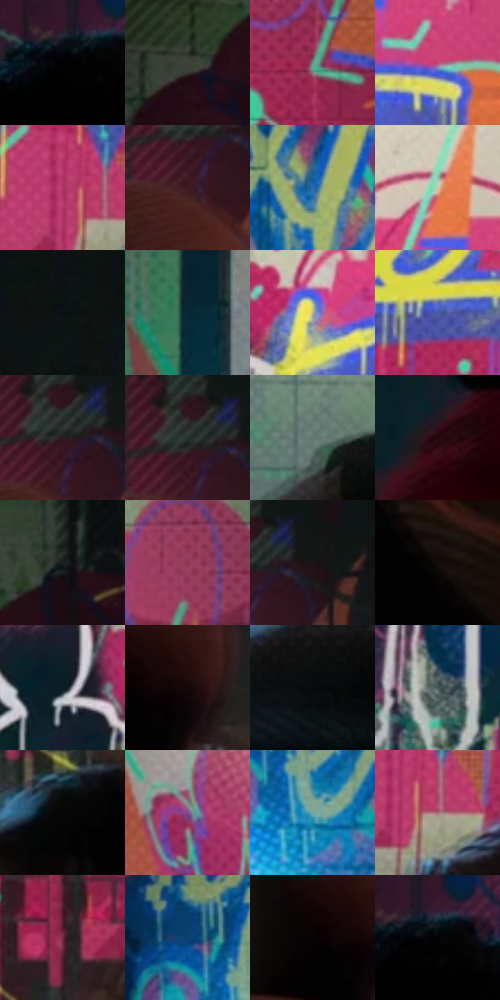

# 电影参考 052

- 状态：常规／活跃；来源世界：miles-home。
- 视角：near-level；景别：environment-wide；场景：interior。
- 时段：interior-time-unknown（外观依据，中置信度；具体时间／晨昏未知）；光照：interior-mixed。
- 材质候选：skin, fabric, brick, stone, paint, metal（帧级，不是像素分割）。
- 明暗组：dark；L* P5/P50/P95：0.35411 / 23.73412 / 75.43898。
- 资格门禁：无附加门禁。
- 原截图 SHA-256：`a22f37fea4fc8c46bbbe779609aeedb61d36b8a2a57c08f921af3e290769069a`；尺寸：2870 × 1200。
- sRGB 像素 SHA-256：`d95c20dc72620cd79bd43795aaa3109adfab03b7c3556aa7166bc36f4f47cae5`。

## 观察与迁移

涂鸦墙、粗糙地面和局部灯光；墙绘颜料层与基底砖石分别分析。

涂鸦中的剪影揭示

画中人形由深色填充和不规则白描边成立，两位观看者只露背影和肩颈，不补造面部。背景喷漆的粗点与滴流可强，但剪影内部更净；砖墙的细丝网和观者衣料排线分属不同尺度。青灯边缘可色散，白色人形外线保持单一可读轮廓；这是一种“画中画”揭示，不要求未来照片增添画中人物。

本公开版保存32个128×128原像素色卡上下文；图集格子并非原场景相邻位置。原rect、图集tile和像素SHA见 `data/palette-crops.json`。上下文不足时不得批准替色，不能以小样推断完整构图。

## 实测色卡

颜色比例分母为保留采样像素，不是材料面积；全部 32 色参与全库匹配。表内四舍五入仅用于阅读，原精度在 JSON。

| ID | HEX | Lab | 原图 xy | 像素数 | 比例 | 明度角色 |
| --- | --- | --- | --- | ---: | ---: | --- |
| 052-S01 | #010101 | [0.274173, -1.7e-05, 3.3e-05] | [516, 476] | 13132 | 6.836165% | deep-shadow |
| 052-S02 | #3E4239 | [27.341401, -3.643534, 4.916921] | [160, 276] | 10530 | 5.481634% | shadow |
| 052-S03 | #7B8C88 | [56.825417, -6.958625, 0.06033] | [2108, 388] | 8935 | 4.651320% | midtone |
| 052-S04 | #C04971 | [48.469487, 51.2148, 2.404834] | [1748, 264] | 8230 | 4.284316% | midtone |
| 052-S05 | #AC3564 | [41.594032, 52.030127, -0.012044] | [1736, 840] | 8186 | 4.261411% | midtone |
| 052-S06 | #3F1B23 | [15.287791, 18.549195, 2.771875] | [2448, 376] | 7983 | 4.155735% | deep-shadow |
| 052-S07 | #266BAD | [44.15085, 2.225427, -41.29813] | [916, 500] | 7722 | 4.019865% | midtone |
| 052-S08 | #D1CAAC | [81.16821, -2.524767, 15.875221] | [1664, 144] | 7647 | 3.980822% | highlight |
| 052-S09 | #0D1314 | [5.435992, -1.921929, -1.356939] | [440, 28] | 7399 | 3.851720% | deep-shadow |
| 052-S10 | #0A2736 | [14.297427, -4.724993, -12.851509] | [828, 160] | 6997 | 3.642450% | deep-shadow |
| 052-S11 | #B1B08C | [71.071638, -5.710979, 18.629811] | [1536, 272] | 6895 | 3.589351% | light |
| 052-S12 | #4D60AA | [42.52818, 14.865219, -42.011637] | [1840, 576] | 6760 | 3.519074% | midtone |
| 052-S13 | #291C21 | [12.035938, 7.411036, -0.917767] | [2460, 324] | 6602 | 3.436823% | deep-shadow |
| 052-S14 | #27302E | [18.981378, -4.366743, -0.010631] | [2452, 312] | 6410 | 3.336873% | deep-shadow |
| 052-S15 | #637771 | [48.30812, -8.667982, 0.843807] | [1324, 1056] | 6351 | 3.306159% | midtone |
| 052-S16 | #270A0F | [6.169702, 15.141852, 3.066281] | [364, 776] | 5804 | 3.021406% | deep-shadow |
| 052-S17 | #192121 | [11.985265, -3.582954, -1.19408] | [276, 188] | 5619 | 2.925100% | deep-shadow |
| 052-S18 | #8E3456 | [35.752504, 41.386974, -0.324978] | [2160, 228] | 5363 | 2.791833% | shadow |
| 052-S19 | #181516 | [7.122081, 1.648319, -0.156357] | [2524, 316] | 5087 | 2.648155% | deep-shadow |
| 052-S20 | #140E0C | [4.420381, 1.915652, 1.682285] | [2260, 844] | 5085 | 2.647114% | deep-shadow |
| 052-S21 | #0A1D24 | [9.565871, -5.094359, -7.139098] | [1408, 280] | 4710 | 2.451899% | deep-shadow |
| 052-S22 | #160705 | [3.012767, 4.803562, 2.547625] | [2516, 608] | 4593 | 2.390992% | deep-shadow |
| 052-S23 | #080A0C | [2.66692, -0.229426, -0.983413] | [1680, 1028] | 4512 | 2.348826% | deep-shadow |
| 052-S24 | #4B5A5B | [37.046936, -5.533716, -2.514994] | [1408, 816] | 4486 | 2.335291% | shadow |
| 052-S25 | #070606 | [1.70335, 0.261395, 0.092336] | [2132, 796] | 4458 | 2.320715% | deep-shadow |
| 052-S26 | #884C87 | [41.458421, 34.655064, -22.347245] | [1036, 72] | 4220 | 2.196818% | midtone |
| 052-S27 | #73A9A3 | [65.485923, -19.069945, -2.582761] | [780, 580] | 3597 | 1.872501% | light |
| 052-S28 | #A46F75 | [52.450323, 21.884205, 5.253205] | [1776, 872] | 3597 | 1.872501% | midtone |
| 052-S29 | #712A43 | [28.308014, 33.933796, 0.588289] | [2152, 660] | 3377 | 1.757975% | shadow |
| 052-S30 | #0A446D | [27.57899, -1.103055, -28.674401] | [712, 492] | 2841 | 1.478948% | shadow |
| 052-S31 | #090303 | [1.172373, 1.568944, 0.55293] | [2452, 608] | 2499 | 1.300912% | deep-shadow |
| 052-S32 | #010405 | [0.941555, -0.645524, -0.654707] | [548, 468] | 2469 | 1.285295% | deep-shadow |

## 色阶与空间分布

- 采样 ROI：`[0.01, 0.02, 0.98, 0.94]`；步长：4；样本数：192096。
- 排除区：`[]`。
- 深暗、暗、中、亮、高光五段计数：`[90803, 35547, 45297, 14419, 6030]`。
- RGB 各 256 箱、L* 100 箱、13×5 色相明度表和 3×3 空间统计全部保存在 [总数据](../film-library.json)。
- [可视化档案](../../references/library.html)按需绘制直方图，不存 2,094 张重复图表图片。

## 纹理特征占比

**这是分块图像特征的面积占比，不是波点／排线／丝网／错版的精确语义覆盖率。** 窗格、发丝、织物也会产生方向或周期特征。
原图 ROI 像素 3073536；已测块覆盖 3073536（100.0000%）；未测 0。

| 特征 | 块覆盖像素 | 占已测面积 | 阈值敏感范围 |
| --- | ---: | ---: | --- |
| low-contrast | 169984 | 5.5306% | 3.9314% ~ 6.5967% |
| directional-structure | 327680 | 10.6613% | 5.3307% ~ 25.8537% |
| periodic-structure | 2428416 | 79.0105% | 67.5496% ~ 79.0105% |
| mixed-detail | 147456 | 4.7976% | 2.6653% ~ 12.0606% |

阈值敏感范围不是统计置信区间。逐块坐标、尺度、对比、方向一致性、频谱集中度、频率与角度见 [全量特征记录](../texture-features.jsonl)，以帧号定位。
四种印刷层的真实像素覆盖仍标为 `null`，不能填 0，也不能拿上表代替。不得据这些代理测量删除唯一证据。

[测量方法与保留策略](../../references/library-retention.md) · [分类索引](../archive/README.md)
