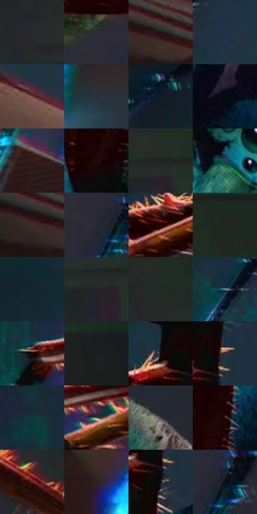

# 电影参考 053

- 状态：常规／活跃；来源世界：miles-home。
- 视角：high-angle；景别：detail；场景：detail。
- 时段：interior-time-unknown（外观依据，中置信度；具体时间／晨昏未知）；光照：cool-interior。
- 材质候选：skin, fabric（帧级，不是像素分割）。
- 明暗组：very-dark；L* P5/P50/P95：2.84803 / 16.20747 / 39.63351。
- 资格门禁：无附加门禁。
- 原截图 SHA-256：`32e59da0681299216f13d1c6321bc2cb08145ef385f09838600b7991ee802f7f`；尺寸：2880 × 1194。
- sRGB 像素 SHA-256：`83e681490af250499f7172436c503f5dcb21eebfe1c5fc157d80b1c8056de1f9`。

## 观察与迁移

微距生物与手部，不把发光边缘推为普通皮肤材质。

霓虹蜘蛛近景

身体近球形、腿节细长且在透视中重叠，腿尖与画面边缘产生强烈空间压力；眼睛高亮仍有清楚位置。腹部靠色块和局部细网塑形，腿部沿节段用密排线和硬亮边，背景暗面保持简洁。青蓝冷光与暖红刺边形成局部双彩分离；不能给所有毛刺加等宽霓虹描边，也不能将此生物造型强加给普通照片。

本公开版保存32个128×128原像素色卡上下文；图集格子并非原场景相邻位置。原rect、图集tile和像素SHA见 `data/palette-crops.json`。上下文不足时不得批准替色，不能以小样推断完整构图。

## 实测色卡

颜色比例分母为保留采样像素，不是材料面积；全部 32 色参与全库匹配。表内四舍五入仅用于阅读，原精度在 JSON。

| ID | HEX | Lab | 原图 xy | 像素数 | 比例 | 明度角色 |
| --- | --- | --- | --- | ---: | ---: | --- |
| 053-S01 | #272A2D | [16.877059, -0.564408, -2.409714] | [2428, 236] | 11473 | 5.977077% | deep-shadow |
| 053-S02 | #2D2E36 | [19.132707, 1.593871, -5.25041] | [1852, 796] | 10953 | 5.706173% | deep-shadow |
| 053-S03 | #221615 | [8.722833, 5.912515, 3.036843] | [228, 524] | 10216 | 5.322219% | deep-shadow |
| 053-S04 | #203447 | [20.895715, -1.714922, -14.248716] | [936, 548] | 9155 | 4.769471% | shadow |
| 053-S05 | #75433B | [34.216889, 20.633858, 14.164127] | [1140, 880] | 8518 | 4.437614% | shadow |
| 053-S06 | #28333D | [20.656445, -1.746785, -7.792187] | [580, 1044] | 7781 | 4.053660% | shadow |
| 053-S07 | #0F1D27 | [10.005179, -2.441695, -8.658301] | [320, 88] | 7554 | 3.935400% | deep-shadow |
| 053-S08 | #060A15 | [2.799491, 0.99865, -5.933438] | [1552, 248] | 7538 | 3.927064% | deep-shadow |
| 053-S09 | #331D1C | [13.629805, 10.651393, 5.212396] | [688, 664] | 6699 | 3.489971% | deep-shadow |
| 053-S10 | #210D0A | [5.719445, 9.18175, 4.628984] | [1244, 412] | 6387 | 3.327429% | deep-shadow |
| 053-S11 | #202323 | [13.414566, -1.371023, -0.472022] | [2564, 264] | 6369 | 3.318052% | deep-shadow |
| 053-S12 | #194A5A | [29.010024, -10.560584, -14.257574] | [1360, 556] | 6297 | 3.280542% | shadow |
| 053-S13 | #3E2A29 | [19.392778, 9.145155, 4.358831] | [156, 528] | 6261 | 3.261787% | deep-shadow |
| 053-S14 | #262A38 | [17.242418, 2.186582, -9.563811] | [1876, 904] | 6243 | 3.252409% | deep-shadow |
| 053-S15 | #1B0302 | [2.733285, 8.518917, 3.429148] | [1032, 164] | 6213 | 3.236780% | deep-shadow |
| 053-S16 | #1C2920 | [15.15302, -7.966077, 4.127541] | [2560, 24] | 5774 | 3.008075% | deep-shadow |
| 053-S17 | #122630 | [13.990302, -4.52933, -9.04139] | [516, 104] | 5532 | 2.882001% | deep-shadow |
| 053-S18 | #23242A | [14.322833, 1.120918, -4.12761] | [2540, 300] | 5423 | 2.825215% | deep-shadow |
| 053-S19 | #222B27 | [16.573794, -4.952559, 1.305252] | [2484, 140] | 5407 | 2.816879% | deep-shadow |
| 053-S20 | #628FA6 | [57.068943, -9.173485, -16.953375] | [604, 408] | 5180 | 2.698619% | midtone |
| 053-S21 | #0F0A09 | [3.056533, 1.361305, 0.907458] | [744, 204] | 4957 | 2.582443% | deep-shadow |
| 053-S22 | #1A1E1E | [10.862775, -1.854745, -0.633073] | [2720, 544] | 4957 | 2.582443% | deep-shadow |
| 053-S23 | #192A33 | [16.011098, -4.061564, -8.037398] | [1272, 36] | 4927 | 2.566814% | deep-shadow |
| 053-S24 | #1B2C3D | [17.325483, -1.265868, -12.975841] | [1348, 36] | 4854 | 2.528784% | deep-shadow |
| 053-S25 | #12343B | [19.639359, -9.702144, -8.092288] | [704, 60] | 4708 | 2.452722% | deep-shadow |
| 053-S26 | #646457 | [42.01838, -2.545689, 7.389492] | [856, 244] | 4374 | 2.278718% | midtone |
| 053-S27 | #393837 | [23.585477, 0.206493, 0.778123] | [1784, 212] | 4136 | 2.154728% | shadow |
| 053-S28 | #2D1411 | [9.788878, 12.378931, 7.340501] | [1304, 292] | 4007 | 2.087523% | deep-shadow |
| 053-S29 | #5D1D1A | [21.136467, 29.014792, 17.856948] | [2388, 680] | 3474 | 1.809846% | shadow |
| 053-S30 | #2D2226 | [14.634935, 6.083997, -0.672604] | [484, 796] | 2864 | 1.492055% | deep-shadow |
| 053-S31 | #0E0F13 | [4.354039, 0.46245, -2.279796] | [1332, 136] | 2128 | 1.108622% | deep-shadow |
| 053-S32 | #0E171A | [7.052006, -2.79183, -3.388055] | [1924, 888] | 1591 | 0.828862% | deep-shadow |

## 色阶与空间分布

- 采样 ROI：`[0.01, 0.02, 0.98, 0.94]`；步长：4；样本数：191950。
- 排除区：`[]`。
- 深暗、暗、中、亮、高光五段计数：`[142968, 39600, 7260, 1845, 277]`。
- RGB 各 256 箱、L* 100 箱、13×5 色相明度表和 3×3 空间统计全部保存在 [总数据](../film-library.json)。
- [可视化档案](../../references/library.html)按需绘制直方图，不存 2,094 张重复图表图片。

## 纹理特征占比

**这是分块图像特征的面积占比，不是波点／排线／丝网／错版的精确语义覆盖率。** 窗格、发丝、织物也会产生方向或周期特征。
原图 ROI 像素 3070606；已测块覆盖 3070606（100.0000%）；未测 0。

| 特征 | 块覆盖像素 | 占已测面积 | 阈值敏感范围 |
| --- | ---: | ---: | --- |
| low-contrast | 832270 | 27.1044% | 19.9470% ~ 29.0178% |
| directional-structure | 344064 | 11.2051% | 4.8022% ~ 27.5250% |
| periodic-structure | 1612928 | 52.5280% | 46.2543% ~ 52.5280% |
| mixed-detail | 281344 | 9.1625% | 3.2015% ~ 19.9257% |

阈值敏感范围不是统计置信区间。逐块坐标、尺度、对比、方向一致性、频谱集中度、频率与角度见 [全量特征记录](../texture-features.jsonl)，以帧号定位。
四种印刷层的真实像素覆盖仍标为 `null`，不能填 0，也不能拿上表代替。不得据这些代理测量删除唯一证据。

[测量方法与保留策略](../../references/library-retention.md) · [分类索引](../archive/README.md)
