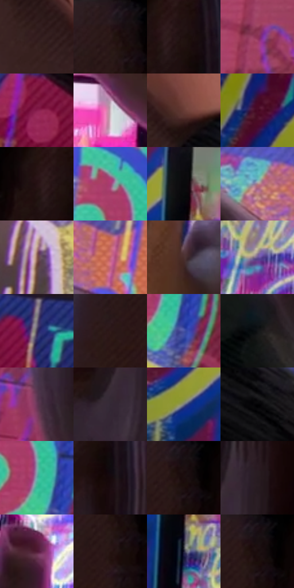

# 电影参考 054

- 状态：条件／活跃；来源世界：miles-home。
- 视角：near-level；景别：detail；场景：detail。
- 时段：interior-time-unknown（外观依据，中置信度；具体时间／晨昏未知）；光照：interior-mixed。
- 材质候选：skin, screen, glass, paint（帧级，不是像素分割）。
- 明暗组：dark；L* P5/P50/P95：2.7681 / 22.77541 / 67.51895。
- 资格门禁：secondary-image。
- 原截图 SHA-256：`89dc847046e1b4a2f2f51e450032c498a6ae22a857448feb9012e43be5d90777`；尺寸：2880 × 1206。
- sRGB 像素 SHA-256：`7cfe37e2e71d39d403b69f2ae51d0b5ce197141ffb37b4510a8c973d84715cfc`。

## 观察与迁移

手机取景与实体墙绘色彩重复，载体不可混同。

手机取景中的墙绘

手机形成第二画框，屏内同一墙绘因屏幕发光而更亮、更密、更偏粉；两只手的指节、夹持方向和遮挡关系先于纹理成立。墙绘粗点、滴流与砖缝排线在屏外有独立密度，屏内细像素与窄幅彩边更明显。屏幕和原墙的内容应对应，不应凭空改写字形或让画框遮掉唯一的主体。

本公开版保存32个128×128原像素色卡上下文；图集格子并非原场景相邻位置。原rect、图集tile和像素SHA见 `data/palette-crops.json`。上下文不足时不得批准替色，不能以小样推断完整构图。

## 实测色卡

颜色比例分母为保留采样像素，不是材料面积；全部 32 色参与全库匹配。表内四舍五入仅用于阅读，原精度在 JSON。

| ID | HEX | Lab | 原图 xy | 像素数 | 比例 | 明度角色 |
| --- | --- | --- | --- | ---: | ---: | --- |
| 054-S01 | #36201F | [15.042177, 10.508582, 5.096455] | [1240, 488] | 11823 | 6.114944% | deep-shadow |
| 054-S02 | #291616 | [9.823657, 9.666167, 4.051564] | [2376, 52] | 9701 | 5.017430% | deep-shadow |
| 054-S03 | #1F100F | [6.290884, 7.155146, 3.091454] | [2556, 84] | 9388 | 4.855544% | deep-shadow |
| 054-S04 | #8A3352 | [34.765166, 40.040279, 0.717002] | [1880, 148] | 8020 | 4.148004% | shadow |
| 054-S05 | #871C4C | [30.651555, 47.726536, -1.456786] | [1500, 1028] | 8004 | 4.139729% | shadow |
| 054-S06 | #D2BCC7 | [78.340522, 9.683617, -2.67647] | [1024, 348] | 7933 | 4.103007% | light |
| 054-S07 | #663B34 | [29.914764, 18.099068, 12.449715] | [1588, 716] | 7235 | 3.741996% | shadow |
| 054-S08 | #1D2F6F | [21.73148, 16.776866, -39.301457] | [36, 212] | 7107 | 3.675794% | shadow |
| 054-S09 | #251113 | [7.599561, 10.719986, 2.784527] | [2512, 84] | 7071 | 3.657174% | deep-shadow |
| 054-S10 | #A93B74 | [42.499893, 50.496177, -8.667405] | [1724, 440] | 7019 | 3.630279% | midtone |
| 054-S11 | #09090B | [2.50764, 0.281476, -0.766199] | [344, 332] | 6911 | 3.574421% | deep-shadow |
| 054-S12 | #AB8689 | [59.448407, 14.597753, 3.81601] | [1292, 192] | 6750 | 3.491151% | midtone |
| 054-S13 | #8F6558 | [46.780651, 15.153948, 14.10232] | [924, 120] | 6562 | 3.393916% | midtone |
| 054-S14 | #C16272 | [53.265976, 39.581801, 8.698514] | [1436, 232] | 6365 | 3.292026% | midtone |
| 054-S15 | #4B302F | [23.05115, 12.179009, 5.67737] | [704, 1020] | 6201 | 3.207204% | shadow |
| 054-S16 | #6B5494 | [40.580237, 23.759049, -31.834642] | [512, 528] | 6038 | 3.122899% | midtone |
| 054-S17 | #433957 | [26.179453, 11.559228, -16.45479] | [1344, 948] | 5998 | 3.102211% | shadow |
| 054-S18 | #2E1919 | [11.596312, 10.511631, 4.443737] | [2316, 156] | 5992 | 3.099107% | deep-shadow |
| 054-S19 | #4654A5 | [38.477896, 19.34827, -45.547943] | [1800, 580] | 5970 | 3.087729% | shadow |
| 054-S20 | #121416 | [6.204058, -0.34509, -1.567975] | [2156, 960] | 5706 | 2.951186% | deep-shadow |
| 054-S21 | #683757 | [30.313048, 26.530699, -9.716739] | [2084, 620] | 5376 | 2.780507% | shadow |
| 054-S22 | #332734 | [17.473319, 8.476837, -6.293439] | [2588, 456] | 5258 | 2.719477% | deep-shadow |
| 054-S23 | #767B7F | [51.324122, -1.031553, -2.823886] | [232, 416] | 5097 | 2.636207% | midtone |
| 054-S24 | #030304 | [0.842307, 0.138992, -0.378325] | [1760, 804] | 4907 | 2.537937% | deep-shadow |
| 054-S25 | #62ACA6 | [65.633999, -24.534015, -4.129382] | [1764, 520] | 4875 | 2.521387% | light |
| 054-S26 | #15080B | [3.227377, 4.789226, 0.39464] | [2588, 168] | 4512 | 2.333640% | deep-shadow |
| 054-S27 | #1B0D0C | [4.945109, 5.815331, 2.539869] | [2404, 72] | 4405 | 2.278299% | deep-shadow |
| 054-S28 | #271B21 | [11.449626, 7.185804, -1.813114] | [2660, 380] | 4222 | 2.183650% | deep-shadow |
| 054-S29 | #4F1934 | [18.390793, 28.421484, -4.478833] | [780, 476] | 3632 | 1.878498% | deep-shadow |
| 054-S30 | #261513 | [8.953936, 8.381484, 4.772421] | [2384, 124] | 2893 | 1.496281% | deep-shadow |
| 054-S31 | #1C1C33 | [11.389242, 7.12105, -15.17493] | [352, 448] | 1416 | 0.732366% | deep-shadow |
| 054-S32 | #180F13 | [5.265114, 4.548383, -0.840129] | [2404, 28] | 959 | 0.496002% | deep-shadow |

## 色阶与空间分布

- 采样 ROI：`[0.01, 0.02, 0.98, 0.94]`；步长：4；样本数：193346。
- 排除区：`[]`。
- 深暗、暗、中、亮、高光五段计数：`[90975, 53764, 32813, 12733, 3061]`。
- RGB 各 256 箱、L* 100 箱、13×5 色相明度表和 3×3 空间统计全部保存在 [总数据](../film-library.json)。
- [可视化档案](../../references/library.html)按需绘制直方图，不存 2,094 张重复图表图片。

## 纹理特征占比

**这是分块图像特征的面积占比，不是波点／排线／丝网／错版的精确语义覆盖率。** 窗格、发丝、织物也会产生方向或周期特征。
原图 ROI 像素 3098546；已测块覆盖 3098546（100.0000%）；未测 0。

| 特征 | 块覆盖像素 | 占已测面积 | 阈值敏感范围 |
| --- | ---: | ---: | --- |
| low-contrast | 355250 | 11.4651% | 9.3277% ~ 14.4600% |
| directional-structure | 606080 | 19.5601% | 7.7538% ~ 33.2997% |
| periodic-structure | 1998080 | 64.4844% | 56.3150% ~ 74.3533% |
| mixed-detail | 139136 | 4.4904% | 1.0575% ~ 4.4904% |

阈值敏感范围不是统计置信区间。逐块坐标、尺度、对比、方向一致性、频谱集中度、频率与角度见 [全量特征记录](../texture-features.jsonl)，以帧号定位。
四种印刷层的真实像素覆盖仍标为 `null`，不能填 0，也不能拿上表代替。不得据这些代理测量删除唯一证据。

[测量方法与保留策略](../../references/library-retention.md) · [分类索引](../archive/README.md)
