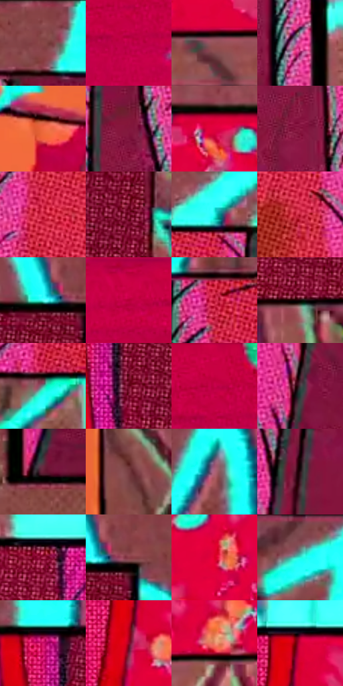

# 电影参考 055

- 状态：条件／活跃；来源世界：miles-home。
- 视角：graphic-nonphysical；景别：graphic-or-multipanel；场景：graphic。
- 时段：graphic-no-physical-time（外观依据，中置信度；具体时间／晨昏未知）；光照：graphic-field。
- 材质候选：paper, paint（帧级，不是像素分割）。
- 明暗组：middle；L* P5/P50/P95：12.30167 / 41.65767 / 90.36291。
- 资格门禁：panel。
- 原截图 SHA-256：`dc99f6b1e17c75f631bb3a0fa8e94505e0ccd069cf7f2da80fde30e6d4750301`；尺寸：2880 × 1206。
- sRGB 像素 SHA-256：`b827f55bc070759cd3a00a43fd1098f8ea62255bd09d07e7ccef496cde88689d`。

## 观察与迁移

漫画分格与高饱和图形，黑色沟槽不纳入场景材料色。

非等分漫画画格

左侧竖长画格与右侧上下两条横格不等分；粗黑外框和明确的画格间距让阅读视线先看竖格，再扫右上、右下。框间并非白色空页，底层青色涂写继续穿过，制造电影画面与美国超级英雄漫画页面互相嵌套的感觉。树干的方向性墨线、红底的密半调和右下近景较大的彩色斑块各用不同频率；近黑画框保持硬而稳定，局部青/品红套版错位留给画格内部的高反差物体，不把全部边框做成 RGB 影子。

这张提供的是**可选的叙事构图方法**，不是所有照片的默认版式。适合照片本身有动作链、观察与被观察、主体与关键细节等可拆解关系，或用户明确要求漫画叙事时使用。可从同一原照抽取全景、动作和细节的不同裁切来建立阅读顺序；只有一张静止照片时，不凭空声称它记录了多个先后事件。画格数量、比例、阅读方向、出框点和底层贯穿图案应服务原照内容与故事焦点，保留主体身份、空间关系及关键动作。不可照搬此帧的树、斑块、涂鸦或美国漫画特定角色设计。

本公开版保存32个128×128原像素色卡上下文；图集格子并非原场景相邻位置。原rect、图集tile和像素SHA见 `data/palette-crops.json`。上下文不足时不得批准替色，不能以小样推断完整构图。

## 实测色卡

颜色比例分母为保留采样像素，不是材料面积；全部 32 色参与全库匹配。表内四舍五入仅用于阅读，原精度在 JSON。

| ID | HEX | Lab | 原图 xy | 像素数 | 比例 | 明度角色 |
| --- | --- | --- | --- | ---: | ---: | --- |
| 055-S01 | #8B494A | [39.15587, 27.984018, 12.032206] | [448, 32] | 11141 | 5.762209% | shadow |
| 055-S02 | #BF0045 | [40.425765, 66.374291, 18.47554] | [1952, 768] | 10317 | 5.336030% | midtone |
| 055-S03 | #965357 | [43.301021, 28.253698, 10.015619] | [1916, 572] | 10266 | 5.309652% | midtone |
| 055-S04 | #E04090 | [53.526805, 67.39218, -8.141924] | [1100, 1024] | 10258 | 5.305514% | midtone |
| 055-S05 | #EF6840 | [60.450957, 49.71831, 47.3849] | [2388, 820] | 10024 | 5.184488% | light |
| 055-S06 | #83173C | [28.813657, 46.620429, 6.443414] | [884, 196] | 9087 | 4.699864% | shadow |
| 055-S07 | #E0003F | [47.250513, 73.899167, 32.25625] | [2008, 144] | 8529 | 4.411263% | midtone |
| 055-S08 | #8F1D47 | [32.202042, 49.221033, 4.286149] | [968, 604] | 8174 | 4.227654% | shadow |
| 055-S09 | #DD3653 | [50.263023, 64.745533, 23.839659] | [600, 308] | 7847 | 4.058527% | midtone |
| 055-S10 | #7B0E30 | [25.98, 45.758261, 10.378502] | [2640, 452] | 7219 | 3.733721% | shadow |
| 055-S11 | #20F6E8 | [87.987224, -49.747585, -6.789885] | [780, 92] | 7083 | 3.663381% | highlight |
| 055-S12 | #BC1D35 | [40.945526, 60.716452, 29.025252] | [760, 588] | 6810 | 3.522183% | midtone |
| 055-S13 | #4FFAF3 | [90.090286, -44.248109, -9.337128] | [2616, 108] | 6748 | 3.490116% | highlight |
| 055-S14 | #B50036 | [38.0093, 63.222446, 24.494028] | [1764, 716] | 6574 | 3.400122% | shadow |
| 055-S15 | #CE2648 | [45.606821, 64.427238, 23.936302] | [588, 148] | 6406 | 3.313231% | midtone |
| 055-S16 | #100405 | [1.878636, 3.557038, 0.826053] | [2548, 552] | 6312 | 3.264614% | deep-shadow |
| 055-S17 | #5C9892 | [58.794067, -20.944866, -2.987651] | [536, 1128] | 5665 | 2.929980% | midtone |
| 055-S18 | #65061C | [19.970346, 40.002174, 15.424132] | [2428, 284] | 5497 | 2.843090% | deep-shadow |
| 055-S19 | #C9004B | [42.65673, 69.058648, 18.01575] | [1940, 712] | 4845 | 2.505870% | midtone |
| 055-S20 | #423C42 | [26.108405, 3.899034, -2.741295] | [296, 820] | 4779 | 2.471735% | shadow |
| 055-S21 | #671E37 | [23.962667, 34.782311, 2.154341] | [240, 1100] | 4496 | 2.325365% | shadow |
| 055-S22 | #783D42 | [33.403222, 26.191086, 8.665898] | [2716, 760] | 4242 | 2.193994% | shadow |
| 055-S23 | #AE637A | [51.070376, 33.092199, 0.455588] | [96, 332] | 4242 | 2.193994% | midtone |
| 055-S24 | #2A1119 | [8.683067, 14.118816, 0.186156] | [384, 460] | 4046 | 2.092622% | deep-shadow |
| 055-S25 | #B3335C | [42.348686, 54.125499, 6.23893] | [1528, 136] | 3884 | 2.008834% | midtone |
| 055-S26 | #8B3E49 | [36.774493, 33.872551, 9.356383] | [2672, 104] | 3840 | 1.986077% | shadow |
| 055-S27 | #DA0024 | [45.685823, 71.628425, 45.73503] | [2140, 400] | 3056 | 1.580586% | midtone |
| 055-S28 | #6F5C64 | [41.143244, 9.194244, -1.677768] | [60, 52] | 2751 | 1.422838% | midtone |
| 055-S29 | #D0136A | [45.52478, 70.828924, 2.800517] | [2380, 136] | 2715 | 1.404218% | midtone |
| 055-S30 | #95062A | [31.088237, 53.846203, 22.133273] | [1684, 224] | 2551 | 1.319396% | shadow |
| 055-S31 | #E98367 | [65.388922, 36.477354, 32.275796] | [2064, 536] | 2086 | 1.078895% | light |
| 055-S32 | #CC0139 | [43.001317, 68.81311, 29.826303] | [1704, 132] | 1856 | 0.959937% | midtone |

## 色阶与空间分布

- 采样 ROI：`[0.01, 0.02, 0.98, 0.94]`；步长：4；样本数：193346。
- 排除区：`[]`。
- 深暗、暗、中、亮、高光五段计数：`[13953, 66982, 85905, 13853, 12653]`。
- RGB 各 256 箱、L* 100 箱、13×5 色相明度表和 3×3 空间统计全部保存在 [总数据](../film-library.json)。
- [可视化档案](../../references/library.html)按需绘制直方图，不存 2,094 张重复图表图片。

## 纹理特征占比

**这是分块图像特征的面积占比，不是波点／排线／丝网／错版的精确语义覆盖率。** 窗格、发丝、织物也会产生方向或周期特征。
原图 ROI 像素 3098546；已测块覆盖 3098546（100.0000%）；未测 0。

| 特征 | 块覆盖像素 | 占已测面积 | 阈值敏感范围 |
| --- | ---: | ---: | --- |
| low-contrast | 49152 | 1.5863% | 1.5863% ~ 1.5863% |
| directional-structure | 298034 | 9.6185% | 4.2219% ~ 20.6234% |
| periodic-structure | 2685824 | 86.6801% | 75.6752% ~ 86.8800% |
| mixed-detail | 65536 | 2.1151% | 2.1151% ~ 7.3118% |

阈值敏感范围不是统计置信区间。逐块坐标、尺度、对比、方向一致性、频谱集中度、频率与角度见 [全量特征记录](../texture-features.jsonl)，以帧号定位。
四种印刷层的真实像素覆盖仍标为 `null`，不能填 0，也不能拿上表代替。不得据这些代理测量删除唯一证据。

[测量方法与保留策略](../../references/library-retention.md) · [分类索引](../archive/README.md)
