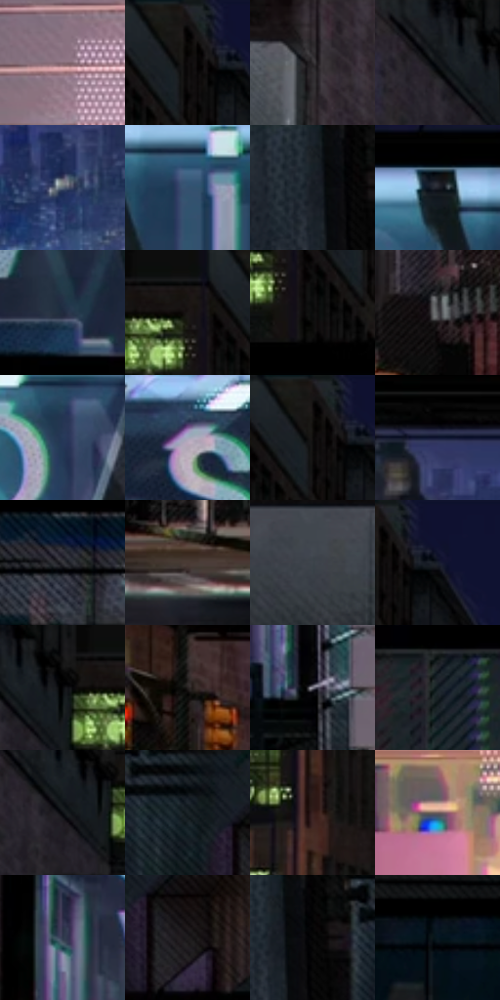

# 电影参考 056

- 状态：常规／活跃；来源世界：miles-home。
- 视角：near-level；景别：environment-wide；场景：city。
- 时段：night-appearance（外观依据，中置信度；具体时间／晨昏未知）；光照：night-mixed。
- 材质候选：brick, glass, asphalt, sky（帧级，不是像素分割）。
- 明暗组：very-dark；L* P5/P50/P95：0.76421 / 15.30767 / 55.5751。
- 资格门禁：无附加门禁。
- 原截图 SHA-256：`a30975703196fe083c693c52cd9c93f4306a86bf840b16d8612163a34e806c20`；尺寸：2880 × 1206。
- sRGB 像素 SHA-256：`34ee07a8793d02c3d5cda70ece772ee8e6e66a8da987451d73cbb7dba96403fd`。

## 观察与迁移

夜间校桥同机位，红光轨迹另于实体道路结构。

本公开版保存32个128×128原像素色卡上下文；图集格子并非原场景相邻位置。原rect、图集tile和像素SHA见 `data/palette-crops.json`。上下文不足时不得批准替色，不能以小样推断完整构图。

## 实测色卡

颜色比例分母为保留采样像素，不是材料面积；全部 32 色参与全库匹配。表内四舍五入仅用于阅读，原精度在 JSON。

| ID | HEX | Lab | 原图 xy | 像素数 | 比例 | 明度角色 |
| --- | --- | --- | --- | ---: | ---: | --- |
| 056-S01 | #826972 | [47.058841, 11.524328, -1.256305] | [2736, 400] | 9242 | 4.780032% | midtone |
| 056-S02 | #010101 | [0.274173, -1.7e-05, 3.3e-05] | [868, 36] | 8745 | 4.522980% | deep-shadow |
| 056-S03 | #2F2B2E | [18.050909, 2.503117, -1.285854] | [444, 64] | 8683 | 4.490913% | deep-shadow |
| 056-S04 | #131619 | [7.067691, -0.524474, -2.553148] | [620, 68] | 8275 | 4.279892% | deep-shadow |
| 056-S05 | #5B6879 | [43.514285, -0.810345, -11.11791] | [1512, 652] | 7679 | 3.971636% | midtone |
| 056-S06 | #35516F | [33.539258, -1.202978, -20.465931] | [1408, 296] | 7362 | 3.807682% | shadow |
| 056-S07 | #181D23 | [10.514756, -0.531452, -4.864875] | [2076, 32] | 7234 | 3.741479% | deep-shadow |
| 056-S08 | #20232C | [13.773821, 1.159942, -6.417478] | [1308, 236] | 7157 | 3.701654% | deep-shadow |
| 056-S09 | #212B3D | [17.403749, 1.329421, -12.82088] | [708, 436] | 6837 | 3.536148% | deep-shadow |
| 056-S10 | #1B1716 | [8.162439, 1.756596, 1.4046] | [772, 72] | 6774 | 3.503564% | deep-shadow |
| 056-S11 | #0B0C0B | [3.23606, -0.435651, 0.311627] | [808, 140] | 6766 | 3.499426% | deep-shadow |
| 056-S12 | #515054 | [34.245441, 1.278555, -2.198461] | [1944, 860] | 6609 | 3.418224% | shadow |
| 056-S13 | #263958 | [23.8117, 2.650841, -20.983263] | [1768, 316] | 6501 | 3.362366% | shadow |
| 056-S14 | #A6ABBE | [70.140877, 2.08241, -10.297749] | [2240, 292] | 6495 | 3.359263% | light |
| 056-S15 | #13100F | [4.909658, 0.960712, 0.908863] | [864, 40] | 6391 | 3.305473% | deep-shadow |
| 056-S16 | #121833 | [9.163416, 7.096162, -18.75806] | [1260, 548] | 6143 | 3.177206% | deep-shadow |
| 056-S17 | #35353A | [22.332682, 1.19548, -3.127556] | [268, 688] | 6004 | 3.105314% | shadow |
| 056-S18 | #4A3B35 | [26.27694, 5.500538, 6.203037] | [2004, 1028] | 5776 | 2.987390% | shadow |
| 056-S19 | #3D444B | [28.470233, -1.12796, -5.183802] | [128, 100] | 5761 | 2.979632% | shadow |
| 056-S20 | #0F1230 | [6.752008, 9.506116, -20.43073] | [924, 44] | 5419 | 2.802747% | deep-shadow |
| 056-S21 | #060709 | [1.900479, 0.016466, -0.848755] | [688, 72] | 5286 | 2.733959% | deep-shadow |
| 056-S22 | #252020 | [12.801611, 2.380125, 0.871303] | [536, 596] | 5189 | 2.683790% | deep-shadow |
| 056-S23 | #898794 | [56.864667, 3.374989, -6.662855] | [2404, 468] | 4827 | 2.496561% | midtone |
| 056-S24 | #242C2B | [17.229964, -3.733906, -0.519207] | [56, 824] | 4785 | 2.474838% | deep-shadow |
| 056-S25 | #0B0E12 | [3.874069, -0.141235, -2.383073] | [648, 104] | 4516 | 2.335709% | deep-shadow |
| 056-S26 | #0B1117 | [4.82251, -0.589196, -4.378889] | [2240, 36] | 4457 | 2.305194% | deep-shadow |
| 056-S27 | #38211F | [15.631281, 10.795843, 5.963765] | [800, 636] | 4432 | 2.292264% | deep-shadow |
| 056-S28 | #6D5B5B | [40.39225, 7.315194, 2.734461] | [2708, 540] | 4334 | 2.241577% | midtone |
| 056-S29 | #2E384B | [23.395149, 1.318715, -12.990936] | [536, 320] | 4323 | 2.235888% | shadow |
| 056-S30 | #1E1C1E | [10.559362, 1.457915, -1.031317] | [2328, 120] | 4200 | 2.172271% | deep-shadow |
| 056-S31 | #040404 | [1.096694, -7e-05, 0.000132] | [2116, 32] | 4151 | 2.146928% | deep-shadow |
| 056-S32 | #081721 | [6.992903, -2.248322, -8.849224] | [68, 332] | 2993 | 1.548002% | deep-shadow |

## 色阶与空间分布

- 采样 ROI：`[0.01, 0.02, 0.98, 0.94]`；步长：4；样本数：193346。
- 排除区：`[]`。
- 深暗、暗、中、亮、高光五段计数：`[117097, 45858, 23123, 6426, 842]`。
- RGB 各 256 箱、L* 100 箱、13×5 色相明度表和 3×3 空间统计全部保存在 [总数据](../film-library.json)。
- [可视化档案](../../references/library.html)按需绘制直方图，不存 2,094 张重复图表图片。

## 纹理特征占比

**这是分块图像特征的面积占比，不是波点／排线／丝网／错版的精确语义覆盖率。** 窗格、发丝、织物也会产生方向或周期特征。
原图 ROI 像素 3098546；已测块覆盖 3098546（100.0000%）；未测 0。

| 特征 | 块覆盖像素 | 占已测面积 | 阈值敏感范围 |
| --- | ---: | ---: | --- |
| low-contrast | 98304 | 3.1726% | 3.1726% ~ 3.7013% |
| directional-structure | 715442 | 23.0896% | 11.2874% ~ 33.5699% |
| periodic-structure | 2091008 | 67.4835% | 62.2000% ~ 72.3292% |
| mixed-detail | 193792 | 6.2543% | 1.0575% ~ 12.6821% |

阈值敏感范围不是统计置信区间。逐块坐标、尺度、对比、方向一致性、频谱集中度、频率与角度见 [全量特征记录](../texture-features.jsonl)，以帧号定位。
四种印刷层的真实像素覆盖仍标为 `null`，不能填 0，也不能拿上表代替。不得据这些代理测量删除唯一证据。

[测量方法与保留策略](../../references/library-retention.md) · [分类索引](../archive/README.md)
