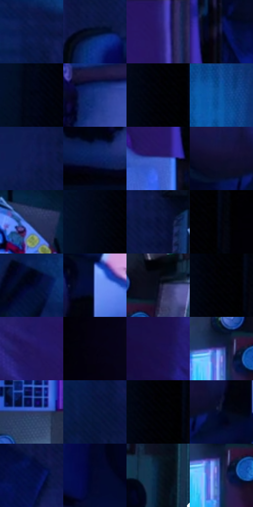

# 电影参考 057

- 状态：常规／活跃；来源世界：miles-home。
- 视角：overhead；景别：environment-wide；场景：interior。
- 时段：interior-time-unknown（外观依据，中置信度；具体时间／晨昏未知）；光照：cool-interior。
- 材质候选：skin, fabric, wood, plastic, screen（帧级，不是像素分割）。
- 明暗组：very-dark；L* P5/P50/P95：0.3148 / 8.69132 / 40.98394。
- 资格门禁：无附加门禁。
- 原截图 SHA-256：`2f2b158d498283e0debf4f737da357b8179be4ffe016f8caed1b59cd0c47d098`；尺寸：2880 × 1204。
- sRGB 像素 SHA-256：`8849ecd1dc9da05578da8bb996e374e618833e8d468ceefccf2c085d7d14195b`。

## 观察与迁移

俯视卧室冷蓝光，床、桌与人物保持体块。

本公开版保存32个128×128原像素色卡上下文；图集格子并非原场景相邻位置。原rect、图集tile和像素SHA见 `data/palette-crops.json`。上下文不足时不得批准替色，不能以小样推断完整构图。

## 实测色卡

颜色比例分母为保留采样像素，不是材料面积；全部 32 色参与全库匹配。表内四舍五入仅用于阅读，原精度在 JSON。

| ID | HEX | Lab | 原图 xy | 像素数 | 比例 | 明度角色 |
| --- | --- | --- | --- | ---: | ---: | --- |
| 057-S01 | #091848 | [10.401587, 14.569918, -31.720297] | [1648, 184] | 11636 | 6.040032% | deep-shadow |
| 057-S02 | #051229 | [5.644588, 3.48265, -17.00659] | [1900, 300] | 8765 | 4.549749% | deep-shadow |
| 057-S03 | #251766 | [15.303026, 30.889876, -43.910351] | [1268, 64] | 8642 | 4.485902% | deep-shadow |
| 057-S04 | #13183D | [10.019089, 11.488565, -24.571845] | [1344, 660] | 8248 | 4.281384% | deep-shadow |
| 057-S05 | #030515 | [1.644175, 2.216955, -7.641444] | [236, 236] | 7836 | 4.067522% | deep-shadow |
| 057-S06 | #12307B | [22.555581, 19.648485, -45.648655] | [980, 960] | 7595 | 3.942423% | shadow |
| 057-S07 | #000106 | [0.314799, 0.433702, -1.984223] | [304, 28] | 7488 | 3.886882% | deep-shadow |
| 057-S08 | #124E9E | [34.075758, 13.250627, -48.558633] | [1956, 32] | 7462 | 3.873386% | shadow |
| 057-S09 | #101D54 | [13.403875, 16.880452, -35.050581] | [2160, 112] | 6605 | 3.428533% | deep-shadow |
| 057-S10 | #091D5D | [13.982503, 19.995108, -40.175168] | [864, 1112] | 6352 | 3.297205% | deep-shadow |
| 057-S11 | #3D5CC0 | [41.923234, 22.096505, -55.913787] | [1256, 748] | 6235 | 3.236473% | midtone |
| 057-S12 | #120E2F | [5.851954, 12.344945, -21.111478] | [2132, 468] | 6234 | 3.235954% | deep-shadow |
| 057-S13 | #232E55 | [19.910928, 8.477766, -25.174122] | [2500, 884] | 6232 | 3.234915% | deep-shadow |
| 057-S14 | #020817 | [2.243794, 1.243519, -8.207526] | [252, 68] | 6173 | 3.204290% | deep-shadow |
| 057-S15 | #060F36 | [5.840568, 12.088508, -26.331385] | [2240, 144] | 5854 | 3.038703% | deep-shadow |
| 057-S16 | #000410 | [1.122093, 0.771378, -5.314806] | [372, 40] | 5822 | 3.022092% | deep-shadow |
| 057-S17 | #01041B | [1.557105, 3.680008, -12.387275] | [1524, 56] | 5712 | 2.964993% | deep-shadow |
| 057-S18 | #6B8EE9 | [60.20581, 13.609216, -49.783442] | [2288, 400] | 5678 | 2.947344% | light |
| 057-S19 | #080B1D | [3.429279, 3.303979, -11.157969] | [2652, 220] | 5456 | 2.832108% | deep-shadow |
| 057-S20 | #010209 | [0.628546, 0.711773, -2.741037] | [320, 36] | 5412 | 2.809269% | deep-shadow |
| 057-S21 | #21165A | [13.442346, 26.755349, -38.9898] | [1080, 132] | 5163 | 2.680017% | deep-shadow |
| 057-S22 | #030210 | [0.904864, 2.356997, -5.611026] | [664, 120] | 5133 | 2.664445% | deep-shadow |
| 057-S23 | #1B124A | [10.258026, 22.608959, -33.292793] | [932, 272] | 5083 | 2.638491% | deep-shadow |
| 057-S24 | #404791 | [33.221677, 19.686401, -41.947167] | [2548, 280] | 4975 | 2.582430% | shadow |
| 057-S25 | #2C376A | [24.664718, 12.135169, -31.311019] | [2432, 608] | 4831 | 2.507682% | shadow |
| 057-S26 | #06153A | [7.952482, 10.082292, -25.811293] | [1644, 312] | 4584 | 2.379469% | deep-shadow |
| 057-S27 | #000002 | [0.039574, 0.278088, -0.756847] | [316, 28] | 4512 | 2.342095% | deep-shadow |
| 057-S28 | #020922 | [2.924112, 4.245756, -15.882811] | [2224, 496] | 4343 | 2.254371% | deep-shadow |
| 057-S29 | #040E43 | [6.729097, 19.092627, -34.239122] | [1728, 724] | 4317 | 2.240875% | deep-shadow |
| 057-S30 | #04082B | [3.376687, 8.907974, -22.092453] | [1952, 572] | 4124 | 2.140692% | deep-shadow |
| 057-S31 | #071A30 | [8.968448, 1.582567, -16.923463] | [2776, 540] | 3181 | 1.651198% | deep-shadow |
| 057-S32 | #112952 | [17.055335, 7.132589, -27.784812] | [2560, 312] | 2965 | 1.539076% | deep-shadow |

## 色阶与空间分布

- 采样 ROI：`[0.01, 0.02, 0.98, 0.94]`；步长：4；样本数：192648。
- 排除区：`[]`。
- 深暗、暗、中、亮、高光五段计数：`[155218, 27027, 7483, 2896, 24]`。
- RGB 各 256 箱、L* 100 箱、13×5 色相明度表和 3×3 空间统计全部保存在 [总数据](../film-library.json)。
- [可视化档案](../../references/library.html)按需绘制直方图，不存 2,094 张重复图表图片。

## 纹理特征占比

**这是分块图像特征的面积占比，不是波点／排线／丝网／错版的精确语义覆盖率。** 窗格、发丝、织物也会产生方向或周期特征。
原图 ROI 像素 3092958；已测块覆盖 3092958（100.0000%）；未测 0。

| 特征 | 块覆盖像素 | 占已测面积 | 阈值敏感范围 |
| --- | ---: | ---: | --- |
| low-contrast | 828928 | 26.8005% | 23.0925% ~ 31.8524% |
| directional-structure | 443776 | 14.3479% | 8.2024% ~ 21.1143% |
| periodic-structure | 1721950 | 55.6732% | 53.7748% ~ 55.6732% |
| mixed-detail | 98304 | 3.1783% | 0.5297% ~ 6.1704% |

阈值敏感范围不是统计置信区间。逐块坐标、尺度、对比、方向一致性、频谱集中度、频率与角度见 [全量特征记录](../texture-features.jsonl)，以帧号定位。
四种印刷层的真实像素覆盖仍标为 `null`，不能填 0，也不能拿上表代替。不得据这些代理测量删除唯一证据。

[测量方法与保留策略](../../references/library-retention.md) · [分类索引](../archive/README.md)
