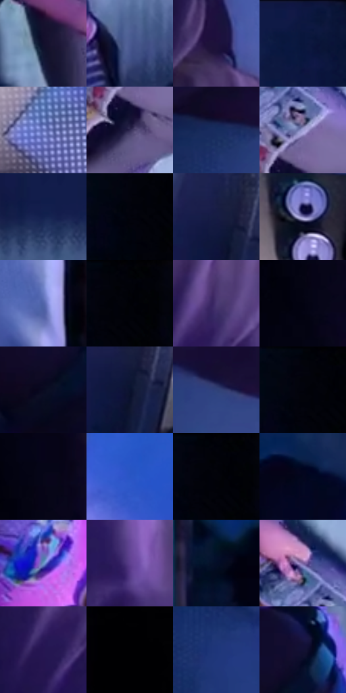

# 电影参考 058

- 状态：常规／活跃；来源世界：miles-home。
- 视角：overhead；景别：environment-wide；场景：interior。
- 时段：interior-time-unknown（外观依据，中置信度；具体时间／晨昏未知）；光照：cool-interior。
- 材质候选：skin, fabric, wood, plastic, screen（帧级，不是像素分割）。
- 明暗组：very-dark；L* P5/P50/P95：0.54803 / 12.5868 / 61.84975。
- 资格门禁：无附加门禁。
- 原截图 SHA-256：`ca6ff35bbb2e25b4bf836d61b68352aafe2e819b19dacad8eb2a3f8d053d5b0d`；尺寸：2880 × 1206。
- sRGB 像素 SHA-256：`2c67535bfc41decb26d2184fa17e1849d16ff7aff4dff945b90a1e1aece659d6`。

## 观察与迁移

俯视卧室冷蓝光，床、桌与人物保持体块。

本公开版保存32个128×128原像素色卡上下文；图集格子并非原场景相邻位置。原rect、图集tile和像素SHA见 `data/palette-crops.json`。上下文不足时不得批准替色，不能以小样推断完整构图。

## 实测色卡

颜色比例分母为保留采样像素，不是材料面积；全部 32 色参与全库匹配。表内四舍五入仅用于阅读，原精度在 JSON。

| ID | HEX | Lab | 原图 xy | 像素数 | 比例 | 明度角色 |
| --- | --- | --- | --- | ---: | ---: | --- |
| 058-S01 | #120F2B | [5.822737, 9.970508, -18.170457] | [1868, 792] | 9508 | 4.917609% | deep-shadow |
| 058-S02 | #4A5B92 | [39.601543, 9.426517, -32.3587] | [2144, 1132] | 8719 | 4.509532% | shadow |
| 058-S03 | #1D123B | [9.070479, 17.691265, -24.627131] | [968, 152] | 7975 | 4.124730% | deep-shadow |
| 058-S04 | #0A163D | [8.782397, 11.327341, -26.602507] | [2400, 48] | 7774 | 4.020771% | deep-shadow |
| 058-S05 | #6070B6 | [48.823676, 13.239541, -38.963501] | [2604, 1036] | 7752 | 4.009392% | midtone |
| 058-S06 | #2F2952 | [19.221336, 14.33474, -24.200413] | [2196, 736] | 7116 | 3.680449% | deep-shadow |
| 058-S07 | #172C5E | [19.18786, 11.006619, -32.346271] | [812, 772] | 7075 | 3.659243% | deep-shadow |
| 058-S08 | #A0A1D6 | [67.885779, 11.158011, -27.01211] | [2212, 644] | 6861 | 3.548561% | light |
| 058-S09 | #13214F | [14.34655, 12.187401, -30.109963] | [2072, 72] | 6685 | 3.457532% | deep-shadow |
| 058-S10 | #010413 | [1.267142, 1.642405, -6.881566] | [32, 100] | 6681 | 3.455463% | deep-shadow |
| 058-S11 | #161D42 | [12.23767, 10.395719, -24.516726] | [2384, 1044] | 6677 | 3.453394% | deep-shadow |
| 058-S12 | #847FB9 | [55.671232, 15.059879, -29.77277] | [2624, 684] | 6295 | 3.255821% | midtone |
| 058-S13 | #5064A9 | [43.77516, 12.693798, -39.428866] | [1288, 1124] | 6191 | 3.202032% | midtone |
| 058-S14 | #010106 | [0.373108, 0.695202, -1.892085] | [112, 48] | 6148 | 3.179792% | deep-shadow |
| 058-S15 | #4A3873 | [28.17244, 22.444145, -31.311853] | [1024, 340] | 6122 | 3.166344% | shadow |
| 058-S16 | #020211 | [0.874187, 2.289673, -6.231633] | [516, 248] | 6085 | 3.147208% | deep-shadow |
| 058-S17 | #090A20 | [3.427147, 4.964523, -13.514705] | [1852, 360] | 5987 | 3.096521% | deep-shadow |
| 058-S18 | #0A122F | [6.343708, 7.651842, -20.362168] | [2400, 1088] | 5943 | 3.073764% | deep-shadow |
| 058-S19 | #2F4279 | [29.109296, 10.766904, -33.737525] | [948, 808] | 5842 | 3.021526% | shadow |
| 058-S20 | #02030C | [0.944522, 1.005502, -3.54047] | [72, 28] | 5734 | 2.965668% | deep-shadow |
| 058-S21 | #070618 | [2.180075, 3.611387, -9.025048] | [536, 176] | 5718 | 2.957392% | deep-shadow |
| 058-S22 | #2955C4 | [39.499544, 25.603733, -62.20873] | [2592, 420] | 5482 | 2.835331% | shadow |
| 058-S23 | #010209 | [0.628546, 0.711773, -2.741037] | [100, 28] | 5400 | 2.792920% | deep-shadow |
| 058-S24 | #03071E | [2.393831, 3.92802, -13.53335] | [1704, 108] | 5391 | 2.788266% | deep-shadow |
| 058-S25 | #6A95C5 | [60.416615, -1.653547, -29.356763] | [1948, 524] | 5237 | 2.708616% | light |
| 058-S26 | #5E3F8F | [33.810709, 31.517502, -39.629455] | [1108, 496] | 5234 | 2.707064% | shadow |
| 058-S27 | #040D27 | [4.1558, 5.028696, -17.826072] | [1412, 312] | 4723 | 2.442771% | deep-shadow |
| 058-S28 | #79619F | [45.7945, 22.971214, -30.120482] | [2168, 548] | 4319 | 2.233819% | midtone |
| 058-S29 | #261652 | [13.199249, 24.962696, -33.946458] | [968, 428] | 3956 | 2.046073% | deep-shadow |
| 058-S30 | #010103 | [0.313747, 0.27807, -0.756814] | [260, 28] | 3907 | 2.020730% | deep-shadow |
| 058-S31 | #1E357A | [24.407213, 17.091054, -41.981733] | [776, 992] | 3613 | 1.868671% | shadow |
| 058-S32 | #121134 | [7.02168, 12.81121, -22.924616] | [1908, 280] | 3196 | 1.652995% | deep-shadow |

## 色阶与空间分布

- 采样 ROI：`[0.01, 0.02, 0.98, 0.94]`；步长：4；样本数：193346。
- 排除区：`[]`。
- 深暗、暗、中、亮、高光五段计数：`[117068, 34034, 30833, 11324, 87]`。
- RGB 各 256 箱、L* 100 箱、13×5 色相明度表和 3×3 空间统计全部保存在 [总数据](../film-library.json)。
- [可视化档案](../../references/library.html)按需绘制直方图，不存 2,094 张重复图表图片。

## 纹理特征占比

**这是分块图像特征的面积占比，不是波点／排线／丝网／错版的精确语义覆盖率。** 窗格、发丝、织物也会产生方向或周期特征。
原图 ROI 像素 3098546；已测块覆盖 3098546（100.0000%）；未测 0。

| 特征 | 块覆盖像素 | 占已测面积 | 阈值敏感范围 |
| --- | ---: | ---: | --- |
| low-contrast | 644224 | 20.7912% | 18.3250% ~ 23.4350% |
| directional-structure | 775168 | 25.0172% | 15.1483% ~ 34.3573% |
| periodic-structure | 1550898 | 50.0524% | 44.6739% ~ 55.6912% |
| mixed-detail | 128256 | 4.1392% | 2.6438% ~ 5.7255% |

阈值敏感范围不是统计置信区间。逐块坐标、尺度、对比、方向一致性、频谱集中度、频率与角度见 [全量特征记录](../texture-features.jsonl)，以帧号定位。
四种印刷层的真实像素覆盖仍标为 `null`，不能填 0，也不能拿上表代替。不得据这些代理测量删除唯一证据。

[测量方法与保留策略](../../references/library-retention.md) · [分类索引](../archive/README.md)
