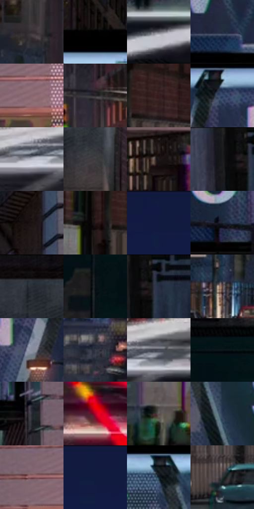

# 电影参考 059

- 状态：常规／活跃；来源世界：miles-home。
- 视角：near-level；景别：environment-wide；场景：city。
- 时段：night-appearance（外观依据，中置信度；具体时间／晨昏未知）；光照：night-mixed。
- 材质候选：brick, glass, asphalt, sky（帧级，不是像素分割）。
- 明暗组：very-dark；L* P5/P50/P95：1.33476 / 17.43915 / 59.69197。
- 资格门禁：无附加门禁。
- 原截图 SHA-256：`5c25b5cd4889abe7a9f4bfcac20fd9e9b918bb4436e8cb63685ad8427bac25e6`；尺寸：2880 × 1210。
- sRGB 像素 SHA-256：`647f876eb4daa3ed69a45518a99e9c0b652cf8fb1c1d1959cfffc56185408776`。

## 观察与迁移

夜间校桥同机位，红光轨迹另于实体道路结构。

本公开版保存32个128×128原像素色卡上下文；图集格子并非原场景相邻位置。原rect、图集tile和像素SHA见 `data/palette-crops.json`。上下文不足时不得批准替色，不能以小样推断完整构图。

## 实测色卡

颜色比例分母为保留采样像素，不是材料面积；全部 32 色参与全库匹配。表内四舍五入仅用于阅读，原精度在 JSON。

| ID | HEX | Lab | 原图 xy | 像素数 | 比例 | 明度角色 |
| --- | --- | --- | --- | ---: | ---: | --- |
| 059-S01 | #342E32 | [19.697682, 3.595269, -1.573305] | [1080, 784] | 10525 | 5.424028% | deep-shadow |
| 059-S02 | #010101 | [0.274173, -1.7e-05, 3.3e-05] | [836, 180] | 9278 | 4.781390% | deep-shadow |
| 059-S03 | #686770 | [43.964044, 2.301425, -4.897722] | [336, 1108] | 8979 | 4.627301% | midtone |
| 059-S04 | #232E42 | [18.819339, 1.589978, -14.054899] | [688, 444] | 8741 | 4.504648% | deep-shadow |
| 059-S05 | #8A666F | [47.045901, 15.922045, 0.626788] | [2712, 448] | 8543 | 4.402610% | midtone |
| 059-S06 | #272428 | [14.659034, 2.358404, -2.150664] | [1944, 616] | 8253 | 4.253159% | deep-shadow |
| 059-S07 | #391E20 | [14.969101, 13.452729, 4.343034] | [592, 776] | 8121 | 4.185133% | deep-shadow |
| 059-S08 | #374A6B | [31.279475, 2.518978, -21.457293] | [1888, 276] | 7855 | 4.048051% | shadow |
| 059-S09 | #B7B8C5 | [75.063469, 2.154204, -6.673867] | [1012, 1060] | 7079 | 3.648142% | light |
| 059-S10 | #3C3B3E | [25.064613, 1.113423, -1.696401] | [396, 176] | 7050 | 3.633197% | shadow |
| 059-S11 | #1A191B | [8.941408, 1.001126, -1.223025] | [2536, 840] | 6671 | 3.437880% | deep-shadow |
| 059-S12 | #1D1F22 | [11.666123, -0.127622, -2.356426] | [2104, 28] | 6616 | 3.409536% | deep-shadow |
| 059-S13 | #1A1212 | [6.286258, 3.687879, 1.300193] | [2388, 84] | 6581 | 3.391499% | deep-shadow |
| 059-S14 | #26191A | [10.423754, 6.694833, 1.870013] | [504, 808] | 6226 | 3.208551% | deep-shadow |
| 059-S15 | #121B43 | [11.397583, 11.47854, -26.585979] | [1580, 28] | 6045 | 3.115273% | deep-shadow |
| 059-S16 | #1C2532 | [14.401788, 0.125294, -9.774147] | [2284, 448] | 5539 | 2.854507% | deep-shadow |
| 059-S17 | #0F0C0C | [3.53236, 0.947863, 0.334451] | [196, 32] | 5517 | 2.843170% | deep-shadow |
| 059-S18 | #081115 | [4.576403, -1.870107, -3.324757] | [64, 420] | 5485 | 2.826678% | deep-shadow |
| 059-S19 | #050808 | [2.018462, -0.784637, -0.276152] | [2168, 28] | 5317 | 2.740100% | deep-shadow |
| 059-S20 | #553C38 | [27.977142, 10.367253, 6.818129] | [948, 884] | 5243 | 2.701965% | shadow |
| 059-S21 | #8A8F9D | [59.418004, 1.102678, -8.013301] | [2072, 416] | 4926 | 2.538599% | midtone |
| 059-S22 | #353B4B | [24.929296, 1.765691, -10.591764] | [1508, 824] | 4905 | 2.527777% | shadow |
| 059-S23 | #494D58 | [32.763529, 1.004365, -7.01364] | [1088, 1036] | 4747 | 2.446352% | shadow |
| 059-S24 | #0D171B | [7.022644, -2.819054, -4.204083] | [196, 344] | 4685 | 2.414401% | deep-shadow |
| 059-S25 | #252831 | [16.16828, 1.107617, -6.303539] | [2424, 512] | 4682 | 2.412855% | deep-shadow |
| 059-S26 | #B70129 | [38.291623, 63.091117, 33.024626] | [1552, 1036] | 4619 | 2.380388% | shadow |
| 059-S27 | #605454 | [36.869687, 4.918935, 1.808865] | [268, 928] | 4466 | 2.301540% | shadow |
| 059-S28 | #283A51 | [23.904906, 0.049296, -16.217418] | [1100, 388] | 4100 | 2.112923% | shadow |
| 059-S29 | #86565C | [41.996295, 20.764632, 4.802561] | [2616, 416] | 3770 | 1.942858% | midtone |
| 059-S30 | #111B3F | [11.005376, 9.566861, -24.407041] | [1292, 64] | 3624 | 1.867618% | deep-shadow |
| 059-S31 | #0F1F2A | [10.911201, -2.736864, -9.463986] | [1016, 268] | 3401 | 1.752695% | deep-shadow |
| 059-S32 | #2A3433 | [20.778398, -4.470619, -0.779126] | [676, 956] | 2455 | 1.265177% | shadow |

## 色阶与空间分布

- 采样 ROI：`[0.01, 0.02, 0.98, 0.94]`；步长：4；样本数：194044。
- 排除区：`[]`。
- 深暗、暗、中、亮、高光五段计数：`[109942, 48988, 25529, 7949, 1636]`。
- RGB 各 256 箱、L* 100 箱、13×5 色相明度表和 3×3 空间统计全部保存在 [总数据](../film-library.json)。
- [可视化档案](../../references/library.html)按需绘制直方图，不存 2,094 张重复图表图片。

## 纹理特征占比

**这是分块图像特征的面积占比，不是波点／排线／丝网／错版的精确语义覆盖率。** 窗格、发丝、织物也会产生方向或周期特征。
原图 ROI 像素 3109722；已测块覆盖 3109722（100.0000%）；未测 0。

| 特征 | 块覆盖像素 | 占已测面积 | 阈值敏感范围 |
| --- | ---: | ---: | --- |
| low-contrast | 98304 | 3.1612% | 3.1612% ~ 3.1612% |
| directional-structure | 783706 | 25.2018% | 11.7721% ~ 40.4809% |
| periodic-structure | 2083072 | 66.9858% | 54.2505% ~ 72.6936% |
| mixed-detail | 144640 | 4.6512% | 2.1075% ~ 12.3731% |

阈值敏感范围不是统计置信区间。逐块坐标、尺度、对比、方向一致性、频谱集中度、频率与角度见 [全量特征记录](../texture-features.jsonl)，以帧号定位。
四种印刷层的真实像素覆盖仍标为 `null`，不能填 0，也不能拿上表代替。不得据这些代理测量删除唯一证据。

[测量方法与保留策略](../../references/library-retention.md) · [分类索引](../archive/README.md)
