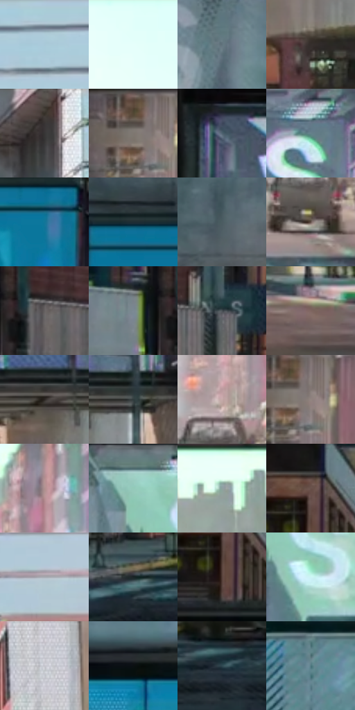

# 电影参考 060

- 状态：常规／活跃；来源世界：miles-home。
- 视角：near-level；景别：environment-wide；场景：city。
- 时段：daylight-time-unspecified（外观依据，中置信度；具体时间／晨昏未知）；光照：neutral-day。
- 材质候选：brick, glass, asphalt, sky, painted-metal（帧级，不是像素分割）。
- 明暗组：middle；L* P5/P50/P95：11.39558 / 45.52467 / 96.71715。
- 资格门禁：无附加门禁。
- 原截图 SHA-256：`3e091ceb002497d12e4a6bc3ff8b867edeae45bef061f4073a8509dc44808ac5`；尺寸：2880 × 1206。
- sRGB 像素 SHA-256：`b0804fd1d82a682ed1f0bd975d6183e760167c71ac73ac385c073a394cb509d0`。

## 观察与迁移

日间校桥，中性立面与青天空，不能强制夜景化。

本公开版保存32个128×128原像素色卡上下文；图集格子并非原场景相邻位置。原rect、图集tile和像素SHA见 `data/palette-crops.json`。上下文不足时不得批准替色，不能以小样推断完整构图。

## 实测色卡

颜色比例分母为保留采样像素，不是材料面积；全部 32 色参与全库匹配。表内四舍五入仅用于阅读，原精度在 JSON。

| ID | HEX | Lab | 原图 xy | 像素数 | 比例 | 明度角色 |
| --- | --- | --- | --- | ---: | ---: | --- |
| 060-S01 | #ADC9D5 | [79.305604, -6.83291, -9.109334] | [2736, 48] | 11094 | 5.737900% | light |
| 060-S02 | #E1FFFA | [97.804215, -10.59291, -0.885377] | [1080, 28] | 8363 | 4.325406% | highlight |
| 060-S03 | #62737D | [47.415303, -3.93453, -7.606318] | [2132, 340] | 7883 | 4.077147% | midtone |
| 060-S04 | #352E2C | [19.60931, 2.746367, 2.448066] | [2244, 828] | 7843 | 4.056458% | deep-shadow |
| 060-S05 | #423B38 | [25.478226, 2.423111, 2.963184] | [2384, 40] | 7256 | 3.752858% | shadow |
| 060-S06 | #7E7771 | [50.478016, 1.548485, 4.25798] | [1044, 600] | 7131 | 3.688207% | midtone |
| 060-S07 | #4F6371 | [40.860676, -3.919871, -10.350398] | [540, 264] | 7127 | 3.686138% | midtone |
| 060-S08 | #66818B | [52.273799, -7.214397, -8.564927] | [2288, 288] | 7004 | 3.622521% | midtone |
| 060-S09 | #127699 | [46.155318, -13.812069, -26.414572] | [360, 364] | 6849 | 3.542354% | midtone |
| 060-S10 | #1F2D34 | [17.533908, -3.729339, -6.388253] | [128, 308] | 6826 | 3.530458% | deep-shadow |
| 060-S11 | #4C5C62 | [37.971951, -4.644242, -5.480939] | [332, 184] | 6513 | 3.368572% | shadow |
| 060-S12 | #65524B | [36.57378, 6.677991, 7.076393] | [1592, 980] | 6333 | 3.275475% | shadow |
| 060-S13 | #666262 | [41.910253, 1.576519, 0.564892] | [560, 836] | 6273 | 3.244443% | midtone |
| 060-S14 | #7B8994 | [56.327171, -2.646032, -7.580029] | [460, 840] | 6171 | 3.191687% | midtone |
| 060-S15 | #484F55 | [33.190285, -1.374954, -4.479974] | [728, 840] | 6160 | 3.185998% | shadow |
| 060-S16 | #7F6661 | [45.467251, 9.170599, 6.612652] | [2252, 1072] | 6106 | 3.158069% | midtone |
| 060-S17 | #2C2623 | [15.711809, 2.153923, 3.012151] | [2232, 528] | 6074 | 3.141518% | deep-shadow |
| 060-S18 | #2F3A3C | [23.527397, -4.019691, -2.760264] | [2344, 524] | 5860 | 3.030836% | shadow |
| 060-S19 | #C7ABA9 | [72.317773, 9.814886, 4.791553] | [1596, 868] | 5733 | 2.965151% | light |
| 060-S20 | #928480 | [56.260074, 4.568071, 4.080083] | [1076, 608] | 5589 | 2.890673% | midtone |
| 060-S21 | #B0908F | [62.643234, 11.85661, 5.068991] | [1668, 620] | 5514 | 2.851882% | light |
| 060-S22 | #94CAB9 | [77.303541, -21.069998, 2.83972] | [1108, 284] | 5397 | 2.791369% | light |
| 060-S23 | #8FA1A1 | [64.884715, -6.314277, -2.147483] | [1340, 596] | 5277 | 2.729304% | light |
| 060-S24 | #1A1A1A | [9.263234, -0.000535, 0.001013] | [772, 36] | 5146 | 2.661550% | deep-shadow |
| 060-S25 | #A5AAB0 | [69.386181, -0.588608, -3.689322] | [2672, 416] | 5115 | 2.645516% | light |
| 060-S26 | #1A2427 | [13.398416, -3.486185, -3.438611] | [764, 1036] | 5047 | 2.610346% | deep-shadow |
| 060-S27 | #56403A | [29.2886, 8.575361, 7.375239] | [768, 140] | 4465 | 2.309331% | shadow |
| 060-S28 | #CDF4F6 | [93.594587, -12.091402, -5.147801] | [1192, 392] | 4402 | 2.276747% | highlight |
| 060-S29 | #C4C4CB | [79.344016, 1.305553, -3.491485] | [2036, 76] | 4377 | 2.263817% | light |
| 060-S30 | #0B1011 | [4.355548, -1.387024, -1.084931] | [176, 620] | 4292 | 2.219855% | deep-shadow |
| 060-S31 | #304952 | [29.418376, -6.887625, -8.388735] | [904, 1064] | 3788 | 1.959182% | shadow |
| 060-S32 | #4E777F | [47.423649, -12.064711, -8.913123] | [144, 836] | 2338 | 1.209231% | midtone |

## 色阶与空间分布

- 采样 ROI：`[0.01, 0.02, 0.98, 0.94]`；步长：4；样本数：193346。
- 排除区：`[]`。
- 深暗、暗、中、亮、高光五段计数：`[31354, 46834, 59660, 37676, 17822]`。
- RGB 各 256 箱、L* 100 箱、13×5 色相明度表和 3×3 空间统计全部保存在 [总数据](../film-library.json)。
- [可视化档案](../../references/library.html)按需绘制直方图，不存 2,094 张重复图表图片。

## 纹理特征占比

**这是分块图像特征的面积占比，不是波点／排线／丝网／错版的精确语义覆盖率。** 窗格、发丝、织物也会产生方向或周期特征。
原图 ROI 像素 3098546；已测块覆盖 3098546（100.0000%）；未测 0。

| 特征 | 块覆盖像素 | 占已测面积 | 阈值敏感范围 |
| --- | ---: | ---: | --- |
| low-contrast | 98304 | 3.1726% | 3.1726% ~ 3.1726% |
| directional-structure | 991282 | 31.9918% | 21.9453% ~ 45.4712% |
| periodic-structure | 1992576 | 64.3068% | 51.3562% ~ 68.5369% |
| mixed-detail | 16384 | 0.5288% | 0.0000% ~ 6.3452% |

阈值敏感范围不是统计置信区间。逐块坐标、尺度、对比、方向一致性、频谱集中度、频率与角度见 [全量特征记录](../texture-features.jsonl)，以帧号定位。
四种印刷层的真实像素覆盖仍标为 `null`，不能填 0，也不能拿上表代替。不得据这些代理测量删除唯一证据。

[测量方法与保留策略](../../references/library-retention.md) · [分类索引](../archive/README.md)
