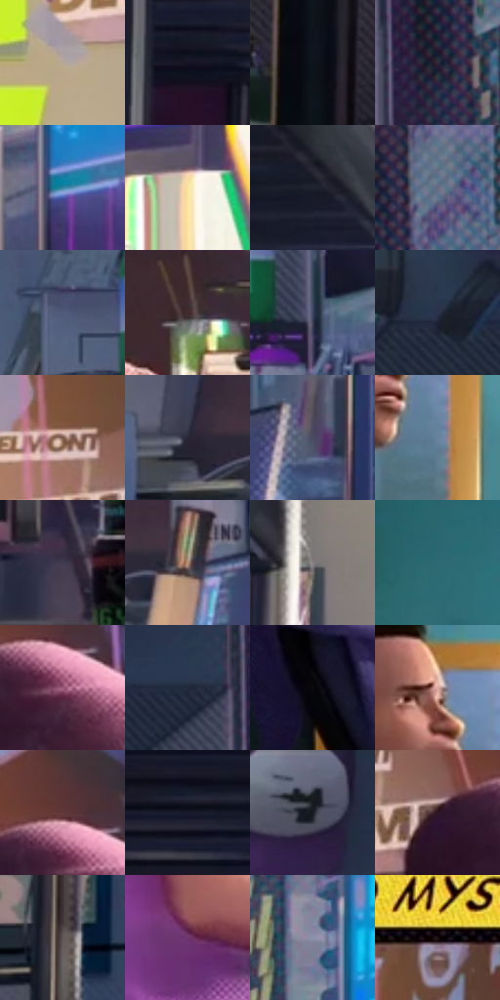

# 电影参考 061

- 状态：条件／活跃；来源世界：miles-home。
- 视角：near-level；景别：full-body；场景：interior。
- 时段：daylight-time-unspecified（外观依据，中置信度；具体时间／晨昏未知）；光照：neutral-day。
- 材质候选：skin, fabric, screen, wood, paper（帧级，不是像素分割）。
- 明暗组：dark；L* P5/P50/P95：5.43198 / 31.44618 / 77.94755。
- 资格门禁：caption。
- 原截图 SHA-256：`38853c91d23d62940887707b730af11dc799be94c6ed423b2cb6daad43c0cbad`；尺寸：2880 × 1206。
- sRGB 像素 SHA-256：`5ed89c7545111c737483bb2b02f3b3080450ff1e3d1fc105943b5ba0d424008f`。

## 观察与迁移

卧室人物与黄色内心框，文案未确认不迁移。

61  /  房间画面上方一个细长黄色框，承载连续的第一人称念头  /  61

本公开版保存32个128×128原像素色卡上下文；图集格子并非原场景相邻位置。原rect、图集tile和像素SHA见 `data/palette-crops.json`。上下文不足时不得批准替色，不能以小样推断完整构图。

## 实测色卡

颜色比例分母为保留采样像素，不是材料面积；全部 32 色参与全库匹配。表内四舍五入仅用于阅读，原精度在 JSON。

| ID | HEX | Lab | 原图 xy | 像素数 | 比例 | 明度角色 |
| --- | --- | --- | --- | ---: | ---: | --- |
| 061-S01 | #B7A797 | [69.426729, 3.112176, 10.377574] | [1584, 592] | 8264 | 4.274203% | light |
| 061-S02 | #171525 | [7.696357, 5.765625, -10.688836] | [292, 248] | 8201 | 4.241619% | deep-shadow |
| 061-S03 | #0F131C | [5.88147, 0.841093, -6.660752] | [196, 908] | 8029 | 4.152659% | deep-shadow |
| 061-S04 | #302E3F | [19.80684, 5.288427, -10.386684] | [2412, 344] | 7609 | 3.935432% | deep-shadow |
| 061-S05 | #3685A1 | [51.984725, -15.025058, -22.01379] | [2652, 676] | 7534 | 3.896641% | midtone |
| 061-S06 | #F7E6A1 | [91.208643, -4.028, 35.761262] | [2796, 840] | 7352 | 3.802509% | highlight |
| 061-S07 | #20212E | [13.181388, 3.223626, -8.757677] | [464, 124] | 7292 | 3.771477% | deep-shadow |
| 061-S08 | #666B81 | [45.53106, 3.157812, -12.797148] | [2476, 184] | 7246 | 3.747685% | midtone |
| 061-S09 | #505A7A | [38.590276, 4.427101, -19.315391] | [2200, 556] | 7010 | 3.625625% | shadow |
| 061-S10 | #412A2D | [19.920965, 11.222935, 2.400004] | [2160, 1000] | 6709 | 3.469945% | deep-shadow |
| 061-S11 | #3C4560 | [29.566222, 3.803343, -17.090762] | [2356, 628] | 6692 | 3.461153% | shadow |
| 061-S12 | #2C344D | [22.042011, 4.030828, -16.430905] | [2128, 200] | 6688 | 3.459084% | shadow |
| 061-S13 | #815B4E | [42.308097, 13.793967, 13.698956] | [1708, 428] | 6662 | 3.445636% | midtone |
| 061-S14 | #2A2636 | [16.229408, 5.986484, -9.68252] | [2172, 784] | 6604 | 3.415638% | deep-shadow |
| 061-S15 | #4B4A63 | [32.467283, 6.514596, -14.431703] | [2436, 804] | 6593 | 3.409949% | shadow |
| 061-S16 | #66839C | [53.445727, -3.964884, -16.683534] | [1224, 408] | 6479 | 3.350987% | midtone |
| 061-S17 | #403C4F | [26.407944, 6.299999, -10.884134] | [2612, 1044] | 6437 | 3.329265% | shadow |
| 061-S18 | #B48B78 | [61.243269, 12.86999, 16.162902] | [2292, 792] | 6133 | 3.172034% | light |
| 061-S19 | #878182 | [54.515127, 2.446193, 0.268899] | [664, 264] | 6077 | 3.143070% | midtone |
| 061-S20 | #2E6A74 | [41.451864, -16.154037, -11.450354] | [856, 152] | 5978 | 3.091866% | midtone |
| 061-S21 | #9D5A7B | [46.858637, 31.980056, -6.608083] | [1920, 500] | 5825 | 3.012734% | midtone |
| 061-S22 | #212B3C | [17.353907, 0.988172, -12.205701] | [2304, 212] | 5819 | 3.009630% | deep-shadow |
| 061-S23 | #09080C | [2.333072, 0.833195, -1.46391] | [1232, 832] | 5464 | 2.826022% | deep-shadow |
| 061-S24 | #DEADA2 | [74.842438, 16.297928, 12.524389] | [1168, 296] | 5279 | 2.730338% | light |
| 061-S25 | #623839 | [28.697388, 18.800908, 7.431146] | [1896, 444] | 4983 | 2.577245% | shadow |
| 061-S26 | #191B2E | [10.466591, 5.057245, -13.015835] | [52, 160] | 4925 | 2.547247% | deep-shadow |
| 061-S27 | #171B21 | [9.607575, -0.101301, -4.758153] | [2224, 56] | 4619 | 2.388981% | deep-shadow |
| 061-S28 | #2E1624 | [11.15002, 14.550334, -4.37173] | [1792, 492] | 3899 | 2.016592% | deep-shadow |
| 061-S29 | #615859 | [38.273747, 3.840618, 0.747527] | [624, 684] | 3839 | 1.985560% | shadow |
| 061-S30 | #71356F | [32.26945, 35.249089, -21.982525] | [1704, 1104] | 3439 | 1.778677% | shadow |
| 061-S31 | #8D94AD | [61.532434, 2.859242, -13.909983] | [2600, 512] | 2993 | 1.548002% | light |
| 061-S32 | #1B0D13 | [5.12996, 7.114294, -0.995406] | [1744, 228] | 2673 | 1.382496% | deep-shadow |

## 色阶与空间分布

- 采样 ROI：`[0.01, 0.02, 0.98, 0.94]`；步长：4；样本数：193346。
- 排除区：`[]`。
- 深暗、暗、中、亮、高光五段计数：`[66180, 52304, 47899, 18136, 8827]`。
- RGB 各 256 箱、L* 100 箱、13×5 色相明度表和 3×3 空间统计全部保存在 [总数据](../film-library.json)。
- [可视化档案](../../references/library.html)按需绘制直方图，不存 2,094 张重复图表图片。

## 纹理特征占比

**这是分块图像特征的面积占比，不是波点／排线／丝网／错版的精确语义覆盖率。** 窗格、发丝、织物也会产生方向或周期特征。
原图 ROI 像素 3098546；已测块覆盖 3098546（100.0000%）；未测 0。

| 特征 | 块覆盖像素 | 占已测面积 | 阈值敏感范围 |
| --- | ---: | ---: | --- |
| low-contrast | 32768 | 1.0575% | 0.5288% ~ 1.9374% |
| directional-structure | 917248 | 29.6025% | 19.7336% ~ 44.7467% |
| periodic-structure | 2123136 | 68.5204% | 54.1958% ~ 74.8656% |
| mixed-detail | 25394 | 0.8195% | 0.5288% ~ 3.4634% |

阈值敏感范围不是统计置信区间。逐块坐标、尺度、对比、方向一致性、频谱集中度、频率与角度见 [全量特征记录](../texture-features.jsonl)，以帧号定位。
四种印刷层的真实像素覆盖仍标为 `null`，不能填 0，也不能拿上表代替。不得据这些代理测量删除唯一证据。

[测量方法与保留策略](../../references/library-retention.md) · [分类索引](../archive/README.md)
