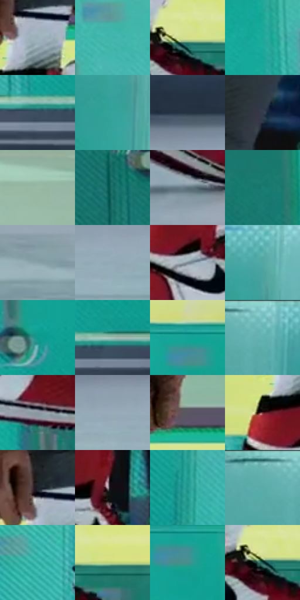

# 电影参考 062

- 状态：常规／活跃；来源世界：miles-home。
- 视角：low-angle；景别：detail；场景：detail。
- 时段：daylight-time-unspecified（外观依据，中置信度；具体时间／晨昏未知）；光照：neutral-day。
- 材质候选：fabric, plastic, painted-metal, stone（帧级，不是像素分割）。
- 明暗组：light；L* P5/P50/P95：17.02705 / 61.04849 / 83.58442。
- 资格门禁：无附加门禁。
- 原截图 SHA-256：`48bedfdb0a5fe242d83fc2a8c5ecb0b5c5bcc7c3d7e952f0a5e327719188e922`；尺寸：2880 × 1204。
- sRGB 像素 SHA-256：`5dc5e20bf85e46890e0d9dae353ea1487bc64ddbeb86eaaff33587413768dc23`。

## 观察与迁移

鞋与地面近景，鞋带是真实结构不是动作线。

本公开版保存32个128×128原像素色卡上下文；图集格子并非原场景相邻位置。原rect、图集tile和像素SHA见 `data/palette-crops.json`。上下文不足时不得批准替色，不能以小样推断完整构图。

## 实测色卡

颜色比例分母为保留采样像素，不是材料面积；全部 32 色参与全库匹配。表内四舍五入仅用于阅读，原精度在 JSON。

| ID | HEX | Lab | 原图 xy | 像素数 | 比例 | 明度角色 |
| --- | --- | --- | --- | ---: | ---: | --- |
| 062-S01 | #9CB1BC | [70.968769, -4.893479, -8.039356] | [1536, 264] | 10049 | 5.216249% | light |
| 062-S02 | #3FB4AD | [67.061634, -33.823808, -6.035163] | [2412, 488] | 9580 | 4.972800% | light |
| 062-S03 | #D4E08A | [86.575425, -17.077748, 40.75955] | [1668, 380] | 9442 | 4.901167% | highlight |
| 062-S04 | #1BA799 | [61.798819, -37.85881, -2.73252] | [2260, 540] | 8638 | 4.483825% | light |
| 062-S05 | #3C4D60 | [32.061889, -1.361849, -13.254685] | [2544, 800] | 8389 | 4.354574% | shadow |
| 062-S06 | #33A39C | [61.042183, -32.420142, -5.490533] | [500, 184] | 7819 | 4.058698% | light |
| 062-S07 | #273442 | [21.133978, -1.212771, -10.465273] | [356, 912] | 6867 | 3.564532% | shadow |
| 062-S08 | #323C4C | [25.049385, 0.325922, -11.09166] | [1028, 348] | 6668 | 3.461235% | shadow |
| 062-S09 | #97BAA5 | [72.503553, -16.034534, 6.76827] | [2244, 88] | 6365 | 3.303953% | light |
| 062-S10 | #196E66 | [41.715374, -26.289331, -2.630364] | [1840, 700] | 6248 | 3.243221% | midtone |
| 062-S11 | #5E707C | [46.207904, -3.78357, -8.846332] | [984, 1032] | 6196 | 3.216229% | midtone |
| 062-S12 | #1F7E74 | [47.588635, -29.129558, -2.339363] | [2008, 544] | 6145 | 3.189755% | midtone |
| 062-S13 | #8CA3AA | [65.49192, -6.472486, -6.310415] | [2748, 1068] | 6081 | 3.156534% | light |
| 062-S14 | #91AAB6 | [68.127748, -5.978369, -9.034864] | [284, 1040] | 6056 | 3.143557% | light |
| 062-S15 | #77858F | [54.74086, -2.878581, -7.08549] | [1536, 420] | 5783 | 3.001848% | midtone |
| 062-S16 | #51A7A2 | [63.33736, -27.129152, -5.365506] | [532, 76] | 5776 | 2.998214% | light |
| 062-S17 | #10998B | [56.835597, -36.367612, -2.117332] | [2604, 648] | 5723 | 2.970703% | midtone |
| 062-S18 | #A9C3BC | [76.736607, -10.168838, 0.554257] | [2640, 780] | 5683 | 2.949940% | light |
| 062-S19 | #12A397 | [60.386841, -37.262214, -3.696645] | [2616, 412] | 5660 | 2.938001% | light |
| 062-S20 | #6ABAB8 | [70.622176, -24.991229, -6.6584] | [312, 52] | 5602 | 2.907894% | light |
| 062-S21 | #8C97A1 | [61.896261, -1.832499, -6.583791] | [1664, 532] | 5540 | 2.875711% | light |
| 062-S22 | #97ABB7 | [68.840361, -4.364299, -8.483842] | [208, 1016] | 5479 | 2.844047% | light |
| 062-S23 | #5A5663 | [37.353523, 4.452585, -6.903335] | [1728, 216] | 5272 | 2.736597% | shadow |
| 062-S24 | #62272C | [24.418531, 27.246048, 10.15714] | [1464, 348] | 5190 | 2.694033% | shadow |
| 062-S25 | #1F232B | [13.637009, 0.451428, -5.915282] | [1504, 212] | 5186 | 2.691956% | deep-shadow |
| 062-S26 | #130E13 | [4.512384, 2.798219, -1.999707] | [924, 776] | 5160 | 2.678460% | deep-shadow |
| 062-S27 | #219890 | [56.871615, -33.015607, -4.895039] | [536, 524] | 5093 | 2.643682% | midtone |
| 062-S28 | #5FB0AC | [66.86985, -25.74689, -5.650117] | [240, 52] | 4518 | 2.345210% | light |
| 062-S29 | #31ADA4 | [64.336909, -35.120251, -5.104302] | [1356, 472] | 4407 | 2.287592% | light |
| 062-S30 | #BDD17E | [80.69792, -19.870576, 38.921483] | [1764, 384] | 2906 | 1.508451% | highlight |
| 062-S31 | #478F8D | [54.975511, -22.970633, -5.871009] | [2640, 456] | 2805 | 1.456023% | midtone |
| 062-S32 | #164E4F | [29.870468, -17.29471, -5.895005] | [1652, 392] | 2322 | 1.205307% | shadow |

## 色阶与空间分布

- 采样 ROI：`[0.01, 0.02, 0.98, 0.94]`；步长：4；样本数：192648。
- 排除区：`[]`。
- 深暗、暗、中、亮、高光五段计数：`[12568, 33119, 43751, 90298, 12912]`。
- RGB 各 256 箱、L* 100 箱、13×5 色相明度表和 3×3 空间统计全部保存在 [总数据](../film-library.json)。
- [可视化档案](../../references/library.html)按需绘制直方图，不存 2,094 张重复图表图片。

## 纹理特征占比

**这是分块图像特征的面积占比，不是波点／排线／丝网／错版的精确语义覆盖率。** 窗格、发丝、织物也会产生方向或周期特征。
原图 ROI 像素 3092958；已测块覆盖 3092958（100.0000%）；未测 0。

| 特征 | 块覆盖像素 | 占已测面积 | 阈值敏感范围 |
| --- | ---: | ---: | --- |
| low-contrast | 16384 | 0.5297% | 0.5297% ~ 1.5892% |
| directional-structure | 1714398 | 55.4291% | 41.6564% ~ 69.1107% |
| periodic-structure | 1332224 | 43.0728% | 30.3595% ~ 51.6394% |
| mixed-detail | 29952 | 0.9684% | 0.0000% ~ 5.1151% |

阈值敏感范围不是统计置信区间。逐块坐标、尺度、对比、方向一致性、频谱集中度、频率与角度见 [全量特征记录](../texture-features.jsonl)，以帧号定位。
四种印刷层的真实像素覆盖仍标为 `null`，不能填 0，也不能拿上表代替。不得据这些代理测量删除唯一证据。

[测量方法与保留策略](../../references/library-retention.md) · [分类索引](../archive/README.md)
