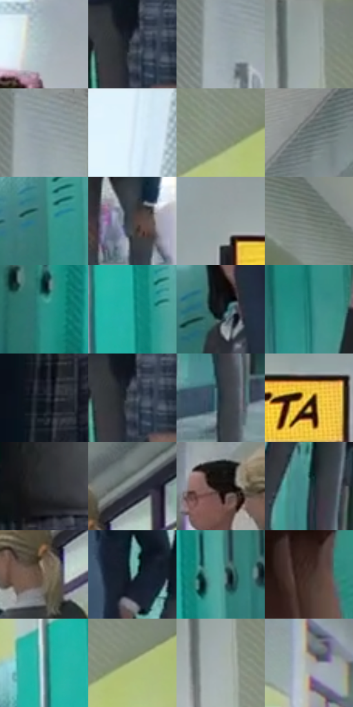

# 电影参考 063

- 状态：条件／活跃；来源世界：miles-home。
- 视角：near-level；景别：environment-wide；场景：interior。
- 时段：daylight-time-unspecified（外观依据，中置信度；具体时间／晨昏未知）；光照：neutral-day。
- 材质候选：skin, fabric, painted-metal, stone（帧级，不是像素分割）。
- 明暗组：middle；L* P5/P50/P95：10.19149 / 54.2501 / 82.41886。
- 资格门禁：caption。
- 原截图 SHA-256：`d06f0e1096c09eef0feee84e5523fed06c9c5cf90ed347bb5f7c9705d3e9b6c8`；尺寸：2880 × 1198。
- sRGB 像素 SHA-256：`fee2b8d5ffe4ffbd8ba02920b0ef319d5b3aa7e3245856b33a3ad347a9b79606`。

## 观察与迁移

走廊人物和分离黄框，黄框色不能当照明色。

63  /  走廊上方三个分开的框，按空间顺序分割短句，跟随人物窘迫的节奏  /  63

本公开版保存32个128×128原像素色卡上下文；图集格子并非原场景相邻位置。原rect、图集tile和像素SHA见 `data/palette-crops.json`。上下文不足时不得批准替色，不能以小样推断完整构图。

## 实测色卡

颜色比例分母为保留采样像素，不是材料面积；全部 32 色参与全库匹配。表内四舍五入仅用于阅读，原精度在 JSON。

| ID | HEX | Lab | 原图 xy | 像素数 | 比例 | 明度角色 |
| --- | --- | --- | --- | ---: | ---: | --- |
| 063-S01 | #ADBDC3 | [75.587245, -4.272458, -4.893981] | [1532, 524] | 14952 | 7.761306% | light |
| 063-S02 | #313A43 | [23.94788, -1.333135, -6.794542] | [2028, 804] | 9386 | 4.872098% | shadow |
| 063-S03 | #9CA8AF | [68.144101, -2.783569, -5.043977] | [476, 104] | 8968 | 4.655122% | light |
| 063-S04 | #929D9C | [63.856027, -4.115069, -0.824453] | [2360, 24] | 8955 | 4.648374% | light |
| 063-S05 | #899598 | [60.852041, -3.675078, -3.052353] | [496, 36] | 7942 | 4.122545% | light |
| 063-S06 | #DAEBF7 | [92.147824, -3.285976, -7.710382] | [1520, 44] | 7924 | 4.113201% | highlight |
| 063-S07 | #8A9383 | [59.806742, -6.348297, 7.364047] | [2492, 256] | 7917 | 4.109568% | midtone |
| 063-S08 | #6B7778 | [49.099817, -4.241867, -2.070803] | [2140, 128] | 7184 | 3.729081% | midtone |
| 063-S09 | #387877 | [46.451352, -20.635443, -5.71917] | [2544, 524] | 7057 | 3.663158% | midtone |
| 063-S10 | #444244 | [28.228227, 1.282512, -0.910837] | [1512, 864] | 7039 | 3.653814% | shadow |
| 063-S11 | #98A1A3 | [65.599807, -2.794317, -2.140242] | [1672, 172] | 6730 | 3.493418% | light |
| 063-S12 | #7C837B | [53.971421, -4.192335, 3.430554] | [704, 164] | 6728 | 3.492380% | midtone |
| 063-S13 | #2B9188 | [54.595577, -30.749257, -3.648561] | [376, 756] | 6380 | 3.311740% | midtone |
| 063-S14 | #23ABA0 | [63.358263, -36.948822, -4.344224] | [2392, 568] | 6310 | 3.275404% | light |
| 063-S15 | #161A20 | [9.104371, -0.094429, -4.779561] | [2728, 436] | 6119 | 3.176259% | deep-shadow |
| 063-S16 | #1B766F | [44.711606, -27.24432, -3.618558] | [2612, 968] | 6004 | 3.116565% | midtone |
| 063-S17 | #1B212A | [12.530526, -0.015252, -6.905806] | [52, 660] | 5939 | 3.082825% | deep-shadow |
| 063-S18 | #47515B | [33.940315, -1.483177, -7.166822] | [2032, 812] | 5907 | 3.066214% | shadow |
| 063-S19 | #1F2E3A | [18.146103, -2.44507, -9.617215] | [888, 992] | 5864 | 3.043894% | deep-shadow |
| 063-S20 | #E5CC5E | [82.192761, -4.256833, 56.857151] | [1144, 216] | 5741 | 2.980047% | highlight |
| 063-S21 | #292B30 | [17.518366, 0.390074, -3.537612] | [116, 536] | 5658 | 2.936963% | deep-shadow |
| 063-S22 | #5A6164 | [40.643006, -2.043929, -2.63654] | [2152, 384] | 5420 | 2.813421% | midtone |
| 063-S23 | #181211 | [6.027639, 2.454547, 1.49007] | [1972, 432] | 5291 | 2.746460% | deep-shadow |
| 063-S24 | #2B5759 | [34.088315, -14.550356, -5.863437] | [876, 852] | 4243 | 2.202463% | shadow |
| 063-S25 | #776555 | [44.068541, 4.519198, 11.735778] | [2092, 476] | 4158 | 2.158341% | midtone |
| 063-S26 | #86ACAE | [67.745619, -12.337399, -5.243451] | [780, 712] | 4154 | 2.156264% | light |
| 063-S27 | #559E9A | [60.530504, -23.795844, -4.998478] | [2456, 708] | 3774 | 1.959013% | light |
| 063-S28 | #402E27 | [20.791817, 7.086728, 7.729011] | [180, 908] | 3332 | 1.729579% | shadow |
| 063-S29 | #668B91 | [55.41409, -11.314348, -7.359975] | [2328, 500] | 2202 | 1.143017% | midtone |
| 063-S30 | #B1C087 | [75.324188, -14.764336, 27.089754] | [2564, 248] | 1835 | 0.952514% | light |
| 063-S31 | #A6AFAD | [70.721578, -3.539741, -0.06581] | [2360, 144] | 1808 | 0.938499% | light |
| 063-S32 | #A5A7A7 | [68.333943, -0.712604, -0.246141] | [1036, 600] | 1727 | 0.896454% | light |

## 色阶与空间分布

- 采样 ROI：`[0.01, 0.02, 0.98, 0.94]`；步长：4；样本数：192648。
- 排除区：`[]`。
- 深暗、暗、中、亮、高光五段计数：`[28504, 33470, 52997, 65452, 12225]`。
- RGB 各 256 箱、L* 100 箱、13×5 色相明度表和 3×3 空间统计全部保存在 [总数据](../film-library.json)。
- [可视化档案](../../references/library.html)按需绘制直方图，不存 2,094 张重复图表图片。

## 纹理特征占比

**这是分块图像特征的面积占比，不是波点／排线／丝网／错版的精确语义覆盖率。** 窗格、发丝、织物也会产生方向或周期特征。
原图 ROI 像素 3081782；已测块覆盖 3081782（100.0000%）；未测 0。

| 特征 | 块覆盖像素 | 占已测面积 | 阈值敏感范围 |
| --- | ---: | ---: | --- |
| low-contrast | 16384 | 0.5316% | 0.0000% ~ 1.0633% |
| directional-structure | 857216 | 27.8156% | 14.6035% ~ 46.3773% |
| periodic-structure | 2191798 | 71.1211% | 53.6227% ~ 81.8785% |
| mixed-detail | 16384 | 0.5316% | 0.0000% ~ 2.4547% |

阈值敏感范围不是统计置信区间。逐块坐标、尺度、对比、方向一致性、频谱集中度、频率与角度见 [全量特征记录](../texture-features.jsonl)，以帧号定位。
四种印刷层的真实像素覆盖仍标为 `null`，不能填 0，也不能拿上表代替。不得据这些代理测量删除唯一证据。

[测量方法与保留策略](../../references/library-retention.md) · [分类索引](../archive/README.md)
