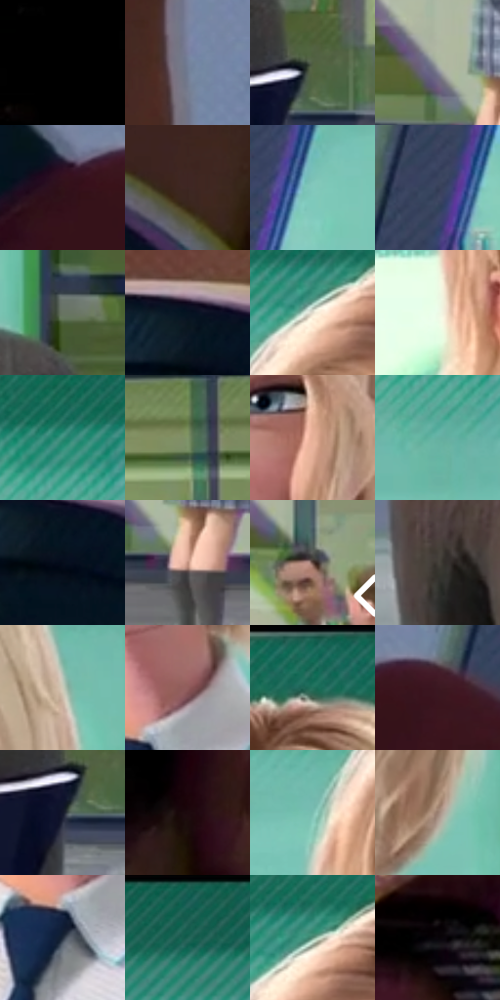

# 电影参考 064

- 状态：常规／活跃；来源世界：miles-home。
- 视角：near-level；景别：medium；场景：portrait。
- 时段：daylight-time-unspecified（外观依据，中置信度；具体时间／晨昏未知）；光照：neutral-day。
- 材质候选：skin, hair, fabric, glass, stone, paint（帧级，不是像素分割）。
- 明暗组：middle；L* P5/P50/P95：0.36964 / 43.0483 / 88.30006。
- 资格门禁：无附加门禁。
- 原截图 SHA-256：`592a22ff679c9cb59ba79e78fe8ab7cf1051ff5b3198fed8483d2813eaa7a212`；尺寸：2880 × 1214。
- sRGB 像素 SHA-256：`6334acab5844948af4bf495c3eaaa213baaccadd796e1a281c4156f246b23733`。

## 观察与迁移

天窗大堂人像，面部各有设计，背景留在次层。

本公开版保存32个128×128原像素色卡上下文；图集格子并非原场景相邻位置。原rect、图集tile和像素SHA见 `data/palette-crops.json`。上下文不足时不得批准替色，不能以小样推断完整构图。

## 实测色卡

颜色比例分母为保留采样像素，不是材料面积；全部 32 色参与全库匹配。表内四舍五入仅用于阅读，原精度在 JSON。

| ID | HEX | Lab | 原图 xy | 像素数 | 比例 | 明度角色 |
| --- | --- | --- | --- | ---: | ---: | --- |
| 064-S01 | #000000 | [0.0, 0.0, 0.0] | [32, 28] | 10393 | 5.336805% | deep-shadow |
| 064-S02 | #747F98 | [53.122162, 1.704912, -14.762975] | [836, 204] | 10390 | 5.335264% | midtone |
| 064-S03 | #505E41 | [38.007922, -11.277822, 14.902799] | [2116, 912] | 10247 | 5.261834% | shadow |
| 064-S04 | #AAB4A4 | [72.140701, -6.481808, 6.966305] | [2588, 908] | 9990 | 5.129864% | light |
| 064-S05 | #311319 | [10.476431, 15.993858, 2.934134] | [704, 804] | 9828 | 5.046677% | deep-shadow |
| 064-S06 | #3D2622 | [17.891556, 10.269703, 7.098571] | [496, 500] | 8505 | 4.367317% | deep-shadow |
| 064-S07 | #81C8BC | [75.825683, -24.952288, -1.052031] | [1068, 352] | 8328 | 4.276427% | light |
| 064-S08 | #353F58 | [26.780953, 3.027616, -16.277058] | [920, 664] | 8051 | 4.134188% | shadow |
| 064-S09 | #687462 | [47.385835, -8.164579, 8.448261] | [2060, 768] | 7999 | 4.107486% | midtone |
| 064-S10 | #061321 | [5.54809, -0.057998, -11.071329] | [248, 480] | 7973 | 4.094135% | deep-shadow |
| 064-S11 | #E1DCCC | [87.753564, -1.029461, 8.466296] | [1544, 152] | 6823 | 3.503610% | highlight |
| 064-S12 | #ECFAE7 | [96.809371, -7.953666, 7.535229] | [1444, 448] | 6535 | 3.355722% | highlight |
| 064-S13 | #3B8E7C | [53.738975, -29.721623, 2.066017] | [1216, 124] | 6216 | 3.191915% | midtone |
| 064-S14 | #7F946A | [58.725735, -15.362828, 19.817413] | [2388, 268] | 6101 | 3.132863% | midtone |
| 064-S15 | #E5AF97 | [75.795439, 16.467767, 19.931738] | [1808, 436] | 5812 | 2.984461% | light |
| 064-S16 | #65B0A2 | [66.842683, -26.738083, -0.118913] | [1216, 232] | 5580 | 2.865330% | light |
| 064-S17 | #040C1A | [3.28165, 0.926187, -9.023015] | [276, 536] | 5566 | 2.858141% | deep-shadow |
| 064-S18 | #BE8C7A | [62.600771, 16.58052, 17.076601] | [2644, 980] | 5533 | 2.841195% | light |
| 064-S19 | #5E453D | [31.74596, 9.480055, 9.021659] | [2792, 576] | 5459 | 2.803196% | shadow |
| 064-S20 | #433E39 | [26.545977, 1.115817, 3.847374] | [1356, 1008] | 5278 | 2.710253% | shadow |
| 064-S21 | #CACAB8 | [80.882381, -3.15466, 8.995042] | [1948, 276] | 5195 | 2.667632% | highlight |
| 064-S22 | #905D5C | [44.986292, 20.751156, 9.223362] | [1740, 704] | 4624 | 2.374424% | midtone |
| 064-S23 | #246F5B | [41.997592, -28.167832, 4.454687] | [1776, 64] | 4615 | 2.369802% | midtone |
| 064-S24 | #3B1721 | [13.547235, 19.015519, 1.633441] | [812, 792] | 4518 | 2.319993% | deep-shadow |
| 064-S25 | #15182A | [8.822101, 4.494974, -12.677176] | [2088, 960] | 4322 | 2.219347% | deep-shadow |
| 064-S26 | #1C0A0E | [4.477815, 8.01045, 0.913139] | [624, 228] | 4185 | 2.148997% | deep-shadow |
| 064-S27 | #7BBFB2 | [72.683896, -24.451434, -0.253988] | [1432, 272] | 3729 | 1.914841% | light |
| 064-S28 | #9B8072 | [55.70809, 8.141072, 11.489473] | [1952, 596] | 3535 | 1.815222% | midtone |
| 064-S29 | #202B3B | [17.228397, 0.311353, -11.712529] | [1696, 788] | 3514 | 1.804439% | deep-shadow |
| 064-S30 | #1E5E56 | [35.893005, -22.219274, -1.368092] | [2220, 28] | 3480 | 1.786980% | shadow |
| 064-S31 | #639481 | [57.47896, -20.837409, 4.825257] | [1564, 128] | 1484 | 0.762034% | midtone |
| 064-S32 | #09050A | [1.703037, 1.741129, -1.523399] | [240, 980] | 934 | 0.479609% | deep-shadow |

## 色阶与空间分布

- 采样 ROI：`[0.01, 0.02, 0.98, 0.94]`；步长：4；样本数：194742。
- 排除区：`[]`。
- 深暗、暗、中、亮、高光五段计数：`[58317, 34023, 43258, 41793, 17351]`。
- RGB 各 256 箱、L* 100 箱、13×5 色相明度表和 3×3 空间统计全部保存在 [总数据](../film-library.json)。
- [可视化档案](../../references/library.html)按需绘制直方图，不存 2,094 张重复图表图片。

## 纹理特征占比

**这是分块图像特征的面积占比，不是波点／排线／丝网／错版的精确语义覆盖率。** 窗格、发丝、织物也会产生方向或周期特征。
原图 ROI 像素 3120898；已测块覆盖 3120898（100.0000%）；未测 0。

| 特征 | 块覆盖像素 | 占已测面积 | 阈值敏感范围 |
| --- | ---: | ---: | --- |
| low-contrast | 276992 | 8.8754% | 8.4940% ~ 8.8754% |
| directional-structure | 1395458 | 44.7133% | 25.3466% ~ 61.6644% |
| periodic-structure | 1403776 | 44.9799% | 29.4602% ~ 62.3903% |
| mixed-detail | 44672 | 1.4314% | 0.3814% ~ 3.3877% |

阈值敏感范围不是统计置信区间。逐块坐标、尺度、对比、方向一致性、频谱集中度、频率与角度见 [全量特征记录](../texture-features.jsonl)，以帧号定位。
四种印刷层的真实像素覆盖仍标为 `null`，不能填 0，也不能拿上表代替。不得据这些代理测量删除唯一证据。

[测量方法与保留策略](../../references/library-retention.md) · [分类索引](../archive/README.md)
