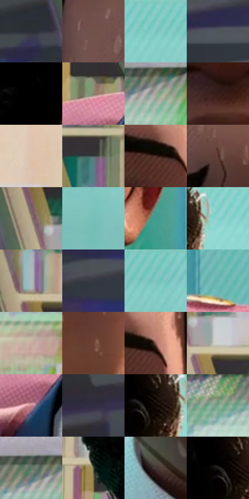

# 电影参考 065

- 状态：常规／活跃；来源世界：miles-home。
- 视角：near-level；景别：close-up；场景：portrait。
- 时段：daylight-time-unspecified（外观依据，中置信度；具体时间／晨昏未知）；光照：neutral-day。
- 材质候选：skin, hair, fabric, glass, stone, paint（帧级，不是像素分割）。
- 明暗组：middle；L* P5/P50/P95：2.85331 / 46.52636 / 80.70957。
- 资格门禁：无附加门禁。
- 原截图 SHA-256：`e18af020efd9d3cdde0a36fc6e35e4357bb359f479244391ab736351b02d16c2`；尺寸：2880 × 1194。
- sRGB 像素 SHA-256：`004de06248454c243ce7ee7df5e437008a69f6ca56a95f27f68ec9f079d75fc9`。

## 观察与迁移

天窗大堂人像，面部各有设计，背景留在次层。

本公开版保存32个128×128原像素色卡上下文；图集格子并非原场景相邻位置。原rect、图集tile和像素SHA见 `data/palette-crops.json`。上下文不足时不得批准替色，不能以小样推断完整构图。

## 实测色卡

颜色比例分母为保留采样像素，不是材料面积；全部 32 色参与全库匹配。表内四舍五入仅用于阅读，原精度在 JSON。

| ID | HEX | Lab | 原图 xy | 像素数 | 比例 | 明度角色 |
| --- | --- | --- | --- | ---: | ---: | --- |
| 065-S01 | #2C2E38 | [19.119004, 1.736139, -6.660119] | [236, 136] | 8852 | 4.611618% | deep-shadow |
| 065-S02 | #70534A | [38.068092, 10.695201, 9.976134] | [1164, 164] | 8765 | 4.566293% | shadow |
| 065-S03 | #85CCC6 | [77.428295, -23.526244, -4.070944] | [2452, 24] | 8667 | 4.515238% | light |
| 065-S04 | #505559 | [35.836854, -1.07859, -3.007287] | [276, 604] | 8360 | 4.355301% | shadow |
| 065-S05 | #010101 | [0.274173, -1.7e-05, 3.3e-05] | [1036, 24] | 7878 | 4.104194% | deep-shadow |
| 065-S06 | #83826C | [53.892551, -3.622784, 12.077809] | [1088, 932] | 7377 | 3.843188% | midtone |
| 065-S07 | #A4A697 | [67.575655, -3.466277, 7.524795] | [2624, 536] | 7283 | 3.794217% | light |
| 065-S08 | #381E19 | [14.622396, 12.01254, 8.853506] | [1420, 768] | 7196 | 3.748893% | deep-shadow |
| 065-S09 | #DDC3AE | [80.437628, 5.901686, 13.927383] | [904, 756] | 7176 | 3.738474% | highlight |
| 065-S10 | #394A4A | [30.063173, -6.668942, -2.207421] | [668, 724] | 6994 | 3.643657% | shadow |
| 065-S11 | #492B24 | [21.101556, 12.978743, 10.391464] | [1684, 336] | 6911 | 3.600417% | shadow |
| 065-S12 | #593731 | [26.95707, 14.37443, 10.069237] | [1404, 244] | 6849 | 3.568117% | shadow |
| 065-S13 | #9E8A79 | [58.814182, 4.74185, 11.88215] | [412, 252] | 6274 | 3.268560% | midtone |
| 065-S14 | #79C0BA | [73.093661, -23.626388, -4.023528] | [2780, 216] | 6260 | 3.261266% | light |
| 065-S15 | #429A90 | [58.3031, -28.772815, -2.692387] | [1872, 668] | 6136 | 3.196666% | midtone |
| 065-S16 | #8FD3CE | [80.113085, -22.406935, -4.352353] | [2024, 32] | 6088 | 3.171659% | highlight |
| 065-S17 | #ADBBBA | [74.805696, -5.012414, -1.149097] | [412, 128] | 6054 | 3.153946% | light |
| 065-S18 | #363841 | [23.652292, 1.383824, -5.858691] | [288, 440] | 5908 | 3.077885% | shadow |
| 065-S19 | #83C4BF | [74.86561, -21.711007, -4.074803] | [2748, 64] | 5908 | 3.077885% | light |
| 065-S20 | #67B6B0 | [69.091652, -25.758953, -4.539562] | [1980, 928] | 5741 | 2.990883% | light |
| 065-S21 | #C8AB9B | [72.076639, 8.021428, 12.144007] | [2532, 900] | 5593 | 2.913780% | light |
| 065-S22 | #6B4334 | [32.676023, 15.445904, 16.260587] | [1656, 744] | 5545 | 2.888773% | shadow |
| 065-S23 | #8C5F54 | [44.802734, 16.888646, 13.717297] | [1728, 324] | 5153 | 2.684553% | midtone |
| 065-S24 | #CCD2D1 | [83.722416, -2.224868, -0.213417] | [500, 320] | 5054 | 2.632977% | highlight |
| 065-S25 | #C5868B | [62.327244, 24.853933, 7.179799] | [1096, 1032] | 4796 | 2.498567% | light |
| 065-S26 | #332E45 | [20.390617, 8.149882, -13.552968] | [464, 940] | 4581 | 2.386559% | shadow |
| 065-S27 | #160C08 | [4.0746, 3.172779, 2.87619] | [1940, 76] | 4344 | 2.263089% | deep-shadow |
| 065-S28 | #77A78C | [64.525056, -21.858533, 8.864707] | [2440, 560] | 3934 | 2.049492% | light |
| 065-S29 | #587C68 | [48.870292, -17.264226, 6.868616] | [2572, 508] | 3740 | 1.948424% | midtone |
| 065-S30 | #54553D | [35.437268, -4.925486, 13.918427] | [940, 352] | 3508 | 1.827559% | shadow |
| 065-S31 | #4A3D3A | [27.014944, 5.087691, 3.960379] | [1252, 1052] | 3298 | 1.718156% | shadow |
| 065-S32 | #242122 | [13.097354, 1.649435, -0.16398] | [1900, 68] | 1727 | 0.899713% | deep-shadow |

## 色阶与空间分布

- 采样 ROI：`[0.01, 0.02, 0.98, 0.94]`；步长：4；样本数：191950。
- 排除区：`[]`。
- 深暗、暗、中、亮、高光五段计数：`[30597, 56106, 29074, 64491, 11682]`。
- RGB 各 256 箱、L* 100 箱、13×5 色相明度表和 3×3 空间统计全部保存在 [总数据](../film-library.json)。
- [可视化档案](../../references/library.html)按需绘制直方图，不存 2,094 张重复图表图片。

## 纹理特征占比

**这是分块图像特征的面积占比，不是波点／排线／丝网／错版的精确语义覆盖率。** 窗格、发丝、织物也会产生方向或周期特征。
原图 ROI 像素 3070606；已测块覆盖 3070606（100.0000%）；未测 0。

| 特征 | 块覆盖像素 | 占已测面积 | 阈值敏感范围 |
| --- | ---: | ---: | --- |
| low-contrast | 147456 | 4.8022% | 1.0672% ~ 10.3964% |
| directional-structure | 1033856 | 33.6694% | 14.8109% ~ 48.6096% |
| periodic-structure | 1790990 | 58.3269% | 50.3233% ~ 71.0577% |
| mixed-detail | 98304 | 3.2015% | 0.0000% ~ 3.7350% |

阈值敏感范围不是统计置信区间。逐块坐标、尺度、对比、方向一致性、频谱集中度、频率与角度见 [全量特征记录](../texture-features.jsonl)，以帧号定位。
四种印刷层的真实像素覆盖仍标为 `null`，不能填 0，也不能拿上表代替。不得据这些代理测量删除唯一证据。

[测量方法与保留策略](../../references/library-retention.md) · [分类索引](../archive/README.md)
