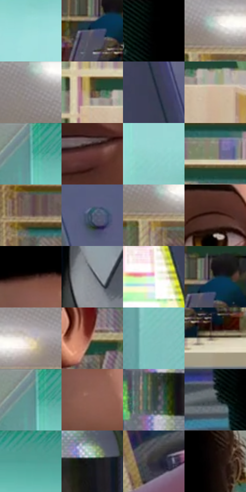

# 电影参考 066

- 状态：常规／活跃；来源世界：miles-home。
- 视角：near-level；景别：medium；场景：portrait。
- 时段：daylight-time-unspecified（外观依据，中置信度；具体时间／晨昏未知）；光照：neutral-day。
- 材质候选：skin, hair, fabric, glass, stone, paint（帧级，不是像素分割）。
- 明暗组：middle；L* P5/P50/P95：3.70354 / 52.30696 / 85.50643。
- 资格门禁：无附加门禁。
- 原截图 SHA-256：`f9b32e1002df1905589a06b52c733d66057db70389fd2cf02b6d403d461dd00e`；尺寸：2880 × 1200。
- sRGB 像素 SHA-256：`dc5f1c780829f66573f66cf855672d899734746e29b41eb9ee9b20c14b522ea0`。

## 观察与迁移

天窗大堂人像，面部各有设计，背景留在次层。

本公开版保存32个128×128原像素色卡上下文；图集格子并非原场景相邻位置。原rect、图集tile和像素SHA见 `data/palette-crops.json`。上下文不足时不得批准替色，不能以小样推断完整构图。

## 实测色卡

颜色比例分母为保留采样像素，不是材料面积；全部 32 色参与全库匹配。表内四舍五入仅用于阅读，原精度在 JSON。

| ID | HEX | Lab | 原图 xy | 像素数 | 比例 | 明度角色 |
| --- | --- | --- | --- | ---: | ---: | --- |
| 066-S01 | #A0DEDC | [84.422274, -19.939575, -5.347047] | [2356, 248] | 8745 | 4.539367% | highlight |
| 066-S02 | #626676 | [43.370486, 2.086469, -9.466894] | [336, 924] | 8533 | 4.429322% | midtone |
| 066-S03 | #010101 | [0.274173, -1.7e-05, 3.3e-05] | [868, 24] | 7740 | 4.017690% | deep-shadow |
| 066-S04 | #B2AEAC | [71.361671, 1.050584, 1.53064] | [300, 128] | 7706 | 4.000042% | light |
| 066-S05 | #989694 | [62.190894, 0.34671, 1.312715] | [156, 40] | 7525 | 3.906088% | light |
| 066-S06 | #674E3D | [35.340567, 7.947229, 14.120957] | [536, 576] | 7128 | 3.700012% | shadow |
| 066-S07 | #3E3F54 | [27.350099, 4.931396, -12.732878] | [2676, 456] | 7073 | 3.671463% | shadow |
| 066-S08 | #D0B69C | [75.617548, 5.307378, 16.675193] | [616, 620] | 7062 | 3.665753% | light |
| 066-S09 | #66AEA8 | [66.46034, -24.011042, -4.002438] | [1816, 52] | 7050 | 3.659524% | light |
| 066-S10 | #673A39 | [29.925735, 19.746273, 9.251997] | [1260, 728] | 6995 | 3.630975% | shadow |
| 066-S11 | #92D3D0 | [80.320603, -21.11292, -5.098628] | [1888, 468] | 6861 | 3.561418% | highlight |
| 066-S12 | #848369 | [54.194611, -4.270912, 14.236717] | [392, 420] | 6829 | 3.544807% | midtone |
| 066-S13 | #765E51 | [41.925081, 7.668587, 11.155417] | [44, 236] | 6776 | 3.517296% | midtone |
| 066-S14 | #4E5970 | [37.723624, 1.590799, -14.503805] | [2712, 188] | 6721 | 3.488746% | shadow |
| 066-S15 | #9B8773 | [57.593152, 4.321893, 13.552039] | [276, 164] | 6676 | 3.465388% | midtone |
| 066-S16 | #4E3027 | [23.272208, 12.474835, 11.421153] | [1324, 368] | 6559 | 3.404655% | shadow |
| 066-S17 | #38221C | [15.844385, 9.683943, 8.380336] | [1208, 124] | 6306 | 3.273328% | deep-shadow |
| 066-S18 | #858990 | [56.969339, -0.03215, -4.240748] | [1108, 1080] | 6263 | 3.251007% | midtone |
| 066-S19 | #EEEEE6 | [93.90017, -1.397967, 3.870082] | [2576, 636] | 6237 | 3.237511% | highlight |
| 066-S20 | #192C35 | [16.82036, -4.731023, -8.204917] | [364, 888] | 6132 | 3.183007% | deep-shadow |
| 066-S21 | #D9CDBC | [82.937942, 1.319977, 9.957761] | [396, 100] | 5476 | 2.842490% | highlight |
| 066-S22 | #C59A80 | [66.932017, 12.416422, 19.799246] | [1556, 544] | 5437 | 2.822246% | light |
| 066-S23 | #80BDBA | [72.579698, -20.183123, -4.742272] | [1848, 696] | 4995 | 2.592812% | light |
| 066-S24 | #A99D84 | [65.133387, 0.224651, 14.683871] | [432, 1004] | 4957 | 2.573087% | light |
| 066-S25 | #648F90 | [56.453191, -14.358817, -5.253857] | [1804, 44] | 4811 | 2.497301% | midtone |
| 066-S26 | #936156 | [46.211723, 18.912034, 14.591125] | [1236, 216] | 4544 | 2.358706% | midtone |
| 066-S27 | #304042 | [25.827776, -5.863959, -3.329928] | [2620, 1104] | 4131 | 2.144325% | shadow |
| 066-S28 | #495255 | [34.204296, -2.856578, -2.968471] | [816, 324] | 4069 | 2.112142% | shadow |
| 066-S29 | #49978A | [57.446809, -27.340585, -0.501697] | [2120, 32] | 3850 | 1.998464% | midtone |
| 066-S30 | #141619 | [7.160539, -0.108077, -2.405837] | [2756, 1056] | 3735 | 1.938769% | deep-shadow |
| 066-S31 | #353338 | [21.616518, 2.049926, -2.833573] | [896, 956] | 3317 | 1.721793% | shadow |
| 066-S32 | #130805 | [2.918556, 3.101133, 2.375234] | [1536, 152] | 2409 | 1.250467% | deep-shadow |

## 色阶与空间分布

- 采样 ROI：`[0.01, 0.02, 0.98, 0.94]`；步长：4；样本数：192648。
- 排除区：`[]`。
- 深暗、暗、中、亮、高光五段计数：`[25997, 47936, 43500, 50403, 24812]`。
- RGB 各 256 箱、L* 100 箱、13×5 色相明度表和 3×3 空间统计全部保存在 [总数据](../film-library.json)。
- [可视化档案](../../references/library.html)按需绘制直方图，不存 2,094 张重复图表图片。

## 纹理特征占比

**这是分块图像特征的面积占比，不是波点／排线／丝网／错版的精确语义覆盖率。** 窗格、发丝、织物也会产生方向或周期特征。
原图 ROI 像素 3084576；已测块覆盖 3084576（100.0000%）；未测 0。

| 特征 | 块覆盖像素 | 占已测面积 | 阈值敏感范围 |
| --- | ---: | ---: | --- |
| low-contrast | 40192 | 1.3030% | 0.0000% ~ 2.8052% |
| directional-structure | 849664 | 27.5456% | 15.6858% ~ 42.7915% |
| periodic-structure | 2129184 | 69.0268% | 56.6774% ~ 75.5335% |
| mixed-detail | 65536 | 2.1246% | 0.5312% ~ 5.9755% |

阈值敏感范围不是统计置信区间。逐块坐标、尺度、对比、方向一致性、频谱集中度、频率与角度见 [全量特征记录](../texture-features.jsonl)，以帧号定位。
四种印刷层的真实像素覆盖仍标为 `null`，不能填 0，也不能拿上表代替。不得据这些代理测量删除唯一证据。

[测量方法与保留策略](../../references/library-retention.md) · [分类索引](../archive/README.md)
