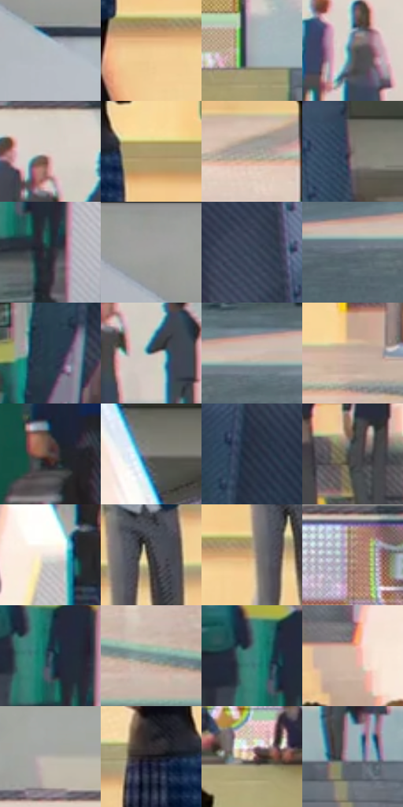

# 电影参考 067

- 状态：常规／活跃；来源世界：miles-home。
- 视角：near-level；景别：environment-wide；场景：portrait。
- 时段：daylight-time-unspecified（外观依据，中置信度；具体时间／晨昏未知）；光照：neutral-day。
- 材质候选：skin, hair, fabric, glass, stone, paint（帧级，不是像素分割）。
- 明暗组：light；L* P5/P50/P95：18.46607 / 60.21627 / 85.81107。
- 资格门禁：无附加门禁。
- 原截图 SHA-256：`99af6b833bdfedc00d8bf83fe80801b1e7c1db39fb90321d165d7801595899d8`；尺寸：2880 × 1200。
- sRGB 像素 SHA-256：`2bf31fcdcff8e576dbab5e0b74c10f4d00ac78b53eff6976c4079e681a9cd592`。

## 观察与迁移

天窗大堂人像，面部各有设计，背景留在次层。

本公开版保存32个128×128原像素色卡上下文；图集格子并非原场景相邻位置。原rect、图集tile和像素SHA见 `data/palette-crops.json`。上下文不足时不得批准替色，不能以小样推断完整构图。

## 实测色卡

颜色比例分母为保留采样像素，不是材料面积；全部 32 色参与全库匹配。表内四舍五入仅用于阅读，原精度在 JSON。

| ID | HEX | Lab | 原图 xy | 像素数 | 比例 | 明度角色 |
| --- | --- | --- | --- | ---: | ---: | --- |
| 067-S01 | #B5BCC2 | [75.875407, -1.26127, -3.859973] | [632, 172] | 12870 | 6.680578% | light |
| 067-S02 | #F1CC94 | [83.980103, 5.497258, 32.766856] | [1668, 880] | 9172 | 4.761015% | highlight |
| 067-S03 | #A6ADB1 | [70.293556, -1.674232, -2.897775] | [1720, 404] | 8905 | 4.622420% | light |
| 067-S04 | #5C5C5D | [39.104664, 0.210555, -0.571081] | [924, 280] | 8606 | 4.467215% | shadow |
| 067-S05 | #D8CDC6 | [83.093621, 2.602161, 4.844987] | [1900, 212] | 8350 | 4.334330% | highlight |
| 067-S06 | #AC9B6F | [64.453093, -0.385333, 25.385169] | [1656, 744] | 8261 | 4.288132% | light |
| 067-S07 | #A9A29B | [67.008018, 1.262858, 4.539791] | [1484, 1004] | 7685 | 3.989141% | light |
| 067-S08 | #716A64 | [45.274735, 1.592203, 4.349581] | [344, 496] | 7630 | 3.960591% | midtone |
| 067-S09 | #272A33 | [17.113783, 1.089133, -6.26113] | [548, 868] | 7506 | 3.896225% | deep-shadow |
| 067-S10 | #9B9B98 | [63.89957, -0.572595, 1.572269] | [568, 28] | 7340 | 3.810058% | light |
| 067-S11 | #384559 | [28.948568, 0.369148, -13.567647] | [208, 236] | 7319 | 3.799157% | shadow |
| 067-S12 | #5E6A75 | [44.192423, -1.967319, -7.663024] | [360, 1028] | 7312 | 3.795523% | midtone |
| 067-S13 | #2A414D | [26.181713, -5.271138, -10.07536] | [2512, 704] | 7007 | 3.637204% | shadow |
| 067-S14 | #6E7983 | [50.249199, -1.851754, -6.83703] | [1944, 296] | 6741 | 3.499128% | midtone |
| 067-S15 | #CEBDB3 | [77.740563, 4.324629, 7.225083] | [472, 996] | 6237 | 3.237511% | light |
| 067-S16 | #C6AEA0 | [72.77134, 6.395865, 10.365037] | [1888, 968] | 6155 | 3.194946% | light |
| 067-S17 | #554A46 | [32.416565, 3.847835, 4.08182] | [2816, 796] | 6000 | 3.114489% | shadow |
| 067-S18 | #847D78 | [52.871775, 1.713322, 3.673989] | [2212, 516] | 5428 | 2.817574% | midtone |
| 067-S19 | #283141 | [20.160699, 0.860368, -11.271019] | [2588, 512] | 5352 | 2.778124% | shadow |
| 067-S20 | #454749 | [30.041231, -0.370648, -1.483811] | [2124, 860] | 5287 | 2.744384% | shadow |
| 067-S21 | #EDE4DD | [91.10403, 1.850251, 4.499336] | [2260, 732] | 5118 | 2.656659% | highlight |
| 067-S22 | #3A383E | [23.920078, 2.258657, -3.410261] | [1232, 824] | 4619 | 2.397637% | shadow |
| 067-S23 | #C9A67D | [70.296678, 7.126798, 26.055984] | [1176, 860] | 4609 | 2.392446% | light |
| 067-S24 | #A18070 | [56.273967, 10.28751, 13.521967] | [1332, 208] | 4207 | 2.183776% | midtone |
| 067-S25 | #3F5465 | [34.674265, -3.315799, -12.405634] | [512, 788] | 3781 | 1.962647% | shadow |
| 067-S26 | #7E9497 | [59.752193, -7.109381, -4.195055] | [2440, 1088] | 3702 | 1.921639% | midtone |
| 067-S27 | #3C827C | [49.953754, -23.519971, -3.468747] | [484, 772] | 3464 | 1.798098% | midtone |
| 067-S28 | #D4B8A5 | [76.676726, 7.052138, 13.349679] | [2084, 576] | 3421 | 1.775778% | light |
| 067-S29 | #B7B2AA | [72.767062, 0.334629, 4.715298] | [964, 100] | 3367 | 1.747747% | light |
| 067-S30 | #18171B | [8.004206, 1.55868, -2.636921] | [1548, 748] | 2907 | 1.508970% | deep-shadow |
| 067-S31 | #EBD1B8 | [85.365211, 5.200866, 15.726077] | [1276, 416] | 2759 | 1.432146% | highlight |
| 067-S32 | #92ADB1 | [68.875287, -8.380838, -5.149591] | [1860, 420] | 1531 | 0.794714% | light |

## 色阶与空间分布

- 采样 ROI：`[0.01, 0.02, 0.98, 0.94]`；步长：4；样本数：192648。
- 排除区：`[]`。
- 深暗、暗、中、亮、高光五段计数：`[12726, 43031, 40274, 71662, 24955]`。
- RGB 各 256 箱、L* 100 箱、13×5 色相明度表和 3×3 空间统计全部保存在 [总数据](../film-library.json)。
- [可视化档案](../../references/library.html)按需绘制直方图，不存 2,094 张重复图表图片。

## 纹理特征占比

**这是分块图像特征的面积占比，不是波点／排线／丝网／错版的精确语义覆盖率。** 窗格、发丝、织物也会产生方向或周期特征。
原图 ROI 像素 3084576；已测块覆盖 3084576（100.0000%）；未测 0。

| 特征 | 块覆盖像素 | 占已测面积 | 阈值敏感范围 |
| --- | ---: | ---: | --- |
| low-contrast | 0 | 0.0000% | 0.0000% ~ 0.0000% |
| directional-structure | 964608 | 31.2720% | 21.6447% ~ 44.8580% |
| periodic-structure | 2093344 | 67.8649% | 54.6108% ~ 76.4962% |
| mixed-detail | 26624 | 0.8631% | 0.5312% ~ 1.8591% |

阈值敏感范围不是统计置信区间。逐块坐标、尺度、对比、方向一致性、频谱集中度、频率与角度见 [全量特征记录](../texture-features.jsonl)，以帧号定位。
四种印刷层的真实像素覆盖仍标为 `null`，不能填 0，也不能拿上表代替。不得据这些代理测量删除唯一证据。

[测量方法与保留策略](../../references/library-retention.md) · [分类索引](../archive/README.md)
