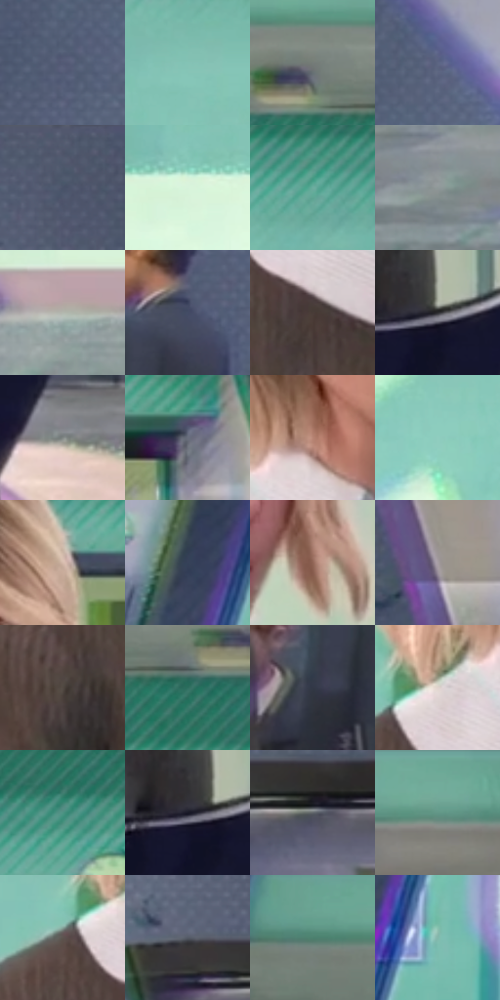

# 电影参考 068

- 状态：常规／活跃；来源世界：miles-home。
- 视角：near-level；景别：medium；场景：portrait。
- 时段：daylight-time-unspecified（外观依据，中置信度；具体时间／晨昏未知）；光照：neutral-day。
- 材质候选：skin, hair, fabric, glass, stone, paint（帧级，不是像素分割）。
- 明暗组：middle；L* P5/P50/P95：20.93809 / 49.24531 / 85.42958。
- 资格门禁：无附加门禁。
- 原截图 SHA-256：`4bd7b1ba6c37d804e91dfae224712b052ba6af98ddbbe963dde4ab2254432f8c`；尺寸：2880 × 1206。
- sRGB 像素 SHA-256：`aded698539e12e39cf8d312cd0f473669fdd7e0916cb6967e738d3311118c727`。

## 观察与迁移

天窗大堂人像，面部各有设计，背景留在次层。

本公开版保存32个128×128原像素色卡上下文；图集格子并非原场景相邻位置。原rect、图集tile和像素SHA见 `data/palette-crops.json`。上下文不足时不得批准替色，不能以小样推断完整构图。

## 实测色卡

颜色比例分母为保留采样像素，不是材料面积；全部 32 色参与全库匹配。表内四舍五入仅用于阅读，原精度在 JSON。

| ID | HEX | Lab | 原图 xy | 像素数 | 比例 | 明度角色 |
| --- | --- | --- | --- | ---: | ---: | --- |
| 068-S01 | #525A75 | [38.533755, 3.67185, -16.318925] | [240, 376] | 10825 | 5.598771% | shadow |
| 068-S02 | #84C3B5 | [74.362121, -23.203313, 0.618332] | [792, 392] | 9664 | 4.998293% | light |
| 068-S03 | #757C78 | [51.328186, -3.432395, 1.279906] | [1076, 112] | 8954 | 4.631076% | midtone |
| 068-S04 | #5C6583 | [43.094221, 3.968483, -17.782955] | [340, 272] | 8634 | 4.465569% | midtone |
| 068-S05 | #4B566A | [36.350833, 0.802819, -12.897338] | [2472, 48] | 8003 | 4.139212% | shadow |
| 068-S06 | #D8F3DB | [93.369517, -13.20874, 8.608497] | [700, 496] | 7849 | 4.059562% | highlight |
| 068-S07 | #6CAD9F | [66.195299, -24.058466, 0.63884] | [1184, 288] | 7579 | 3.919916% | light |
| 068-S08 | #8F9898 | [62.136842, -3.227783, -1.113389] | [660, 1084] | 7528 | 3.893538% | light |
| 068-S09 | #B3B8AF | [74.164039, -3.417011, 3.962552] | [936, 1000] | 7464 | 3.860437% | light |
| 068-S10 | #444B65 | [32.258857, 4.018309, -16.069659] | [184, 700] | 6881 | 3.558905% | shadow |
| 068-S11 | #483B37 | [26.103405, 4.938186, 4.60624] | [1408, 832] | 6435 | 3.328230% | shadow |
| 068-S12 | #2F2E32 | [19.176608, 1.40503, -2.401349] | [1888, 912] | 6432 | 3.326679% | deep-shadow |
| 068-S13 | #808685 | [55.413387, -2.412429, -0.227634] | [1976, 1036] | 6333 | 3.275475% | midtone |
| 068-S14 | #696E7D | [46.492638, 1.448609, -8.931563] | [2248, 340] | 6323 | 3.270303% | midtone |
| 068-S15 | #B88574 | [60.094419, 17.315953, 16.908743] | [1472, 652] | 6180 | 3.196342% | light |
| 068-S16 | #90CDBF | [78.082039, -22.484859, 0.718353] | [968, 568] | 5937 | 3.070661% | light |
| 068-S17 | #D6BAAC | [77.515864, 7.774175, 10.779956] | [1784, 328] | 5740 | 2.968771% | light |
| 068-S18 | #364158 | [27.488323, 2.026583, -15.178393] | [520, 332] | 5725 | 2.961013% | shadow |
| 068-S19 | #906556 | [46.855807, 15.324255, 15.413262] | [1748, 592] | 5602 | 2.897396% | midtone |
| 068-S20 | #A89EA4 | [66.104587, 4.737934, -1.809373] | [2788, 88] | 5356 | 2.770163% | light |
| 068-S21 | #524943 | [31.725571, 2.616766, 4.968039] | [1284, 896] | 5241 | 2.710684% | shadow |
| 068-S22 | #2D6E5F | [42.054361, -24.703323, 2.161986] | [1168, 176] | 5229 | 2.704478% | midtone |
| 068-S23 | #323846 | [23.500554, 1.226861, -9.4664] | [108, 828] | 5109 | 2.642413% | shadow |
| 068-S24 | #E1D4CD | [85.757383, 3.285316, 5.066413] | [1368, 712] | 5053 | 2.613449% | highlight |
| 068-S25 | #4D9384 | [56.197566, -25.89913, 1.124041] | [884, 252] | 4175 | 2.159341% | midtone |
| 068-S26 | #191827 | [9.044594, 4.928128, -10.073635] | [1860, 916] | 4174 | 2.158824% | deep-shadow |
| 068-S27 | #5F646A | [42.13533, -0.60877, -4.050913] | [2716, 664] | 3849 | 1.990732% | midtone |
| 068-S28 | #679D8D | [60.710414, -21.545755, 2.71186] | [1948, 60] | 3677 | 1.901772% | light |
| 068-S29 | #5D544F | [36.428131, 2.717529, 4.257892] | [1308, 748] | 3656 | 1.890911% | shadow |
| 068-S30 | #535965 | [37.704155, 0.459013, -7.683852] | [2600, 608] | 3549 | 1.835569% | shadow |
| 068-S31 | #4C806F | [49.643381, -21.634084, 3.784515] | [756, 68] | 3313 | 1.713508% | midtone |
| 068-S32 | #84B7AB | [70.671391, -19.355174, 0.69322] | [520, 656] | 2877 | 1.488006% | light |

## 色阶与空间分布

- 采样 ROI：`[0.01, 0.02, 0.98, 0.94]`；步长：4；样本数：193346。
- 排除区：`[]`。
- 深暗、暗、中、亮、高光五段计数：`[8434, 56295, 59191, 54227, 15199]`。
- RGB 各 256 箱、L* 100 箱、13×5 色相明度表和 3×3 空间统计全部保存在 [总数据](../film-library.json)。
- [可视化档案](../../references/library.html)按需绘制直方图，不存 2,094 张重复图表图片。

## 纹理特征占比

**这是分块图像特征的面积占比，不是波点／排线／丝网／错版的精确语义覆盖率。** 窗格、发丝、织物也会产生方向或周期特征。
原图 ROI 像素 3098546；已测块覆盖 3098546（100.0000%）；未测 0。

| 特征 | 块覆盖像素 | 占已测面积 | 阈值敏感范围 |
| --- | ---: | ---: | --- |
| low-contrast | 98304 | 3.1726% | 1.0575% ~ 3.1726% |
| directional-structure | 941440 | 30.3833% | 16.2925% ~ 54.5123% |
| periodic-structure | 2042418 | 65.9154% | 44.4302% ~ 76.6600% |
| mixed-detail | 16384 | 0.5288% | 0.0000% ~ 3.8748% |

阈值敏感范围不是统计置信区间。逐块坐标、尺度、对比、方向一致性、频谱集中度、频率与角度见 [全量特征记录](../texture-features.jsonl)，以帧号定位。
四种印刷层的真实像素覆盖仍标为 `null`，不能填 0，也不能拿上表代替。不得据这些代理测量删除唯一证据。

[测量方法与保留策略](../../references/library-retention.md) · [分类索引](../archive/README.md)
