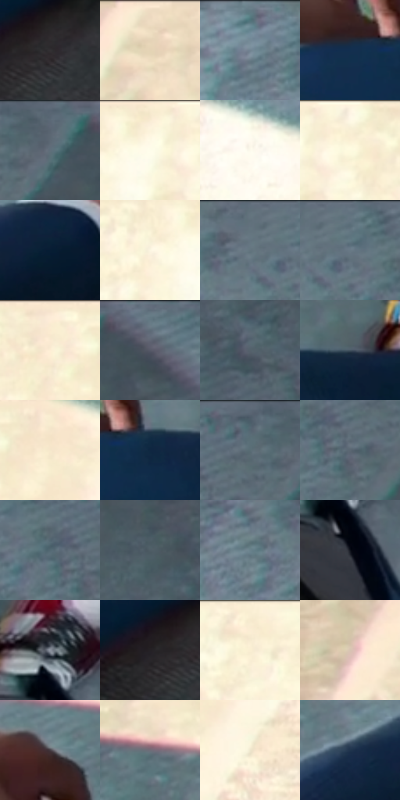

# 电影参考 069

- 状态：常规／活跃；来源世界：miles-home。
- 视角：overhead；景别：detail；场景：detail。
- 时段：daylight-time-unspecified（外观依据，中置信度；具体时间／晨昏未知）；光照：neutral-day。
- 材质候选：skin, fabric, stone（帧级，不是像素分割）。
- 明暗组：middle；L* P5/P50/P95：10.5781 / 47.96392 / 97.16317。
- 资格门禁：无附加门禁。
- 原截图 SHA-256：`f1a38bb5f2b81bc94c2ff5914476ae82df2c3096dca07219e16b2c28ece81527`；尺寸：2880 × 1208。
- sRGB 像素 SHA-256：`18577ef3ea6c196e62cda70a6e9813a580fed2de43938da2bbfee665629cc1cc`。

## 观察与迁移

俯视地面与鞋、手，硬边日光块和细表面纹理分开。

本公开版保存32个128×128原像素色卡上下文；图集格子并非原场景相邻位置。原rect、图集tile和像素SHA见 `data/palette-crops.json`。上下文不足时不得批准替色，不能以小样推断完整构图。

## 实测色卡

颜色比例分母为保留采样像素，不是材料面积；全部 32 色参与全库匹配。表内四舍五入仅用于阅读，原精度在 JSON。

| ID | HEX | Lab | 原图 xy | 像素数 | 比例 | 明度角色 |
| --- | --- | --- | --- | ---: | ---: | --- |
| 069-S01 | #343033 | [20.373316, 2.462029, -1.266545] | [1108, 888] | 9748 | 5.041739% | shadow |
| 069-S02 | #EFDCC3 | [88.675584, 2.568741, 14.65512] | [224, 28] | 9669 | 5.000879% | highlight |
| 069-S03 | #728491 | [54.157968, -3.53138, -9.152595] | [2152, 64] | 9096 | 4.704519% | midtone |
| 069-S04 | #122F4F | [18.910615, 1.643234, -22.801667] | [900, 692] | 8063 | 4.170244% | deep-shadow |
| 069-S05 | #5F6F7A | [45.915727, -3.352786, -8.080692] | [2676, 64] | 8015 | 4.145418% | midtone |
| 069-S06 | #FCF3DB | [95.960351, -0.903917, 12.657151] | [864, 40] | 7725 | 3.995428% | highlight |
| 069-S07 | #FEFAED | [98.255973, -0.873787, 6.702221] | [1896, 144] | 7613 | 3.937501% | highlight |
| 069-S08 | #F8EFD5 | [94.523467, -1.209076, 13.669341] | [940, 36] | 7587 | 3.924053% | highlight |
| 069-S09 | #071D34 | [10.346888, 1.106922, -17.638329] | [584, 628] | 7558 | 3.909054% | deep-shadow |
| 069-S10 | #FDF6E2 | [96.937131, -0.975777, 10.455604] | [788, 76] | 7413 | 3.834059% | highlight |
| 069-S11 | #657681 | [48.645878, -3.687177, -8.118651] | [2384, 44] | 7119 | 3.682000% | midtone |
| 069-S12 | #5F757F | [47.863497, -5.613847, -8.14679] | [2440, 44] | 7052 | 3.647347% | midtone |
| 069-S13 | #F8E8CE | [92.631076, 1.291168, 14.613766] | [1472, 48] | 6934 | 3.586317% | highlight |
| 069-S14 | #677B86 | [50.417195, -4.689394, -8.405247] | [2784, 28] | 6797 | 3.515459% | midtone |
| 069-S15 | #55616B | [40.478629, -2.21178, -7.211961] | [2804, 336] | 6576 | 3.401156% | midtone |
| 069-S16 | #455461 | [34.940385, -2.461819, -9.454163] | [1144, 680] | 6541 | 3.383054% | shadow |
| 069-S17 | #F5E7CB | [92.07717, 0.279737, 15.354095] | [1588, 68] | 6280 | 3.248063% | highlight |
| 069-S18 | #0F2641 | [14.785459, 1.651913, -19.776815] | [988, 700] | 6256 | 3.235650% | deep-shadow |
| 069-S19 | #596E77 | [45.091337, -5.548852, -7.559948] | [2596, 48] | 5998 | 3.102211% | midtone |
| 069-S20 | #5B6772 | [42.97228, -1.966164, -7.698569] | [2552, 132] | 5793 | 2.996183% | midtone |
| 069-S21 | #546973 | [43.100783, -5.305482, -8.163906] | [2504, 104] | 5747 | 2.972391% | midtone |
| 069-S22 | #4E5D66 | [38.563906, -3.525884, -7.055523] | [2760, 212] | 5246 | 2.713271% | shadow |
| 069-S23 | #69818B | [52.472504, -6.240658, -8.247255] | [2284, 116] | 4680 | 2.420531% | midtone |
| 069-S24 | #0D111A | [5.067636, 0.802104, -6.329865] | [1676, 984] | 4444 | 2.298470% | deep-shadow |
| 069-S25 | #8B929E | [60.351169, -0.026608, -7.185687] | [1660, 880] | 4225 | 2.185202% | light |
| 069-S26 | #242125 | [13.207983, 2.387482, -2.175693] | [1052, 892] | 4151 | 2.146928% | deep-shadow |
| 069-S27 | #FCECD4 | [94.072964, 1.577998, 13.591585] | [1188, 40] | 3988 | 2.062623% | highlight |
| 069-S28 | #D7C3B3 | [80.029299, 4.435024, 10.598317] | [64, 152] | 3679 | 1.902806% | highlight |
| 069-S29 | #443D43 | [26.654066, 4.308489, -2.572095] | [916, 552] | 3067 | 1.586275% | shadow |
| 069-S30 | #706D79 | [46.661269, 3.671288, -6.226874] | [264, 424] | 2350 | 1.215438% | midtone |
| 069-S31 | #EEE5CD | [91.06416, -0.893851, 12.802653] | [1528, 384] | 2067 | 1.069068% | highlight |
| 069-S32 | #20344D | [21.202197, 0.465968, -17.803174] | [432, 624] | 1869 | 0.966661% | shadow |

## 色阶与空间分布

- 采样 ROI：`[0.01, 0.02, 0.98, 0.94]`；步长：4；样本数：193346。
- 排除区：`[]`。
- 深暗、暗、中、亮、高光五段计数：`[33200, 25683, 69949, 2997, 61517]`。
- RGB 各 256 箱、L* 100 箱、13×5 色相明度表和 3×3 空间统计全部保存在 [总数据](../film-library.json)。
- [可视化档案](../../references/library.html)按需绘制直方图，不存 2,094 张重复图表图片。

## 纹理特征占比

**这是分块图像特征的面积占比，不是波点／排线／丝网／错版的精确语义覆盖率。** 窗格、发丝、织物也会产生方向或周期特征。
原图 ROI 像素 3104134；已测块覆盖 3104134（100.0000%）；未测 0。

| 特征 | 块覆盖像素 | 占已测面积 | 阈值敏感范围 |
| --- | ---: | ---: | --- |
| low-contrast | 121216 | 3.9050% | 1.6041% ~ 8.3172% |
| directional-structure | 638976 | 20.5847% | 12.1397% ~ 36.7450% |
| periodic-structure | 2179462 | 70.2116% | 61.1231% ~ 70.7188% |
| mixed-detail | 164480 | 5.2987% | 0.5278% ~ 8.8244% |

阈值敏感范围不是统计置信区间。逐块坐标、尺度、对比、方向一致性、频谱集中度、频率与角度见 [全量特征记录](../texture-features.jsonl)，以帧号定位。
四种印刷层的真实像素覆盖仍标为 `null`，不能填 0，也不能拿上表代替。不得据这些代理测量删除唯一证据。

[测量方法与保留策略](../../references/library-retention.md) · [分类索引](../archive/README.md)
