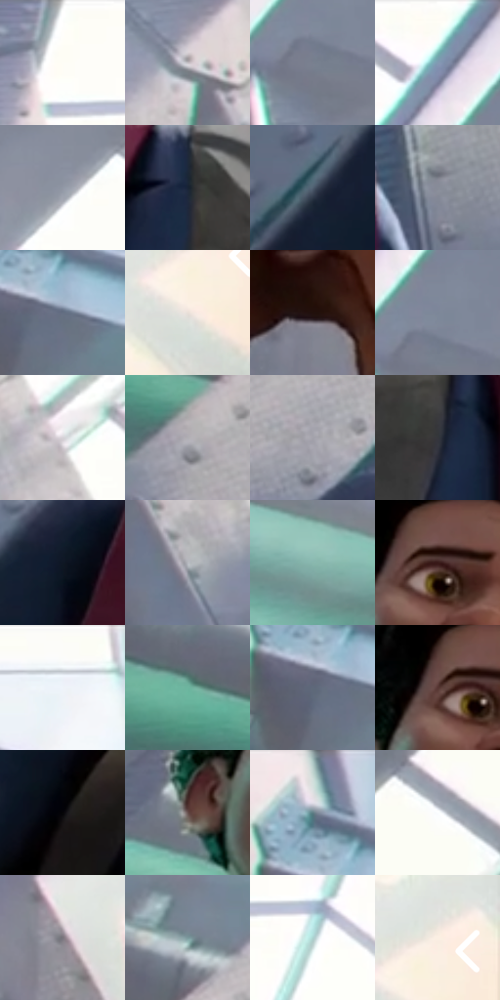

# 电影参考 070

- 状态：常规／活跃；来源世界：miles-home。
- 视角：low-angle；景别：medium；场景：portrait。
- 时段：daylight-time-unspecified（外观依据，中置信度；具体时间／晨昏未知）；光照：neutral-day。
- 材质候选：skin, hair, fabric, glass, stone, paint（帧级，不是像素分割）。
- 明暗组：middle；L* P5/P50/P95：6.41889 / 59.76575 / 99.60533。
- 资格门禁：无附加门禁。
- 原截图 SHA-256：`e03da976a29565392697a7ab0860cfb66adeb0e197412db99d720e15f2e305e5`；尺寸：2880 × 1206。
- sRGB 像素 SHA-256：`1015e21a3af5f14af5245bc66541d6b527aac5d5672a8443c5dd7f336a880c4a`。

## 观察与迁移

天窗大堂人像，面部各有设计，背景留在次层。

本公开版保存32个128×128原像素色卡上下文；图集格子并非原场景相邻位置。原rect、图集tile和像素SHA见 `data/palette-crops.json`。上下文不足时不得批准替色，不能以小样推断完整构图。

## 实测色卡

颜色比例分母为保留采样像素，不是材料面积；全部 32 色参与全库匹配。表内四舍五入仅用于阅读，原精度在 JSON。

| ID | HEX | Lab | 原图 xy | 像素数 | 比例 | 明度角色 |
| --- | --- | --- | --- | ---: | ---: | --- |
| 070-S01 | #FEFEFC | [99.605335, -0.351304, 0.958013] | [1320, 28] | 11981 | 6.196663% | highlight |
| 070-S02 | #C6C1C6 | [78.591607, 2.651215, -1.883131] | [2200, 416] | 8620 | 4.458329% | light |
| 070-S03 | #79808F | [53.477451, 0.677052, -8.954571] | [2128, 212] | 8430 | 4.360059% | midtone |
| 070-S04 | #FDFCF6 | [98.890318, -0.709165, 2.987722] | [2084, 28] | 8321 | 4.303684% | highlight |
| 070-S05 | #9197A5 | [62.397042, 0.739135, -8.05986] | [2364, 220] | 8318 | 4.302132% | light |
| 070-S06 | #182234 | [13.14511, 1.666316, -13.167574] | [828, 672] | 8111 | 4.195070% | deep-shadow |
| 070-S07 | #506071 | [40.020045, -1.776216, -11.613784] | [344, 860] | 7721 | 3.993359% | midtone |
| 070-S08 | #888C98 | [58.280317, 1.025909, -6.864984] | [1264, 804] | 7595 | 3.928191% | midtone |
| 070-S09 | #636E82 | [46.198495, 0.591367, -12.407713] | [204, 152] | 7455 | 3.855782% | midtone |
| 070-S10 | #E9DFD9 | [89.444227, 2.374123, 4.152617] | [2792, 660] | 7304 | 3.777684% | highlight |
| 070-S11 | #21100C | [6.508538, 7.927242, 4.920731] | [2004, 1032] | 6640 | 3.434258% | deep-shadow |
| 070-S12 | #7C8798 | [55.966964, -0.250546, -10.415828] | [2140, 168] | 6513 | 3.368572% | midtone |
| 070-S13 | #D3D1D6 | [84.124236, 1.592755, -2.222652] | [2356, 472] | 6433 | 3.327196% | highlight |
| 070-S14 | #B0AEB4 | [71.417295, 1.840493, -2.809393] | [412, 464] | 6422 | 3.321507% | light |
| 070-S15 | #A3A2AA | [66.922443, 1.905723, -4.005311] | [552, 552] | 6053 | 3.130657% | light |
| 070-S16 | #34363B | [22.598414, 0.361552, -3.418762] | [1044, 800] | 5942 | 3.073247% | shadow |
| 070-S17 | #0F1724 | [7.60274, 0.889943, -10.138581] | [544, 704] | 5517 | 2.853434% | deep-shadow |
| 070-S18 | #B7B9C0 | [75.183508, 0.635387, -3.773975] | [2340, 632] | 5433 | 2.809988% | light |
| 070-S19 | #8AB7AE | [71.094304, -16.847333, -0.293797] | [1528, 740] | 5281 | 2.731373% | light |
| 070-S20 | #391919 | [13.444934, 15.804393, 7.28781] | [984, 356] | 5151 | 2.664136% | deep-shadow |
| 070-S21 | #EAEFF2 | [94.156441, -1.117464, -2.021371] | [432, 44] | 5101 | 2.638275% | highlight |
| 070-S22 | #6DB59F | [68.606378, -27.744087, 4.143666] | [312, 376] | 5057 | 2.615518% | light |
| 070-S23 | #5F6879 | [43.819465, 0.560893, -10.627673] | [164, 156] | 5030 | 2.601554% | midtone |
| 070-S24 | #563432 | [25.758599, 15.046986, 7.687001] | [948, 360] | 4891 | 2.529662% | shadow |
| 070-S25 | #050508 | [1.430228, 0.417044, -1.135106] | [468, 992] | 4879 | 2.523455% | deep-shadow |
| 070-S26 | #69514F | [36.842353, 9.677036, 5.019876] | [848, 468] | 4571 | 2.364155% | shadow |
| 070-S27 | #5F7E85 | [50.742512, -9.255364, -7.387848] | [156, 64] | 4479 | 2.316572% | midtone |
| 070-S28 | #FBFDFE | [99.188286, -0.483808, -0.703414] | [2596, 96] | 4443 | 2.297953% | highlight |
| 070-S29 | #7B767E | [50.303852, 3.512479, -3.692256] | [2504, 752] | 3413 | 1.765229% | midtone |
| 070-S30 | #7A999C | [61.062502, -10.040199, -5.126578] | [468, 324] | 3059 | 1.582138% | light |
| 070-S31 | #ACD3D0 | [81.790128, -13.38801, -2.766909] | [1420, 140] | 2752 | 1.423355% | highlight |
| 070-S32 | #FBEFE3 | [95.072152, 2.040918, 7.244187] | [2816, 588] | 2430 | 1.256814% | highlight |

## 色阶与空间分布

- 采样 ROI：`[0.01, 0.02, 0.98, 0.94]`；步长：4；样本数：193346。
- 排除区：`[]`。
- 深暗、暗、中、亮、高光五段计数：`[32661, 15602, 48952, 46829, 49302]`。
- RGB 各 256 箱、L* 100 箱、13×5 色相明度表和 3×3 空间统计全部保存在 [总数据](../film-library.json)。
- [可视化档案](../../references/library.html)按需绘制直方图，不存 2,094 张重复图表图片。

## 纹理特征占比

**这是分块图像特征的面积占比，不是波点／排线／丝网／错版的精确语义覆盖率。** 窗格、发丝、织物也会产生方向或周期特征。
原图 ROI 像素 3098546；已测块覆盖 3098546（100.0000%）；未测 0。

| 特征 | 块覆盖像素 | 占已测面积 | 阈值敏感范围 |
| --- | ---: | ---: | --- |
| low-contrast | 57216 | 1.8465% | 0.8799% ~ 2.9041% |
| directional-structure | 1053824 | 34.0103% | 17.4451% ~ 51.0397% |
| periodic-structure | 1938354 | 62.5569% | 47.5516% ~ 74.0121% |
| mixed-detail | 49152 | 1.5863% | 0.5288% ~ 5.6388% |

阈值敏感范围不是统计置信区间。逐块坐标、尺度、对比、方向一致性、频谱集中度、频率与角度见 [全量特征记录](../texture-features.jsonl)，以帧号定位。
四种印刷层的真实像素覆盖仍标为 `null`，不能填 0，也不能拿上表代替。不得据这些代理测量删除唯一证据。

[测量方法与保留策略](../../references/library-retention.md) · [分类索引](../archive/README.md)
