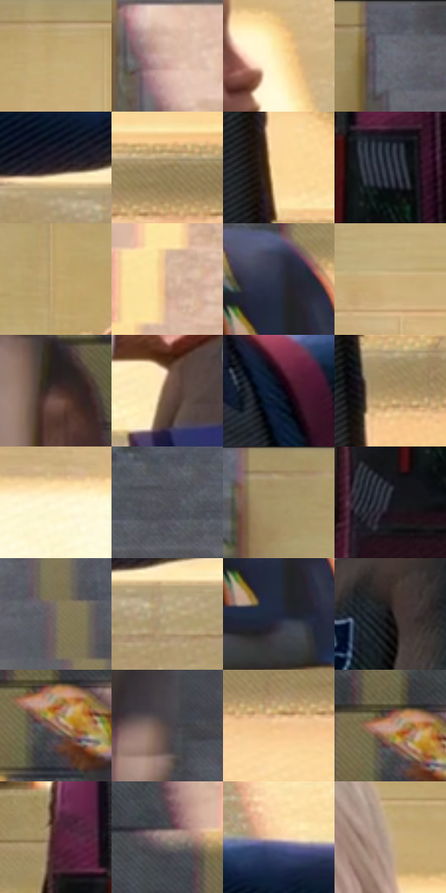

# 电影参考 071

- 状态：常规／活跃；来源世界：miles-home。
- 视角：near-level；景别：medium；场景：portrait。
- 时段：daylight-time-unspecified（外观依据，中置信度；具体时间／晨昏未知）；光照：neutral-day。
- 材质候选：skin, hair, fabric, glass, stone, paint（帧级，不是像素分割）。
- 明暗组：middle；L* P5/P50/P95：6.65391 / 57.59907 / 92.43738。
- 资格门禁：无附加门禁。
- 原截图 SHA-256：`789e5a2e41e54cff40f049faedb15b2ad213aa96cddb4a28ee9e2dc8a3846447`；尺寸：2880 × 1206。
- sRGB 像素 SHA-256：`fc7516d97361dbe568eeac58e277ede404f399bcf3a8697fe6ce66e53dafc413`。

## 观察与迁移

天窗大堂人像，面部各有设计，背景留在次层。

本公开版保存32个128×128原像素色卡上下文；图集格子并非原场景相邻位置。原rect、图集tile和像素SHA见 `data/palette-crops.json`。上下文不足时不得批准替色，不能以小样推断完整构图。

## 实测色卡

颜色比例分母为保留采样像素，不是材料面积；全部 32 色参与全库匹配。表内四舍五入仅用于阅读，原精度在 JSON。

| ID | HEX | Lab | 原图 xy | 像素数 | 比例 | 明度角色 |
| --- | --- | --- | --- | ---: | ---: | --- |
| 071-S01 | #C2A977 | [70.301045, 1.976677, 29.165699] | [1040, 68] | 10780 | 5.575497% | light |
| 071-S02 | #DDBBAC | [78.399432, 9.851137, 12.121456] | [2372, 372] | 9511 | 4.919160% | light |
| 071-S03 | #FDE7B0 | [92.207951, -0.464768, 29.557897] | [1144, 396] | 8926 | 4.616594% | highlight |
| 071-S04 | #5E5E67 | [40.187377, 1.963779, -5.114319] | [2276, 28] | 8924 | 4.615560% | midtone |
| 071-S05 | #2A1F22 | [13.155482, 5.943651, 0.006913] | [1388, 720] | 8762 | 4.531772% | deep-shadow |
| 071-S06 | #9A825D | [55.712048, 3.756986, 23.454556] | [2264, 1048] | 8323 | 4.304718% | midtone |
| 071-S07 | #F9D699 | [87.258999, 3.996637, 34.655059] | [1136, 960] | 8124 | 4.201794% | highlight |
| 071-S08 | #3B3F4C | [26.753306, 1.62104, -8.433441] | [644, 880] | 7073 | 3.658209% | shadow |
| 071-S09 | #BEA06A | [67.375325, 3.750072, 32.22221] | [1804, 116] | 6644 | 3.436327% | light |
| 071-S10 | #D2B196 | [74.412963, 7.923156, 18.273749] | [236, 584] | 6506 | 3.364952% | light |
| 071-S11 | #2C3143 | [20.585305, 2.906561, -11.949669] | [372, 884] | 6431 | 3.326161% | shadow |
| 071-S12 | #CEAF7D | [73.065687, 4.304849, 29.816481] | [1624, 220] | 6298 | 3.257373% | light |
| 071-S13 | #4D3532 | [24.810583, 10.301922, 6.179462] | [2612, 872] | 6257 | 3.236167% | shadow |
| 071-S14 | #715545 | [38.617334, 9.220462, 13.830791] | [1736, 692] | 6139 | 3.175137% | shadow |
| 071-S15 | #0D182C | [8.311649, 2.800604, -15.003576] | [1080, 656] | 6010 | 3.108417% | deep-shadow |
| 071-S16 | #B1966A | [63.509375, 3.813109, 26.953044] | [1164, 1084] | 6001 | 3.103762% | light |
| 071-S17 | #FDF4D1 | [96.075046, -2.560746, 17.97325] | [1568, 372] | 5921 | 3.062386% | highlight |
| 071-S18 | #525257 | [35.036227, 1.10078, -2.914218] | [2580, 84] | 5848 | 3.024629% | shadow |
| 071-S19 | #A79069 | [60.942901, 2.85349, 23.931432] | [644, 32] | 5808 | 3.003941% | light |
| 071-S20 | #12121B | [5.784026, 2.249471, -6.005195] | [568, 980] | 5647 | 2.920671% | deep-shadow |
| 071-S21 | #786D62 | [46.727571, 2.31512, 7.708466] | [2432, 120] | 5594 | 2.893259% | midtone |
| 071-S22 | #B39D78 | [65.791451, 2.518265, 22.363352] | [1460, 776] | 5386 | 2.785680% | light |
| 071-S23 | #21283D | [16.393544, 3.468582, -14.389168] | [372, 964] | 5094 | 2.634655% | deep-shadow |
| 071-S24 | #0A0608 | [1.91785, 1.32398, -0.388095] | [1956, 716] | 4497 | 2.325882% | deep-shadow |
| 071-S25 | #966B59 | [49.15712, 14.745768, 16.892647] | [144, 960] | 4490 | 2.322262% | midtone |
| 071-S26 | #504646 | [30.707586, 4.225708, 1.552196] | [196, 176] | 4457 | 2.305194% | shadow |
| 071-S27 | #ECBD89 | [79.635069, 10.181156, 32.671197] | [2188, 1116] | 3957 | 2.046590% | light |
| 071-S28 | #C2978A | [66.089291, 14.193872, 13.028695] | [128, 932] | 3692 | 1.909530% | light |
| 071-S29 | #4D222F | [19.750953, 21.907117, 0.997276] | [520, 796] | 3402 | 1.759540% | deep-shadow |
| 071-S30 | #9B877E | [57.850136, 6.03504, 7.62097] | [84, 732] | 3162 | 1.635410% | midtone |
| 071-S31 | #F4D2B3 | [86.297339, 7.32958, 19.778158] | [1296, 592] | 2895 | 1.497316% | highlight |
| 071-S32 | #C4AD92 | [72.02724, 4.101507, 16.939378] | [2044, 300] | 2787 | 1.441457% | light |

## 色阶与空间分布

- 采样 ROI：`[0.01, 0.02, 0.98, 0.94]`；步长：4；样本数：193346。
- 排除区：`[]`。
- 深暗、暗、中、亮、高光五段计数：`[34412, 37112, 29908, 61436, 30478]`。
- RGB 各 256 箱、L* 100 箱、13×5 色相明度表和 3×3 空间统计全部保存在 [总数据](../film-library.json)。
- [可视化档案](../../references/library.html)按需绘制直方图，不存 2,094 张重复图表图片。

## 纹理特征占比

**这是分块图像特征的面积占比，不是波点／排线／丝网／错版的精确语义覆盖率。** 窗格、发丝、织物也会产生方向或周期特征。
原图 ROI 像素 3098546；已测块覆盖 3098546（100.0000%）；未测 0。

| 特征 | 块覆盖像素 | 占已测面积 | 阈值敏感范围 |
| --- | ---: | ---: | --- |
| low-contrast | 0 | 0.0000% | 0.0000% ~ 0.0000% |
| directional-structure | 806066 | 26.0143% | 14.0081% ~ 41.1585% |
| periodic-structure | 2232448 | 72.0482% | 57.9616% ~ 78.5107% |
| mixed-detail | 60032 | 1.9374% | 0.8799% ~ 7.4812% |

阈值敏感范围不是统计置信区间。逐块坐标、尺度、对比、方向一致性、频谱集中度、频率与角度见 [全量特征记录](../texture-features.jsonl)，以帧号定位。
四种印刷层的真实像素覆盖仍标为 `null`，不能填 0，也不能拿上表代替。不得据这些代理测量删除唯一证据。

[测量方法与保留策略](../../references/library-retention.md) · [分类索引](../archive/README.md)
