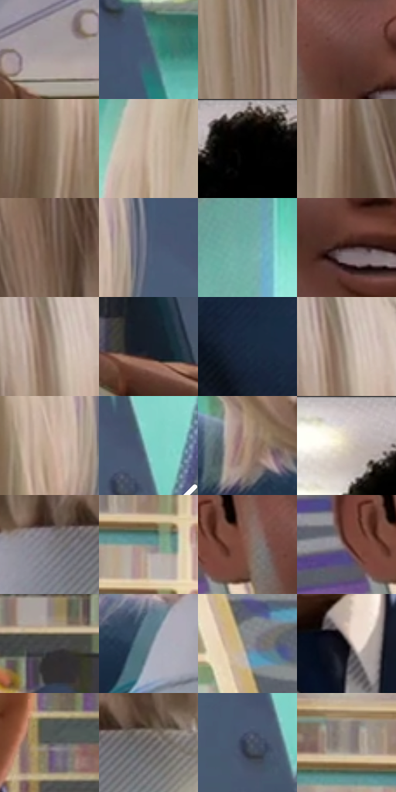

# 电影参考 072

- 状态：常规／活跃；来源世界：miles-home。
- 视角：near-level；景别：medium；场景：portrait。
- 时段：daylight-time-unspecified（外观依据，中置信度；具体时间／晨昏未知）；光照：neutral-day。
- 材质候选：skin, hair, fabric, glass, stone, paint（帧级，不是像素分割）。
- 明暗组：middle；L* P5/P50/P95：4.56497 / 47.31206 / 78.51379。
- 资格门禁：无附加门禁。
- 原截图 SHA-256：`725f7a99b0f369366db79dcdd5c613d9869e498ba055c7c321e0689baf2e312b`；尺寸：2880 × 1202。
- sRGB 像素 SHA-256：`39f0dac5bf9ecfb337e2f38d393aba6ee01f1ab67a05cd4b6abdb5cf252a8c37`。

## 观察与迁移

天窗大堂人像，面部各有设计，背景留在次层。

本公开版保存32个128×128原像素色卡上下文；图集格子并非原场景相邻位置。原rect、图集tile和像素SHA见 `data/palette-crops.json`。上下文不足时不得批准替色，不能以小样推断完整构图。

## 实测色卡

颜色比例分母为保留采样像素，不是材料面积；全部 32 色参与全库匹配。表内四舍五入仅用于阅读，原精度在 JSON。

| ID | HEX | Lab | 原图 xy | 像素数 | 比例 | 明度角色 |
| --- | --- | --- | --- | ---: | ---: | --- |
| 072-S01 | #A29D9E | [65.171663, 1.995536, 0.126214] | [2660, 1068] | 10999 | 5.709377% | light |
| 072-S02 | #45576E | [36.379722, -0.647637, -15.378474] | [2672, 136] | 10002 | 5.191852% | shadow |
| 072-S03 | #947C6A | [53.763583, 6.392143, 13.288148] | [1904, 212] | 9565 | 4.965014% | midtone |
| 072-S04 | #64423A | [31.605268, 13.632248, 10.860108] | [840, 604] | 9078 | 4.712221% | shadow |
| 072-S05 | #867160 | [49.15936, 5.46201, 12.506434] | [2324, 284] | 8298 | 4.307338% | midtone |
| 072-S06 | #CFB8A4 | [76.20904, 5.022118, 13.167248] | [1596, 172] | 8263 | 4.289170% | light |
| 072-S07 | #010101 | [0.274173, -1.7e-05, 3.3e-05] | [756, 44] | 7789 | 4.043125% | deep-shadow |
| 072-S08 | #785F4F | [42.372872, 7.644988, 13.018898] | [2000, 176] | 7717 | 4.005751% | midtone |
| 072-S09 | #6C5244 | [37.189577, 8.690989, 12.401178] | [2020, 664] | 7617 | 3.953843% | shadow |
| 072-S10 | #505A73 | [38.296672, 2.459533, -15.464792] | [2536, 356] | 7353 | 3.816806% | shadow |
| 072-S11 | #70AEA7 | [66.904088, -21.551735, -2.740135] | [1384, 192] | 7049 | 3.659005% | light |
| 072-S12 | #3A2122 | [16.018432, 12.209627, 4.415413] | [892, 656] | 6537 | 3.393235% | deep-shadow |
| 072-S13 | #9F8A7B | [58.954678, 5.447145, 10.95419] | [2308, 112] | 6351 | 3.296686% | midtone |
| 072-S14 | #171D28 | [10.660507, 0.714937, -8.335582] | [2412, 1024] | 5974 | 3.100992% | deep-shadow |
| 072-S15 | #1C2B3F | [17.147507, 0.467198, -14.629245] | [1388, 1004] | 5943 | 3.084901% | deep-shadow |
| 072-S16 | #B4A495 | [68.332665, 3.288665, 9.893515] | [2316, 100] | 5877 | 3.050642% | light |
| 072-S17 | #C4A993 | [71.022135, 6.404188, 14.991801] | [2452, 384] | 5873 | 3.048565% | light |
| 072-S18 | #84D0C6 | [78.515269, -25.770389, -2.477969] | [2796, 532] | 5811 | 3.016382% | light |
| 072-S19 | #AF917A | [62.314016, 7.784931, 16.438553] | [1608, 896] | 5712 | 2.964993% | light |
| 072-S20 | #DDD1C0 | [84.370139, 1.309812, 9.920737] | [628, 52] | 5669 | 2.942673% | highlight |
| 072-S21 | #78767D | [50.014242, 2.187752, -3.558748] | [1984, 880] | 5390 | 2.797849% | midtone |
| 072-S22 | #7F9492 | [59.677278, -7.860899, -1.45171] | [164, 276] | 4978 | 2.583987% | midtone |
| 072-S23 | #866054 | [44.340467, 13.756407, 12.967211] | [740, 584] | 4759 | 2.470309% | midtone |
| 072-S24 | #552E2C | [23.89365, 17.591113, 9.091508] | [660, 584] | 4703 | 2.441240% | shadow |
| 072-S25 | #444346 | [28.604584, 1.089857, -1.661869] | [120, 760] | 4127 | 2.142249% | shadow |
| 072-S26 | #5F7781 | [48.524705, -6.268401, -8.343165] | [1824, 952] | 3770 | 1.956937% | midtone |
| 072-S27 | #868587 | [55.677631, 0.765203, -0.939612] | [396, 396] | 3659 | 1.899319% | midtone |
| 072-S28 | #120E11 | [4.364283, 1.983752, -1.009902] | [1000, 868] | 3186 | 1.653793% | deep-shadow |
| 072-S29 | #565556 | [36.266417, 0.61417, -0.436754] | [1108, 696] | 2976 | 1.544786% | shadow |
| 072-S30 | #6B6563 | [43.262472, 1.967182, 1.978255] | [2084, 872] | 2888 | 1.499107% | midtone |
| 072-S31 | #464F5F | [33.392911, 0.472304, -10.52713] | [2756, 580] | 2516 | 1.306009% | shadow |
| 072-S32 | #938B84 | [58.353248, 1.694618, 4.8081] | [96, 220] | 2219 | 1.151842% | midtone |

## 色阶与空间分布

- 采样 ROI：`[0.01, 0.02, 0.98, 0.94]`；步长：4；样本数：192648。
- 排除区：`[]`。
- 深暗、暗、中、亮、高光五段计数：`[27162, 49067, 56854, 52155, 7410]`。
- RGB 各 256 箱、L* 100 箱、13×5 色相明度表和 3×3 空间统计全部保存在 [总数据](../film-library.json)。
- [可视化档案](../../references/library.html)按需绘制直方图，不存 2,094 张重复图表图片。

## 纹理特征占比

**这是分块图像特征的面积占比，不是波点／排线／丝网／错版的精确语义覆盖率。** 窗格、发丝、织物也会产生方向或周期特征。
原图 ROI 像素 3087370；已测块覆盖 3087370（100.0000%）；未测 0。

| 特征 | 块覆盖像素 | 占已测面积 | 阈值敏感范围 |
| --- | ---: | ---: | --- |
| low-contrast | 59520 | 1.9279% | 1.9279% ~ 1.9279% |
| directional-structure | 1367562 | 44.2954% | 34.0591% ~ 55.8625% |
| periodic-structure | 1590400 | 51.5131% | 41.1483% ~ 58.7602% |
| mixed-detail | 69888 | 2.2637% | 1.0614% ~ 5.2529% |

阈值敏感范围不是统计置信区间。逐块坐标、尺度、对比、方向一致性、频谱集中度、频率与角度见 [全量特征记录](../texture-features.jsonl)，以帧号定位。
四种印刷层的真实像素覆盖仍标为 `null`，不能填 0，也不能拿上表代替。不得据这些代理测量删除唯一证据。

[测量方法与保留策略](../../references/library-retention.md) · [分类索引](../archive/README.md)
