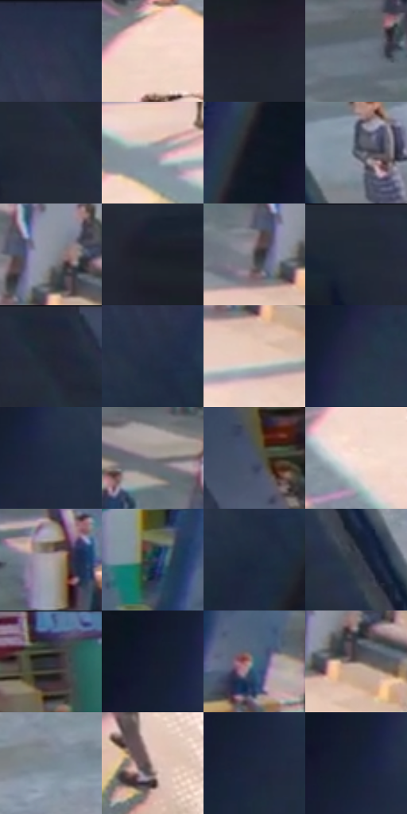

# 电影参考 073

- 状态：常规／活跃；来源世界：miles-home。
- 视角：high-angle；景别：environment-wide；场景：interior。
- 时段：daylight-time-unspecified（外观依据，中置信度；具体时间／晨昏未知）；光照：neutral-day。
- 材质候选：stone, paint, glass, painted-metal, plastic（帧级，不是像素分割）。
- 明暗组：dark；L* P5/P50/P95：10.3944 / 24.08916 / 87.00123。
- 资格门禁：无附加门禁。
- 原截图 SHA-256：`b94621b9915510bc7cf6e267f5803c7a07f117f1cdc2fac5a383dcc7b65164f4`；尺寸：2880 × 1208。
- sRGB 像素 SHA-256：`87d1f202de47c352e97a55cb99eb3e95fb63f5d17bbf78da116a41b26c0cc6e2`。

## 观察与迁移

大堂天窗投影和青绿墙面，结构柱与斜光区分层。

本公开版保存32个128×128原像素色卡上下文；图集格子并非原场景相邻位置。原rect、图集tile和像素SHA见 `data/palette-crops.json`。上下文不足时不得批准替色，不能以小样推断完整构图。

## 实测色卡

颜色比例分母为保留采样像素，不是材料面积；全部 32 色参与全库匹配。表内四舍五入仅用于阅读，原精度在 JSON。

| ID | HEX | Lab | 原图 xy | 像素数 | 比例 | 明度角色 |
| --- | --- | --- | --- | ---: | ---: | --- |
| 073-S01 | #2A344B | [21.784811, 2.722387, -15.504241] | [2820, 52] | 9373 | 4.847786% | shadow |
| 073-S02 | #F0D4C7 | [86.867974, 7.677152, 9.99749] | [1436, 500] | 8837 | 4.570563% | highlight |
| 073-S03 | #20242F | [14.253565, 1.360089, -7.835167] | [128, 228] | 8746 | 4.523497% | deep-shadow |
| 073-S04 | #697481 | [48.358973, -1.146834, -8.517038] | [1208, 328] | 8573 | 4.434020% | midtone |
| 073-S05 | #272D3C | [18.515196, 1.696383, -10.377696] | [272, 96] | 8398 | 4.343509% | deep-shadow |
| 073-S06 | #9298A5 | [62.746394, 0.522819, -7.531715] | [1664, 508] | 8175 | 4.228171% | light |
| 073-S07 | #131824 | [8.297983, 1.574268, -9.035437] | [2340, 212] | 7924 | 4.098352% | deep-shadow |
| 073-S08 | #5B626F | [41.385629, 0.308313, -8.250729] | [784, 636] | 7311 | 3.781304% | midtone |
| 073-S09 | #878E9A | [58.816298, -0.021471, -7.220834] | [1932, 356] | 7227 | 3.737859% | midtone |
| 073-S10 | #1D1F29 | [11.965921, 1.92842, -7.02207] | [48, 104] | 6683 | 3.456498% | deep-shadow |
| 073-S11 | #4D4A4D | [31.832357, 1.887131, -1.338196] | [1876, 388] | 6470 | 3.346332% | shadow |
| 073-S12 | #252B38 | [17.490391, 1.107924, -9.192431] | [216, 28] | 6359 | 3.288922% | deep-shadow |
| 073-S13 | #232835 | [16.164626, 1.534337, -9.138911] | [324, 36] | 6265 | 3.240305% | deep-shadow |
| 073-S14 | #232E42 | [18.819339, 1.589978, -14.054899] | [2796, 232] | 6260 | 3.237719% | deep-shadow |
| 073-S15 | #E6C8B9 | [82.719539, 8.218289, 11.39507] | [1920, 476] | 6190 | 3.201514% | highlight |
| 073-S16 | #283145 | [20.35068, 2.154397, -13.695203] | [2548, 116] | 6103 | 3.156517% | shadow |
| 073-S17 | #202C43 | [17.979621, 2.413085, -16.063352] | [2516, 248] | 6028 | 3.117727% | deep-shadow |
| 073-S18 | #848085 | [54.066642, 2.486618, -2.162332] | [1828, 284] | 5941 | 3.072730% | midtone |
| 073-S19 | #4A5367 | [35.244796, 1.519587, -12.716199] | [564, 224] | 5712 | 2.954289% | shadow |
| 073-S20 | #F9E2D8 | [91.456386, 6.252972, 7.743963] | [1296, 692] | 5629 | 2.911361% | highlight |
| 073-S21 | #ACA1A3 | [67.205776, 4.345174, 0.400283] | [1352, 324] | 5579 | 2.885501% | light |
| 073-S22 | #324257 | [27.469553, -0.231214, -14.582733] | [1484, 80] | 5295 | 2.738614% | shadow |
| 073-S23 | #1D2B3E | [17.162952, 0.403167, -13.908923] | [2796, 304] | 5166 | 2.671894% | deep-shadow |
| 073-S24 | #333846 | [23.586089, 1.598147, -9.328436] | [804, 912] | 4945 | 2.557591% | shadow |
| 073-S25 | #30313C | [20.639518, 2.380303, -7.070414] | [952, 64] | 4629 | 2.394153% | shadow |
| 073-S26 | #161D2D | [10.839781, 2.134375, -11.723953] | [2448, 172] | 4355 | 2.252439% | deep-shadow |
| 073-S27 | #426B79 | [42.84348, -10.31236, -12.284924] | [1556, 276] | 3934 | 2.034694% | midtone |
| 073-S28 | #736560 | [43.940475, 4.652612, 4.869837] | [1964, 408] | 3773 | 1.951424% | midtone |
| 073-S29 | #798792 | [55.55087, -2.647917, -7.598649] | [976, 664] | 3695 | 1.911082% | midtone |
| 073-S30 | #CCB5AD | [75.391185, 6.902395, 7.084264] | [1816, 1088] | 3686 | 1.906427% | light |
| 073-S31 | #1D263B | [15.292279, 2.902581, -14.735] | [2468, 288] | 3625 | 1.874877% | deep-shadow |
| 073-S32 | #182135 | [12.852867, 2.779476, -14.337216] | [2464, 216] | 2460 | 1.272330% | deep-shadow |

## 色阶与空间分布

- 采样 ROI：`[0.01, 0.02, 0.98, 0.94]`；步长：4；样本数：193346。
- 排除区：`[]`。
- 深暗、暗、中、亮、高光五段计数：`[76055, 41935, 35970, 19132, 20254]`。
- RGB 各 256 箱、L* 100 箱、13×5 色相明度表和 3×3 空间统计全部保存在 [总数据](../film-library.json)。
- [可视化档案](../../references/library.html)按需绘制直方图，不存 2,094 张重复图表图片。

## 纹理特征占比

**这是分块图像特征的面积占比，不是波点／排线／丝网／错版的精确语义覆盖率。** 窗格、发丝、织物也会产生方向或周期特征。
原图 ROI 像素 3104134；已测块覆盖 3104134（100.0000%）；未测 0。

| 特征 | 块覆盖像素 | 占已测面积 | 阈值敏感范围 |
| --- | ---: | ---: | --- |
| low-contrast | 714368 | 23.0134% | 18.3332% ~ 26.5267% |
| directional-structure | 338816 | 10.9150% | 4.7503% ~ 21.4919% |
| periodic-structure | 1974278 | 63.6016% | 59.6471% ~ 64.6696% |
| mixed-detail | 76672 | 2.4700% | 0.5278% ~ 4.0534% |

阈值敏感范围不是统计置信区间。逐块坐标、尺度、对比、方向一致性、频谱集中度、频率与角度见 [全量特征记录](../texture-features.jsonl)，以帧号定位。
四种印刷层的真实像素覆盖仍标为 `null`，不能填 0，也不能拿上表代替。不得据这些代理测量删除唯一证据。

[测量方法与保留策略](../../references/library-retention.md) · [分类索引](../archive/README.md)
