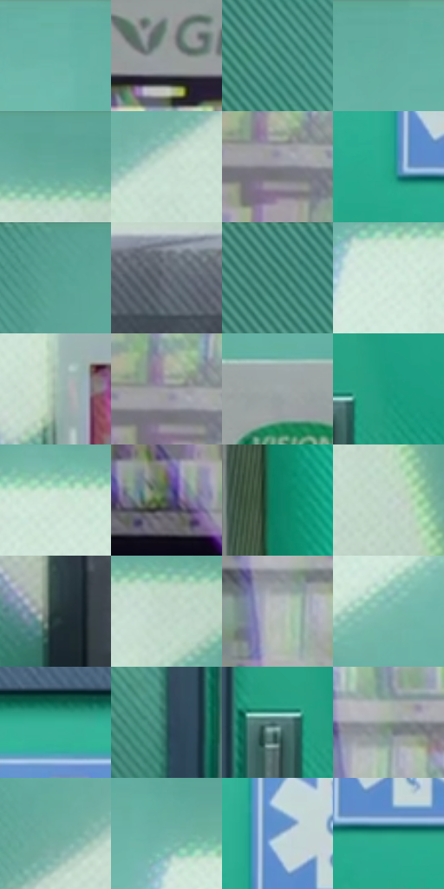

# 电影参考 074

- 状态：常规／活跃；来源世界：miles-home。
- 视角：near-level；景别：environment-wide；场景：interior。
- 时段：daylight-time-unspecified（外观依据，中置信度；具体时间／晨昏未知）；光照：neutral-day。
- 材质候选：stone, paint, glass, painted-metal, plastic（帧级，不是像素分割）。
- 明暗组：light；L* P5/P50/P95：32.80531 / 63.83487 / 89.07017。
- 资格门禁：无附加门禁。
- 原截图 SHA-256：`c90bf768f182d97242389762b1a759c5e61b7467971f14cdce4e5ce21245caf9`；尺寸：2880 × 1202。
- sRGB 像素 SHA-256：`dbd0a0b2f9bed8316334b9d7df1b539228b3435707a71a838915b9b85a3e90fd`。

## 观察与迁移

大堂天窗投影和青绿墙面，结构柱与斜光区分层。

本公开版保存32个128×128原像素色卡上下文；图集格子并非原场景相邻位置。原rect、图集tile和像素SHA见 `data/palette-crops.json`。上下文不足时不得批准替色，不能以小样推断完整构图。

## 实测色卡

颜色比例分母为保留采样像素，不是材料面积；全部 32 色参与全库匹配。表内四舍五入仅用于阅读，原精度在 JSON。

| ID | HEX | Lab | 原图 xy | 像素数 | 比例 | 明度角色 |
| --- | --- | --- | --- | ---: | ---: | --- |
| 074-S01 | #69B4A6 | [68.312158, -26.703809, -0.162198] | [1460, 36] | 12283 | 6.375877% | light |
| 074-S02 | #949B9A | [63.401912, -2.707464, -0.345421] | [156, 400] | 10851 | 5.632553% | light |
| 074-S03 | #4C9486 | [56.521836, -26.147561, 0.44666] | [364, 132] | 8900 | 4.619825% | midtone |
| 074-S04 | #61AC9E | [65.367889, -26.769847, -0.073336] | [1056, 28] | 8777 | 4.555978% | light |
| 074-S05 | #5DA597 | [62.902489, -26.043131, 0.215527] | [2412, 28] | 8734 | 4.533657% | light |
| 074-S06 | #C8DDD2 | [86.327764, -9.061667, 3.015297] | [2520, 484] | 7587 | 3.938271% | highlight |
| 074-S07 | #83828B | [54.714723, 2.198032, -4.702669] | [352, 976] | 7529 | 3.908164% | midtone |
| 074-S08 | #24A88B | [61.862613, -41.285954, 5.220328] | [1312, 516] | 7497 | 3.891554% | light |
| 074-S09 | #56A092 | [60.952227, -26.593689, 0.144384] | [576, 32] | 7184 | 3.729081% | light |
| 074-S10 | #606672 | [43.069358, 0.414177, -7.512618] | [2368, 948] | 7048 | 3.658486% | midtone |
| 074-S11 | #3A7F71 | [48.5978, -25.440717, 0.99762] | [256, 48] | 6936 | 3.600349% | midtone |
| 074-S12 | #D5EADE | [90.900632, -9.149603, 3.462687] | [1816, 148] | 6803 | 3.531311% | highlight |
| 074-S13 | #A5BFB1 | [75.098149, -11.581054, 4.099079] | [1868, 560] | 6709 | 3.482517% | light |
| 074-S14 | #9D9FA5 | [65.49941, 0.459103, -3.36252] | [344, 952] | 6666 | 3.460197% | light |
| 074-S15 | #A0A9AA | [68.570846, -2.971015, -1.608656] | [796, 344] | 6603 | 3.427495% | light |
| 074-S16 | #19997D | [56.553318, -39.608028, 5.460328] | [1304, 740] | 6588 | 3.419708% | midtone |
| 074-S17 | #CFE4D8 | [88.784897, -9.193863, 3.482738] | [1980, 116] | 6487 | 3.367281% | highlight |
| 074-S18 | #475052 | [33.320143, -3.106347, -2.394056] | [248, 1068] | 6064 | 3.147710% | shadow |
| 074-S19 | #0A7E64 | [46.849776, -35.770671, 5.989445] | [988, 528] | 5953 | 3.090092% | midtone |
| 074-S20 | #BCD0C6 | [81.772719, -8.639006, 2.668814] | [2672, 664] | 5428 | 2.817574% | highlight |
| 074-S21 | #243737 | [21.517256, -7.602211, -2.45806] | [2216, 1064] | 5271 | 2.736078% | shadow |
| 074-S22 | #C3DACB | [85.024936, -10.494238, 4.783299] | [2460, 136] | 5252 | 2.726216% | highlight |
| 074-S23 | #B8BEBD | [76.491544, -2.265997, -0.216793] | [160, 764] | 4913 | 2.550247% | light |
| 074-S24 | #7AB9AD | [70.767914, -22.881138, -0.32661] | [2100, 476] | 4862 | 2.523774% | light |
| 074-S25 | #36B298 | [65.662595, -39.937794, 3.515283] | [1404, 292] | 4745 | 2.463041% | light |
| 074-S26 | #2C5E5C | [36.580047, -17.33209, -4.026945] | [1140, 884] | 4589 | 2.382065% | shadow |
| 074-S27 | #5C7E81 | [50.430284, -11.21025, -5.524471] | [1236, 760] | 2562 | 1.329887% | midtone |
| 074-S28 | #859989 | [61.285575, -10.317593, 6.036055] | [188, 716] | 2443 | 1.268116% | light |
| 074-S29 | #6CAD9D | [66.14224, -24.523166, 1.671853] | [2128, 680] | 2252 | 1.168971% | light |
| 074-S30 | #6EB0A5 | [67.337367, -23.597853, -1.00763] | [1768, 76] | 2117 | 1.098895% | light |
| 074-S31 | #6F95BD | [60.379621, -2.643349, -24.88677] | [1352, 440] | 1697 | 0.880881% | light |
| 074-S32 | #299D84 | [58.273021, -37.691408, 3.997549] | [1392, 536] | 1318 | 0.684149% | midtone |

## 色阶与空间分布

- 采样 ROI：`[0.01, 0.02, 0.98, 0.94]`；步长：4；样本数：192648。
- 排除区：`[]`。
- 深暗、暗、中、亮、高光五段计数：`[1826, 14390, 51671, 93303, 31458]`。
- RGB 各 256 箱、L* 100 箱、13×5 色相明度表和 3×3 空间统计全部保存在 [总数据](../film-library.json)。
- [可视化档案](../../references/library.html)按需绘制直方图，不存 2,094 张重复图表图片。

## 纹理特征占比

**这是分块图像特征的面积占比，不是波点／排线／丝网／错版的精确语义覆盖率。** 窗格、发丝、织物也会产生方向或周期特征。
原图 ROI 像素 3087370；已测块覆盖 3087370（100.0000%）；未测 0。

| 特征 | 块覆盖像素 | 占已测面积 | 阈值敏感范围 |
| --- | ---: | ---: | --- |
| low-contrast | 441472 | 14.2993% | 6.6252% ~ 17.7615% |
| directional-structure | 893440 | 28.9385% | 19.5812% ~ 38.4369% |
| periodic-structure | 1654154 | 53.5781% | 53.3459% ~ 58.4119% |
| mixed-detail | 98304 | 3.1841% | 1.5920% ~ 4.2454% |

阈值敏感范围不是统计置信区间。逐块坐标、尺度、对比、方向一致性、频谱集中度、频率与角度见 [全量特征记录](../texture-features.jsonl)，以帧号定位。
四种印刷层的真实像素覆盖仍标为 `null`，不能填 0，也不能拿上表代替。不得据这些代理测量删除唯一证据。

[测量方法与保留策略](../../references/library-retention.md) · [分类索引](../archive/README.md)
