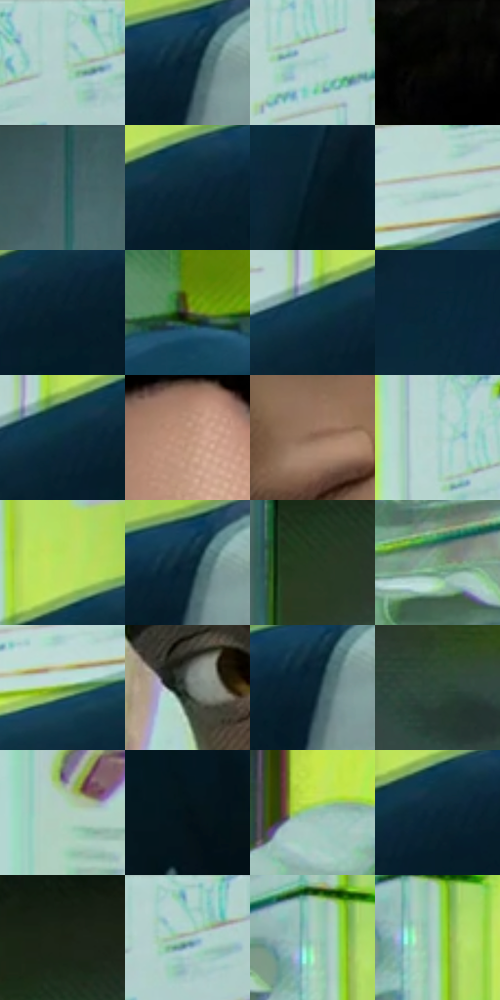

# 电影参考 075

- 状态：常规／活跃；来源世界：miles-home。
- 视角：near-level；景别：medium；场景：portrait。
- 时段：daylight-time-unspecified（外观依据，中置信度；具体时间／晨昏未知）；光照：neutral-day。
- 材质候选：skin, hair, fabric, paint, glass（帧级，不是像素分割）。
- 明暗组：dark；L* P5/P50/P95：3.99431 / 28.08186 / 82.7932。
- 资格门禁：无附加门禁。
- 原截图 SHA-256：`5902f59cce35163c4c54ee7f8b46997b06c0872d6b8ee26ddd9b2592b942c5e3`；尺寸：2880 × 1204。
- sRGB 像素 SHA-256：`60b09832864ad4a9a86e20e13b86bc21e799a712df215afcf7dd08ab62e53587`。

## 观察与迁移

侧脸和头发形体、浅墙面，镜类物件必须核对反射载体。

本公开版保存32个128×128原像素色卡上下文；图集格子并非原场景相邻位置。原rect、图集tile和像素SHA见 `data/palette-crops.json`。上下文不足时不得批准替色，不能以小样推断完整构图。

## 实测色卡

颜色比例分母为保留采样像素，不是材料面积；全部 32 色参与全库匹配。表内四舍五入仅用于阅读，原精度在 JSON。

| ID | HEX | Lab | 原图 xy | 像素数 | 比例 | 明度角色 |
| --- | --- | --- | --- | ---: | ---: | --- |
| 075-S01 | #AED1CD | [81.29486, -12.353659, -1.877583] | [2428, 40] | 11701 | 6.073772% | highlight |
| 075-S02 | #0A2434 | [13.071344, -3.458698, -13.342363] | [2804, 348] | 10360 | 5.377684% | deep-shadow |
| 075-S03 | #A2C6C4 | [77.312917, -12.355091, -2.977617] | [2264, 140] | 9460 | 4.910510% | light |
| 075-S04 | #050503 | [1.331294, -0.278175, 0.757012] | [496, 28] | 9150 | 4.749595% | deep-shadow |
| 075-S05 | #3E6261 | [38.93647, -13.102566, -3.530798] | [1180, 48] | 8126 | 4.218056% | shadow |
| 075-S06 | #0A2637 | [13.980573, -3.599879, -14.051105] | [2704, 372] | 7828 | 4.063369% | deep-shadow |
| 075-S07 | #041A26 | [8.168664, -3.702241, -10.810086] | [1108, 832] | 7725 | 4.009904% | deep-shadow |
| 075-S08 | #B7D7D0 | [83.558476, -11.944459, -0.095217] | [2432, 368] | 7608 | 3.949172% | highlight |
| 075-S09 | #061F2E | [10.673575, -3.332312, -12.782662] | [2708, 404] | 7588 | 3.938790% | deep-shadow |
| 075-S10 | #424026 | [26.635117, -3.832445, 16.226444] | [1424, 584] | 7507 | 3.896744% | shadow |
| 075-S11 | #10374A | [21.344521, -6.264227, -15.627647] | [2604, 384] | 7372 | 3.826668% | shadow |
| 075-S12 | #08283A | [14.814343, -4.084252, -14.864499] | [2340, 644] | 7080 | 3.675097% | deep-shadow |
| 075-S13 | #0A2C3D | [16.516417, -5.230187, -14.29506] | [2628, 388] | 6324 | 3.282671% | deep-shadow |
| 075-S14 | #BC9178 | [63.59013, 12.761206, 19.520301] | [748, 172] | 6197 | 3.216748% | light |
| 075-S15 | #886651 | [46.08564, 10.693642, 17.176034] | [720, 584] | 6180 | 3.207923% | midtone |
| 075-S16 | #A9CEC7 | [80.010408, -13.633396, -0.58533] | [2216, 84] | 6017 | 3.123313% | highlight |
| 075-S17 | #B8DF5F | [83.857366, -31.638474, 57.3601] | [2664, 292] | 5813 | 3.017420% | highlight |
| 075-S18 | #0C2637 | [14.059306, -3.208854, -13.922382] | [2808, 340] | 5586 | 2.899589% | deep-shadow |
| 075-S19 | #263922 | [21.776461, -13.125959, 11.967609] | [1444, 188] | 5279 | 2.740231% | shadow |
| 075-S20 | #7BA27E | [62.975286, -20.679259, 14.493713] | [1936, 464] | 5197 | 2.697666% | light |
| 075-S21 | #679530 | [56.675242, -32.238132, 46.52792] | [2364, 432] | 5160 | 2.678460% | midtone |
| 075-S22 | #5C635C | [41.170991, -4.199984, 3.045658] | [516, 544] | 4909 | 2.548171% | midtone |
| 075-S23 | #0A2230 | [12.102353, -3.727717, -11.988406] | [2804, 368] | 4709 | 2.444354% | deep-shadow |
| 075-S24 | #30493A | [28.639391, -13.358211, 5.961935] | [1672, 256] | 4498 | 2.334828% | shadow |
| 075-S25 | #B0CEBF | [80.254515, -12.946725, 4.107775] | [272, 436] | 4302 | 2.233088% | highlight |
| 075-S26 | #051217 | [4.757633, -2.750063, -4.51577] | [1180, 972] | 4117 | 2.137058% | deep-shadow |
| 075-S27 | #95BFB1 | [74.077164, -16.850855, 2.492142] | [1904, 160] | 4025 | 2.089303% | light |
| 075-S28 | #072433 | [12.896199, -4.496871, -12.911626] | [2684, 380] | 3761 | 1.952265% | deep-shadow |
| 075-S29 | #1B2214 | [12.139951, -6.49797, 8.392886] | [1480, 76] | 3366 | 1.747228% | deep-shadow |
| 075-S30 | #9EAFA1 | [69.825495, -8.637683, 5.170121] | [2464, 60] | 2487 | 1.290956% | light |
| 075-S31 | #A4CDBE | [79.197374, -16.544445, 3.016915] | [2056, 312] | 2421 | 1.256696% | light |
| 075-S32 | #A2D3AE | [80.361795, -23.267958, 13.20772] | [2080, 332] | 795 | 0.412670% | highlight |

## 色阶与空间分布

- 采样 ROI：`[0.01, 0.02, 0.98, 0.94]`；步长：4；样本数：192648。
- 排除区：`[]`。
- 深暗、暗、中、亮、高光五段计数：`[82010, 27215, 19696, 34181, 29546]`。
- RGB 各 256 箱、L* 100 箱、13×5 色相明度表和 3×3 空间统计全部保存在 [总数据](../film-library.json)。
- [可视化档案](../../references/library.html)按需绘制直方图，不存 2,094 张重复图表图片。

## 纹理特征占比

**这是分块图像特征的面积占比，不是波点／排线／丝网／错版的精确语义覆盖率。** 窗格、发丝、织物也会产生方向或周期特征。
原图 ROI 像素 3092958；已测块覆盖 3092958（100.0000%）；未测 0。

| 特征 | 块覆盖像素 | 占已测面积 | 阈值敏感范围 |
| --- | ---: | ---: | --- |
| low-contrast | 788608 | 25.4969% | 22.8483% ~ 27.9593% |
| directional-structure | 957534 | 30.9585% | 18.7016% ~ 40.3072% |
| periodic-structure | 1287040 | 41.6119% | 35.7850% ~ 48.7579% |
| mixed-detail | 59776 | 1.9326% | 1.0594% ~ 4.5812% |

阈值敏感范围不是统计置信区间。逐块坐标、尺度、对比、方向一致性、频谱集中度、频率与角度见 [全量特征记录](../texture-features.jsonl)，以帧号定位。
四种印刷层的真实像素覆盖仍标为 `null`，不能填 0，也不能拿上表代替。不得据这些代理测量删除唯一证据。

[测量方法与保留策略](../../references/library-retention.md) · [分类索引](../archive/README.md)
