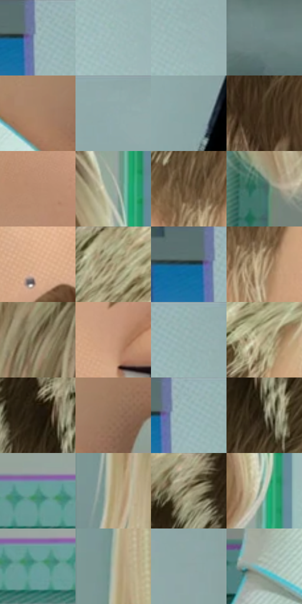

# 电影参考 076

- 状态：常规／活跃；来源世界：miles-home。
- 视角：near-level；景别：close-up；场景：portrait。
- 时段：daylight-time-unspecified（外观依据，中置信度；具体时间／晨昏未知）；光照：neutral-day。
- 材质候选：skin, hair, fabric, paint, glass（帧级，不是像素分割）。
- 明暗组：light；L* P5/P50/P95：24.99544 / 65.0236 / 75.50597。
- 资格门禁：无附加门禁。
- 原截图 SHA-256：`8677b46827d1a7643a83424cd6092b15f5e52b966a04818fdf77dc6e788ef6e2`；尺寸：2880 × 1202。
- sRGB 像素 SHA-256：`e97669fc2e74a94be464e907f6ad617552060f65f13607e311c48a8c304f34fc`。

## 观察与迁移

侧脸和头发形体、浅墙面，镜类物件必须核对反射载体。

本公开版保存32个128×128原像素色卡上下文；图集格子并非原场景相邻位置。原rect、图集tile和像素SHA见 `data/palette-crops.json`。上下文不足时不得批准替色，不能以小样推断完整构图。

## 实测色卡

颜色比例分母为保留采样像素，不是材料面积；全部 32 色参与全库匹配。表内四舍五入仅用于阅读，原精度在 JSON。

| ID | HEX | Lab | 原图 xy | 像素数 | 比例 | 明度角色 |
| --- | --- | --- | --- | ---: | ---: | --- |
| 076-S01 | #A0BBBB | [73.933861, -9.136759, -3.077963] | [2244, 64] | 15373 | 7.979839% | light |
| 076-S02 | #A4BFBF | [75.398194, -9.107336, -3.070484] | [2336, 268] | 11316 | 5.873926% | light |
| 076-S03 | #9EB8B8 | [72.898344, -8.832118, -2.978052] | [2344, 184] | 9109 | 4.728313% | light |
| 076-S04 | #708687 | [54.284577, -7.657769, -3.180434] | [1964, 256] | 8897 | 4.618268% | midtone |
| 076-S05 | #A88267 | [57.338358, 10.856478, 20.236913] | [724, 1028] | 8272 | 4.293842% | midtone |
| 076-S06 | #92ACAC | [68.455933, -8.922453, -3.000815] | [2584, 36] | 7759 | 4.027553% | light |
| 076-S07 | #8BA6A5 | [66.118485, -9.515575, -2.602059] | [2480, 856] | 7730 | 4.012499% | light |
| 076-S08 | #473622 | [23.978724, 4.539387, 15.451355] | [508, 512] | 7367 | 3.824073% | shadow |
| 076-S09 | #B88A6F | [61.23513, 13.928679, 21.282609] | [920, 612] | 7115 | 3.693264% | light |
| 076-S10 | #97A69C | [66.711786, -7.245497, 3.376678] | [1436, 196] | 7097 | 3.683921% | light |
| 076-S11 | #6D553C | [37.976766, 6.268401, 18.368206] | [804, 368] | 6744 | 3.500685% | shadow |
| 076-S12 | #466A66 | [42.106393, -13.810775, -1.859838] | [116, 948] | 6699 | 3.477327% | midtone |
| 076-S13 | #DCAD8E | [74.227077, 12.939439, 22.497808] | [1120, 264] | 6647 | 3.450334% | light |
| 076-S14 | #B0A684 | [68.145228, -1.921226, 18.948212] | [736, 52] | 6508 | 3.378182% | light |
| 076-S15 | #5A706E | [45.479565, -8.549953, -1.579908] | [2196, 44] | 6384 | 3.313816% | midtone |
| 076-S16 | #C6AC8B | [71.809736, 4.456702, 20.474775] | [840, 424] | 6333 | 3.287343% | light |
| 076-S17 | #7B694D | [45.428802, 2.752056, 18.409193] | [228, 480] | 5959 | 3.093206% | midtone |
| 076-S18 | #C7977B | [66.295898, 14.250377, 21.727751] | [1060, 444] | 5720 | 2.969146% | light |
| 076-S19 | #97B1B1 | [70.313717, -8.884227, -2.991265] | [2324, 32] | 5527 | 2.868963% | light |
| 076-S20 | #A39574 | [62.120136, -0.101882, 19.346148] | [932, 140] | 5453 | 2.830551% | light |
| 076-S21 | #211910 | [9.449969, 2.305492, 7.172671] | [524, 168] | 5175 | 2.686246% | deep-shadow |
| 076-S22 | #937157 | [50.337353, 9.756025, 19.593576] | [816, 1000] | 5161 | 2.678979% | midtone |
| 076-S23 | #9BB5B5 | [71.792929, -8.854253, -2.983691] | [2268, 28] | 4899 | 2.542980% | light |
| 076-S24 | #534F3E | [33.518145, -1.559989, 10.661427] | [564, 232] | 4343 | 2.254371% | shadow |
| 076-S25 | #4F8D81 | [54.339463, -23.08566, 0.150772] | [1248, 1100] | 4189 | 2.174432% | midtone |
| 076-S26 | #7F958D | [59.824979, -9.464706, 1.607474] | [48, 576] | 3979 | 2.065425% | midtone |
| 076-S27 | #8E8466 | [55.291272, -1.205468, 17.5992] | [408, 64] | 3707 | 1.924235% | midtone |
| 076-S28 | #C6D1C1 | [82.623679, -6.654352, 6.652943] | [1456, 388] | 3566 | 1.851044% | highlight |
| 076-S29 | #659F96 | [61.449691, -21.053219, -1.302129] | [1348, 1120] | 2710 | 1.406711% | light |
| 076-S30 | #B3B6A1 | [73.293734, -4.80564, 10.342035] | [64, 324] | 1355 | 0.703355% | light |
| 076-S31 | #90A5A4 | [66.150925, -7.516299, -1.95735] | [2812, 428] | 1315 | 0.682592% | light |
| 076-S32 | #A9BBB7 | [74.441039, -6.958048, -0.08305] | [496, 1116] | 240 | 0.124580% | light |

## 色阶与空间分布

- 采样 ROI：`[0.01, 0.02, 0.98, 0.94]`；步长：4；样本数：192648。
- 排除区：`[]`。
- 深暗、暗、中、亮、高光五段计数：`[6552, 18503, 52154, 112819, 2620]`。
- RGB 各 256 箱、L* 100 箱、13×5 色相明度表和 3×3 空间统计全部保存在 [总数据](../film-library.json)。
- [可视化档案](../../references/library.html)按需绘制直方图，不存 2,094 张重复图表图片。

## 纹理特征占比

**这是分块图像特征的面积占比，不是波点／排线／丝网／错版的精确语义覆盖率。** 窗格、发丝、织物也会产生方向或周期特征。
原图 ROI 像素 3087370；已测块覆盖 3087370（100.0000%）；未测 0。

| 特征 | 块覆盖像素 | 占已测面积 | 阈值敏感范围 |
| --- | ---: | ---: | --- |
| low-contrast | 675200 | 21.8697% | 18.3499% ~ 24.5231% |
| directional-structure | 1287040 | 41.6873% | 25.4187% ~ 54.0756% |
| periodic-structure | 977674 | 31.6669% | 24.3905% ~ 43.1594% |
| mixed-detail | 147456 | 4.7761% | 3.1841% ~ 6.8988% |

阈值敏感范围不是统计置信区间。逐块坐标、尺度、对比、方向一致性、频谱集中度、频率与角度见 [全量特征记录](../texture-features.jsonl)，以帧号定位。
四种印刷层的真实像素覆盖仍标为 `null`，不能填 0，也不能拿上表代替。不得据这些代理测量删除唯一证据。

[测量方法与保留策略](../../references/library-retention.md) · [分类索引](../archive/README.md)
