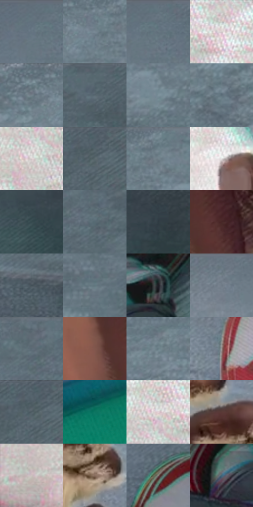

# 电影参考 077

- 状态：常规／活跃；来源世界：miles-home。
- 视角：overhead；景别：detail；场景：detail。
- 时段：daylight-time-unspecified（外观依据，中置信度；具体时间／晨昏未知）；光照：neutral-day。
- 材质候选：skin, fabric, stone（帧级，不是像素分割）。
- 明暗组：middle；L* P5/P50/P95：20.9084 / 47.81512 / 86.47184。
- 资格门禁：无附加门禁。
- 原截图 SHA-256：`a05f91875550022ad15f0b11a0068b79ff8ee5e911d7ba9b36e2f400020066c2`；尺寸：2880 × 1206。
- sRGB 像素 SHA-256：`01112d817f3b2f766ba7f93a03e2dbfb392311a2cf4e3ec2c8eb31d5e1587be6`。

## 观察与迁移

俯视地面与鞋、手，硬边日光块和细表面纹理分开。

本公开版保存32个128×128原像素色卡上下文；图集格子并非原场景相邻位置。原rect、图集tile和像素SHA见 `data/palette-crops.json`。上下文不足时不得批准替色，不能以小样推断完整构图。

## 实测色卡

颜色比例分母为保留采样像素，不是材料面积；全部 32 色参与全库匹配。表内四舍五入仅用于阅读，原精度在 JSON。

| ID | HEX | Lab | 原图 xy | 像素数 | 比例 | 明度角色 |
| --- | --- | --- | --- | ---: | ---: | --- |
| 077-S01 | #61717C | [46.719515, -3.351264, -8.058083] | [1108, 28] | 10549 | 5.456022% | midtone |
| 077-S02 | #788894 | [55.82546, -3.094027, -8.351238] | [1764, 80] | 9673 | 5.002948% | midtone |
| 077-S03 | #677681 | [48.791095, -3.00472, -7.886477] | [1152, 28] | 9490 | 4.908299% | midtone |
| 077-S04 | #CEC7C6 | [80.764483, 2.247399, 1.367402] | [224, 32] | 9422 | 4.873129% | highlight |
| 077-S05 | #72828D | [53.45495, -3.33312, -7.87958] | [1672, 36] | 8982 | 4.645558% | midtone |
| 077-S06 | #51616A | [40.145643, -3.869375, -7.128185] | [2556, 48] | 8111 | 4.195070% | midtone |
| 077-S07 | #7D929C | [59.266897, -5.202891, -7.770122] | [1908, 164] | 7746 | 4.006289% | midtone |
| 077-S08 | #5C6E79 | [45.368977, -4.034908, -8.322399] | [1636, 276] | 7726 | 3.995945% | midtone |
| 077-S09 | #DDD4D4 | [85.611418, 3.084858, 1.106321] | [116, 144] | 7665 | 3.964395% | highlight |
| 077-S10 | #4B5A62 | [37.279729, -3.787172, -6.52111] | [2748, 32] | 7569 | 3.914744% | shadow |
| 077-S11 | #6D7F89 | [52.102499, -4.250393, -7.602681] | [1828, 52] | 7061 | 3.652002% | midtone |
| 077-S12 | #E5E4E3 | [90.638689, 0.156394, 0.609353] | [696, 332] | 6468 | 3.345298% | highlight |
| 077-S13 | #35484E | [29.264213, -5.777521, -6.005634] | [2548, 1024] | 6353 | 3.285819% | shadow |
| 077-S14 | #576A73 | [43.612295, -4.88316, -7.376954] | [2388, 108] | 5931 | 3.067558% | midtone |
| 077-S15 | #2E3B42 | [24.005723, -3.384828, -6.064213] | [2680, 980] | 5857 | 3.029284% | shadow |
| 077-S16 | #472727 | [19.7915, 15.0359, 6.490968] | [888, 840] | 5847 | 3.024112% | deep-shadow |
| 077-S17 | #425057 | [33.099888, -3.712815, -5.933503] | [2560, 632] | 5844 | 3.022561% | shadow |
| 077-S18 | #607880 | [48.856338, -6.76346, -7.249325] | [2188, 180] | 5480 | 2.834297% | midtone |
| 077-S19 | #1D1C23 | [10.653341, 2.351607, -4.60734] | [1956, 980] | 5467 | 2.827573% | deep-shadow |
| 077-S20 | #6C7A86 | [50.485353, -2.422053, -8.265942] | [748, 32] | 5451 | 2.819298% | midtone |
| 077-S21 | #5C6A74 | [44.008338, -2.911107, -7.350834] | [2312, 60] | 5440 | 2.813609% | midtone |
| 077-S22 | #81574C | [41.226089, 15.917112, 13.430983] | [792, 844] | 5401 | 2.793438% | midtone |
| 077-S23 | #677C85 | [50.677556, -5.506369, -7.428904] | [1508, 108] | 4890 | 2.529145% | midtone |
| 077-S24 | #9A9594 | [62.085998, 1.639014, 1.180338] | [1240, 648] | 4698 | 2.429841% | light |
| 077-S25 | #57656F | [41.970534, -2.915041, -7.406848] | [2732, 32] | 4581 | 2.369328% | midtone |
| 077-S26 | #0E7662 | [44.133813, -32.464229, 3.280339] | [132, 1116] | 4502 | 2.328468% | midtone |
| 077-S27 | #D0D5D1 | [84.792834, -2.429098, 1.383514] | [132, 40] | 4419 | 2.285540% | highlight |
| 077-S28 | #583A36 | [27.757305, 12.703497, 7.87648] | [1028, 404] | 4153 | 2.147963% | shadow |
| 077-S29 | #BFB5B3 | [74.431698, 3.183023, 2.288218] | [48, 672] | 3403 | 1.760057% | light |
| 077-S30 | #8A6F5F | [49.006315, 8.15728, 12.945337] | [1100, 512] | 3116 | 1.611619% | midtone |
| 077-S31 | #8B807B | [54.404519, 3.253562, 4.218088] | [1936, 632] | 1171 | 0.605650% | midtone |
| 077-S32 | #406779 | [41.48534, -8.523072, -14.357049] | [1816, 1052] | 880 | 0.455143% | midtone |

## 色阶与空间分布

- 采样 ROI：`[0.01, 0.02, 0.98, 0.94]`；步长：4；样本数：193346。
- 排除区：`[]`。
- 深暗、暗、中、亮、高光五段计数：`[8910, 38072, 109131, 11928, 25305]`。
- RGB 各 256 箱、L* 100 箱、13×5 色相明度表和 3×3 空间统计全部保存在 [总数据](../film-library.json)。
- [可视化档案](../../references/library.html)按需绘制直方图，不存 2,094 张重复图表图片。

## 纹理特征占比

**这是分块图像特征的面积占比，不是波点／排线／丝网／错版的精确语义覆盖率。** 窗格、发丝、织物也会产生方向或周期特征。
原图 ROI 像素 3098546；已测块覆盖 3098546（100.0000%）；未测 0。

| 特征 | 块覆盖像素 | 占已测面积 | 阈值敏感范围 |
| --- | ---: | ---: | --- |
| low-contrast | 49024 | 1.5822% | 0.7023% ~ 4.3391% |
| directional-structure | 152832 | 4.9324% | 2.9950% ~ 13.3885% |
| periodic-structure | 1730176 | 55.8383% | 41.3923% ~ 63.2410% |
| mixed-detail | 1166514 | 37.6471% | 22.6682% ~ 51.2736% |

阈值敏感范围不是统计置信区间。逐块坐标、尺度、对比、方向一致性、频谱集中度、频率与角度见 [全量特征记录](../texture-features.jsonl)，以帧号定位。
四种印刷层的真实像素覆盖仍标为 `null`，不能填 0，也不能拿上表代替。不得据这些代理测量删除唯一证据。

[测量方法与保留策略](../../references/library-retention.md) · [分类索引](../archive/README.md)
