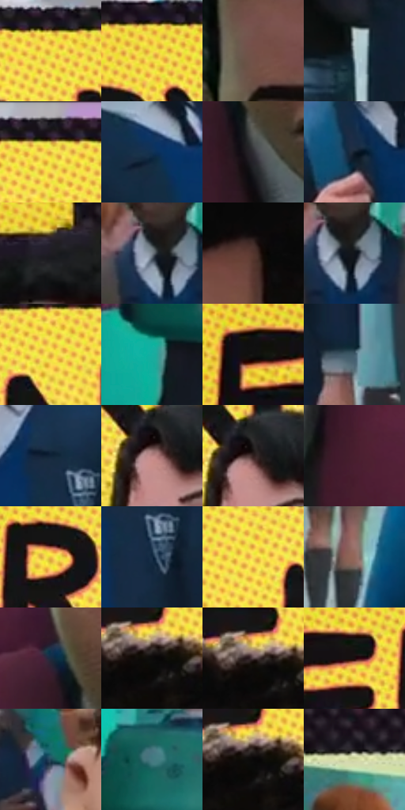

# 电影参考 078

- 状态：条件／活跃；来源世界：miles-home。
- 视角：near-level；景别：medium；场景：portrait。
- 时段：daylight-time-unspecified（外观依据，中置信度；具体时间／晨昏未知）；光照：neutral-day。
- 材质候选：skin, hair, fabric, painted-metal（帧级，不是像素分割）。
- 明暗组：dark；L* P5/P50/P95：3.98731 / 26.01687 / 87.56274。
- 资格门禁：caption。
- 原截图 SHA-256：`00e4c6be823bb132e9cc5e7c081032c67f68f6305dff29cda650f5d47cbd826b`；尺寸：2880 × 1208。
- sRGB 像素 SHA-256：`d0b854969f37a9aa838f28adc4ff034a1ebd9becda2fa3780f00d8acab0eb157`。

## 观察与迁移

近景黄框与后方人群，印刷文字不当物体色。

78  /  近景人物头顶的大幅长框，念头的视觉压力盖过背景人群  /  78

本公开版保存32个128×128原像素色卡上下文；图集格子并非原场景相邻位置。原rect、图集tile和像素SHA见 `data/palette-crops.json`。上下文不足时不得批准替色，不能以小样推断完整构图。

## 实测色卡

颜色比例分母为保留采样像素，不是材料面积；全部 32 色参与全库匹配。表内四舍五入仅用于阅读，原精度在 JSON。

| ID | HEX | Lab | 原图 xy | 像素数 | 比例 | 明度角色 |
| --- | --- | --- | --- | ---: | ---: | --- |
| 078-S01 | #F1D246 | [84.607068, -3.709489, 69.704785] | [1920, 76] | 8892 | 4.599009% | highlight |
| 078-S02 | #F0DF3E | [87.800575, -11.015943, 75.541032] | [768, 84] | 8583 | 4.439192% | highlight |
| 078-S03 | #745048 | [37.696523, 13.978883, 10.772675] | [1256, 580] | 8404 | 4.346612% | shadow |
| 078-S04 | #A5B7BB | [73.189441, -5.368363, -4.134772] | [1948, 1132] | 8215 | 4.248860% | light |
| 078-S05 | #1A151A | [7.50216, 3.711521, -2.595313] | [1084, 36] | 7938 | 4.105593% | deep-shadow |
| 078-S06 | #113253 | [20.141959, 1.034576, -23.532229] | [584, 1008] | 7471 | 3.864057% | shadow |
| 078-S07 | #302E33 | [19.313871, 2.08415, -2.877663] | [1272, 908] | 7341 | 3.796820% | deep-shadow |
| 078-S08 | #121E2C | [10.84134, -0.308071, -11.015955] | [1964, 648] | 7317 | 3.784407% | deep-shadow |
| 078-S09 | #1E1D23 | [11.107221, 2.056863, -3.914522] | [2728, 400] | 6852 | 3.543906% | deep-shadow |
| 078-S10 | #78818A | [53.522827, -1.372695, -5.984915] | [2364, 584] | 6741 | 3.486496% | midtone |
| 078-S11 | #52342C | [25.051245, 12.409851, 10.602177] | [1548, 484] | 6363 | 3.290991% | shadow |
| 078-S12 | #10141A | [6.187811, -0.035661, -4.650184] | [2388, 592] | 6337 | 3.277544% | deep-shadow |
| 078-S13 | #DFA940 | [72.520002, 9.720297, 59.395041] | [1220, 108] | 6337 | 3.277544% | light |
| 078-S14 | #18AEA0 | [64.162238, -39.210556, -3.174267] | [244, 884] | 6230 | 3.222203% | light |
| 078-S15 | #111110 | [5.035673, -0.194496, 0.529077] | [188, 172] | 6062 | 3.135312% | deep-shadow |
| 078-S16 | #3E596A | [36.383604, -5.222562, -12.929658] | [2264, 1128] | 5951 | 3.077902% | shadow |
| 078-S17 | #102337 | [13.156354, -0.146001, -15.32142] | [2108, 632] | 5909 | 3.056179% | deep-shadow |
| 078-S18 | #BA8585 | [60.70162, 20.3534, 8.112458] | [1940, 284] | 5887 | 3.044801% | light |
| 078-S19 | #311F1D | [13.953672, 8.429683, 4.899247] | [1952, 272] | 5835 | 3.017906% | deep-shadow |
| 078-S20 | #481F2E | [18.166734, 21.507223, -0.71444] | [1576, 976] | 5791 | 2.995149% | deep-shadow |
| 078-S21 | #EDC047 | [79.706179, 3.914972, 64.288024] | [708, 172] | 5716 | 2.956358% | light |
| 078-S22 | #112941 | [15.934733, -0.123353, -17.955871] | [2136, 704] | 5609 | 2.901017% | deep-shadow |
| 078-S23 | #F9DF54 | [88.71349, -6.235049, 68.678131] | [1608, 116] | 5301 | 2.741717% | highlight |
| 078-S24 | #91675B | [47.59381, 15.216033, 13.476189] | [912, 1072] | 5217 | 2.698271% | midtone |
| 078-S25 | #1B2B3F | [17.0817, 0.174667, -14.73671] | [1224, 816] | 4996 | 2.583969% | deep-shadow |
| 078-S26 | #0C0B0A | [3.065997, 0.141501, 0.488602] | [1480, 216] | 4948 | 2.559143% | deep-shadow |
| 078-S27 | #544345 | [30.227824, 7.670994, 1.556463] | [1464, 204] | 4903 | 2.535868% | shadow |
| 078-S28 | #1B0F11 | [5.556796, 5.706224, 0.844612] | [592, 168] | 4742 | 2.452598% | deep-shadow |
| 078-S29 | #1F4657 | [27.734822, -7.969402, -14.264077] | [2556, 636] | 4632 | 2.395705% | shadow |
| 078-S30 | #447981 | [47.607855, -15.360183, -9.873727] | [296, 680] | 3944 | 2.039866% | midtone |
| 078-S31 | #090808 | [2.251697, 0.26136, 0.092402] | [1484, 216] | 3752 | 1.940563% | deep-shadow |
| 078-S32 | #D4DAA2 | [85.377155, -11.067299, 26.96744] | [368, 472] | 1130 | 0.584444% | highlight |

## 色阶与空间分布

- 采样 ROI：`[0.01, 0.02, 0.98, 0.94]`；步长：4；样本数：193346。
- 排除区：`[]`。
- 深暗、暗、中、亮、高光五段计数：`[82413, 35919, 21780, 25845, 27389]`。
- RGB 各 256 箱、L* 100 箱、13×5 色相明度表和 3×3 空间统计全部保存在 [总数据](../film-library.json)。
- [可视化档案](../../references/library.html)按需绘制直方图，不存 2,094 张重复图表图片。

## 纹理特征占比

**这是分块图像特征的面积占比，不是波点／排线／丝网／错版的精确语义覆盖率。** 窗格、发丝、织物也会产生方向或周期特征。
原图 ROI 像素 3104134；已测块覆盖 3104134（100.0000%）；未测 0。

| 特征 | 块覆盖像素 | 占已测面积 | 阈值敏感范围 |
| --- | ---: | ---: | --- |
| low-contrast | 43904 | 1.4144% | 1.4144% ~ 1.7731% |
| directional-structure | 577158 | 18.5932% | 8.2471% ~ 36.1883% |
| periodic-structure | 2466688 | 79.4646% | 62.3973% ~ 87.8686% |
| mixed-detail | 16384 | 0.5278% | 0.0000% ~ 2.1112% |

阈值敏感范围不是统计置信区间。逐块坐标、尺度、对比、方向一致性、频谱集中度、频率与角度见 [全量特征记录](../texture-features.jsonl)，以帧号定位。
四种印刷层的真实像素覆盖仍标为 `null`，不能填 0，也不能拿上表代替。不得据这些代理测量删除唯一证据。

[测量方法与保留策略](../../references/library-retention.md) · [分类索引](../archive/README.md)
