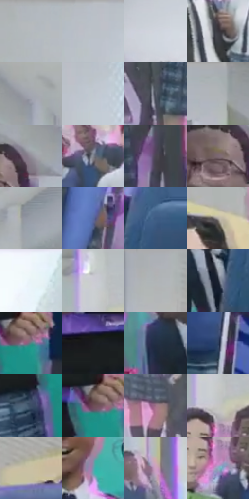

# 电影参考 079

- 状态：常规／活跃；来源世界：miles-home。
- 视角：near-level；景别：environment-wide；场景：interior。
- 时段：daylight-time-unspecified（外观依据，中置信度；具体时间／晨昏未知）；光照：neutral-day。
- 材质候选：skin, fabric, stone, paint（帧级，不是像素分割）。
- 明暗组：light；L* P5/P50/P95：15.32664 / 61.18702 / 85.74047。
- 资格门禁：无附加门禁。
- 原截图 SHA-256：`755bbbf5530ced1a3606b3312a19a8035b44bda2c66676d8e2add4ea85a961d1`；尺寸：2880 × 1200。
- sRGB 像素 SHA-256：`55571f77c1272f6a165337796d335c2e645a1514607dc0c806474f8f3d5bc750`。

## 观察与迁移

明亮走廊群像，主次依焦点而非只看远近。

本公开版保存32个128×128原像素色卡上下文；图集格子并非原场景相邻位置。原rect、图集tile和像素SHA见 `data/palette-crops.json`。上下文不足时不得批准替色，不能以小样推断完整构图。

## 实测色卡

颜色比例分母为保留采样像素，不是材料面积；全部 32 色参与全库匹配。表内四舍五入仅用于阅读，原精度在 JSON。

| ID | HEX | Lab | 原图 xy | 像素数 | 比例 | 明度角色 |
| --- | --- | --- | --- | ---: | ---: | --- |
| 079-S01 | #B2B8BD | [74.457462, -1.121108, -3.251557] | [1040, 24] | 10276 | 5.334081% | light |
| 079-S02 | #B9BFC6 | [77.072715, -0.725171, -4.231318] | [1192, 24] | 9926 | 5.152402% | light |
| 079-S03 | #D0D5DF | [85.162248, 0.188421, -5.501406] | [1264, 480] | 9241 | 4.796832% | highlight |
| 079-S04 | #3A373F | [23.640978, 3.168467, -4.495781] | [1360, 748] | 8978 | 4.660313% | shadow |
| 079-S05 | #A5A7B1 | [68.614031, 1.250896, -5.382855] | [912, 248] | 8791 | 4.563245% | light |
| 079-S06 | #C1C7D0 | [80.031958, -0.332756, -5.192772] | [1260, 80] | 8128 | 4.219094% | highlight |
| 079-S07 | #585D6A | [39.485695, 1.051367, -8.060385] | [1816, 996] | 8108 | 4.208712% | shadow |
| 079-S08 | #ABB1B4 | [71.823742, -1.520503, -2.257389] | [504, 44] | 7295 | 3.786699% | light |
| 079-S09 | #958F9A | [60.219408, 4.351424, -5.015786] | [848, 320] | 7057 | 3.663158% | light |
| 079-S10 | #7E828E | [54.400216, 1.050519, -6.955036] | [1824, 676] | 6994 | 3.630456% | midtone |
| 079-S11 | #4B4551 | [30.269586, 5.184456, -6.248459] | [2032, 984] | 6922 | 3.593082% | shadow |
| 079-S12 | #7B6873 | [46.1095, 9.581574, -3.334746] | [768, 364] | 6605 | 3.428533% | midtone |
| 079-S13 | #969CA6 | [64.172075, -0.115765, -5.945127] | [2016, 296] | 6506 | 3.377144% | light |
| 079-S14 | #55699F | [44.992926, 7.621279, -31.587569] | [968, 920] | 6465 | 3.355861% | midtone |
| 079-S15 | #3E5B83 | [38.10003, 1.449745, -25.674524] | [2704, 668] | 6160 | 3.197542% | shadow |
| 079-S16 | #AFA8A1 | [69.25017, 1.251456, 4.508782] | [588, 468] | 6029 | 3.129542% | light |
| 079-S17 | #F0F6FC | [96.601005, -0.890069, -3.559798] | [1656, 36] | 5865 | 3.044413% | highlight |
| 079-S18 | #CBCBD4 | [81.925979, 1.674519, -4.45843] | [1952, 496] | 5620 | 2.917238% | highlight |
| 079-S19 | #B0B4B5 | [73.029065, -1.210601, -0.994291] | [2668, 68] | 5575 | 2.893879% | light |
| 079-S20 | #1F2533 | [14.698188, 1.543849, -10.007059] | [2616, 748] | 5572 | 2.892322% | deep-shadow |
| 079-S21 | #4B8884 | [52.695656, -20.781622, -4.021077] | [496, 992] | 5224 | 2.711681% | midtone |
| 079-S22 | #191C21 | [10.160194, 0.01479, -3.907556] | [292, 1004] | 5169 | 2.683132% | deep-shadow |
| 079-S23 | #232E43 | [18.870312, 1.934842, -14.659322] | [2516, 720] | 4959 | 2.574125% | deep-shadow |
| 079-S24 | #2C4060 | [26.866562, 2.359368, -21.377479] | [740, 1056] | 4911 | 2.549209% | shadow |
| 079-S25 | #3C4D65 | [32.274961, 0.149566, -16.095375] | [404, 1088] | 4598 | 2.386736% | shadow |
| 079-S26 | #6C4C55 | [36.01008, 15.032053, 0.093517] | [456, 984] | 4303 | 2.233607% | shadow |
| 079-S27 | #9E7489 | [53.564515, 19.916613, -4.952438] | [1656, 908] | 3987 | 2.069578% | midtone |
| 079-S28 | #C6C5C3 | [79.544612, -0.020341, 1.125998] | [1968, 564] | 3342 | 1.734770% | light |
| 079-S29 | #C9BFA2 | [77.453142, -1.246029, 15.918388] | [2820, 372] | 3331 | 1.729060% | light |
| 079-S30 | #679CAC | [61.340102, -13.322887, -13.872359] | [376, 612] | 3293 | 1.709335% | light |
| 079-S31 | #CDA1BF | [71.030411, 21.163609, -9.165664] | [1096, 624] | 2489 | 1.291994% | light |
| 079-S32 | #93A9C0 | [68.302391, -2.509832, -14.299136] | [1972, 660] | 929 | 0.482227% | light |

## 色阶与空间分布

- 采样 ROI：`[0.01, 0.02, 0.98, 0.94]`；步长：4；样本数：192648。
- 排除区：`[]`。
- 深暗、暗、中、亮、高光五段计数：`[14906, 39166, 39620, 73182, 25774]`。
- RGB 各 256 箱、L* 100 箱、13×5 色相明度表和 3×3 空间统计全部保存在 [总数据](../film-library.json)。
- [可视化档案](../../references/library.html)按需绘制直方图，不存 2,094 张重复图表图片。

## 纹理特征占比

**这是分块图像特征的面积占比，不是波点／排线／丝网／错版的精确语义覆盖率。** 窗格、发丝、织物也会产生方向或周期特征。
原图 ROI 像素 3084576；已测块覆盖 3084576（100.0000%）；未测 0。

| 特征 | 块覆盖像素 | 占已测面积 | 阈值敏感范围 |
| --- | ---: | ---: | --- |
| low-contrast | 131072 | 4.2493% | 1.5935% ~ 5.7515% |
| directional-structure | 743456 | 24.1024% | 9.1469% ~ 42.3776% |
| periodic-structure | 2160896 | 70.0549% | 55.4978% ~ 81.4748% |
| mixed-detail | 49152 | 1.5935% | 0.5312% ~ 3.6268% |

阈值敏感范围不是统计置信区间。逐块坐标、尺度、对比、方向一致性、频谱集中度、频率与角度见 [全量特征记录](../texture-features.jsonl)，以帧号定位。
四种印刷层的真实像素覆盖仍标为 `null`，不能填 0，也不能拿上表代替。不得据这些代理测量删除唯一证据。

[测量方法与保留策略](../../references/library-retention.md) · [分类索引](../archive/README.md)
