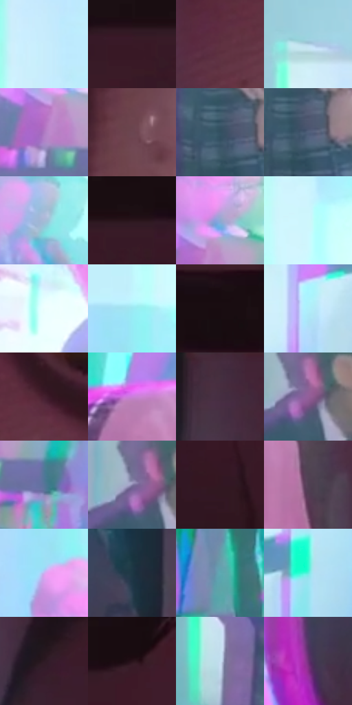

# 电影参考 080

- 状态：条件／活跃；来源世界：miles-home。
- 视角：near-level；景别：close-up；场景：portrait。
- 时段：graphic-no-physical-time（外观依据，中置信度；具体时间／晨昏未知）；光照：graphic-field。
- 材质候选：skin, hair, fabric, paint（帧级，不是像素分割）。
- 明暗组：middle；L* P5/P50/P95：9.77113 / 49.43774 / 94.28346。
- 资格门禁：strong-separation。
- 原截图 SHA-256：`881440d07d59c496badfbec79d97e7d6c55367a7475b71ad76a07bd52ae95c01`；尺寸：2880 × 1206。
- sRGB 像素 SHA-256：`1d32aab5ea4a859d7c91851f038b0bdaf1eaec099d80f47602487d701852d562`。

## 观察与迁移

面部压迫近景与强彩色错位，不能全图均匀套用。

本公开版保存32个128×128原像素色卡上下文；图集格子并非原场景相邻位置。原rect、图集tile和像素SHA见 `data/palette-crops.json`。上下文不足时不得批准替色，不能以小样推断完整构图。

## 实测色卡

颜色比例分母为保留采样像素，不是材料面积；全部 32 色参与全库匹配。表内四舍五入仅用于阅读，原精度在 JSON。

| ID | HEX | Lab | 原图 xy | 像素数 | 比例 | 明度角色 |
| --- | --- | --- | --- | ---: | ---: | --- |
| 080-S01 | #C8ECFB | [91.339637, -8.526349, -11.123923] | [1012, 156] | 11291 | 5.839790% | highlight |
| 080-S02 | #391926 | [13.857543, 17.682757, -1.612589] | [2232, 152] | 11061 | 5.720832% | deep-shadow |
| 080-S03 | #5E3040 | [26.344524, 22.978584, -0.656222] | [1972, 816] | 10476 | 5.418266% | shadow |
| 080-S04 | #B3D2E5 | [82.557022, -6.210603, -12.778291] | [444, 132] | 9572 | 4.950710% | highlight |
| 080-S05 | #AD79C2 | [58.466018, 33.286345, -30.261172] | [1152, 676] | 9044 | 4.677625% | midtone |
| 080-S06 | #6B4651 | [34.191819, 17.625245, -0.041403] | [2800, 864] | 7626 | 3.944224% | shadow |
| 080-S07 | #335162 | [32.85386, -5.98869, -13.361376] | [552, 1080] | 7565 | 3.912675% | shadow |
| 080-S08 | #4F607A | [40.299783, 0.390046, -16.693687] | [576, 1092] | 7151 | 3.698551% | midtone |
| 080-S09 | #A8BAD6 | [75.011502, -0.18075, -16.113387] | [1440, 540] | 6747 | 3.489599% | light |
| 080-S10 | #2A151C | [9.8956, 11.890951, -0.320091] | [2308, 128] | 6661 | 3.445119% | deep-shadow |
| 080-S11 | #8EA9D0 | [68.51822, -0.129322, -22.843564] | [1184, 596] | 6520 | 3.372193% | light |
| 080-S12 | #CEF7FC | [94.597765, -12.065014, -6.769146] | [1216, 172] | 6437 | 3.329265% | highlight |
| 080-S13 | #EDFEFE | [98.449275, -5.528388, -1.90215] | [1588, 292] | 6028 | 3.117727% | highlight |
| 080-S14 | #9CE8F2 | [87.576427, -20.925318, -12.284639] | [1136, 380] | 5989 | 3.097556% | highlight |
| 080-S15 | #1C0F14 | [5.772691, 6.904835, -0.690433] | [2392, 32] | 5986 | 3.096004% | deep-shadow |
| 080-S16 | #B0EFFB | [90.74557, -16.951829, -12.156469] | [836, 920] | 5881 | 3.041697% | highlight |
| 080-S17 | #45202F | [17.935535, 19.817218, -1.818592] | [2072, 744] | 5840 | 3.020492% | deep-shadow |
| 080-S18 | #C980D9 | [64.05286, 42.693671, -34.291875] | [1480, 900] | 5705 | 2.950669% | light |
| 080-S19 | #452E41 | [22.305911, 14.218981, -7.723896] | [1908, 64] | 5591 | 2.891707% | shadow |
| 080-S20 | #925F9B | [47.831985, 31.211336, -24.377343] | [192, 524] | 5504 | 2.846710% | midtone |
| 080-S21 | #577499 | [48.027249, -0.343936, -23.317228] | [1260, 736] | 5345 | 2.764474% | midtone |
| 080-S22 | #8680A8 | [55.41415, 10.892552, -20.400224] | [168, 516] | 5239 | 2.709650% | midtone |
| 080-S23 | #321721 | [11.963324, 15.079679, -0.865799] | [2668, 328] | 5174 | 2.676032% | deep-shadow |
| 080-S24 | #504054 | [29.443848, 11.092641, -9.380154] | [1844, 1000] | 4999 | 2.585520% | shadow |
| 080-S25 | #CDB1F1 | [76.541993, 22.195333, -28.145261] | [1112, 476] | 4883 | 2.525524% | light |
| 080-S26 | #1E3745 | [21.718329, -4.998755, -11.644026] | [1792, 428] | 4858 | 2.512594% | shadow |
| 080-S27 | #5EA9B2 | [64.937003, -20.848033, -11.871003] | [1172, 1056] | 4806 | 2.485699% | light |
| 080-S28 | #5FEEDD | [86.403713, -42.289797, -3.247479] | [956, 868] | 3404 | 1.760574% | highlight |
| 080-S29 | #2E1A24 | [12.26775, 11.788787, -2.700369] | [1980, 216] | 3129 | 1.618342% | deep-shadow |
| 080-S30 | #28121A | [8.640013, 12.684536, -0.683079] | [2676, 112] | 2253 | 1.165268% | deep-shadow |
| 080-S31 | #C4DDF0 | [86.868331, -4.368178, -12.049872] | [440, 992] | 1964 | 1.015796% | highlight |
| 080-S32 | #6F327A | [31.957256, 38.478118, -29.430205] | [1684, 596] | 617 | 0.319117% | shadow |

## 色阶与空间分布

- 采样 ROI：`[0.01, 0.02, 0.98, 0.94]`；步长：4；样本数：193346。
- 排除区：`[]`。
- 深暗、暗、中、亮、高光五段计数：`[41619, 41675, 28169, 30722, 51161]`。
- RGB 各 256 箱、L* 100 箱、13×5 色相明度表和 3×3 空间统计全部保存在 [总数据](../film-library.json)。
- [可视化档案](../../references/library.html)按需绘制直方图，不存 2,094 张重复图表图片。

## 纹理特征占比

**这是分块图像特征的面积占比，不是波点／排线／丝网／错版的精确语义覆盖率。** 窗格、发丝、织物也会产生方向或周期特征。
原图 ROI 像素 3098546；已测块覆盖 3098546（100.0000%）；未测 0。

| 特征 | 块覆盖像素 | 占已测面积 | 阈值敏感范围 |
| --- | ---: | ---: | --- |
| low-contrast | 354816 | 11.4510% | 9.8648% ~ 12.8597% |
| directional-structure | 1086592 | 35.0678% | 22.7327% ~ 49.4229% |
| periodic-structure | 1657138 | 53.4811% | 40.7123% ~ 62.8213% |
| mixed-detail | 0 | 0.0000% | 0.0000% ~ 1.5863% |

阈值敏感范围不是统计置信区间。逐块坐标、尺度、对比、方向一致性、频谱集中度、频率与角度见 [全量特征记录](../texture-features.jsonl)，以帧号定位。
四种印刷层的真实像素覆盖仍标为 `null`，不能填 0，也不能拿上表代替。不得据这些代理测量删除唯一证据。

[测量方法与保留策略](../../references/library-retention.md) · [分类索引](../archive/README.md)
