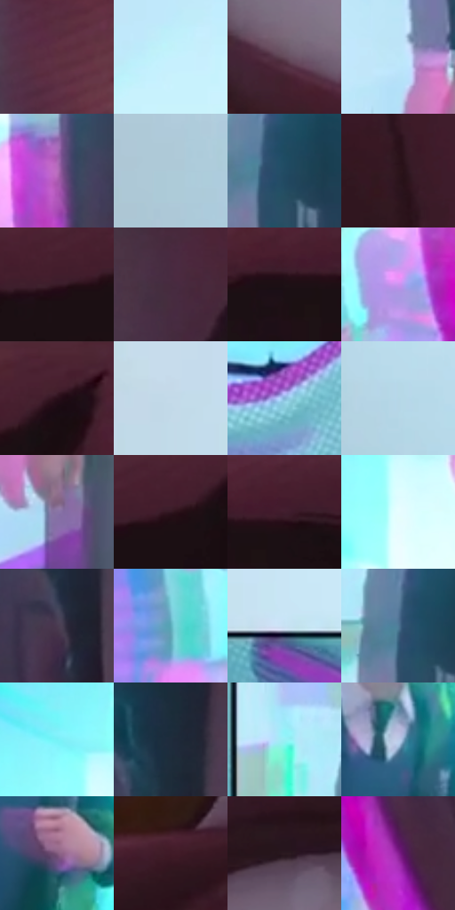

# 电影参考 081

- 状态：条件／活跃；来源世界：miles-home。
- 视角：near-level；景别：close-up；场景：portrait。
- 时段：graphic-no-physical-time（外观依据，中置信度；具体时间／晨昏未知）；光照：graphic-field。
- 材质候选：skin, hair, fabric, paint（帧级，不是像素分割）。
- 明暗组：middle；L* P5/P50/P95：9.95157 / 46.88141 / 93.50435。
- 资格门禁：strong-separation。
- 原截图 SHA-256：`9d218292e7ef9a8d8b0daae1d39d76d6555a478cc053ab0a54a937f8f170d3f1`；尺寸：2880 × 1196。
- sRGB 像素 SHA-256：`85feb7a448abd4ec111131dbf355d40ed337f41bb4b40feda3b9e685c975b75c`。

## 观察与迁移

面部压迫近景与强彩色错位，不能全图均匀套用。

本公开版保存32个128×128原像素色卡上下文；图集格子并非原场景相邻位置。原rect、图集tile和像素SHA见 `data/palette-crops.json`。上下文不足时不得批准替色，不能以小样推断完整构图。

## 实测色卡

颜色比例分母为保留采样像素，不是材料面积；全部 32 色参与全库匹配。表内四舍五入仅用于阅读，原精度在 JSON。

| ID | HEX | Lab | 原图 xy | 像素数 | 比例 | 明度角色 |
| --- | --- | --- | --- | ---: | ---: | --- |
| 081-S01 | #5E3040 | [26.344524, 22.978584, -0.656222] | [1872, 896] | 10473 | 5.436340% | shadow |
| 081-S02 | #C5F1FD | [92.517522, -11.523394, -10.431813] | [928, 116] | 10450 | 5.424401% | highlight |
| 081-S03 | #644959 | [34.387809, 14.371136, -4.935807] | [2028, 680] | 10087 | 5.235974% | shadow |
| 081-S04 | #BCE6F8 | [88.95074, -9.670764, -13.197324] | [784, 916] | 8732 | 4.532619% | highlight |
| 081-S05 | #B86FBD | [57.30323, 41.170677, -29.11643] | [1548, 500] | 8346 | 4.332254% | midtone |
| 081-S06 | #ADCBD8 | [79.927193, -7.232205, -9.795025] | [200, 1052] | 8196 | 4.254391% | light |
| 081-S07 | #214B63 | [30.048815, -6.337379, -18.386269] | [864, 708] | 7922 | 4.112163% | shadow |
| 081-S08 | #2C151B | [10.191241, 12.654944, 0.903856] | [2672, 444] | 7651 | 3.971492% | deep-shadow |
| 081-S09 | #391B27 | [14.402797, 16.563009, -1.534916] | [2544, 116] | 7614 | 3.952286% | deep-shadow |
| 081-S10 | #462B3E | [21.497655, 15.966397, -6.891137] | [1872, 228] | 7371 | 3.826149% | shadow |
| 081-S11 | #1D1015 | [6.196394, 7.182528, -0.732027] | [2192, 148] | 7239 | 3.757630% | deep-shadow |
| 081-S12 | #CB92EE | [69.06, 37.891773, -38.093055] | [1476, 632] | 6241 | 3.239587% | light |
| 081-S13 | #4B2231 | [19.482534, 21.382945, -0.832388] | [2676, 28] | 6216 | 3.226610% | deep-shadow |
| 081-S14 | #C3DAE9 | [85.819417, -4.592581, -9.923844] | [204, 160] | 6138 | 3.186122% | highlight |
| 081-S15 | #88B6D9 | [72.02592, -6.608376, -22.461772] | [524, 684] | 5989 | 3.108779% | light |
| 081-S16 | #B5D7E7 | [84.065761, -7.768175, -11.574091] | [344, 892] | 5843 | 3.032993% | highlight |
| 081-S17 | #8773A5 | [51.982574, 18.151481, -23.92704] | [864, 1052] | 5721 | 2.969665% | midtone |
| 081-S18 | #321721 | [11.963324, 15.079679, -0.865799] | [2604, 104] | 5585 | 2.899070% | deep-shadow |
| 081-S19 | #421E2D | [16.876178, 19.486455, -2.022129] | [2252, 128] | 5415 | 2.810826% | deep-shadow |
| 081-S20 | #E6FDFF | [97.749586, -7.065458, -3.498051] | [1316, 172] | 5382 | 2.793696% | highlight |
| 081-S21 | #493A50 | [26.796845, 11.337225, -10.863008] | [1692, 540] | 5196 | 2.697147% | shadow |
| 081-S22 | #5CADBC | [66.359786, -20.611362, -15.300605] | [1336, 776] | 5162 | 2.679498% | light |
| 081-S23 | #C8E1F4 | [88.285175, -4.365274, -12.01302] | [352, 416] | 4912 | 2.549728% | highlight |
| 081-S24 | #4E7A97 | [49.218316, -6.860224, -20.351213] | [836, 696] | 4587 | 2.381027% | midtone |
| 081-S25 | #76F1F6 | [88.643308, -33.000108, -12.94812] | [1272, 76] | 4480 | 2.325485% | highlight |
| 081-S26 | #202C3C | [17.619972, -0.048612, -11.8013] | [1704, 384] | 4313 | 2.238798% | deep-shadow |
| 081-S27 | #9BEFF6 | [89.557341, -23.673575, -11.429307] | [740, 600] | 4268 | 2.215440% | highlight |
| 081-S28 | #BCCBE8 | [81.416822, 0.896084, -16.027957] | [1064, 552] | 4255 | 2.208691% | highlight |
| 081-S29 | #805A7C | [43.296687, 21.609223, -12.928426] | [1096, 672] | 3247 | 1.685457% | midtone |
| 081-S30 | #401B27 | [15.594957, 19.560144, 0.352629] | [2364, 780] | 3162 | 1.641335% | deep-shadow |
| 081-S31 | #2A1A20 | [11.520793, 9.116293, -0.921473] | [2148, 420] | 2018 | 1.047506% | deep-shadow |
| 081-S32 | #861F92 | [34.24058, 56.668553, -40.466897] | [1608, 748] | 437 | 0.226839% | shadow |

## 色阶与空间分布

- 采样 ROI：`[0.01, 0.02, 0.98, 0.94]`；步长：4；样本数：192648。
- 排除区：`[]`。
- 深暗、暗、中、亮、高光五段计数：`[47256, 43879, 18153, 24783, 58577]`。
- RGB 各 256 箱、L* 100 箱、13×5 色相明度表和 3×3 空间统计全部保存在 [总数据](../film-library.json)。
- [可视化档案](../../references/library.html)按需绘制直方图，不存 2,094 张重复图表图片。

## 纹理特征占比

**这是分块图像特征的面积占比，不是波点／排线／丝网／错版的精确语义覆盖率。** 窗格、发丝、织物也会产生方向或周期特征。
原图 ROI 像素 3076194；已测块覆盖 3076194（100.0000%）；未测 0。

| 特征 | 块覆盖像素 | 占已测面积 | 阈值敏感范围 |
| --- | ---: | ---: | --- |
| low-contrast | 532352 | 17.3055% | 14.8547% ~ 21.1420% |
| directional-structure | 1035520 | 33.6624% | 15.2334% ~ 51.5754% |
| periodic-structure | 1465698 | 47.6465% | 33.5699% ~ 58.2820% |
| mixed-detail | 42624 | 1.3856% | 0.0000% ~ 5.3427% |

阈值敏感范围不是统计置信区间。逐块坐标、尺度、对比、方向一致性、频谱集中度、频率与角度见 [全量特征记录](../texture-features.jsonl)，以帧号定位。
四种印刷层的真实像素覆盖仍标为 `null`，不能填 0，也不能拿上表代替。不得据这些代理测量删除唯一证据。

[测量方法与保留策略](../../references/library-retention.md) · [分类索引](../archive/README.md)
