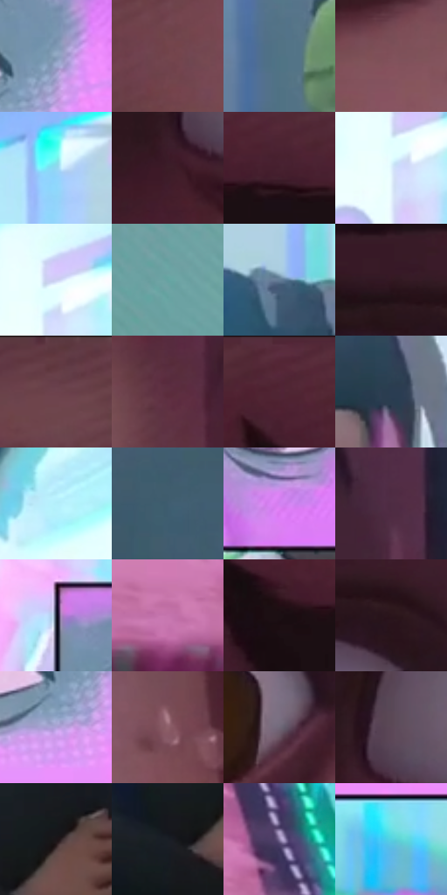

# 电影参考 082

- 状态：条件／活跃；来源世界：miles-home。
- 视角：near-level；景别：close-up；场景：portrait。
- 时段：graphic-no-physical-time（外观依据，中置信度；具体时间／晨昏未知）；光照：graphic-field。
- 材质候选：skin, hair, fabric, paint（帧级，不是像素分割）。
- 明暗组：dark；L* P5/P50/P95：9.22185 / 39.50416 / 90.00418。
- 资格门禁：strong-separation。
- 原截图 SHA-256：`9d1bbe3f5909d35ba98e4d902b9bc855f4bc0865edcaf6d50d78d2920968026b`；尺寸：2880 × 1206。
- sRGB 像素 SHA-256：`343a731ac7f6d3c80c70caea180e7c72016e54b6efbbc72708314f19511ba54a`。

## 观察与迁移

面部压迫近景与强彩色错位，不能全图均匀套用。

本公开版保存32个128×128原像素色卡上下文；图集格子并非原场景相邻位置。原rect、图集tile和像素SHA见 `data/palette-crops.json`。上下文不足时不得批准替色，不能以小样推断完整构图。

## 实测色卡

颜色比例分母为保留采样像素，不是材料面积；全部 32 色参与全库匹配。表内四舍五入仅用于阅读，原精度在 JSON。

| ID | HEX | Lab | 原图 xy | 像素数 | 比例 | 明度角色 |
| --- | --- | --- | --- | ---: | ---: | --- |
| 082-S01 | #8BA2BE | [65.784561, -1.600173, -17.042151] | [1792, 608] | 9493 | 4.909851% | light |
| 082-S02 | #73464D | [35.126374, 20.301047, 3.987746] | [448, 964] | 7951 | 4.112317% | shadow |
| 082-S03 | #4F7385 | [46.467047, -7.818159, -13.915051] | [2384, 388] | 7640 | 3.951465% | midtone |
| 082-S04 | #80505A | [39.690732, 21.578022, 2.620395] | [712, 848] | 7634 | 3.948362% | shadow |
| 082-S05 | #93D7F2 | [82.492219, -14.672257, -19.970573] | [1920, 96] | 7554 | 3.906985% | highlight |
| 082-S06 | #3C1C28 | [15.193659, 17.383016, -1.036152] | [328, 720] | 7406 | 3.830439% | deep-shadow |
| 082-S07 | #46212F | [18.344349, 19.612029, -1.197527] | [308, 156] | 7040 | 3.641141% | deep-shadow |
| 082-S08 | #DEF2FD | [94.36547, -4.41504, -7.516306] | [1484, 224] | 6805 | 3.519597% | highlight |
| 082-S09 | #CED0F2 | [84.299681, 5.991263, -16.886695] | [1500, 180] | 6763 | 3.497874% | highlight |
| 082-S10 | #65A3A1 | [62.954729, -20.415223, -5.276874] | [2692, 92] | 6655 | 3.442016% | light |
| 082-S11 | #647E97 | [51.683677, -3.020829, -16.469244] | [2032, 264] | 6644 | 3.436327% | midtone |
| 082-S12 | #341921 | [12.830668, 14.645499, 0.442547] | [680, 340] | 6619 | 3.423396% | deep-shadow |
| 082-S13 | #633A42 | [29.595035, 19.275321, 2.834151] | [768, 28] | 6584 | 3.405294% | shadow |
| 082-S14 | #5B2E3E | [25.340556, 22.659173, -0.842427] | [1012, 732] | 6581 | 3.403743% | shadow |
| 082-S15 | #512434 | [21.054269, 23.076663, -0.496976] | [152, 60] | 6529 | 3.376848% | shadow |
| 082-S16 | #2A3D52 | [25.071569, -1.024715, -15.059851] | [2160, 408] | 6482 | 3.352539% | shadow |
| 082-S17 | #B4EFFB | [90.961274, -15.841806, -11.81194] | [1380, 100] | 6478 | 3.350470% | highlight |
| 082-S18 | #3E5D70 | [37.882045, -5.845618, -14.358172] | [2448, 1092] | 6429 | 3.325127% | shadow |
| 082-S19 | #D282F1 | [66.534234, 49.041705, -43.635897] | [1976, 708] | 6344 | 3.281164% | light |
| 082-S20 | #4E2C42 | [23.049084, 19.354736, -7.158837] | [1012, 396] | 5944 | 3.074281% | shadow |
| 082-S21 | #1F2535 | [14.797343, 2.209445, -11.270053] | [1496, 460] | 5782 | 2.990494% | deep-shadow |
| 082-S22 | #C575AD | [59.536558, 39.261805, -16.394938] | [1356, 1056] | 5571 | 2.881363% | midtone |
| 082-S23 | #1B0F13 | [5.615903, 6.121577, -0.285819] | [200, 184] | 5102 | 2.638793% | deep-shadow |
| 082-S24 | #2B151B | [10.024157, 12.183218, 0.640681] | [760, 388] | 5007 | 2.589658% | deep-shadow |
| 082-S25 | #B0A2D9 | [69.526478, 16.213386, -26.037325] | [1744, 684] | 4937 | 2.553453% | light |
| 082-S26 | #8E606A | [45.850035, 20.216463, 1.95672] | [92, 928] | 4741 | 2.452081% | midtone |
| 082-S27 | #706878 | [45.222551, 6.441385, -7.773091] | [816, 616] | 4319 | 2.233819% | midtone |
| 082-S28 | #5C4757 | [32.854043, 12.02162, -6.047298] | [372, 640] | 4139 | 2.140722% | shadow |
| 082-S29 | #1B1519 | [7.583563, 3.954162, -1.695846] | [2136, 1044] | 3846 | 1.989180% | deep-shadow |
| 082-S30 | #1A1E26 | [11.191724, 0.500265, -6.032247] | [2060, 1096] | 3740 | 1.934356% | deep-shadow |
| 082-S31 | #8D80A9 | [56.053169, 13.429982, -19.945305] | [1464, 980] | 3499 | 1.809709% | midtone |
| 082-S32 | #57D1E2 | [77.942211, -28.823526, -18.539734] | [1632, 808] | 3088 | 1.597137% | light |

## 色阶与空间分布

- 采样 ROI：`[0.01, 0.02, 0.98, 0.94]`；步长：4；样本数：193346。
- 排除区：`[]`。
- 深暗、暗、中、亮、高光五段计数：`[46776, 51299, 36336, 33228, 25707]`。
- RGB 各 256 箱、L* 100 箱、13×5 色相明度表和 3×3 空间统计全部保存在 [总数据](../film-library.json)。
- [可视化档案](../../references/library.html)按需绘制直方图，不存 2,094 张重复图表图片。

## 纹理特征占比

**这是分块图像特征的面积占比，不是波点／排线／丝网／错版的精确语义覆盖率。** 窗格、发丝、织物也会产生方向或周期特征。
原图 ROI 像素 3098546；已测块覆盖 3098546（100.0000%）；未测 0。

| 特征 | 块覆盖像素 | 占已测面积 | 阈值敏感范围 |
| --- | ---: | ---: | --- |
| low-contrast | 210176 | 6.7831% | 4.1392% ~ 7.8406% |
| directional-structure | 1116288 | 36.0262% | 26.8678% ~ 54.1091% |
| periodic-structure | 1728434 | 55.7821% | 41.7517% ~ 61.7720% |
| mixed-detail | 43648 | 1.4087% | 0.0000% ~ 3.5196% |

阈值敏感范围不是统计置信区间。逐块坐标、尺度、对比、方向一致性、频谱集中度、频率与角度见 [全量特征记录](../texture-features.jsonl)，以帧号定位。
四种印刷层的真实像素覆盖仍标为 `null`，不能填 0，也不能拿上表代替。不得据这些代理测量删除唯一证据。

[测量方法与保留策略](../../references/library-retention.md) · [分类索引](../archive/README.md)
