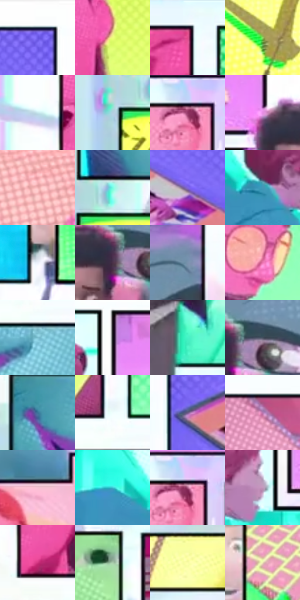

# 电影参考 083

- 状态：条件／活跃；来源世界：miles-home。
- 视角：graphic-nonphysical；景别：graphic-or-multipanel；场景：graphic。
- 时段：graphic-no-physical-time（外观依据，中置信度；具体时间／晨昏未知）；光照：graphic-field。
- 材质候选：skin, fabric, paper（帧级，不是像素分割）。
- 明暗组：light；L* P5/P50/P95：24.82556 / 71.77512 / 99.03939。
- 资格门禁：panel。
- 原截图 SHA-256：`d7032343578d72f171144e0bc3c133bc7637a3d242acb7fd1c4befb4ad3ff3e5`；尺寸：2880 × 1206。
- sRGB 像素 SHA-256：`fcb9a28b4d55551de05411081b8787e3898d213f5d0da3a7af2bdb2da5dc04e7`。

## 观察与迁移

多格感知拼贴，不是单一真实空间配色。

本公开版保存32个128×128原像素色卡上下文；图集格子并非原场景相邻位置。原rect、图集tile和像素SHA见 `data/palette-crops.json`。上下文不足时不得批准替色，不能以小样推断完整构图。

## 实测色卡

颜色比例分母为保留采样像素，不是材料面积；全部 32 色参与全库匹配。表内四舍五入仅用于阅读，原精度在 JSON。

| ID | HEX | Lab | 原图 xy | 像素数 | 比例 | 明度角色 |
| --- | --- | --- | --- | ---: | ---: | --- |
| 083-S01 | #FBFDFD | [99.16323, -0.66053, -0.226668] | [1372, 32] | 13745 | 7.109017% | highlight |
| 083-S02 | #EEFD7B | [95.938371, -22.597814, 59.773838] | [312, 188] | 9760 | 5.047945% | highlight |
| 083-S03 | #E34B8A | [55.280218, 63.616189, -1.932366] | [548, 56] | 9038 | 4.674521% | midtone |
| 083-S04 | #9ADF6E | [82.254955, -41.086634, 48.196217] | [356, 1064] | 8907 | 4.606767% | highlight |
| 083-S05 | #C7E7ED | [89.583108, -9.205089, -6.419603] | [136, 244] | 8378 | 4.333164% | highlight |
| 083-S06 | #B3CEE0 | [81.350132, -5.211583, -11.914878] | [160, 860] | 8189 | 4.235412% | highlight |
| 083-S07 | #933765 | [37.619899, 43.501257, -6.997841] | [1812, 820] | 8138 | 4.209035% | shadow |
| 083-S08 | #E48CE4 | [70.073257, 46.593803, -30.816501] | [1396, 560] | 8110 | 4.194553% | light |
| 083-S09 | #F5B4B5 | [79.267912, 23.735035, 8.817959] | [784, 116] | 7381 | 3.817509% | light |
| 083-S10 | #74FDE3 | [91.462096, -43.568864, 1.097858] | [232, 808] | 7122 | 3.683552% | highlight |
| 083-S11 | #8065DC | [50.76043, 38.756136, -57.489747] | [1276, 152] | 7091 | 3.667518% | midtone |
| 083-S12 | #4297B7 | [58.703112, -15.669359, -24.247153] | [936, 600] | 7078 | 3.660795% | midtone |
| 083-S13 | #EAEFF9 | [94.339894, 0.175804, -5.385025] | [2464, 724] | 6922 | 3.580110% | highlight |
| 083-S14 | #4A3147 | [24.023928, 15.570478, -9.101885] | [1528, 608] | 6891 | 3.564077% | shadow |
| 083-S15 | #7A92AC | [59.592024, -2.302283, -16.407341] | [2036, 512] | 6741 | 3.486496% | midtone |
| 083-S16 | #EA73AF | [64.041596, 52.614313, -10.273527] | [880, 292] | 6643 | 3.435809% | light |
| 083-S17 | #7ABDCE | [72.882959, -16.855108, -15.233765] | [584, 448] | 5923 | 3.063420% | light |
| 083-S18 | #191B1F | [9.715434, 0.163621, -3.084665] | [1104, 464] | 5534 | 2.862226% | deep-shadow |
| 083-S19 | #45F3C7 | [86.743645, -53.718376, 8.683499] | [1552, 1096] | 5141 | 2.658964% | highlight |
| 083-S20 | #424D5C | [32.343741, -0.487983, -10.245007] | [1580, 580] | 5117 | 2.646551% | shadow |
| 083-S21 | #397498 | [46.480281, -7.807272, -25.242922] | [220, 492] | 4822 | 2.493975% | midtone |
| 083-S22 | #EFFDFD | [98.309844, -4.567606, -1.576287] | [572, 360] | 4725 | 2.443805% | highlight |
| 083-S23 | #675583 | [39.612711, 17.492106, -23.074956] | [1076, 152] | 4458 | 2.305711% | shadow |
| 083-S24 | #B777B1 | [58.449092, 34.242922, -20.495202] | [1644, 76] | 4437 | 2.294850% | midtone |
| 083-S25 | #F7C3D5 | [83.762731, 21.267407, -1.857701] | [688, 864] | 4041 | 2.090035% | highlight |
| 083-S26 | #40C1D1 | [72.114469, -29.495844, -18.225669] | [832, 568] | 3981 | 2.059003% | light |
| 083-S27 | #AE5E87 | [50.399509, 37.667851, -8.270901] | [1824, 816] | 3977 | 2.056934% | midtone |
| 083-S28 | #C196BA | [67.048603, 22.143191, -12.463518] | [1060, 588] | 3606 | 1.865050% | light |
| 083-S29 | #D33481 | [49.366866, 66.284886, -5.590511] | [208, 344] | 3213 | 1.661788% | midtone |
| 083-S30 | #A8CAAC | [78.194847, -17.144369, 11.256944] | [2212, 860] | 2064 | 1.067516% | light |
| 083-S31 | #FBFDA6 | [97.4361, -13.364273, 41.477512] | [2580, 96] | 1553 | 0.803223% | highlight |
| 083-S32 | #ECE6B4 | [90.653424, -5.77046, 25.163228] | [2528, 592] | 620 | 0.320669% | highlight |

## 色阶与空间分布

- 采样 ROI：`[0.01, 0.02, 0.98, 0.94]`；步长：4；样本数：193346。
- 排除区：`[]`。
- 深暗、暗、中、亮、高光五段计数：`[6804, 19279, 42185, 45451, 79627]`。
- RGB 各 256 箱、L* 100 箱、13×5 色相明度表和 3×3 空间统计全部保存在 [总数据](../film-library.json)。
- [可视化档案](../../references/library.html)按需绘制直方图，不存 2,094 张重复图表图片。

## 纹理特征占比

**这是分块图像特征的面积占比，不是波点／排线／丝网／错版的精确语义覆盖率。** 窗格、发丝、织物也会产生方向或周期特征。
原图 ROI 像素 3098546；已测块覆盖 3098546（100.0000%）；未测 0。

| 特征 | 块覆盖像素 | 占已测面积 | 阈值敏感范围 |
| --- | ---: | ---: | --- |
| low-contrast | 0 | 0.0000% | 0.0000% ~ 0.0000% |
| directional-structure | 1578290 | 50.9365% | 40.5388% ~ 59.5702% |
| periodic-structure | 1520256 | 49.0635% | 40.4298% ~ 56.8174% |
| mixed-detail | 0 | 0.0000% | 0.0000% ~ 2.6438% |

阈值敏感范围不是统计置信区间。逐块坐标、尺度、对比、方向一致性、频谱集中度、频率与角度见 [全量特征记录](../texture-features.jsonl)，以帧号定位。
四种印刷层的真实像素覆盖仍标为 `null`，不能填 0，也不能拿上表代替。不得据这些代理测量删除唯一证据。

[测量方法与保留策略](../../references/library-retention.md) · [分类索引](../archive/README.md)
