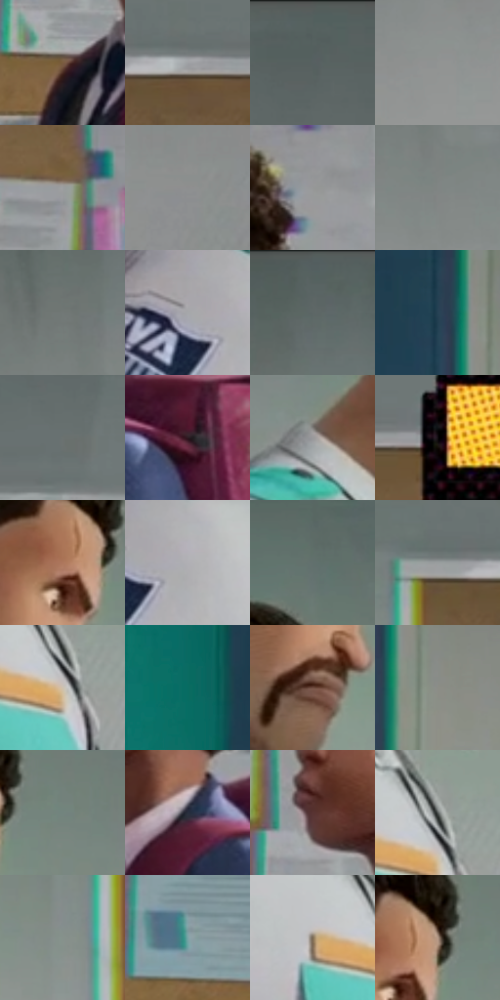

# 电影参考 084

- 状态：条件／活跃；来源世界：miles-home。
- 视角：near-level；景别：medium；场景：interior。
- 时段：daylight-time-unspecified（外观依据，中置信度；具体时间／晨昏未知）；光照：neutral-day。
- 材质候选：skin, fabric, paint（帧级，不是像素分割）。
- 明暗组：middle；L* P5/P50/P95：11.34241 / 53.89966 / 71.41404。
- 资格门禁：caption。
- 原截图 SHA-256：`8ae5023146388b41539bc4720c42d8efe73100a35d315c3c8036ea440f4ca005`；尺寸：2880 × 1206。
- sRGB 像素 SHA-256：`773ed025142282577dd03a19e8a03e654a1aae53ce9fdeb9c78dd888a1dd61f5`。

## 观察与迁移

走廊对话与小黄框，普通服装和墙面保持中性色。

84  /  对峙画面的右上方小框，只强调一瞬间的心理决定  /  84

本公开版保存32个128×128原像素色卡上下文；图集格子并非原场景相邻位置。原rect、图集tile和像素SHA见 `data/palette-crops.json`。上下文不足时不得批准替色，不能以小样推断完整构图。

## 实测色卡

颜色比例分母为保留采样像素，不是材料面积；全部 32 色参与全库匹配。表内四舍五入仅用于阅读，原精度在 JSON。

| ID | HEX | Lab | 原图 xy | 像素数 | 比例 | 明度角色 |
| --- | --- | --- | --- | ---: | ---: | --- |
| 084-S01 | #7A5C3F | [41.455975, 8.303667, 21.400279] | [1784, 752] | 13290 | 6.873688% | midtone |
| 084-S02 | #A0A2A5 | [66.543406, -0.134517, -1.80092] | [1656, 216] | 10423 | 5.390854% | light |
| 084-S03 | #576061 | [40.006488, -3.256187, -1.76081] | [2304, 64] | 9360 | 4.841062% | midtone |
| 084-S04 | #919393 | [60.77607, -0.729095, -0.252173] | [520, 456] | 9177 | 4.746413% | light |
| 084-S05 | #9C9EA0 | [65.009858, -0.330875, -1.289423] | [1712, 464] | 8624 | 4.460397% | light |
| 084-S06 | #8E8E8F | [59.04825, 0.194102, -0.527744] | [2760, 584] | 8277 | 4.280926% | midtone |
| 084-S07 | #969898 | [62.682357, -0.724751, -0.250589] | [2084, 480] | 8274 | 4.279375% | light |
| 084-S08 | #808583 | [55.075259, -2.250188, 0.435767] | [684, 328] | 8191 | 4.236447% | midtone |
| 084-S09 | #717876 | [49.799761, -3.040075, 0.19085] | [648, 216] | 7586 | 3.923536% | midtone |
| 084-S10 | #A6A7AA | [68.49451, 0.218002, -1.66645] | [920, 480] | 6813 | 3.523735% | light |
| 084-S11 | #5E6766 | [42.822444, -3.664046, -0.617602] | [940, 56] | 6753 | 3.492702% | midtone |
| 084-S12 | #254254 | [26.532891, -5.022434, -14.140359] | [180, 444] | 6670 | 3.449774% | shadow |
| 084-S13 | #6B7170 | [47.112974, -2.485118, -0.232251] | [1908, 156] | 6386 | 3.302887% | midtone |
| 084-S14 | #2D1921 | [11.709531, 11.432992, -1.331939] | [2056, 736] | 6237 | 3.225823% | deep-shadow |
| 084-S15 | #99989B | [63.007005, 0.941, -1.440312] | [1016, 344] | 6233 | 3.223754% | light |
| 084-S16 | #100C10 | [3.708189, 1.985844, -1.419117] | [2056, 220] | 5983 | 3.094452% | deep-shadow |
| 084-S17 | #AD765C | [54.674292, 18.45956, 23.025498] | [1288, 260] | 5925 | 3.064454% | midtone |
| 084-S18 | #B0AFB4 | [71.680552, 1.297762, -2.422632] | [980, 488] | 5901 | 3.052041% | light |
| 084-S19 | #62706D | [46.027352, -5.900156, -0.110983] | [1328, 84] | 5735 | 2.966185% | midtone |
| 084-S20 | #999D9E | [64.447107, -1.239974, -1.019383] | [1560, 212] | 5566 | 2.878777% | light |
| 084-S21 | #CDC1AF | [78.586981, 1.193123, 10.579228] | [1204, 592] | 5566 | 2.878777% | light |
| 084-S22 | #086E64 | [41.410286, -28.563645, -1.896366] | [44, 320] | 5317 | 2.749992% | midtone |
| 084-S23 | #6F4C3F | [35.806473, 13.033639, 13.673416] | [1260, 392] | 4524 | 2.339847% | shadow |
| 084-S24 | #8B8D87 | [58.30942, -1.89769, 2.942218] | [252, 544] | 4378 | 2.264334% | midtone |
| 084-S25 | #72847E | [53.584873, -7.81009, 1.034161] | [1392, 252] | 4184 | 2.163996% | midtone |
| 084-S26 | #282E3D | [18.979198, 1.677391, -10.347398] | [1924, 704] | 3997 | 2.067278% | deep-shadow |
| 084-S27 | #573332 | [25.637388, 16.12765, 7.539505] | [1780, 628] | 3990 | 2.063658% | shadow |
| 084-S28 | #515654 | [36.070672, -2.428164, 0.47601] | [1204, 548] | 2837 | 1.467318% | shadow |
| 084-S29 | #86918B | [59.143305, -5.183821, 1.817962] | [1484, 380] | 2557 | 1.322500% | midtone |
| 084-S30 | #79A3A5 | [64.140396, -13.6485, -5.647419] | [2364, 724] | 2289 | 1.183888% | light |
| 084-S31 | #7C6B54 | [46.232572, 2.975689, 15.389622] | [1124, 576] | 1249 | 0.645992% | midtone |
| 084-S32 | #B49A88 | [65.430759, 6.778394, 13.020101] | [1328, 236] | 1054 | 0.545137% | light |

## 色阶与空间分布

- 采样 ROI：`[0.01, 0.02, 0.98, 0.94]`；步长：4；样本数：193346。
- 排除区：`[]`。
- 深暗、暗、中、亮、高光五段计数：`[14613, 30158, 77322, 70005, 1248]`。
- RGB 各 256 箱、L* 100 箱、13×5 色相明度表和 3×3 空间统计全部保存在 [总数据](../film-library.json)。
- [可视化档案](../../references/library.html)按需绘制直方图，不存 2,094 张重复图表图片。

## 纹理特征占比

**这是分块图像特征的面积占比，不是波点／排线／丝网／错版的精确语义覆盖率。** 窗格、发丝、织物也会产生方向或周期特征。
原图 ROI 像素 3098546；已测块覆盖 3098546（100.0000%）；未测 0。

| 特征 | 块覆盖像素 | 占已测面积 | 阈值敏感范围 |
| --- | ---: | ---: | --- |
| low-contrast | 177152 | 5.7173% | 1.9333% ~ 9.5012% |
| directional-structure | 1386880 | 44.7591% | 28.5491% ~ 53.0375% |
| periodic-structure | 1422642 | 45.9132% | 44.5913% ~ 56.7529% |
| mixed-detail | 111872 | 3.6105% | 0.4379% ~ 5.1968% |

阈值敏感范围不是统计置信区间。逐块坐标、尺度、对比、方向一致性、频谱集中度、频率与角度见 [全量特征记录](../texture-features.jsonl)，以帧号定位。
四种印刷层的真实像素覆盖仍标为 `null`，不能填 0，也不能拿上表代替。不得据这些代理测量删除唯一证据。

[测量方法与保留策略](../../references/library-retention.md) · [分类索引](../archive/README.md)
