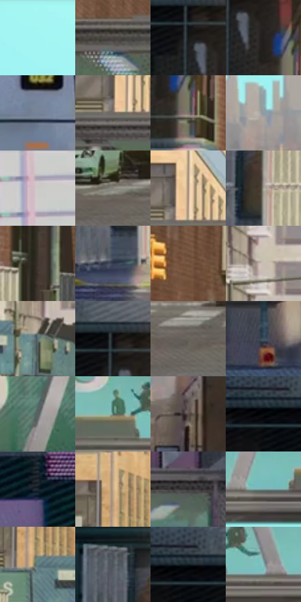

# 电影参考 085

- 状态：常规／活跃；来源世界：miles-home。
- 视角：near-level；景别：environment-wide；场景：city。
- 时段：daylight-time-unspecified（外观依据，中置信度；具体时间／晨昏未知）；光照：neutral-day。
- 材质候选：brick, glass, asphalt, sky, painted-metal（帧级，不是像素分割）。
- 明暗组：middle；L* P5/P50/P95：5.44038 / 43.56911 / 90.08433。
- 资格门禁：无附加门禁。
- 原截图 SHA-256：`06d871fe80d14f2f84baae32240eab001eb42c21fe274831424e50e32c3cc644`；尺寸：2880 × 1206。
- sRGB 像素 SHA-256：`e1ed4e4fa60828a0ce21ccb34c8f9b5edec5809e7ff1a99b9a9b3f43966a3ded`。

## 观察与迁移

日间校桥，中性立面与青天空，不能强制夜景化。

本公开版保存32个128×128原像素色卡上下文；图集格子并非原场景相邻位置。原rect、图集tile和像素SHA见 `data/palette-crops.json`。上下文不足时不得批准替色，不能以小样推断完整构图。

## 实测色卡

颜色比例分母为保留采样像素，不是材料面积；全部 32 色参与全库匹配。表内四舍五入仅用于阅读，原精度在 JSON。

| ID | HEX | Lab | 原图 xy | 像素数 | 比例 | 明度角色 |
| --- | --- | --- | --- | ---: | ---: | --- |
| 085-S01 | #A5F5F3 | [91.582217, -24.695663, -6.808067] | [1296, 28] | 10530 | 5.446195% | highlight |
| 085-S02 | #494441 | [29.241382, 1.488761, 2.574226] | [596, 212] | 8084 | 4.181105% | shadow |
| 085-S03 | #161618 | [7.319703, 0.508421, -1.383102] | [280, 368] | 7878 | 4.074561% | deep-shadow |
| 085-S04 | #231E1E | [11.821433, 2.402839, 0.881039] | [336, 420] | 7500 | 3.879056% | deep-shadow |
| 085-S05 | #778397 | [54.436644, 0.136205, -12.175241] | [2464, 824] | 7359 | 3.806130% | midtone |
| 085-S06 | #6D6968 | [44.736288, 1.358071, 1.118366] | [764, 176] | 7232 | 3.740445% | midtone |
| 085-S07 | #7A756A | [49.375793, -0.143256, 6.756392] | [384, 488] | 7147 | 3.696482% | midtone |
| 085-S08 | #8F9AA2 | [62.976727, -2.258178, -5.52237] | [1520, 652] | 7140 | 3.692862% | light |
| 085-S09 | #CECDCB | [82.430507, -0.020396, 1.117765] | [2504, 28] | 6593 | 3.409949% | highlight |
| 085-S10 | #86857C | [55.378744, -1.34142, 4.984655] | [812, 1056] | 6589 | 3.407880% | midtone |
| 085-S11 | #A28974 | [58.820992, 6.173177, 14.792236] | [788, 120] | 6589 | 3.407880% | midtone |
| 085-S12 | #A5A198 | [66.333331, -0.198694, 5.196524] | [356, 916] | 6544 | 3.384606% | light |
| 085-S13 | #3E342D | [22.547973, 3.121484, 6.082686] | [500, 804] | 6538 | 3.381503% | shadow |
| 085-S14 | #333C4C | [25.128606, 0.677277, -10.963611] | [312, 1024] | 6449 | 3.335471% | shadow |
| 085-S15 | #795943 | [40.598759, 10.112561, 17.870717] | [624, 656] | 6007 | 3.106865% | midtone |
| 085-S16 | #C9BEB2 | [77.554779, 1.809428, 7.443725] | [988, 624] | 6002 | 3.104279% | light |
| 085-S17 | #60747C | [47.536648, -5.439995, -6.845626] | [968, 812] | 5856 | 3.028767% | midtone |
| 085-S18 | #0D1215 | [5.16956, -1.079868, -2.421824] | [280, 324] | 5855 | 3.028250% | deep-shadow |
| 085-S19 | #68615B | [41.607522, 1.626858, 4.420554] | [1152, 1088] | 5723 | 2.959978% | midtone |
| 085-S20 | #3E5360 | [34.096769, -4.468207, -10.148108] | [2348, 596] | 5714 | 2.955324% | shadow |
| 085-S21 | #5A6163 | [40.611789, -2.26963, -2.069795] | [1800, 396] | 5590 | 2.891190% | midtone |
| 085-S22 | #526E63 | [44.011465, -12.762559, 2.817279] | [1256, 444] | 5580 | 2.886018% | midtone |
| 085-S23 | #5B514C | [35.263902, 3.165579, 4.443138] | [1616, 752] | 5571 | 2.881363% | shadow |
| 085-S24 | #060A0C | [2.550302, -0.752424, -1.16769] | [144, 324] | 5450 | 2.818781% | deep-shadow |
| 085-S25 | #232936 | [16.550174, 1.141268, -9.250072] | [2732, 544] | 5135 | 2.655860% | deep-shadow |
| 085-S26 | #C0A88A | [70.209607, 4.123751, 18.732073] | [784, 712] | 4935 | 2.552419% | light |
| 085-S27 | #2F2D2E | [18.70686, 1.12735, -0.323417] | [2336, 216] | 4885 | 2.526559% | deep-shadow |
| 085-S28 | #79A0A2 | [63.18888, -12.748617, -5.372178] | [1552, 484] | 4753 | 2.458287% | light |
| 085-S29 | #648284 | [52.219272, -10.135208, -4.574879] | [800, 796] | 4182 | 2.162962% | midtone |
| 085-S30 | #4F555D | [35.886747, -0.509854, -5.447978] | [284, 824] | 4029 | 2.083829% | shadow |
| 085-S31 | #122024 | [11.197822, -4.675713, -4.618175] | [172, 312] | 3413 | 1.765229% | deep-shadow |
| 085-S32 | #87BFBD | [73.600449, -18.500454, -4.829984] | [1364, 468] | 2494 | 1.289915% | light |

## 色阶与空间分布

- 采样 ROI：`[0.01, 0.02, 0.98, 0.94]`；步长：4；样本数：193346。
- 排除区：`[]`。
- 深暗、暗、中、亮、高光五段计数：`[39720, 43233, 60401, 31875, 18117]`。
- RGB 各 256 箱、L* 100 箱、13×5 色相明度表和 3×3 空间统计全部保存在 [总数据](../film-library.json)。
- [可视化档案](../../references/library.html)按需绘制直方图，不存 2,094 张重复图表图片。

## 纹理特征占比

**这是分块图像特征的面积占比，不是波点／排线／丝网／错版的精确语义覆盖率。** 窗格、发丝、织物也会产生方向或周期特征。
原图 ROI 像素 3098546；已测块覆盖 3098546（100.0000%）；未测 0。

| 特征 | 块覆盖像素 | 占已测面积 | 阈值敏感范围 |
| --- | ---: | ---: | --- |
| low-contrast | 98304 | 3.1726% | 3.1726% ~ 3.1726% |
| directional-structure | 941746 | 30.3932% | 17.2773% ~ 45.3721% |
| periodic-structure | 1960192 | 63.2617% | 50.9266% ~ 68.8013% |
| mixed-detail | 98304 | 3.1726% | 0.5288% ~ 10.7488% |

阈值敏感范围不是统计置信区间。逐块坐标、尺度、对比、方向一致性、频谱集中度、频率与角度见 [全量特征记录](../texture-features.jsonl)，以帧号定位。
四种印刷层的真实像素覆盖仍标为 `null`，不能填 0，也不能拿上表代替。不得据这些代理测量删除唯一证据。

[测量方法与保留策略](../../references/library-retention.md) · [分类索引](../archive/README.md)
