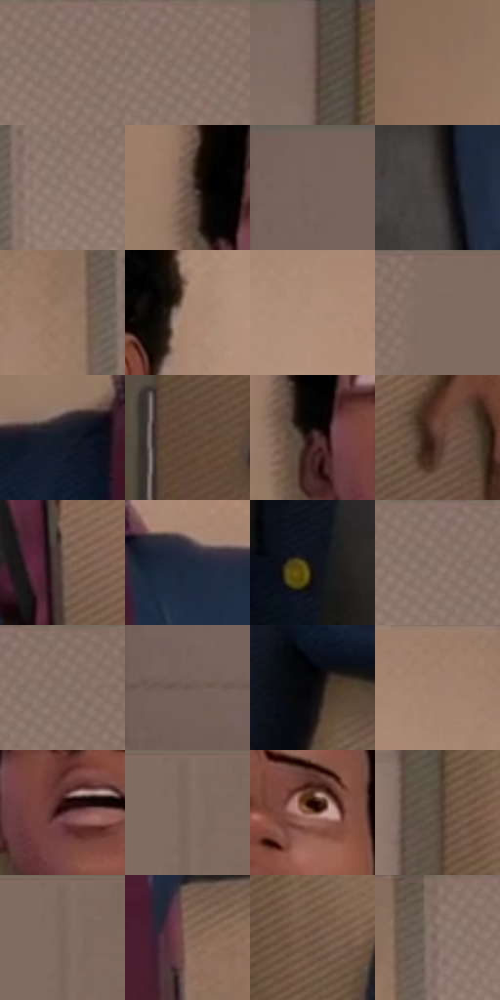

# 电影参考 086

- 状态：常规／活跃；来源世界：miles-home。
- 视角：near-level；景别：medium；场景：interior。
- 时段：daylight-time-unspecified（外观依据，中置信度；具体时间／晨昏未知）；光照：warm-day。
- 材质候选：skin, fabric, wood, paint, glass, paper（帧级，不是像素分割）。
- 明暗组：middle；L* P5/P50/P95：7.02947 / 43.98388 / 59.23485。
- 资格门禁：无附加门禁。
- 原截图 SHA-256：`1f63d59f49a110129b7793ae500e925d8cbcf5d6ce0d7c71b2a4eae0fcc87f3b`；尺寸：2880 × 1198。
- sRGB 像素 SHA-256：`45e6fffad1143d1fbd49f9685e65876f51a9e66f2221746a0c0f9af3354a4f3d`。

## 观察与迁移

办公室与门后人物，暖窗投影和遮挡关系优先。

本公开版保存32个128×128原像素色卡上下文；图集格子并非原场景相邻位置。原rect、图集tile和像素SHA见 `data/palette-crops.json`。上下文不足时不得批准替色，不能以小样推断完整构图。

## 实测色卡

颜色比例分母为保留采样像素，不是材料面积；全部 32 色参与全库匹配。表内四舍五入仅用于阅读，原精度在 JSON。

| ID | HEX | Lab | 原图 xy | 像素数 | 比例 | 明度角色 |
| --- | --- | --- | --- | ---: | ---: | --- |
| 086-S01 | #836E65 | [48.155696, 6.74457, 8.098388] | [2300, 24] | 9508 | 4.935426% | midtone |
| 086-S02 | #88736A | [50.140976, 6.67443, 8.025779] | [2352, 24] | 8544 | 4.435032% | midtone |
| 086-S03 | #725E57 | [41.644233, 6.898949, 7.047503] | [604, 40] | 8100 | 4.204560% | midtone |
| 086-S04 | #8E705C | [49.632602, 8.845632, 15.636535] | [864, 152] | 7543 | 3.915431% | midtone |
| 086-S05 | #957E75 | [54.654132, 7.331731, 8.18245] | [2196, 120] | 7474 | 3.879615% | midtone |
| 086-S06 | #665248 | [36.607633, 6.632055, 9.009741] | [1156, 212] | 7357 | 3.818882% | shadow |
| 086-S07 | #77645D | [43.983881, 6.388049, 6.798976] | [60, 24] | 7322 | 3.800714% | midtone |
| 086-S08 | #3C3633 | [23.128749, 2.011997, 2.842268] | [1388, 756] | 7297 | 3.787737% | shadow |
| 086-S09 | #977964 | [53.140699, 8.510834, 15.944761] | [2088, 116] | 7183 | 3.728562% | midtone |
| 086-S10 | #A78773 | [58.772449, 9.185522, 15.3695] | [1516, 248] | 7035 | 3.651738% | midtone |
| 086-S11 | #B28F7A | [62.097336, 10.103013, 16.185349] | [1644, 136] | 6865 | 3.563494% | light |
| 086-S12 | #806B63 | [46.982352, 6.950027, 7.582631] | [2612, 24] | 6707 | 3.481479% | midtone |
| 086-S13 | #151B28 | [9.77031, 1.469753, -9.721518] | [1052, 472] | 6519 | 3.383892% | deep-shadow |
| 086-S14 | #654B3E | [34.287481, 9.032545, 12.027069] | [680, 764] | 6294 | 3.267099% | shadow |
| 086-S15 | #351E1F | [14.313188, 11.397855, 4.048341] | [1188, 272] | 6140 | 3.187160% | deep-shadow |
| 086-S16 | #5B3D34 | [28.928003, 11.890212, 10.856971] | [1776, 1100] | 5856 | 3.039741% | shadow |
| 086-S17 | #6E594F | [39.622094, 6.931715, 9.032061] | [1644, 1008] | 5830 | 3.026245% | shadow |
| 086-S18 | #1F283A | [16.075794, 1.760588, -12.80486] | [1636, 472] | 5515 | 2.862734% | deep-shadow |
| 086-S19 | #141118 | [5.560366, 2.813689, -3.976818] | [1188, 1060] | 5428 | 2.817574% | deep-shadow |
| 086-S20 | #90796F | [52.677502, 7.24273, 8.800133] | [2304, 52] | 5217 | 2.708048% | midtone |
| 086-S21 | #8D766D | [51.524177, 7.444513, 8.293847] | [2376, 36] | 5119 | 2.657178% | midtone |
| 086-S22 | #68554E | [37.82537, 6.62468, 7.025488] | [44, 616] | 5046 | 2.619285% | shadow |
| 086-S23 | #09070A | [2.095192, 0.940008, -0.950763] | [880, 632] | 5027 | 2.609422% | deep-shadow |
| 086-S24 | #9E7F6A | [55.573089, 8.800088, 15.948418] | [1920, 28] | 4984 | 2.587102% | midtone |
| 086-S25 | #4B242A | [19.741533, 19.140531, 4.429039] | [1272, 304] | 4972 | 2.580873% | deep-shadow |
| 086-S26 | #7D6860 | [45.778591, 6.995394, 7.62678] | [2780, 24] | 4743 | 2.462003% | midtone |
| 086-S27 | #795041 | [38.17207, 15.284034, 15.84561] | [1372, 204] | 4724 | 2.452141% | shadow |
| 086-S28 | #59483E | [32.04854, 5.494909, 8.718542] | [644, 360] | 4580 | 2.377393% | shadow |
| 086-S29 | #7B665E | [44.972951, 7.026536, 7.657058] | [2776, 24] | 4464 | 2.317180% | midtone |
| 086-S30 | #866958 | [46.812555, 8.993171, 13.984978] | [1628, 696] | 4182 | 2.170799% | midtone |
| 086-S31 | #7C6152 | [43.425301, 8.604851, 12.729771] | [724, 488] | 4084 | 2.119929% | midtone |
| 086-S32 | #876E65 | [48.564813, 8.390761, 8.734805] | [2156, 32] | 2989 | 1.551534% | midtone |

## 色阶与空间分布

- 采样 ROI：`[0.01, 0.02, 0.98, 0.94]`；步长：4；样本数：192648。
- 排除区：`[]`。
- 深暗、暗、中、亮、高光五段计数：`[32145, 44565, 108222, 7712, 4]`。
- RGB 各 256 箱、L* 100 箱、13×5 色相明度表和 3×3 空间统计全部保存在 [总数据](../film-library.json)。
- [可视化档案](../../references/library.html)按需绘制直方图，不存 2,094 张重复图表图片。

## 纹理特征占比

**这是分块图像特征的面积占比，不是波点／排线／丝网／错版的精确语义覆盖率。** 窗格、发丝、织物也会产生方向或周期特征。
原图 ROI 像素 3081782；已测块覆盖 3081782（100.0000%）；未测 0。

| 特征 | 块覆盖像素 | 占已测面积 | 阈值敏感范围 |
| --- | ---: | ---: | --- |
| low-contrast | 490368 | 15.9118% | 10.2673% ~ 20.6966% |
| directional-structure | 698240 | 22.6570% | 11.6961% ~ 36.8410% |
| periodic-structure | 1745718 | 56.6464% | 50.2335% ~ 62.2909% |
| mixed-detail | 147456 | 4.7848% | 2.6582% ~ 5.3164% |

阈值敏感范围不是统计置信区间。逐块坐标、尺度、对比、方向一致性、频谱集中度、频率与角度见 [全量特征记录](../texture-features.jsonl)，以帧号定位。
四种印刷层的真实像素覆盖仍标为 `null`，不能填 0，也不能拿上表代替。不得据这些代理测量删除唯一证据。

[测量方法与保留策略](../../references/library-retention.md) · [分类索引](../archive/README.md)
