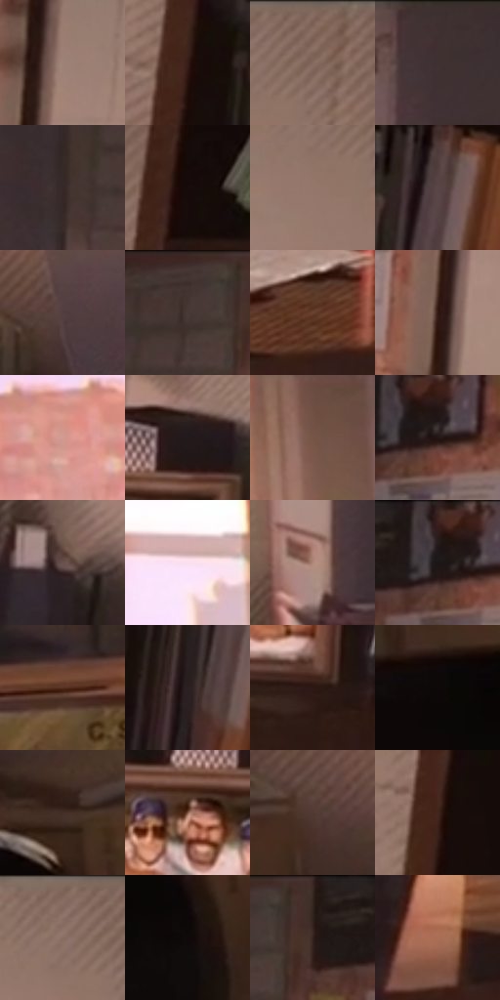

# 电影参考 087

- 状态：常规／活跃；来源世界：miles-home。
- 视角：near-level；景别：environment-wide；场景：interior。
- 时段：daylight-time-unspecified（外观依据，中置信度；具体时间／晨昏未知）；光照：warm-day。
- 材质候选：skin, fabric, wood, paint, glass, paper（帧级，不是像素分割）。
- 明暗组：dark；L* P5/P50/P95：3.45683 / 24.91635 / 66.90545。
- 资格门禁：无附加门禁。
- 原截图 SHA-256：`6d009de2c0903a8b6cd3c25c527e8aaa9fcb54bb730caac607f8a3ed51f1a9fb`；尺寸：2880 × 1206。
- sRGB 像素 SHA-256：`38d4fab2c04ac566f1e263027578e790e1cb0f8fb0e90106e322ca3a5695308f`。

## 观察与迁移

办公室与门后人物，暖窗投影和遮挡关系优先。

本公开版保存32个128×128原像素色卡上下文；图集格子并非原场景相邻位置。原rect、图集tile和像素SHA见 `data/palette-crops.json`。上下文不足时不得批准替色，不能以小样推断完整构图。

## 实测色卡

颜色比例分母为保留采样像素，不是材料面积；全部 32 色参与全库匹配。表内四舍五入仅用于阅读，原精度在 JSON。

| ID | HEX | Lab | 原图 xy | 像素数 | 比例 | 明度角色 |
| --- | --- | --- | --- | ---: | ---: | --- |
| 087-S01 | #9F8277 | [56.751577, 9.361393, 10.136976] | [2192, 140] | 10201 | 5.276034% | midtone |
| 087-S02 | #361D17 | [13.97264, 11.452641, 9.352249] | [2592, 636] | 10059 | 5.202590% | deep-shadow |
| 087-S03 | #81655A | [45.239121, 9.517361, 10.525954] | [2528, 44] | 9504 | 4.915540% | midtone |
| 087-S04 | #3F3030 | [21.521231, 6.810974, 2.607561] | [1452, 48] | 8679 | 4.488844% | shadow |
| 087-S05 | #372928 | [18.149572, 6.328725, 3.159175] | [1624, 164] | 8118 | 4.198690% | deep-shadow |
| 087-S06 | #160B09 | [3.881225, 3.747282, 2.186504] | [2676, 112] | 7566 | 3.913192% | deep-shadow |
| 087-S07 | #95776B | [52.559523, 9.820553, 11.040509] | [2460, 132] | 6973 | 3.606488% | midtone |
| 087-S08 | #5A4646 | [31.79886, 8.544203, 3.266881] | [2736, 632] | 6737 | 3.484427% | shadow |
| 087-S09 | #523E3F | [28.375303, 8.907406, 2.754559] | [732, 640] | 6606 | 3.416673% | shadow |
| 087-S10 | #483734 | [24.822035, 7.024059, 4.774245] | [1760, 60] | 6578 | 3.402191% | shadow |
| 087-S11 | #694230 | [32.064543, 14.723046, 17.908726] | [1704, 772] | 6353 | 3.285819% | shadow |
| 087-S12 | #331A14 | [12.565244, 11.63764, 9.479814] | [2144, 292] | 6058 | 3.133243% | deep-shadow |
| 087-S13 | #D29B90 | [68.867255, 19.021989, 13.831627] | [668, 272] | 5981 | 3.093418% | light |
| 087-S14 | #21191C | [9.817448, 4.637525, -0.589193] | [2032, 532] | 5979 | 3.092384% | deep-shadow |
| 087-S15 | #755447 | [38.860773, 11.858904, 13.013356] | [972, 68] | 5796 | 2.997735% | shadow |
| 087-S16 | #231512 | [8.458667, 6.652834, 4.619354] | [1976, 72] | 5768 | 2.983253% | deep-shadow |
| 087-S17 | #68514D | [36.676181, 8.918569, 6.018412] | [2196, 656] | 5710 | 2.953255% | shadow |
| 087-S18 | #F9DFEE | [91.274663, 11.427392, -4.032234] | [840, 136] | 5699 | 2.947566% | highlight |
| 087-S19 | #AE8878 | [59.856647, 12.135774, 14.143406] | [1392, 404] | 5633 | 2.913430% | midtone |
| 087-S20 | #271C1C | [11.591726, 5.405634, 2.083602] | [1944, 40] | 5318 | 2.750509% | deep-shadow |
| 087-S21 | #553020 | [24.161153, 15.038296, 17.364151] | [1276, 720] | 5315 | 2.748958% | shadow |
| 087-S22 | #2C2122 | [14.051776, 5.477679, 1.340943] | [2676, 784] | 5238 | 2.709133% | deep-shadow |
| 087-S23 | #2E1914 | [11.461253, 9.794439, 7.84009] | [2052, 756] | 5128 | 2.652240% | deep-shadow |
| 087-S24 | #0C0807 | [2.413403, 0.936264, 0.757618] | [120, 700] | 4822 | 2.493975% | deep-shadow |
| 087-S25 | #442E26 | [21.294071, 8.871419, 9.181001] | [308, 640] | 4811 | 2.488285% | shadow |
| 087-S26 | #865A48 | [42.535786, 15.822283, 17.728296] | [1948, 612] | 4450 | 2.301573% | midtone |
| 087-S27 | #523A33 | [26.90303, 9.521516, 8.536515] | [484, 616] | 4294 | 2.220889% | shadow |
| 087-S28 | #41261C | [18.339144, 11.442436, 11.94541] | [2612, 456] | 4256 | 2.201235% | deep-shadow |
| 087-S29 | #8A6E64 | [48.854309, 9.475713, 9.780251] | [2468, 64] | 4139 | 2.140722% | midtone |
| 087-S30 | #0F0A09 | [3.056533, 1.361305, 0.907458] | [312, 772] | 4111 | 2.126240% | deep-shadow |
| 087-S31 | #35231E | [15.762085, 7.792075, 6.78723] | [1836, 64] | 3785 | 1.957630% | deep-shadow |
| 087-S32 | #AA7057 | [52.756794, 20.072145, 23.28737] | [736, 852] | 3681 | 1.903841% | midtone |

## 色阶与空间分布

- 采样 ROI：`[0.01, 0.02, 0.98, 0.94]`；步长：4；样本数：193346。
- 排除区：`[]`。
- 深暗、暗、中、亮、高光五段计数：`[76581, 58807, 44194, 8486, 5278]`。
- RGB 各 256 箱、L* 100 箱、13×5 色相明度表和 3×3 空间统计全部保存在 [总数据](../film-library.json)。
- [可视化档案](../../references/library.html)按需绘制直方图，不存 2,094 张重复图表图片。

## 纹理特征占比

**这是分块图像特征的面积占比，不是波点／排线／丝网／错版的精确语义覆盖率。** 窗格、发丝、织物也会产生方向或周期特征。
原图 ROI 像素 3098546；已测块覆盖 3098546（100.0000%）；未测 0。

| 特征 | 块覆盖像素 | 占已测面积 | 阈值敏感范围 |
| --- | ---: | ---: | --- |
| low-contrast | 458240 | 14.7889% | 11.6163% ~ 17.6062% |
| directional-structure | 892544 | 28.8053% | 19.1181% ~ 44.5732% |
| periodic-structure | 1622194 | 52.3534% | 43.2818% ~ 59.7520% |
| mixed-detail | 125568 | 4.0525% | 0.5288% ~ 4.0525% |

阈值敏感范围不是统计置信区间。逐块坐标、尺度、对比、方向一致性、频谱集中度、频率与角度见 [全量特征记录](../texture-features.jsonl)，以帧号定位。
四种印刷层的真实像素覆盖仍标为 `null`，不能填 0，也不能拿上表代替。不得据这些代理测量删除唯一证据。

[测量方法与保留策略](../../references/library-retention.md) · [分类索引](../archive/README.md)
