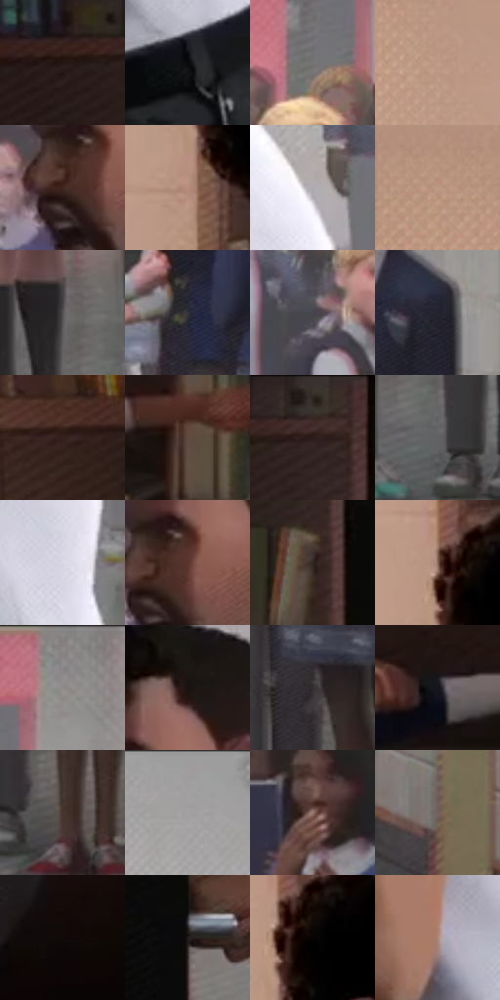

# 电影参考 088

- 状态：常规／活跃；来源世界：miles-home。
- 视角：near-level；景别：full-body；场景：interior。
- 时段：daylight-time-unspecified（外观依据，中置信度；具体时间／晨昏未知）；光照：warm-day。
- 材质候选：skin, fabric, wood, paint, glass, paper（帧级，不是像素分割）。
- 明暗组：dark；L* P5/P50/P95：2.74173 / 28.87016 / 70.03473。
- 资格门禁：无附加门禁。
- 原截图 SHA-256：`3a96e3219683ea5e5cd3367f7b45535420a70826e5b3e1669e3102025b0bf879`；尺寸：2880 × 1206。
- sRGB 像素 SHA-256：`9d7a80bfcc06ad98e99137bb3963ce9acb53c174a82d1440d6de2a91f588b4c7`。

## 观察与迁移

办公室与门后人物，暖窗投影和遮挡关系优先。

本公开版保存32个128×128原像素色卡上下文；图集格子并非原场景相邻位置。原rect、图集tile和像素SHA见 `data/palette-crops.json`。上下文不足时不得批准替色，不能以小样推断完整构图。

## 实测色卡

颜色比例分母为保留采样像素，不是材料面积；全部 32 色参与全库匹配。表内四舍五入仅用于阅读，原精度在 JSON。

| ID | HEX | Lab | 原图 xy | 像素数 | 比例 | 明度角色 |
| --- | --- | --- | --- | ---: | ---: | --- |
| 088-S01 | #241714 | [9.30762, 6.041362, 4.591179] | [1172, 72] | 11284 | 5.836169% | deep-shadow |
| 088-S02 | #090A0B | [2.703718, -0.119084, -0.479881] | [2044, 904] | 10162 | 5.255863% | deep-shadow |
| 088-S03 | #787477 | [49.271957, 2.125613, -1.102482] | [2332, 168] | 9549 | 4.938814% | midtone |
| 088-S04 | #C09B88 | [66.845963, 10.93649, 15.171033] | [288, 376] | 8708 | 4.503843% | light |
| 088-S05 | #422823 | [19.213666, 11.481386, 8.339106] | [1660, 240] | 8245 | 4.264376% | deep-shadow |
| 088-S06 | #B58C7D | [61.707843, 13.380498, 14.00008] | [476, 656] | 7712 | 3.988704% | light |
| 088-S07 | #AEAAAF | [70.06602, 2.360993, -2.055219] | [2092, 464] | 7587 | 3.924053% | light |
| 088-S08 | #BA9582 | [64.601629, 11.052567, 15.298171] | [60, 180] | 7247 | 3.748203% | light |
| 088-S09 | #575355 | [35.730211, 2.041438, -0.583712] | [2336, 840] | 7208 | 3.728032% | shadow |
| 088-S10 | #373640 | [23.069562, 2.86349, -6.052969] | [2424, 476] | 6886 | 3.561491% | shadow |
| 088-S11 | #47464F | [30.118895, 2.481202, -5.222648] | [2252, 312] | 6556 | 3.390812% | shadow |
| 088-S12 | #21222D | [13.572117, 2.590531, -7.433052] | [2716, 312] | 6374 | 3.296681% | deep-shadow |
| 088-S13 | #33201B | [14.491005, 8.420383, 7.123106] | [596, 96] | 6244 | 3.229444% | deep-shadow |
| 088-S14 | #5F4A41 | [33.376777, 7.40257, 8.770319] | [1220, 748] | 6218 | 3.215996% | shadow |
| 088-S15 | #2C1B17 | [11.832673, 7.78267, 6.194789] | [1336, 60] | 6194 | 3.203583% | deep-shadow |
| 088-S16 | #616063 | [40.909286, 1.023558, -1.563858] | [2396, 940] | 6086 | 3.147725% | midtone |
| 088-S17 | #DAD8E5 | [86.836777, 3.069575, -6.12072] | [2088, 708] | 6082 | 3.145656% | highlight |
| 088-S18 | #5A362F | [26.785187, 15.207189, 11.169633] | [1696, 220] | 5958 | 3.081522% | shadow |
| 088-S19 | #322622 | [16.404507, 4.889246, 4.801448] | [1360, 248] | 5627 | 2.910327% | deep-shadow |
| 088-S20 | #876559 | [45.88032, 11.90912, 12.118145] | [484, 532] | 5354 | 2.769129% | midtone |
| 088-S21 | #8E8C8D | [58.443051, 0.929695, -0.268209] | [2420, 40] | 5351 | 2.767577% | midtone |
| 088-S22 | #1A120F | [6.203344, 3.105238, 2.885914] | [1736, 116] | 5192 | 2.685341% | deep-shadow |
| 088-S23 | #322E30 | [19.414314, 2.246741, -0.634465] | [2496, 728] | 5186 | 2.682238% | deep-shadow |
| 088-S24 | #16161D | [7.525209, 1.952529, -4.898921] | [1072, 720] | 4381 | 2.265886% | deep-shadow |
| 088-S25 | #453630 | [24.054936, 5.606295, 6.307459] | [2532, 960] | 4232 | 2.188822% | shadow |
| 088-S26 | #A09C9D | [64.711731, 1.63502, -0.004105] | [2020, 28] | 3857 | 1.994869% | light |
| 088-S27 | #97776D | [52.815794, 10.931218, 10.264108] | [2516, 304] | 3759 | 1.944183% | midtone |
| 088-S28 | #72605A | [42.279747, 6.195527, 6.122636] | [2784, 736] | 3750 | 1.939528% | midtone |
| 088-S29 | #100908 | [2.918386, 1.971367, 1.122373] | [988, 1088] | 3620 | 1.872291% | deep-shadow |
| 088-S30 | #221C1C | [10.953199, 2.920152, 1.08113] | [1504, 844] | 3526 | 1.823674% | deep-shadow |
| 088-S31 | #050403 | [1.135216, 0.122386, 0.470694] | [520, 556] | 2816 | 1.456456% | deep-shadow |
| 088-S32 | #AA8678 | [58.931379, 11.653943, 12.790143] | [1936, 748] | 2395 | 1.238712% | midtone |

## 色阶与空间分布

- 采样 ROI：`[0.01, 0.02, 0.98, 0.94]`；步长：4；样本数：193346。
- 排除区：`[]`。
- 深暗、暗、中、亮、高光五段计数：`[73990, 45269, 31128, 37584, 5375]`。
- RGB 各 256 箱、L* 100 箱、13×5 色相明度表和 3×3 空间统计全部保存在 [总数据](../film-library.json)。
- [可视化档案](../../references/library.html)按需绘制直方图，不存 2,094 张重复图表图片。

## 纹理特征占比

**这是分块图像特征的面积占比，不是波点／排线／丝网／错版的精确语义覆盖率。** 窗格、发丝、织物也会产生方向或周期特征。
原图 ROI 像素 3098546；已测块覆盖 3098546（100.0000%）；未测 0。

| 特征 | 块覆盖像素 | 占已测面积 | 阈值敏感范围 |
| --- | ---: | ---: | --- |
| low-contrast | 207488 | 6.6963% | 4.5812% ~ 8.2826% |
| directional-structure | 549426 | 17.7317% | 6.8739% ~ 32.1819% |
| periodic-structure | 2270720 | 73.2834% | 62.3570% ~ 80.6175% |
| mixed-detail | 70912 | 2.2886% | 0.8799% ~ 4.2260% |

阈值敏感范围不是统计置信区间。逐块坐标、尺度、对比、方向一致性、频谱集中度、频率与角度见 [全量特征记录](../texture-features.jsonl)，以帧号定位。
四种印刷层的真实像素覆盖仍标为 `null`，不能填 0，也不能拿上表代替。不得据这些代理测量删除唯一证据。

[测量方法与保留策略](../../references/library-retention.md) · [分类索引](../archive/README.md)
