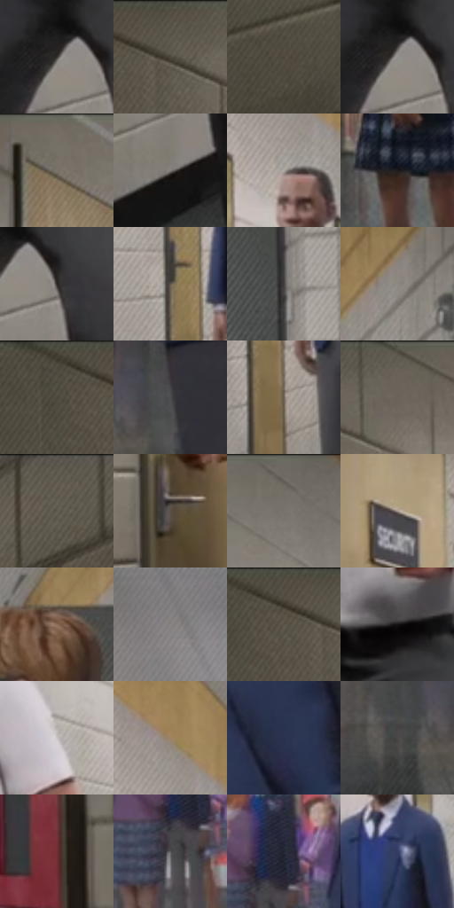

# 电影参考 089

- 状态：常规／活跃；来源世界：miles-home。
- 视角：near-level；景别：environment-wide；场景：interior。
- 时段：daylight-time-unspecified（外观依据，中置信度；具体时间／晨昏未知）；光照：neutral-day。
- 材质候选：skin, fabric, stone, paint（帧级，不是像素分割）。
- 明暗组：dark；L* P5/P50/P95：11.90404 / 35.62575 / 67.91388。
- 资格门禁：无附加门禁。
- 原截图 SHA-256：`c076280bcbd195115e6dc51e0fca608f533229a16ab9eed7c12eadf3491be861`；尺寸：2880 × 1206。
- sRGB 像素 SHA-256：`c6ffe20989e35ce93919954a56777b2a0fecbe3c02dfe22955f8644ca0019bb5`。

## 观察与迁移

灰墙走廊，顶灯节奏与人物位置保留。

89  /  白砖长走廊以顶灯和墙缝汇向消失点，前景几个人形成错开的纵深。  /  透视线、人物尺度和地面反光一起组织群像；远处人物降低细节。

本公开版保存32个128×128原像素色卡上下文；图集格子并非原场景相邻位置。原rect、图集tile和像素SHA见 `data/palette-crops.json`。上下文不足时不得批准替色，不能以小样推断完整构图。

## 实测色卡

颜色比例分母为保留采样像素，不是材料面积；全部 32 色参与全库匹配。表内四舍五入仅用于阅读，原精度在 JSON。

| ID | HEX | Lab | 原图 xy | 像素数 | 比例 | 明度角色 |
| --- | --- | --- | --- | ---: | ---: | --- |
| 089-S01 | #3A3633 | [22.91987, 1.108856, 2.514745] | [736, 784] | 10110 | 5.228968% | shadow |
| 089-S02 | #554F44 | [33.85922, 0.361031, 7.398397] | [244, 28] | 9852 | 5.095528% | shadow |
| 089-S03 | #4B4338 | [28.891435, 1.32332, 7.93047] | [228, 1036] | 8047 | 4.161969% | shadow |
| 089-S04 | #95918E | [60.421198, 0.90242, 2.11315] | [744, 784] | 7935 | 4.104041% | light |
| 089-S05 | #767067 | [47.519968, 0.624461, 5.835247] | [544, 28] | 7378 | 3.815957% | midtone |
| 089-S06 | #7F7A75 | [51.514155, 0.944605, 3.413107] | [772, 972] | 7218 | 3.733204% | midtone |
| 089-S07 | #AEA7A4 | [68.98009, 1.964015, 2.446615] | [1088, 352] | 7087 | 3.665450% | light |
| 089-S08 | #201C1C | [10.714634, 1.935675, 0.705518] | [1348, 804] | 7064 | 3.653554% | deep-shadow |
| 089-S09 | #302B29 | [17.992037, 1.841896, 2.127579] | [792, 808] | 6952 | 3.595626% | deep-shadow |
| 089-S10 | #61594D | [38.238279, 1.003733, 8.125081] | [1000, 640] | 6878 | 3.557353% | shadow |
| 089-S11 | #43413E | [27.632365, 0.200808, 2.130317] | [1936, 396] | 6813 | 3.523735% | shadow |
| 089-S12 | #8E8882 | [57.047204, 1.118064, 4.017746] | [1968, 120] | 6570 | 3.398053% | midtone |
| 089-S13 | #514C40 | [32.454896, -0.245741, 7.89372] | [132, 28] | 6296 | 3.256338% | shadow |
| 089-S14 | #4D4D50 | [32.842233, 0.661235, -1.768724] | [1704, 924] | 6292 | 3.254270% | shadow |
| 089-S15 | #6C6156 | [41.860025, 2.398052, 7.876801] | [1036, 756] | 6228 | 3.221168% | midtone |
| 089-S16 | #635D54 | [39.784554, 0.67422, 6.034551] | [384, 28] | 6167 | 3.189619% | shadow |
| 089-S17 | #5B5549 | [36.371019, 0.161415, 7.890062] | [2572, 28] | 6083 | 3.146173% | shadow |
| 089-S18 | #5B5145 | [35.080923, 1.926855, 8.573389] | [536, 640] | 6043 | 3.125485% | shadow |
| 089-S19 | #6F6961 | [44.724988, 0.823244, 5.340156] | [728, 28] | 5726 | 2.961530% | midtone |
| 089-S20 | #A69A8F | [64.324079, 2.47362, 7.358462] | [580, 256] | 5584 | 2.888087% | light |
| 089-S21 | #8B6B56 | [47.850705, 9.690682, 16.673729] | [1804, 248] | 5477 | 2.832745% | midtone |
| 089-S22 | #868281 | [54.677389, 1.304389, 1.075418] | [1232, 72] | 5408 | 2.797058% | midtone |
| 089-S23 | #50493E | [31.390132, 0.83121, 7.656183] | [184, 36] | 5344 | 2.763957% | shadow |
| 089-S24 | #141314 | [6.006675, 0.637429, -0.455156] | [784, 636] | 5208 | 2.693617% | deep-shadow |
| 089-S25 | #CAC4C5 | [79.652438, 2.262098, 0.245196] | [892, 432] | 5127 | 2.651723% | light |
| 089-S26 | #A08362 | [56.672983, 6.336765, 22.025504] | [1092, 256] | 4899 | 2.533800% | midtone |
| 089-S27 | #29324F | [21.270887, 5.152168, -18.989356] | [1804, 572] | 4590 | 2.373982% | shadow |
| 089-S28 | #484746 | [30.221468, 0.197503, 0.748556] | [1608, 964] | 4250 | 2.198132% | shadow |
| 089-S29 | #6F2E34 | [28.333313, 29.417912, 10.531825] | [2252, 600] | 3662 | 1.894014% | shadow |
| 089-S30 | #555456 | [35.875922, 0.830699, -1.019295] | [1588, 664] | 3201 | 1.655581% | shadow |
| 089-S31 | #222432 | [14.580069, 3.075743, -9.455659] | [1616, 596] | 3020 | 1.561967% | deep-shadow |
| 089-S32 | #343D64 | [26.698591, 7.983105, -24.182694] | [1128, 500] | 2837 | 1.467318% | shadow |

## 色阶与空间分布

- 采样 ROI：`[0.01, 0.02, 0.98, 0.94]`；步长：4；样本数：193346。
- 排除区：`[]`。
- 深暗、暗、中、亮、高光五段计数：`[23248, 93014, 54102, 21287, 1695]`。
- RGB 各 256 箱、L* 100 箱、13×5 色相明度表和 3×3 空间统计全部保存在 [总数据](../film-library.json)。
- [可视化档案](../../references/library.html)按需绘制直方图，不存 2,094 张重复图表图片。

## 纹理特征占比

**这是分块图像特征的面积占比，不是波点／排线／丝网／错版的精确语义覆盖率。** 窗格、发丝、织物也会产生方向或周期特征。
原图 ROI 像素 3098546；已测块覆盖 3098546（100.0000%）；未测 0。

| 特征 | 块覆盖像素 | 占已测面积 | 阈值敏感范围 |
| --- | ---: | ---: | --- |
| low-contrast | 0 | 0.0000% | 0.0000% ~ 0.0000% |
| directional-structure | 453248 | 14.6278% | 2.1151% ~ 32.5149% |
| periodic-structure | 2628914 | 84.8435% | 67.4851% ~ 92.9526% |
| mixed-detail | 16384 | 0.5288% | 0.0000% ~ 4.9324% |

阈值敏感范围不是统计置信区间。逐块坐标、尺度、对比、方向一致性、频谱集中度、频率与角度见 [全量特征记录](../texture-features.jsonl)，以帧号定位。
四种印刷层的真实像素覆盖仍标为 `null`，不能填 0，也不能拿上表代替。不得据这些代理测量删除唯一证据。

[测量方法与保留策略](../../references/library-retention.md) · [分类索引](../archive/README.md)
