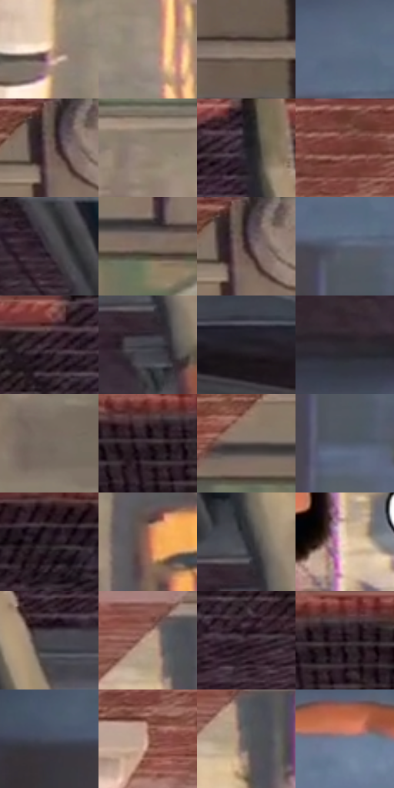

# 电影参考 090

- 状态：条件／活跃；来源世界：miles-home。
- 视角：rolled-or-dutch；景别：full-body；场景：city。
- 时段：daylight-time-unspecified（外观依据，中置信度；具体时间／晨昏未知）；光照：neutral-day。
- 材质候选：skin, fabric, brick, asphalt, glass（帧级，不是像素分割）。
- 明暗组：dark；L* P5/P50/P95：10.56297 / 38.27228 / 73.3418。
- 资格门禁：motion。
- 原截图 SHA-256：`319c09a84ed50abc45a5d2cc1cca8233aeda74cb27beb0cddb6c25433d892d6f`；尺寸：2880 × 1212。
- sRGB 像素 SHA-256：`b089acf45ec642298a49f3e317aa90ecf7448eead6227323a38c817c166379a8`。

## 观察与迁移

竖墙动作，姿态、透视与投影明确；对白独立确认。

90  /  倒置的坠落/贴墙视角里出现白底黑边、带尖尾的文字气泡。  /  镜头旋转与文字方向同属构图；这里的尖尾气泡与黄色内心字幕不是一类。

本公开版保存32个128×128原像素色卡上下文；图集格子并非原场景相邻位置。原rect、图集tile和像素SHA见 `data/palette-crops.json`。上下文不足时不得批准替色，不能以小样推断完整构图。

## 实测色卡

颜色比例分母为保留采样像素，不是材料面积；全部 32 色参与全库匹配。表内四舍五入仅用于阅读，原精度在 JSON。

| ID | HEX | Lab | 原图 xy | 像素数 | 比例 | 明度角色 |
| --- | --- | --- | --- | ---: | ---: | --- |
| 090-S01 | #D1B093 | [74.006746, 7.670147, 19.321798] | [1924, 468] | 8832 | 4.551545% | light |
| 090-S02 | #9C8C7F | [59.303366, 3.770426, 9.128962] | [2276, 636] | 8572 | 4.417555% | midtone |
| 090-S03 | #887A6D | [52.127587, 3.11058, 9.080517] | [2700, 100] | 8410 | 4.334069% | midtone |
| 090-S04 | #5E6C83 | [45.280157, 0.383747, -14.432945] | [788, 736] | 8369 | 4.312939% | midtone |
| 090-S05 | #6D5E54 | [41.052066, 4.286648, 7.967813] | [2104, 48] | 8087 | 4.167611% | midtone |
| 090-S06 | #928376 | [55.737843, 3.443161, 9.102171] | [2184, 352] | 7762 | 4.000124% | midtone |
| 090-S07 | #201B20 | [10.522213, 3.646412, -2.545341] | [1208, 32] | 7676 | 3.955804% | deep-shadow |
| 090-S08 | #784B41 | [36.757817, 17.845158, 13.915716] | [1704, 36] | 7629 | 3.931583% | shadow |
| 090-S09 | #3B373D | [23.668527, 3.105315, -3.102275] | [1168, 292] | 7565 | 3.898600% | shadow |
| 090-S10 | #7F7064 | [48.286397, 3.766721, 8.820641] | [2076, 200] | 7485 | 3.857373% | midtone |
| 090-S11 | #3C2D37 | [20.492304, 8.914713, -3.736329] | [2116, 44] | 7302 | 3.763064% | shadow |
| 090-S12 | #5A6171 | [41.080767, 1.05225, -9.937833] | [800, 804] | 6950 | 3.581662% | midtone |
| 090-S13 | #30222B | [15.206198, 8.564199, -3.367465] | [1000, 64] | 6430 | 3.313681% | deep-shadow |
| 090-S14 | #404047 | [27.329512, 1.634808, -4.243512] | [1288, 436] | 6292 | 3.242564% | shadow |
| 090-S15 | #242227 | [13.624336, 2.182951, -3.003259] | [84, 404] | 5774 | 2.975614% | deep-shadow |
| 090-S16 | #2C282E | [16.749618, 3.260493, -3.247188] | [1180, 520] | 5706 | 2.940570% | deep-shadow |
| 090-S17 | #73695E | [45.020595, 1.927988, 7.614127] | [2556, 548] | 5641 | 2.907073% | midtone |
| 090-S18 | #2A1C24 | [12.287807, 8.533849, -2.732607] | [108, 72] | 5603 | 2.887489% | deep-shadow |
| 090-S19 | #594F4A | [34.417298, 3.182887, 4.463723] | [1976, 164] | 5468 | 2.817918% | shadow |
| 090-S20 | #505968 | [37.570859, 0.13878, -9.769341] | [812, 896] | 5295 | 2.728763% | shadow |
| 090-S21 | #1B1218 | [6.60846, 5.644202, -2.355] | [528, 92] | 5281 | 2.721548% | deep-shadow |
| 090-S22 | #A36451 | [48.879991, 23.323129, 21.489152] | [2076, 576] | 5268 | 2.714848% | midtone |
| 090-S23 | #2F2F37 | [19.692757, 1.998464, -5.079766] | [1292, 364] | 5254 | 2.707633% | deep-shadow |
| 090-S24 | #F3D9BF | [88.181844, 4.993223, 16.10322] | [1512, 892] | 5089 | 2.622601% | highlight |
| 090-S25 | #47454C | [29.707304, 2.412167, -3.895979] | [1324, 160] | 4965 | 2.558698% | shadow |
| 090-S26 | #B79A85 | [65.649887, 7.524348, 15.040124] | [1740, 360] | 4952 | 2.551999% | light |
| 090-S27 | #392730 | [18.07353, 10.197779, -2.516016] | [804, 156] | 4802 | 2.474696% | deep-shadow |
| 090-S28 | #503A3C | [26.899626, 10.074351, 2.569509] | [156, 36] | 4321 | 2.226815% | shadow |
| 090-S29 | #484D5A | [32.752209, 1.139611, -8.310246] | [460, 796] | 4088 | 2.106739% | shadow |
| 090-S30 | #AE8171 | [57.935398, 15.138369, 15.465738] | [1704, 168] | 3921 | 2.020676% | midtone |
| 090-S31 | #5C5B5C | [38.777664, 0.606932, -0.43158] | [1768, 392] | 3659 | 1.885655% | shadow |
| 090-S32 | #757B8F | [51.758672, 2.203386, -11.565646] | [1128, 692] | 1596 | 0.822494% | midtone |

## 色阶与空间分布

- 采样 ROI：`[0.01, 0.02, 0.98, 0.94]`；步长：4；样本数：194044。
- 排除区：`[]`。
- 深暗、暗、中、亮、高光五段计数：`[46306, 57883, 67563, 16971, 5321]`。
- RGB 各 256 箱、L* 100 箱、13×5 色相明度表和 3×3 空间统计全部保存在 [总数据](../film-library.json)。
- [可视化档案](../../references/library.html)按需绘制直方图，不存 2,094 张重复图表图片。

## 纹理特征占比

**这是分块图像特征的面积占比，不是波点／排线／丝网／错版的精确语义覆盖率。** 窗格、发丝、织物也会产生方向或周期特征。
原图 ROI 像素 3115310；已测块覆盖 3115310（100.0000%）；未测 0。

| 特征 | 块覆盖像素 | 占已测面积 | 阈值敏感范围 |
| --- | ---: | ---: | --- |
| low-contrast | 172928 | 5.5509% | 3.2254% ~ 6.6027% |
| directional-structure | 1056768 | 33.9218% | 18.9125% ~ 47.3532% |
| periodic-structure | 1885614 | 60.5273% | 49.4214% ~ 68.6996% |
| mixed-detail | 0 | 0.0000% | 0.0000% ~ 5.7851% |

阈值敏感范围不是统计置信区间。逐块坐标、尺度、对比、方向一致性、频谱集中度、频率与角度见 [全量特征记录](../texture-features.jsonl)，以帧号定位。
四种印刷层的真实像素覆盖仍标为 `null`，不能填 0，也不能拿上表代替。不得据这些代理测量删除唯一证据。

[测量方法与保留策略](../../references/library-retention.md) · [分类索引](../archive/README.md)
