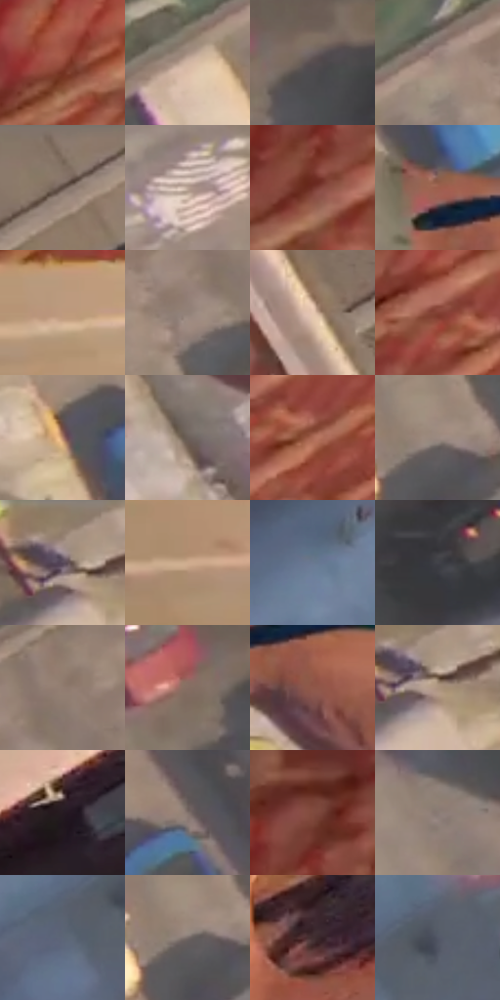

# 电影参考 091

- 状态：条件／活跃；来源世界：miles-home。
- 视角：rolled-or-dutch；景别：full-body；场景：city。
- 时段：daylight-time-unspecified（外观依据，中置信度；具体时间／晨昏未知）；光照：neutral-day。
- 材质候选：skin, fabric, brick, asphalt, glass（帧级，不是像素分割）。
- 明暗组：middle；L* P5/P50/P95：24.83124 / 50.34272 / 76.29741。
- 资格门禁：motion。
- 原截图 SHA-256：`639c478164b7041571311469836553adf8e40145bc02281001323ead1f4ead28`；尺寸：2880 × 1204。
- sRGB 像素 SHA-256：`53e427a08564b3d18beb80c2bf505831bc6fdce7a2ea5115e6e88a808e42c0b5`。

## 观察与迁移

竖墙动作，姿态、透视与投影明确；对白独立确认。

91  /  高角度街谷中身体与墙面相接，砖线、窗框和车道呈不同方向。  /  动作可信度依赖手脚接触点与地面/墙面透视，不能只靠速度线。

本公开版保存32个128×128原像素色卡上下文；图集格子并非原场景相邻位置。原rect、图集tile和像素SHA见 `data/palette-crops.json`。上下文不足时不得批准替色，不能以小样推断完整构图。

## 实测色卡

颜色比例分母为保留采样像素，不是材料面积；全部 32 色参与全库匹配。表内四舍五入仅用于阅读，原精度在 JSON。

| ID | HEX | Lab | 原图 xy | 像素数 | 比例 | 明度角色 |
| --- | --- | --- | --- | ---: | ---: | --- |
| 091-S01 | #964C3C | [41.185738, 29.46526, 23.583342] | [316, 356] | 8544 | 4.435032% | midtone |
| 091-S02 | #D0B5A2 | [75.493481, 6.70668, 13.254049] | [1552, 208] | 7860 | 4.079980% | light |
| 091-S03 | #574D4F | [33.770896, 4.550832, 0.340116] | [2320, 72] | 7338 | 3.809020% | shadow |
| 091-S04 | #99857B | [57.054108, 5.894159, 8.183832] | [1660, 136] | 7333 | 3.806424% | midtone |
| 091-S05 | #8A786A | [51.698346, 4.592709, 10.253904] | [1348, 28] | 7201 | 3.737905% | midtone |
| 091-S06 | #BBA496 | [68.981583, 6.112259, 10.347943] | [2404, 648] | 7182 | 3.728043% | light |
| 091-S07 | #713229 | [29.293542, 27.055467, 19.013744] | [72, 324] | 6962 | 3.613845% | shadow |
| 091-S08 | #9D5E4C | [46.574467, 23.723671, 21.241072] | [1728, 684] | 6712 | 3.484075% | midtone |
| 091-S09 | #BE9A7D | [66.16752, 9.236955, 20.296737] | [288, 732] | 6520 | 3.384411% | light |
| 091-S10 | #928178 | [55.24512, 4.911177, 7.247033] | [1768, 180] | 6420 | 3.332503% | midtone |
| 091-S11 | #E6C7B1 | [82.295958, 7.57951, 15.057623] | [1108, 188] | 6415 | 3.329907% | highlight |
| 091-S12 | #834033 | [35.463893, 27.546917, 21.178278] | [452, 472] | 6387 | 3.315373% | shadow |
| 091-S13 | #B2836B | [58.752368, 14.904694, 20.066908] | [1620, 544] | 6384 | 3.313816% | midtone |
| 091-S14 | #6B5F58 | [41.24008, 3.527691, 5.764426] | [1972, 1088] | 6366 | 3.304472% | midtone |
| 091-S15 | #AB6A55 | [51.409298, 23.659924, 22.688852] | [516, 504] | 6289 | 3.264503% | midtone |
| 091-S16 | #9B8A81 | [58.724627, 4.832732, 7.151255] | [1736, 308] | 6272 | 3.255679% | midtone |
| 091-S17 | #A49087 | [61.29803, 5.944384, 7.522386] | [2656, 44] | 6219 | 3.228167% | light |
| 091-S18 | #CEAB8E | [72.363667, 8.529291, 19.725358] | [144, 756] | 6138 | 3.186122% | light |
| 091-S19 | #697890 | [50.036471, 0.210983, -14.842864] | [1060, 956] | 5831 | 3.026764% | midtone |
| 091-S20 | #42424A | [28.244998, 1.86748, -4.822021] | [2440, 128] | 5661 | 2.938520% | shadow |
| 091-S21 | #917D71 | [53.89935, 5.663496, 9.378797] | [1820, 108] | 5575 | 2.893879% | midtone |
| 091-S22 | #856E63 | [48.310287, 7.253569, 9.531954] | [2240, 88] | 5406 | 2.806154% | midtone |
| 091-S23 | #8F5749 | [42.971091, 21.54153, 17.914085] | [1788, 768] | 5382 | 2.793696% | midtone |
| 091-S24 | #AD947F | [63.008798, 6.022968, 14.568486] | [2680, 84] | 5163 | 2.680017% | light |
| 091-S25 | #261B21 | [11.315895, 6.713229, -2.025908] | [468, 992] | 5122 | 2.658735% | deep-shadow |
| 091-S26 | #82736D | [49.631484, 4.750434, 5.449646] | [1744, 488] | 5039 | 2.615651% | midtone |
| 091-S27 | #804A3E | [37.545856, 21.562175, 17.020796] | [84, 216] | 4827 | 2.505606% | shadow |
| 091-S28 | #8A7A74 | [52.490925, 5.085166, 5.534188] | [2396, 408] | 4787 | 2.484843% | midtone |
| 091-S29 | #5C6577 | [42.633755, 0.830245, -11.230039] | [1232, 1024] | 4719 | 2.449545% | midtone |
| 091-S30 | #766B67 | [46.105162, 3.563675, 3.804923] | [1724, 320] | 4641 | 2.409057% | midtone |
| 091-S31 | #422F31 | [21.628103, 9.043671, 2.127622] | [1068, 564] | 4495 | 2.333271% | shadow |
| 091-S32 | #525766 | [37.058142, 1.581548, -9.284261] | [1304, 976] | 3458 | 1.794984% | shadow |

## 色阶与空间分布

- 采样 ROI：`[0.01, 0.02, 0.98, 0.94]`；步长：4；样本数：192648。
- 排除区：`[]`。
- 深暗、暗、中、亮、高光五段计数：`[6427, 42271, 97399, 42177, 4374]`。
- RGB 各 256 箱、L* 100 箱、13×5 色相明度表和 3×3 空间统计全部保存在 [总数据](../film-library.json)。
- [可视化档案](../../references/library.html)按需绘制直方图，不存 2,094 张重复图表图片。

## 纹理特征占比

**这是分块图像特征的面积占比，不是波点／排线／丝网／错版的精确语义覆盖率。** 窗格、发丝、织物也会产生方向或周期特征。
原图 ROI 像素 3092958；已测块覆盖 3092958（100.0000%）；未测 0。

| 特征 | 块覆盖像素 | 占已测面积 | 阈值敏感范围 |
| --- | ---: | ---: | --- |
| low-contrast | 61824 | 1.9989% | 0.8732% ~ 1.9989% |
| directional-structure | 950272 | 30.7237% | 9.5350% ~ 51.5442% |
| periodic-structure | 2031710 | 65.6883% | 47.5826% ~ 85.4741% |
| mixed-detail | 49152 | 1.5892% | 0.0000% ~ 2.9921% |

阈值敏感范围不是统计置信区间。逐块坐标、尺度、对比、方向一致性、频谱集中度、频率与角度见 [全量特征记录](../texture-features.jsonl)，以帧号定位。
四种印刷层的真实像素覆盖仍标为 `null`，不能填 0，也不能拿上表代替。不得据这些代理测量删除唯一证据。

[测量方法与保留策略](../../references/library-retention.md) · [分类索引](../archive/README.md)
