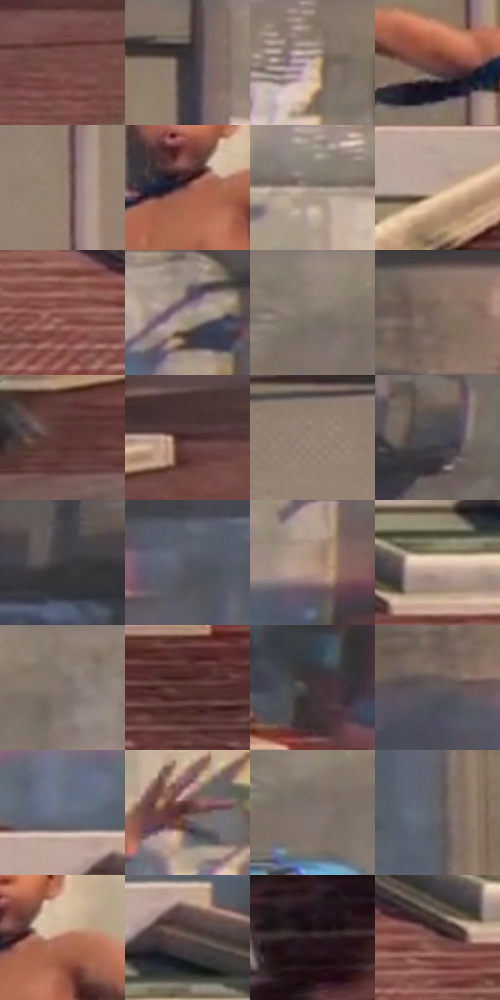

# 电影参考 092

- 状态：条件／活跃；来源世界：miles-home。
- 视角：high-angle；景别：full-body；场景：city。
- 时段：daylight-time-unspecified（外观依据，中置信度；具体时间／晨昏未知）；光照：neutral-day。
- 材质候选：skin, fabric, brick, asphalt, glass（帧级，不是像素分割）。
- 明暗组：middle；L* P5/P50/P95：20.75864 / 44.0979 / 73.27394。
- 资格门禁：motion。
- 原截图 SHA-256：`41218637c335e91074c8959a73772ec5d01784743ff020dd0b6f2b753c6aed8a`；尺寸：2880 × 1200。
- sRGB 像素 SHA-256：`a6c913feca675dc06226f29be05a7bcd5255f5a3d80527baa77c11ef7c69014c`。

## 观察与迁移

竖墙动作，姿态、透视与投影明确；对白独立确认。

92  /  屋顶人物张开四肢，下面的街道与影子强调高度。  /  夸张姿势仍由身体重心、投影和屋顶边缘约束。

本公开版保存32个128×128原像素色卡上下文；图集格子并非原场景相邻位置。原rect、图集tile和像素SHA见 `data/palette-crops.json`。上下文不足时不得批准替色，不能以小样推断完整构图。

## 实测色卡

颜色比例分母为保留采样像素，不是材料面积；全部 32 色参与全库匹配。表内四舍五入仅用于阅读，原精度在 JSON。

| ID | HEX | Lab | 原图 xy | 像素数 | 比例 | 明度角色 |
| --- | --- | --- | --- | ---: | ---: | --- |
| 092-S01 | #774944 | [36.186143, 18.973267, 11.239197] | [1232, 704] | 9038 | 4.691458% | shadow |
| 092-S02 | #786960 | [45.553493, 4.333721, 7.237717] | [1392, 24] | 8408 | 4.364437% | midtone |
| 092-S03 | #C6AF9C | [72.93617, 5.249384, 12.784274] | [2228, 64] | 8352 | 4.335368% | light |
| 092-S04 | #70423C | [33.282115, 19.180388, 12.145691] | [1268, 448] | 7736 | 4.015614% | shadow |
| 092-S05 | #917C6E | [53.558683, 5.767014, 10.639759] | [1288, 168] | 7685 | 3.989141% | midtone |
| 092-S06 | #82524C | [40.08658, 19.305483, 11.88346] | [1444, 424] | 7323 | 3.801233% | midtone |
| 092-S07 | #A08F84 | [60.591525, 4.463006, 8.167086] | [2180, 280] | 7216 | 3.745692% | light |
| 092-S08 | #BEA491 | [69.143286, 6.511264, 13.376826] | [808, 800] | 7006 | 3.636685% | light |
| 092-S09 | #8F5C53 | [44.404136, 19.776917, 13.830963] | [2004, 928] | 7002 | 3.634608% | midtone |
| 092-S10 | #AB9D93 | [65.654422, 3.384935, 7.080161] | [2676, 344] | 6814 | 3.537021% | light |
| 092-S11 | #8F8177 | [54.94083, 3.557502, 7.353843] | [1892, 36] | 6801 | 3.530273% | midtone |
| 092-S12 | #887164 | [49.453978, 6.897474, 10.592698] | [380, 44] | 6423 | 3.334060% | midtone |
| 092-S13 | #5D3834 | [27.855937, 15.9419, 9.427941] | [152, 764] | 6136 | 3.185084% | shadow |
| 092-S14 | #432726 | [19.159431, 13.039314, 6.211554] | [404, 648] | 6109 | 3.171068% | deep-shadow |
| 092-S15 | #988679 | [57.179287, 4.610119, 9.496734] | [1112, 112] | 6068 | 3.149786% | midtone |
| 092-S16 | #4B4A4F | [31.7109, 1.523417, -2.81892] | [2612, 64] | 6053 | 3.142000% | shadow |
| 092-S17 | #424045 | [27.448447, 1.974258, -2.735116] | [2444, 40] | 5894 | 3.059466% | shadow |
| 092-S18 | #525560 | [36.243383, 1.341384, -6.76603] | [584, 320] | 5625 | 2.919833% | shadow |
| 092-S19 | #B2937E | [63.210524, 8.427683, 15.482808] | [2696, 616] | 5533 | 2.872078% | light |
| 092-S20 | #DDC4AF | [80.710289, 5.520755, 13.777178] | [2188, 860] | 5434 | 2.820689% | highlight |
| 092-S21 | #887A6F | [52.176374, 3.441275, 7.981985] | [2016, 24] | 5425 | 2.816017% | midtone |
| 092-S22 | #53302D | [24.137961, 15.555856, 8.709422] | [2680, 964] | 5350 | 2.777086% | shadow |
| 092-S23 | #3F3435 | [22.895641, 5.102931, 1.199973] | [2728, 836] | 5316 | 2.759437% | shadow |
| 092-S24 | #625C5F | [39.71031, 3.008068, -0.853736] | [344, 136] | 5102 | 2.648353% | shadow |
| 092-S25 | #646D7F | [45.877777, 0.779851, -11.091464] | [2216, 712] | 4802 | 2.492629% | midtone |
| 092-S26 | #5D403D | [30.23337, 12.180993, 6.886361] | [1920, 396] | 4721 | 2.450583% | shadow |
| 092-S27 | #7D726C | [48.856299, 3.15695, 4.867341] | [1912, 96] | 4646 | 2.411652% | midtone |
| 092-S28 | #666468 | [42.670591, 1.614091, -1.976555] | [828, 428] | 4548 | 2.360782% | midtone |
| 092-S29 | #AA705C | [52.849723, 20.5943, 20.533043] | [1496, 412] | 4348 | 2.256966% | midtone |
| 092-S30 | #62514D | [36.018273, 6.340527, 4.991502] | [2276, 788] | 4202 | 2.181180% | shadow |
| 092-S31 | #291A1D | [11.268432, 8.036445, 0.913934] | [68, 1120] | 3850 | 1.998464% | deep-shadow |
| 092-S32 | #76544F | [39.168832, 13.404833, 8.528031] | [2108, 908] | 3682 | 1.911258% | shadow |

## 色阶与空间分布

- 采样 ROI：`[0.01, 0.02, 0.98, 0.94]`；步长：4；样本数：192648。
- 排除区：`[]`。
- 深暗、暗、中、亮、高光五段计数：`[8353, 70476, 76243, 35074, 2502]`。
- RGB 各 256 箱、L* 100 箱、13×5 色相明度表和 3×3 空间统计全部保存在 [总数据](../film-library.json)。
- [可视化档案](../../references/library.html)按需绘制直方图，不存 2,094 张重复图表图片。

## 纹理特征占比

**这是分块图像特征的面积占比，不是波点／排线／丝网／错版的精确语义覆盖率。** 窗格、发丝、织物也会产生方向或周期特征。
原图 ROI 像素 3084576；已测块覆盖 3084576（100.0000%）；未测 0。

| 特征 | 块覆盖像素 | 占已测面积 | 阈值敏感范围 |
| --- | ---: | ---: | --- |
| low-contrast | 16384 | 0.5312% | 0.0000% ~ 0.5312% |
| directional-structure | 1563136 | 50.6759% | 34.9652% ~ 64.8273% |
| periodic-structure | 1505056 | 48.7930% | 35.1727% ~ 62.2462% |
| mixed-detail | 0 | 0.0000% | 0.0000% ~ 2.2574% |

阈值敏感范围不是统计置信区间。逐块坐标、尺度、对比、方向一致性、频谱集中度、频率与角度见 [全量特征记录](../texture-features.jsonl)，以帧号定位。
四种印刷层的真实像素覆盖仍标为 `null`，不能填 0，也不能拿上表代替。不得据这些代理测量删除唯一证据。

[测量方法与保留策略](../../references/library-retention.md) · [分类索引](../archive/README.md)
