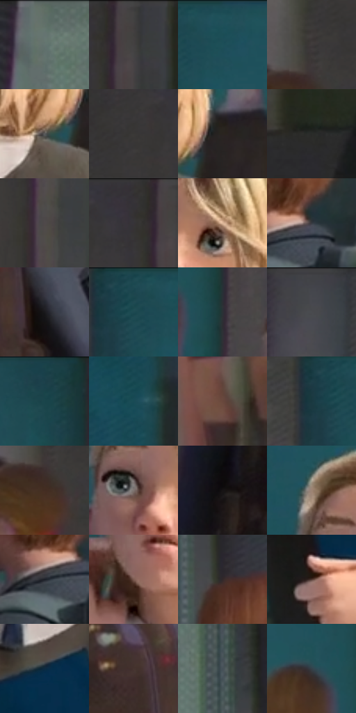

# 电影参考 093

- 状态：常规／活跃；来源世界：miles-home。
- 视角：near-level；景别：medium；场景：portrait。
- 时段：daylight-time-unspecified（外观依据，中置信度；具体时间／晨昏未知）；光照：neutral-day。
- 材质候选：skin, hair, fabric, brick, glass（帧级，不是像素分割）。
- 明暗组：dark；L* P5/P50/P95：9.54065 / 26.52087 / 55.25571。
- 资格门禁：无附加门禁。
- 原截图 SHA-256：`714f9665c686684ab92a30d81c810ba7467b5644c7e1030d69d4f06f11082fe2`；尺寸：2880 × 1206。
- sRGB 像素 SHA-256：`c11bab4b849c35550e93c21949eb61be8e9b77af6e3c9cfdf3f7497411068f25`。

## 观察与迁移

侧后近景人物、校舍与仰视窗洞，身份不换成角色。

93  /  人物近景站在较暗的青色门前，旁人以不同尺度进入画面。  /  浅色发丝与脸是注意力中心；背景暗色和景深让群像退后。

本公开版保存32个128×128原像素色卡上下文；图集格子并非原场景相邻位置。原rect、图集tile和像素SHA见 `data/palette-crops.json`。上下文不足时不得批准替色，不能以小样推断完整构图。

## 实测色卡

颜色比例分母为保留采样像素，不是材料面积；全部 32 色参与全库匹配。表内四舍五入仅用于阅读，原精度在 JSON。

| ID | HEX | Lab | 原图 xy | 像素数 | 比例 | 明度角色 |
| --- | --- | --- | --- | ---: | ---: | --- |
| 093-S01 | #61716A | [46.166476, -7.49781, 1.875393] | [168, 36] | 11464 | 5.929267% | midtone |
| 093-S02 | #444041 | [27.510976, 1.914475, 0.001767] | [2768, 64] | 9726 | 5.030360% | shadow |
| 093-S03 | #20505A | [31.305496, -12.774328, -10.730528] | [1764, 28] | 9511 | 4.919160% | shadow |
| 093-S04 | #3F3B3B | [25.261491, 1.722986, 0.62029] | [2516, 320] | 8840 | 4.572114% | shadow |
| 093-S05 | #59595A | [37.8546, 0.211829, -0.574423] | [2076, 560] | 8711 | 4.505394% | shadow |
| 093-S06 | #393836 | [23.553943, -0.014697, 1.402735] | [2608, 84] | 8416 | 4.352818% | shadow |
| 093-S07 | #2A241F | [14.695949, 1.77483, 4.379053] | [2152, 512] | 8360 | 4.323855% | deep-shadow |
| 093-S08 | #292B29 | [17.269771, -1.376155, 0.992098] | [1676, 1132] | 8320 | 4.303166% | deep-shadow |
| 093-S09 | #4F494A | [31.628311, 2.707793, 0.307775] | [2748, 660] | 7846 | 4.058010% | shadow |
| 093-S10 | #343236 | [21.123067, 1.814624, -2.213137] | [2708, 28] | 6887 | 3.562008% | shadow |
| 093-S11 | #E2BA9C | [78.280197, 10.084718, 20.621278] | [1976, 312] | 6855 | 3.545457% | light |
| 093-S12 | #363940 | [23.936228, 0.458364, -4.764631] | [1164, 516] | 6196 | 3.204618% | shadow |
| 093-S13 | #1A191D | [9.021216, 1.540949, -2.610442] | [964, 648] | 6140 | 3.175654% | deep-shadow |
| 093-S14 | #1E4951 | [28.471634, -12.122689, -9.261808] | [1696, 28] | 5984 | 3.094970% | shadow |
| 093-S15 | #2B3135 | [19.912042, -1.538561, -3.417017] | [2316, 348] | 5873 | 3.037560% | deep-shadow |
| 093-S16 | #46474E | [30.299667, 1.205145, -4.31805] | [740, 40] | 5628 | 2.910844% | shadow |
| 093-S17 | #194249 | [25.514465, -11.788975, -8.540364] | [2256, 48] | 5395 | 2.790334% | shadow |
| 093-S18 | #194B56 | [29.184798, -12.60457, -11.419448] | [1096, 164] | 5242 | 2.711202% | shadow |
| 093-S19 | #68483C | [33.783437, 11.972718, 12.65425] | [2476, 1036] | 5205 | 2.692065% | shadow |
| 093-S20 | #193840 | [21.597678, -8.746433, -8.484203] | [1652, 68] | 5178 | 2.678100% | shadow |
| 093-S21 | #432D22 | [20.773153, 8.503781, 11.153384] | [2512, 396] | 5014 | 2.593278% | shadow |
| 093-S22 | #7F7470 | [49.705228, 3.504022, 3.746145] | [1864, 332] | 4915 | 2.542075% | midtone |
| 093-S23 | #161314 | [6.204116, 1.522901, -0.143163] | [648, 696] | 4817 | 2.491388% | deep-shadow |
| 093-S24 | #9C8373 | [56.623703, 6.988631, 12.212392] | [1820, 220] | 4799 | 2.482079% | midtone |
| 093-S25 | #1C1E27 | [11.427612, 1.634906, -6.389355] | [1108, 544] | 4608 | 2.383292% | deep-shadow |
| 093-S26 | #7C5B50 | [41.762712, 11.908888, 11.640695] | [1848, 484] | 4538 | 2.347088% | midtone |
| 093-S27 | #33292A | [17.722672, 4.833976, 1.083418] | [432, 328] | 4206 | 2.175375% | deep-shadow |
| 093-S28 | #523A33 | [26.90303, 9.521516, 8.536515] | [1824, 920] | 3693 | 1.910047% | shadow |
| 093-S29 | #0C2A40 | [16.023986, -2.227073, -17.13788] | [1944, 712] | 3197 | 1.653512% | deep-shadow |
| 093-S30 | #45332F | [23.129499, 7.420278, 5.675428] | [856, 588] | 3084 | 1.595068% | shadow |
| 093-S31 | #465058 | [33.443528, -1.996701, -6.021486] | [372, 116] | 2506 | 1.296122% | shadow |
| 093-S32 | #334049 | [26.307321, -2.81652, -7.199839] | [2228, 300] | 2192 | 1.133719% | shadow |

## 色阶与空间分布

- 采样 ROI：`[0.01, 0.02, 0.98, 0.94]`；步长：4；样本数：193346。
- 排除区：`[]`。
- 深暗、暗、中、亮、高光五段计数：`[46655, 113710, 24958, 5057, 2966]`。
- RGB 各 256 箱、L* 100 箱、13×5 色相明度表和 3×3 空间统计全部保存在 [总数据](../film-library.json)。
- [可视化档案](../../references/library.html)按需绘制直方图，不存 2,094 张重复图表图片。

## 纹理特征占比

**这是分块图像特征的面积占比，不是波点／排线／丝网／错版的精确语义覆盖率。** 窗格、发丝、织物也会产生方向或周期特征。
原图 ROI 像素 3098546；已测块覆盖 3098546（100.0000%）；未测 0。

| 特征 | 块覆盖像素 | 占已测面积 | 阈值敏感范围 |
| --- | ---: | ---: | --- |
| low-contrast | 234752 | 7.5762% | 4.7589% ~ 9.1625% |
| directional-structure | 512640 | 16.5445% | 10.3770% ~ 29.5860% |
| periodic-structure | 2318386 | 74.8217% | 65.1264% ~ 76.7592% |
| mixed-detail | 32768 | 1.0575% | 0.5288% ~ 3.7013% |

阈值敏感范围不是统计置信区间。逐块坐标、尺度、对比、方向一致性、频谱集中度、频率与角度见 [全量特征记录](../texture-features.jsonl)，以帧号定位。
四种印刷层的真实像素覆盖仍标为 `null`，不能填 0，也不能拿上表代替。不得据这些代理测量删除唯一证据。

[测量方法与保留策略](../../references/library-retention.md) · [分类索引](../archive/README.md)
