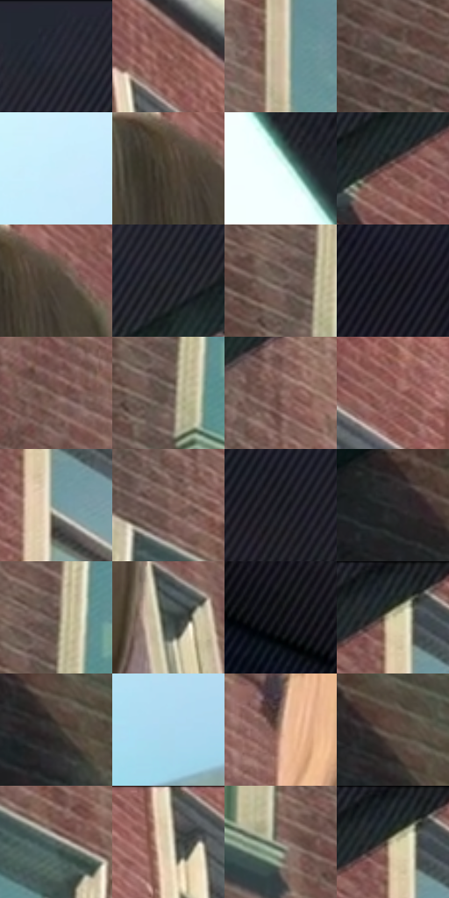

# 电影参考 094

- 状态：常规／活跃；来源世界：miles-home。
- 视角：low-angle；景别：medium；场景：portrait。
- 时段：daylight-time-unspecified（外观依据，中置信度；具体时间／晨昏未知）；光照：neutral-day。
- 材质候选：skin, hair, fabric, brick, glass（帧级，不是像素分割）。
- 明暗组：dark；L* P5/P50/P95：7.92264 / 38.20964 / 93.41714。
- 资格门禁：无附加门禁。
- 原截图 SHA-256：`871d9db72b9c37503dd8e131366dd8791fb6bcceeec363cec7c6181840f4cac1`；尺寸：2880 × 1208。
- sRGB 像素 SHA-256：`c7b185c32deef1feab032ae8528d0471b9605fbe55391d57271558520e21e933`。

## 观察与迁移

侧后近景人物、校舍与仰视窗洞，身份不换成角色。

94  /  背对镜头的人物望向高处砖墙，墙面窗口与头发都保留方向性细线。  /  以视线、背影和大面积建筑建立画外目标，不补造看不到的表情。

本公开版保存32个128×128原像素色卡上下文；图集格子并非原场景相邻位置。原rect、图集tile和像素SHA见 `data/palette-crops.json`。上下文不足时不得批准替色，不能以小样推断完整构图。

## 实测色卡

颜色比例分母为保留采样像素，不是材料面积；全部 32 色参与全库匹配。表内四舍五入仅用于阅读，原精度在 JSON。

| ID | HEX | Lab | 原图 xy | 像素数 | 比例 | 明度角色 |
| --- | --- | --- | --- | ---: | ---: | --- |
| 094-S01 | #232631 | [15.303808, 1.724312, -7.632035] | [812, 28] | 10972 | 5.674801% | deep-shadow |
| 094-S02 | #9D6F67 | [51.287341, 17.13858, 11.730385] | [2028, 156] | 10136 | 5.242415% | midtone |
| 094-S03 | #CBB79E | [75.472096, 3.156917, 15.325312] | [1172, 768] | 8968 | 4.638317% | light |
| 094-S04 | #5E5047 | [35.147258, 4.198371, 7.458929] | [668, 676] | 8127 | 4.203345% | shadow |
| 094-S05 | #C7ECFB | [91.277603, -8.825613, -11.222936] | [2592, 608] | 8098 | 4.188346% | highlight |
| 094-S06 | #463B2E | [25.645874, 2.477925, 9.853761] | [2072, 316] | 7793 | 4.030598% | shadow |
| 094-S07 | #F0FEFE | [98.655818, -4.564394, -1.575259] | [2488, 112] | 7413 | 3.834059% | highlight |
| 094-S08 | #835C55 | [42.968, 14.987424, 10.40328] | [1064, 128] | 7356 | 3.804578% | midtone |
| 094-S09 | #4F463A | [30.274598, 1.579418, 8.636308] | [2116, 316] | 7224 | 3.736307% | shadow |
| 094-S10 | #191C21 | [10.160194, 0.01479, -3.907556] | [912, 116] | 7054 | 3.648382% | deep-shadow |
| 094-S11 | #74655D | [43.960739, 4.544775, 6.724547] | [760, 604] | 6983 | 3.611660% | midtone |
| 094-S12 | #202026 | [12.480505, 1.585348, -4.031162] | [200, 220] | 6695 | 3.462704% | deep-shadow |
| 094-S13 | #6E524A | [37.561984, 10.434547, 9.234929] | [1540, 852] | 6288 | 3.252201% | shadow |
| 094-S14 | #695B53 | [39.76559, 4.234642, 6.702433] | [788, 636] | 6162 | 3.187033% | shadow |
| 094-S15 | #886A62 | [47.527137, 10.689667, 9.067584] | [912, 280] | 5926 | 3.064972% | midtone |
| 094-S16 | #8F6059 | [45.535181, 18.200042, 11.781989] | [1360, 76] | 5760 | 2.979115% | midtone |
| 094-S17 | #7E9998 | [61.206705, -9.62956, -2.619634] | [1196, 164] | 5728 | 2.962565% | light |
| 094-S18 | #755952 | [40.469709, 10.400584, 8.49343] | [880, 376] | 5627 | 2.910327% | midtone |
| 094-S19 | #14151A | [6.861606, 0.862449, -3.614618] | [420, 308] | 5609 | 2.901017% | deep-shadow |
| 094-S20 | #2B2B2D | [17.602719, 0.484573, -1.294674] | [240, 696] | 5259 | 2.719994% | deep-shadow |
| 094-S21 | #5C4A40 | [33.013191, 5.904631, 8.845107] | [796, 572] | 4903 | 2.535868% | shadow |
| 094-S22 | #3E4744 | [29.280576, -4.358754, 0.563509] | [2292, 788] | 4844 | 2.505353% | shadow |
| 094-S23 | #0B0E10 | [3.817528, -0.538548, -1.301743] | [72, 528] | 4761 | 2.462425% | deep-shadow |
| 094-S24 | #1F2429 | [13.903356, -0.85549, -4.077704] | [1168, 28] | 4561 | 2.358983% | deep-shadow |
| 094-S25 | #37332D | [21.466407, 0.510259, 4.44714] | [384, 824] | 4536 | 2.346053% | shadow |
| 094-S26 | #ADD9ED | [84.28854, -9.827097, -14.472842] | [2620, 952] | 4431 | 2.291746% | highlight |
| 094-S27 | #B58E78 | [62.10667, 11.601888, 17.370063] | [1632, 580] | 4123 | 2.132446% | light |
| 094-S28 | #57453A | [30.850611, 5.853098, 9.569383] | [372, 776] | 4119 | 2.130378% | shadow |
| 094-S29 | #555E5A | [39.027206, -4.382644, 1.095323] | [944, 460] | 4069 | 2.104517% | shadow |
| 094-S30 | #E9E0C7 | [89.280221, -1.044451, 13.348969] | [1732, 28] | 3548 | 1.835052% | highlight |
| 094-S31 | #8A7D73 | [53.285772, 3.188405, 7.253653] | [1004, 752] | 3503 | 1.811778% | midtone |
| 094-S32 | #21282C | [15.605979, -1.966736, -3.652869] | [1164, 36] | 2770 | 1.432665% | deep-shadow |

## 色阶与空间分布

- 采样 ROI：`[0.01, 0.02, 0.98, 0.94]`；步长：4；样本数：193346。
- 排除区：`[]`。
- 深暗、暗、中、亮、高光五段计数：`[48271, 55690, 51579, 13313, 24493]`。
- RGB 各 256 箱、L* 100 箱、13×5 色相明度表和 3×3 空间统计全部保存在 [总数据](../film-library.json)。
- [可视化档案](../../references/library.html)按需绘制直方图，不存 2,094 张重复图表图片。

## 纹理特征占比

**这是分块图像特征的面积占比，不是波点／排线／丝网／错版的精确语义覆盖率。** 窗格、发丝、织物也会产生方向或周期特征。
原图 ROI 像素 3104134；已测块覆盖 3104134（100.0000%）；未测 0。

| 特征 | 块覆盖像素 | 占已测面积 | 阈值敏感范围 |
| --- | ---: | ---: | --- |
| low-contrast | 240384 | 7.7440% | 4.8369% ~ 8.2718% |
| directional-structure | 1365376 | 43.9857% | 25.0752% ~ 67.6672% |
| periodic-structure | 1487238 | 47.9115% | 26.4403% ~ 61.4450% |
| mixed-detail | 11136 | 0.3587% | 0.3587% ~ 5.2080% |

阈值敏感范围不是统计置信区间。逐块坐标、尺度、对比、方向一致性、频谱集中度、频率与角度见 [全量特征记录](../texture-features.jsonl)，以帧号定位。
四种印刷层的真实像素覆盖仍标为 `null`，不能填 0，也不能拿上表代替。不得据这些代理测量删除唯一证据。

[测量方法与保留策略](../../references/library-retention.md) · [分类索引](../archive/README.md)
