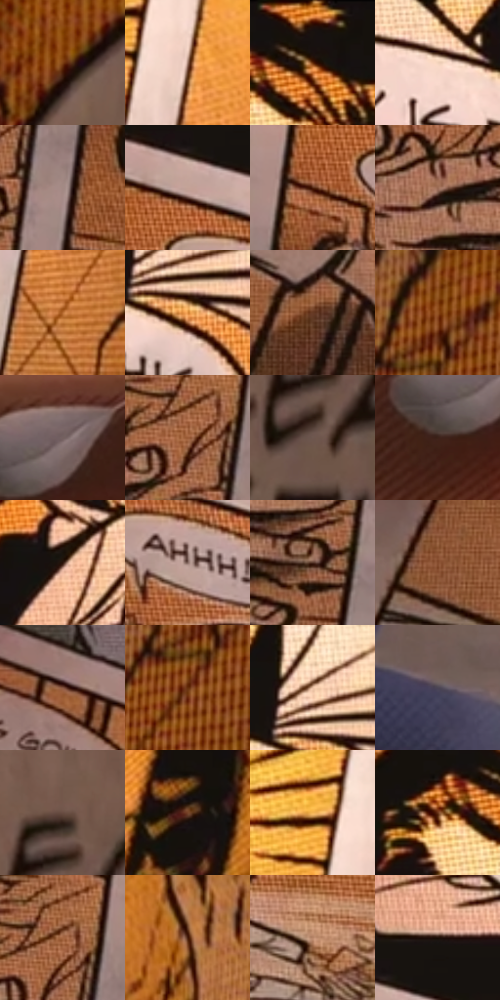

# 电影参考 095

- 状态：条件／活跃；来源世界：miles-home。
- 视角：high-angle；景别：detail；场景：detail。
- 时段：daylight-time-unspecified（外观依据，中置信度；具体时间／晨昏未知）；光照：warm-day。
- 材质候选：skin, paper, paint（帧级，不是像素分割）。
- 明暗组：middle；L* P5/P50/P95：6.50261 / 40.69328 / 81.20166。
- 资格门禁：secondary-image。
- 原截图 SHA-256：`5715654997224b35a3aec3c71110fdb9cbe83491c365f4e94ea9137df3ac894e`；尺寸：2880 × 1202。
- sRGB 像素 SHA-256：`91f0a0c9458bfa4a90eea8a6303ce7fe565c9f94b9925385718acc14735f56eb`。

## 观察与迁移

手持漫画纸，印刷图像与现实手部是不同载体。

95  /  前景手指压着实体漫画页；纸上是黑墨分格、橙黄半调和对白气泡。  /  区分真实场景中的手、纸张透视与纸上二次图像；纸上的对白不属于画面人物当前说话。

本公开版保存32个128×128原像素色卡上下文；图集格子并非原场景相邻位置。原rect、图集tile和像素SHA见 `data/palette-crops.json`。上下文不足时不得批准替色，不能以小样推断完整构图。

## 实测色卡

颜色比例分母为保留采样像素，不是材料面积；全部 32 色参与全库匹配。表内四舍五入仅用于阅读，原精度在 JSON。

| ID | HEX | Lab | 原图 xy | 像素数 | 比例 | 明度角色 |
| --- | --- | --- | --- | ---: | ---: | --- |
| 095-S01 | #7C3F13 | [33.749226, 23.232859, 36.777528] | [2620, 96] | 7560 | 3.924256% | shadow |
| 095-S02 | #9C7768 | [53.235314, 12.271855, 13.840754] | [1924, 348] | 7473 | 3.879096% | midtone |
| 095-S03 | #18120F | [5.973633, 2.075045, 2.522929] | [1496, 36] | 7439 | 3.861447% | deep-shadow |
| 095-S04 | #F3D3BC | [86.640666, 7.678194, 15.511732] | [1520, 468] | 7418 | 3.850546% | highlight |
| 095-S05 | #A38A84 | [59.553256, 8.441024, 6.722904] | [1072, 932] | 7188 | 3.731157% | midtone |
| 095-S06 | #C3A296 | [69.216831, 10.264743, 10.785297] | [1200, 716] | 7108 | 3.689631% | light |
| 095-S07 | #512412 | [20.263824, 19.525404, 21.433167] | [1132, 804] | 7098 | 3.684440% | shadow |
| 095-S08 | #9A6A53 | [49.257606, 16.323118, 20.617552] | [876, 924] | 7037 | 3.652776% | midtone |
| 095-S09 | #B86D32 | [53.341919, 24.909493, 44.387949] | [1928, 620] | 7023 | 3.645509% | midtone |
| 095-S10 | #E18E3F | [66.302773, 24.946658, 53.498227] | [1676, 496] | 6639 | 3.446182% | light |
| 095-S11 | #663A24 | [29.359388, 17.132121, 21.838111] | [648, 824] | 6520 | 3.384411% | shadow |
| 095-S12 | #935223 | [41.783685, 23.246059, 38.120505] | [2424, 480] | 6403 | 3.323678% | midtone |
| 095-S13 | #746060 | [42.64803, 8.060442, 3.02363] | [336, 368] | 6302 | 3.271251% | midtone |
| 095-S14 | #995A35 | [44.721459, 22.375211, 32.048734] | [992, 868] | 6274 | 3.256717% | midtone |
| 095-S15 | #6E574F | [39.064324, 8.147467, 8.248364] | [2784, 304] | 6245 | 3.241664% | shadow |
| 095-S16 | #3C2218 | [16.359659, 11.18297, 11.962886] | [276, 432] | 6193 | 3.214671% | deep-shadow |
| 095-S17 | #2A1309 | [8.805444, 10.694359, 9.718437] | [1272, 368] | 6182 | 3.208961% | deep-shadow |
| 095-S18 | #866B63 | [47.604847, 9.427214, 8.551409] | [1264, 816] | 6159 | 3.197023% | midtone |
| 095-S19 | #4F3024 | [23.35125, 12.595105, 13.540434] | [980, 1024] | 6011 | 3.120198% | shadow |
| 095-S20 | #844A2C | [37.817701, 21.752909, 28.268584] | [444, 836] | 5784 | 3.002367% | shadow |
| 095-S21 | #885643 | [41.683165, 18.499757, 19.644868] | [720, 564] | 5733 | 2.975894% | midtone |
| 095-S22 | #642D0B | [25.596606, 22.570859, 31.585658] | [2404, 568] | 5716 | 2.967069% | shadow |
| 095-S23 | #E8BEA0 | [79.910757, 10.782149, 20.82113] | [1656, 428] | 5699 | 2.958245% | light |
| 095-S24 | #4A4453 | [29.947578, 5.915745, -8.03308] | [304, 1088] | 5457 | 2.832627% | shadow |
| 095-S25 | #684C41 | [34.991466, 10.177564, 11.171413] | [2792, 196] | 5439 | 2.823284% | shadow |
| 095-S26 | #774429 | [34.431377, 19.260961, 25.536246] | [2144, 144] | 5326 | 2.764628% | shadow |
| 095-S27 | #F5B454 | [77.697227, 14.250889, 56.82744] | [1856, 288] | 5183 | 2.690399% | light |
| 095-S28 | #6A3419 | [28.356737, 21.806883, 27.370732] | [1416, 92] | 5091 | 2.642644% | shadow |
| 095-S29 | #A66742 | [49.7412, 21.571335, 31.250678] | [1008, 836] | 4286 | 2.224783% | midtone |
| 095-S30 | #411908 | [14.607153, 18.177873, 18.765276] | [2212, 384] | 3936 | 2.043105% | deep-shadow |
| 095-S31 | #B88569 | [59.877311, 16.022962, 22.821977] | [1452, 916] | 3672 | 1.906067% | midtone |
| 095-S32 | #1B0D06 | [4.824159, 4.965409, 4.853029] | [1252, 636] | 3054 | 1.585275% | deep-shadow |

## 色阶与空间分布

- 采样 ROI：`[0.01, 0.02, 0.98, 0.94]`；步长：4；样本数：192648。
- 排除区：`[]`。
- 深暗、暗、中、亮、高光五段计数：`[30868, 62157, 63443, 25025, 11155]`。
- RGB 各 256 箱、L* 100 箱、13×5 色相明度表和 3×3 空间统计全部保存在 [总数据](../film-library.json)。
- [可视化档案](../../references/library.html)按需绘制直方图，不存 2,094 张重复图表图片。

## 纹理特征占比

**这是分块图像特征的面积占比，不是波点／排线／丝网／错版的精确语义覆盖率。** 窗格、发丝、织物也会产生方向或周期特征。
原图 ROI 像素 3087370；已测块覆盖 3087370（100.0000%）；未测 0。

| 特征 | 块覆盖像素 | 占已测面积 | 阈值敏感范围 |
| --- | ---: | ---: | --- |
| low-contrast | 16384 | 0.5307% | 0.5307% ~ 0.9701% |
| directional-structure | 770304 | 24.9502% | 6.7040% ~ 45.0541% |
| periodic-structure | 2111754 | 68.3998% | 51.7619% ~ 78.2463% |
| mixed-detail | 188928 | 6.1194% | 2.6534% ~ 14.0796% |

阈值敏感范围不是统计置信区间。逐块坐标、尺度、对比、方向一致性、频谱集中度、频率与角度见 [全量特征记录](../texture-features.jsonl)，以帧号定位。
四种印刷层的真实像素覆盖仍标为 `null`，不能填 0，也不能拿上表代替。不得据这些代理测量删除唯一证据。

[测量方法与保留策略](../../references/library-retention.md) · [分类索引](../archive/README.md)
