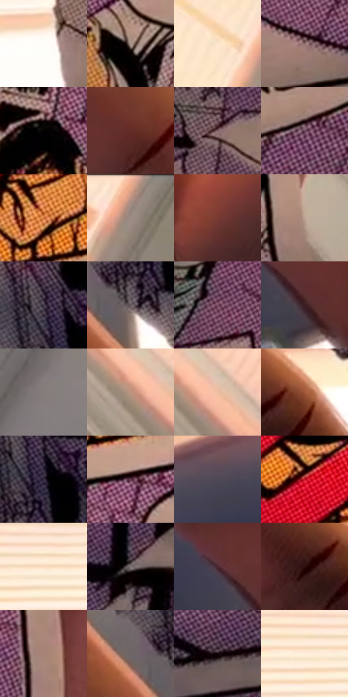

# 电影参考 096

- 状态：条件／活跃；来源世界：miles-home。
- 视角：near-level；景别：detail；场景：detail。
- 时段：daylight-time-unspecified（外观依据，中置信度；具体时间／晨昏未知）；光照：warm-day。
- 材质候选：skin, paper, paint（帧级，不是像素分割）。
- 明暗组：middle；L* P5/P50/P95：1.8387 / 45.33113 / 96.05784。
- 资格门禁：secondary-image。
- 原截图 SHA-256：`2eb2e71cda2abee2519bf4a00b746ddf67830f616ebc7f29f624424195850ee3`；尺寸：2880 × 1208。
- sRGB 像素 SHA-256：`fe412776e68c146141e32c08e0ddd5629193dcb77af71eb6aea6f197be55b8b4`。

## 观察与迁移

手持漫画纸，印刷图像与现实手部是不同载体。

96  /  翻动的漫画页被手指弯曲，紫色半调格、黑框和白色尖尾气泡跟随纸面倾斜。  /  网点与文字框须服从物体曲面和透视，不能像屏幕 UI 一样平贴。

本公开版保存32个128×128原像素色卡上下文；图集格子并非原场景相邻位置。原rect、图集tile和像素SHA见 `data/palette-crops.json`。上下文不足时不得批准替色，不能以小样推断完整构图。

## 实测色卡

颜色比例分母为保留采样像素，不是材料面积；全部 32 色参与全库匹配。表内四舍五入仅用于阅读，原精度在 JSON。

| ID | HEX | Lab | 原图 xy | 像素数 | 比例 | 明度角色 |
| --- | --- | --- | --- | ---: | ---: | --- |
| 096-S01 | #FEFDF9 | [99.284561, -0.365969, 2.029886] | [552, 500] | 8916 | 4.611422% | highlight |
| 096-S02 | #A49289 | [61.875454, 5.153627, 7.214446] | [1476, 420] | 8403 | 4.346095% | light |
| 096-S03 | #FCE6CC | [92.42042, 3.453561, 15.400443] | [2612, 224] | 7964 | 4.119040% | highlight |
| 096-S04 | #947073 | [50.830764, 14.693191, 3.867511] | [1784, 888] | 7829 | 4.049217% | midtone |
| 096-S05 | #040102 | [0.468887, 0.923524, -0.101975] | [1352, 332] | 7538 | 3.898710% | deep-shadow |
| 096-S06 | #632C27 | [25.567026, 24.38415, 15.056095] | [540, 860] | 7293 | 3.771994% | shadow |
| 096-S07 | #836567 | [45.788033, 12.380589, 3.517767] | [1100, 968] | 7010 | 3.625625% | midtone |
| 096-S08 | #674357 | [33.106307, 18.908161, -5.532032] | [1868, 364] | 6993 | 3.616832% | shadow |
| 096-S09 | #D37A40 | [60.016634, 29.874494, 45.751004] | [1252, 140] | 6930 | 3.584248% | light |
| 096-S10 | #96867D | [57.09049, 4.474607, 7.048042] | [2792, 52] | 6461 | 3.341678% | midtone |
| 096-S11 | #783A32 | [32.370588, 26.2447, 17.479902] | [2344, 1092] | 6457 | 3.339609% | shadow |
| 096-S12 | #BEA191 | [68.374788, 8.149068, 12.295588] | [2160, 752] | 6398 | 3.309094% | light |
| 096-S13 | #433648 | [24.638015, 9.694031, -8.916994] | [784, 728] | 6264 | 3.239788% | shadow |
| 096-S14 | #64585D | [38.689196, 5.852707, -1.091302] | [776, 864] | 6165 | 3.188584% | shadow |
| 096-S15 | #7C4E64 | [38.992695, 22.783318, -4.685006] | [1500, 792] | 6028 | 3.117727% | shadow |
| 096-S16 | #3B1D22 | [15.084544, 15.340574, 3.111654] | [624, 1092] | 5684 | 2.939807% | deep-shadow |
| 096-S17 | #847D7B | [52.95281, 2.270562, 2.03995] | [2776, 604] | 5612 | 2.902568% | midtone |
| 096-S18 | #C0927E | [64.380982, 14.567452, 17.322766] | [2300, 600] | 5507 | 2.848262% | light |
| 096-S19 | #EFBEA2 | [80.62146, 13.711135, 20.84044] | [2348, 596] | 5424 | 2.805333% | highlight |
| 096-S20 | #A05739 | [45.063774, 27.316823, 30.44973] | [856, 1040] | 5390 | 2.787748% | midtone |
| 096-S21 | #332C40 | [19.537456, 8.121853, -11.457791] | [812, 768] | 5385 | 2.785162% | deep-shadow |
| 096-S22 | #5E3749 | [28.362918, 20.192922, -3.64304] | [1444, 232] | 5182 | 2.680169% | shadow |
| 096-S23 | #4F4755 | [31.404318, 6.415213, -7.08045] | [240, 896] | 5180 | 2.679135% | shadow |
| 096-S24 | #BF1625 | [40.876157, 62.346795, 38.604508] | [1076, 84] | 5144 | 2.660515% | midtone |
| 096-S25 | #F8D8BC | [88.305105, 6.927374, 17.910703] | [500, 348] | 5137 | 2.656895% | highlight |
| 096-S26 | #7C7273 | [48.955246, 4.053171, 0.848537] | [1072, 604] | 5077 | 2.625862% | midtone |
| 096-S27 | #4C2830 | [21.086061, 17.932471, 2.213564] | [556, 1020] | 5016 | 2.594313% | shadow |
| 096-S28 | #2D0D0D | [7.903374, 16.507621, 6.74447] | [780, 1072] | 4842 | 2.504319% | deep-shadow |
| 096-S29 | #A88276 | [57.654858, 12.826602, 12.115672] | [2120, 268] | 4784 | 2.474321% | midtone |
| 096-S30 | #6D6669 | [43.907046, 3.345943, -0.6956] | [700, 836] | 4773 | 2.468631% | midtone |
| 096-S31 | #120509 | [2.320476, 4.459877, -0.138041] | [2024, 912] | 4536 | 2.346053% | deep-shadow |
| 096-S32 | #FEEEDB | [94.880562, 2.333448, 11.140746] | [432, 356] | 4024 | 2.081243% | highlight |

## 色阶与空间分布

- 采样 ROI：`[0.01, 0.02, 0.98, 0.94]`；步长：4；样本数：193346。
- 排除区：`[]`。
- 深暗、暗、中、亮、高光五段计数：`[28171, 52923, 57667, 25229, 29356]`。
- RGB 各 256 箱、L* 100 箱、13×5 色相明度表和 3×3 空间统计全部保存在 [总数据](../film-library.json)。
- [可视化档案](../../references/library.html)按需绘制直方图，不存 2,094 张重复图表图片。

## 纹理特征占比

**这是分块图像特征的面积占比，不是波点／排线／丝网／错版的精确语义覆盖率。** 窗格、发丝、织物也会产生方向或周期特征。
原图 ROI 像素 3104134；已测块覆盖 3104134（100.0000%）；未测 0。

| 特征 | 块覆盖像素 | 占已测面积 | 阈值敏感范围 |
| --- | ---: | ---: | --- |
| low-contrast | 110598 | 3.5629% | 2.4700% ~ 3.9217% |
| directional-structure | 808320 | 26.0401% | 15.8344% ~ 31.9450% |
| periodic-structure | 2086912 | 67.2301% | 64.5294% ~ 68.0837% |
| mixed-detail | 98304 | 3.1669% | 1.0556% ~ 12.1603% |

阈值敏感范围不是统计置信区间。逐块坐标、尺度、对比、方向一致性、频谱集中度、频率与角度见 [全量特征记录](../texture-features.jsonl)，以帧号定位。
四种印刷层的真实像素覆盖仍标为 `null`，不能填 0，也不能拿上表代替。不得据这些代理测量删除唯一证据。

[测量方法与保留策略](../../references/library-retention.md) · [分类索引](../archive/README.md)
