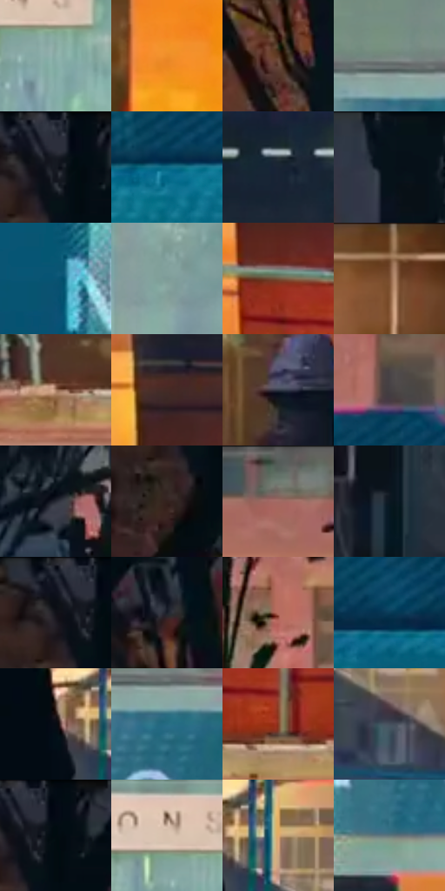

# 电影参考 097

- 状态：常规／活跃；来源世界：miles-home。
- 视角：near-level；景别：environment-wide；场景：city。
- 时段：low-sun-time-unspecified（外观依据，中置信度；具体时间／晨昏未知）；光照：warm-day。
- 材质候选：brick, glass, asphalt, sky（帧级，不是像素分割）。
- 明暗组：dark；L* P5/P50/P95：4.87756 / 33.18454 / 70.30554。
- 资格门禁：无附加门禁。
- 原截图 SHA-256：`a3cb5ba4d2d8e5b59f19f896fc4c65523ce179b1c9dad92e7072dd7f6589af33`；尺寸：2880 × 1206。
- sRGB 像素 SHA-256：`5c7cae5919011f8d1dc34047a67ba9a6950931ec3eb07a550728d6516c708666`。

## 观察与迁移

校舍夕阳立面，橙受光带和青蓝阴影并存。

97  /  街树剪影遮住青色施工围挡，橙色建筑亮带和细密排线形成层次。  /  青橙关系来自实际立面与光线，文字标识只作为原场景信息。

本公开版保存32个128×128原像素色卡上下文；图集格子并非原场景相邻位置。原rect、图集tile和像素SHA见 `data/palette-crops.json`。上下文不足时不得批准替色，不能以小样推断完整构图。

## 实测色卡

颜色比例分母为保留采样像素，不是材料面积；全部 32 色参与全库匹配。表内四舍五入仅用于阅读，原精度在 JSON。

| ID | HEX | Lab | 原图 xy | 像素数 | 比例 | 明度角色 |
| --- | --- | --- | --- | ---: | ---: | --- |
| 097-S01 | #8BAEA8 | [68.451148, -13.129094, -0.847189] | [2452, 504] | 9888 | 5.114148% | light |
| 097-S02 | #EE8D27 | [67.559902, 29.972293, 64.891648] | [1844, 136] | 9585 | 4.957434% | light |
| 097-S03 | #5A3A27 | [27.700651, 11.77757, 17.533493] | [252, 340] | 9169 | 4.742276% | shadow |
| 097-S04 | #77877E | [54.820049, -7.682871, 2.872099] | [1856, 368] | 9038 | 4.674521% | midtone |
| 097-S05 | #2B2F3C | [19.527035, 1.803524, -8.800836] | [96, 28] | 8560 | 4.427296% | deep-shadow |
| 097-S06 | #0C6A86 | [41.384368, -14.440339, -22.505747] | [1172, 392] | 8369 | 4.328510% | midtone |
| 097-S07 | #192433 | [13.86972, 0.166613, -11.324411] | [1628, 744] | 8362 | 4.324889% | deep-shadow |
| 097-S08 | #07131A | [5.288359, -2.031397, -6.045125] | [388, 28] | 7477 | 3.867160% | deep-shadow |
| 097-S09 | #0A5473 | [33.226153, -8.887884, -23.562778] | [1672, 512] | 7426 | 3.840783% | shadow |
| 097-S10 | #7D9C98 | [62.000446, -11.586388, -1.461956] | [2072, 512] | 7282 | 3.766305% | light |
| 097-S11 | #74553D | [38.80792, 9.570325, 19.008473] | [2560, 992] | 6809 | 3.521666% | shadow |
| 097-S12 | #916B4B | [48.315851, 10.996462, 23.81428] | [2264, 40] | 6797 | 3.515459% | midtone |
| 097-S13 | #AA8167 | [57.296307, 12.250259, 20.216555] | [2072, 1104] | 6195 | 3.204100% | midtone |
| 097-S14 | #452B26 | [20.569521, 11.340517, 8.21054] | [2544, 836] | 6157 | 3.184447% | shadow |
| 097-S15 | #323947 | [23.86608, 0.847088, -9.577712] | [2280, 1024] | 6092 | 3.150828% | shadow |
| 097-S16 | #454043 | [27.674872, 2.774326, -1.057247] | [1208, 252] | 6059 | 3.133760% | shadow |
| 097-S17 | #272B35 | [17.534693, 0.97051, -7.020899] | [632, 92] | 5936 | 3.070144% | deep-shadow |
| 097-S18 | #2C2422 | [15.022689, 3.353771, 2.737608] | [32, 168] | 5732 | 2.964633% | deep-shadow |
| 097-S19 | #726861 | [44.718576, 2.636172, 5.368201] | [904, 52] | 5450 | 2.818781% | midtone |
| 097-S20 | #0B1721 | [7.169316, -1.457156, -8.563549] | [108, 1016] | 5148 | 2.662584% | deep-shadow |
| 097-S21 | #131318 | [6.053245, 1.200734, -3.268242] | [52, 48] | 5001 | 2.586555% | deep-shadow |
| 097-S22 | #191D27 | [10.790231, 1.156036, -7.386449] | [244, 148] | 4853 | 2.510008% | deep-shadow |
| 097-S23 | #B76D5E | [53.830285, 27.767581, 20.978295] | [764, 180] | 4800 | 2.482596% | midtone |
| 097-S24 | #0A3B57 | [23.271132, -4.386047, -21.256012] | [1408, 368] | 4675 | 2.417945% | shadow |
| 097-S25 | #070C13 | [3.2077, -0.038195, -4.005945] | [796, 808] | 4095 | 2.117965% | deep-shadow |
| 097-S26 | #256C84 | [42.434746, -13.583617, -19.640344] | [1904, 432] | 3890 | 2.011937% | midtone |
| 097-S27 | #883E24 | [35.612681, 29.718995, 30.474881] | [2632, 1080] | 3890 | 2.011937% | shadow |
| 097-S28 | #46505D | [33.625247, -0.693555, -8.911829] | [944, 920] | 3668 | 1.897117% | shadow |
| 097-S29 | #020B12 | [2.672795, -1.122448, -4.200333] | [120, 52] | 3463 | 1.791090% | deep-shadow |
| 097-S30 | #D8C2AE | [79.750159, 4.570506, 12.894995] | [2404, 452] | 3380 | 1.748161% | light |
| 097-S31 | #E5AC6A | [74.322067, 13.416372, 41.797061] | [880, 800] | 3273 | 1.692820% | light |
| 097-S32 | #5E777C | [48.2953, -7.839114, -5.731441] | [1796, 628] | 2827 | 1.462146% | midtone |

## 色阶与空间分布

- 采样 ROI：`[0.01, 0.02, 0.98, 0.94]`；步长：4；样本数：193346。
- 排除区：`[]`。
- 深暗、暗、中、亮、高光五段计数：`[58750, 55792, 45491, 30714, 2599]`。
- RGB 各 256 箱、L* 100 箱、13×5 色相明度表和 3×3 空间统计全部保存在 [总数据](../film-library.json)。
- [可视化档案](../../references/library.html)按需绘制直方图，不存 2,094 张重复图表图片。

## 纹理特征占比

**这是分块图像特征的面积占比，不是波点／排线／丝网／错版的精确语义覆盖率。** 窗格、发丝、织物也会产生方向或周期特征。
原图 ROI 像素 3098546；已测块覆盖 3098546（100.0000%）；未测 0。

| 特征 | 块覆盖像素 | 占已测面积 | 阈值敏感范围 |
| --- | ---: | ---: | --- |
| low-contrast | 32768 | 1.0575% | 0.5288% ~ 1.0575% |
| directional-structure | 963584 | 31.0979% | 16.9122% ~ 40.4339% |
| periodic-structure | 2034098 | 65.6469% | 58.5085% ~ 74.0162% |
| mixed-detail | 68096 | 2.1977% | 0.5288% ~ 8.0141% |

阈值敏感范围不是统计置信区间。逐块坐标、尺度、对比、方向一致性、频谱集中度、频率与角度见 [全量特征记录](../texture-features.jsonl)，以帧号定位。
四种印刷层的真实像素覆盖仍标为 `null`，不能填 0，也不能拿上表代替。不得据这些代理测量删除唯一证据。

[测量方法与保留策略](../../references/library-retention.md) · [分类索引](../archive/README.md)
