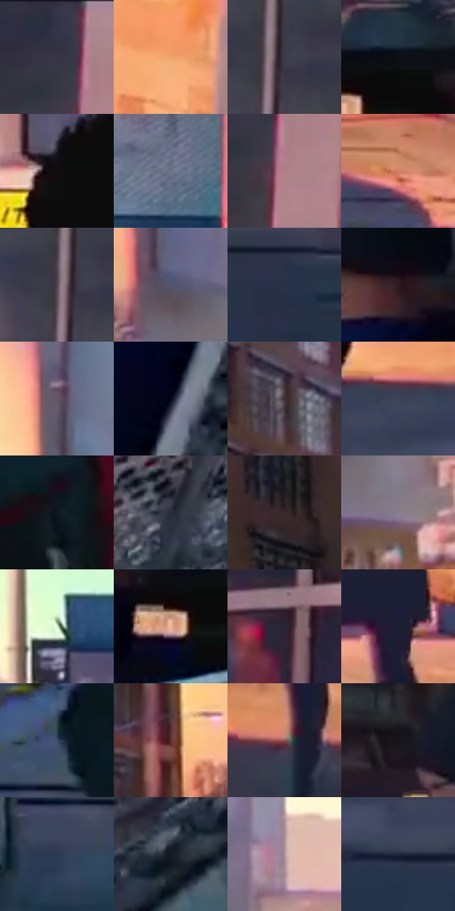

# 电影参考 098

- 状态：条件／活跃；来源世界：miles-home。
- 视角：near-level；景别：medium；场景：street。
- 时段：daylight-time-unspecified（外观依据，中置信度；具体时间／晨昏未知）；光照：warm-day。
- 材质候选：skin, fabric, brick, asphalt（帧级，不是像素分割）。
- 明暗组：dark；L* P5/P50/P95：3.46767 / 24.78402 / 79.04623。
- 资格门禁：caption。
- 原截图 SHA-256：`5853afc273bee67a724c64b1f4be285e80ce57f451b56ce2044a5980712ba18b`；尺寸：2880 × 1202。
- sRGB 像素 SHA-256：`63f660f48abba553085fcf5682e568d24938065d163cb75218ccef287f500e31`。

## 观察与迁移

暖街人像与黄框，日光肌肤和暗衣服分别保留。

98  /  人物快步穿过暖光街道，后方出现黄色黑边的短句框。  /  内心文字可嵌入运动方向，但仍要让人物脸、手和街道动作可读。

98  /  暖光街头的人物经过后，黄色短句框继续跟随内心叙述  /  98

本公开版保存32个128×128原像素色卡上下文；图集格子并非原场景相邻位置。原rect、图集tile和像素SHA见 `data/palette-crops.json`。上下文不足时不得批准替色，不能以小样推断完整构图。

## 实测色卡

颜色比例分母为保留采样像素，不是材料面积；全部 32 色参与全库匹配。表内四舍五入仅用于阅读，原精度在 JSON。

| ID | HEX | Lab | 原图 xy | 像素数 | 比例 | 明度角色 |
| --- | --- | --- | --- | ---: | ---: | --- |
| 098-S01 | #363543 | [22.777587, 3.933073, -8.520147] | [2664, 64] | 9382 | 4.870022% | shadow |
| 098-S02 | #F0A46C | [73.651262, 22.301477, 40.205197] | [2608, 764] | 8984 | 4.663428% | light |
| 098-S03 | #3F3B4A | [25.800147, 5.275803, -8.522833] | [2356, 260] | 8737 | 4.535214% | shadow |
| 098-S04 | #0C1015 | [4.542382, -0.235277, -3.345669] | [464, 592] | 8187 | 4.249720% | deep-shadow |
| 098-S05 | #100B0D | [3.419617, 1.89138, -0.288136] | [1220, 412] | 7753 | 4.024438% | deep-shadow |
| 098-S06 | #697489 | [48.635475, 0.800051, -12.838661] | [1852, 108] | 7237 | 3.756592% | midtone |
| 098-S07 | #AF8189 | [58.622808, 18.951479, 2.675014] | [2700, 128] | 7176 | 3.724928% | midtone |
| 098-S08 | #D17F64 | [61.357518, 28.948155, 28.11768] | [1916, 764] | 7044 | 3.656410% | light |
| 098-S09 | #52434F | [30.334157, 8.842528, -4.784301] | [2332, 264] | 6892 | 3.577509% | shadow |
| 098-S10 | #52546D | [36.439271, 5.269905, -14.577669] | [848, 364] | 6780 | 3.519372% | shadow |
| 098-S11 | #2A3148 | [20.660401, 3.808109, -15.231923] | [2124, 1120] | 6358 | 3.300320% | shadow |
| 098-S12 | #301A1F | [12.391691, 11.771455, 1.196077] | [292, 580] | 6357 | 3.299801% | deep-shadow |
| 098-S13 | #665767 | [38.933946, 9.329185, -6.902785] | [824, 104] | 6343 | 3.292534% | shadow |
| 098-S14 | #04081D | [2.602811, 3.469877, -12.41906] | [160, 1096] | 6181 | 3.208442% | deep-shadow |
| 098-S15 | #403036 | [21.836978, 8.433401, -1.009334] | [592, 148] | 5968 | 3.097878% | shadow |
| 098-S16 | #3C4258 | [28.277983, 3.387753, -13.923281] | [1756, 972] | 5963 | 3.095283% | shadow |
| 098-S17 | #0C161D | [6.690193, -1.792296, -6.23879] | [1200, 788] | 5754 | 2.986795% | deep-shadow |
| 098-S18 | #2C2E3C | [19.289881, 2.879282, -9.153872] | [552, 908] | 5753 | 2.986275% | deep-shadow |
| 098-S19 | #37292A | [18.211742, 6.707139, 1.852569] | [308, 108] | 5741 | 2.980047% | deep-shadow |
| 098-S20 | #877E8C | [53.991047, 6.167654, -6.319306] | [948, 460] | 5738 | 2.978489% | midtone |
| 098-S21 | #DAF3D3 | [93.324023, -13.919048, 12.698657] | [1180, 188] | 5363 | 2.783834% | highlight |
| 098-S22 | #F0B89A | [79.123339, 16.289371, 23.066251] | [404, 652] | 5362 | 2.783315% | light |
| 098-S23 | #292533 | [15.662334, 5.441979, -8.445856] | [2488, 476] | 5330 | 2.766704% | deep-shadow |
| 098-S24 | #1D1F31 | [12.37005, 4.533452, -12.192901] | [2272, 828] | 5313 | 2.757880% | deep-shadow |
| 098-S25 | #3C4C68 | [32.097941, 1.720597, -18.264593] | [960, 1016] | 5003 | 2.596964% | shadow |
| 098-S26 | #5D2F31 | [25.510598, 21.101007, 8.167214] | [692, 328] | 4820 | 2.501973% | shadow |
| 098-S27 | #8F5656 | [43.015882, 23.616129, 10.086258] | [2248, 972] | 4654 | 2.415805% | midtone |
| 098-S28 | #1A151B | [7.543247, 3.984528, -3.299467] | [84, 496] | 4458 | 2.314065% | deep-shadow |
| 098-S29 | #2D3A54 | [24.398044, 2.567557, -17.402777] | [908, 1128] | 4253 | 2.207653% | shadow |
| 098-S30 | #141B25 | [9.530449, 0.033341, -7.876478] | [704, 1016] | 3979 | 2.065425% | deep-shadow |
| 098-S31 | #AC959C | [63.889994, 9.747236, -0.516997] | [1008, 280] | 3208 | 1.665213% | light |
| 098-S32 | #1F263C | [15.506423, 3.90536, -15.088189] | [1888, 1076] | 2577 | 1.337673% | deep-shadow |

## 色阶与空间分布

- 采样 ROI：`[0.01, 0.02, 0.98, 0.94]`；步长：4；样本数：192648。
- 排除区：`[]`。
- 深暗、暗、中、亮、高光五段计数：`[68546, 67248, 27055, 21013, 8786]`。
- RGB 各 256 箱、L* 100 箱、13×5 色相明度表和 3×3 空间统计全部保存在 [总数据](../film-library.json)。
- [可视化档案](../../references/library.html)按需绘制直方图，不存 2,094 张重复图表图片。

## 纹理特征占比

**这是分块图像特征的面积占比，不是波点／排线／丝网／错版的精确语义覆盖率。** 窗格、发丝、织物也会产生方向或周期特征。
原图 ROI 像素 3087370；已测块覆盖 3087370（100.0000%）；未测 0。

| 特征 | 块覆盖像素 | 占已测面积 | 阈值敏感范围 |
| --- | ---: | ---: | --- |
| low-contrast | 59520 | 1.9279% | 1.3972% ~ 3.7980% |
| directional-structure | 958336 | 31.0405% | 26.4593% ~ 42.0732% |
| periodic-structure | 2036746 | 65.9703% | 56.5297% ~ 65.9703% |
| mixed-detail | 32768 | 1.0614% | 0.0000% ~ 5.1119% |

阈值敏感范围不是统计置信区间。逐块坐标、尺度、对比、方向一致性、频谱集中度、频率与角度见 [全量特征记录](../texture-features.jsonl)，以帧号定位。
四种印刷层的真实像素覆盖仍标为 `null`，不能填 0，也不能拿上表代替。不得据这些代理测量删除唯一证据。

[测量方法与保留策略](../../references/library-retention.md) · [分类索引](../archive/README.md)
