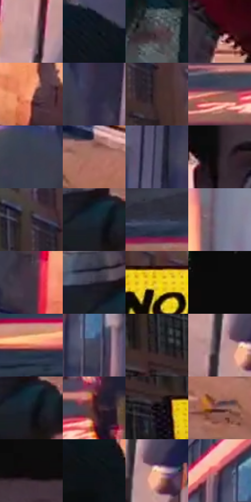

# 电影参考 099

- 状态：条件／活跃；来源世界：miles-home。
- 视角：near-level；景别：close-up；场景：street。
- 时段：daylight-time-unspecified（外观依据，中置信度；具体时间／晨昏未知）；光照：warm-day。
- 材质候选：skin, fabric, brick, asphalt（帧级，不是像素分割）。
- 明暗组：dark；L* P5/P50/P95：3.47102 / 23.65936 / 77.89456。
- 资格门禁：caption。
- 原截图 SHA-256：`f3cc0fe1a9ac9204e2257ec923152f9c76b31657d151c0aa5269e768546b016a`；尺寸：2880 × 1204。
- sRGB 像素 SHA-256：`08b91c710e9363fcc6c49cef063d986c8aa34d35a103644af2c88de451463669`。

## 观察与迁移

暖街人像与黄框，日光肌肤和暗衣服分别保留。

99  /  黄底点阵框在人物近景旁变大，短句中的重点词加粗。  /  框的尺度和字重可随心理压力升级；不能成为固定大小的装饰贴纸。

99  /  人物近景旁的框变大，重点词加粗，心理压力更直接  /  99

本公开版保存32个128×128原像素色卡上下文；图集格子并非原场景相邻位置。原rect、图集tile和像素SHA见 `data/palette-crops.json`。上下文不足时不得批准替色，不能以小样推断完整构图。

## 实测色卡

颜色比例分母为保留采样像素，不是材料面积；全部 32 色参与全库匹配。表内四舍五入仅用于阅读，原精度在 JSON。

| ID | HEX | Lab | 原图 xy | 像素数 | 比例 | 明度角色 |
| --- | --- | --- | --- | ---: | ---: | --- |
| 099-S01 | #C19C9D | [67.687728, 13.86572, 4.683962] | [2740, 712] | 9283 | 4.818633% | light |
| 099-S02 | #0D171D | [7.109111, -2.211441, -5.601685] | [1760, 588] | 8597 | 4.462543% | deep-shadow |
| 099-S03 | #513D45 | [28.158856, 10.240765, -1.505691] | [1280, 1044] | 8148 | 4.229476% | shadow |
| 099-S04 | #2E0C13 | [8.047934, 18.20029, 3.642504] | [1612, 1124] | 7900 | 4.100743% | deep-shadow |
| 099-S05 | #EB9E81 | [72.030687, 25.398067, 26.841659] | [2480, 772] | 7369 | 3.825111% | light |
| 099-S06 | #2C2C44 | [19.030856, 6.710316, -15.034252] | [2276, 552] | 7144 | 3.708318% | deep-shadow |
| 099-S07 | #422C30 | [20.724643, 10.869282, 1.507652] | [508, 160] | 7123 | 3.697417% | shadow |
| 099-S08 | #9D554F | [44.562973, 29.060058, 16.770955] | [760, 648] | 6972 | 3.619036% | midtone |
| 099-S09 | #3C3D4F | [26.33953, 4.135205, -11.022444] | [2164, 520] | 6939 | 3.601906% | shadow |
| 099-S10 | #AD7367 | [54.161323, 21.376772, 16.003505] | [2560, 960] | 6786 | 3.522487% | midtone |
| 099-S11 | #515069 | [35.016018, 6.393407, -14.26456] | [2212, 304] | 6730 | 3.493418% | shadow |
| 099-S12 | #291F26 | [13.177538, 6.370208, -2.882276] | [1212, 408] | 6689 | 3.472136% | deep-shadow |
| 099-S13 | #382E38 | [20.362724, 6.733763, -4.665959] | [448, 84] | 6637 | 3.445143% | shadow |
| 099-S14 | #172635 | [14.542366, -1.176371, -11.713147] | [160, 980] | 6561 | 3.405693% | deep-shadow |
| 099-S15 | #31364C | [23.043168, 4.016598, -14.179245] | [384, 836] | 6472 | 3.359495% | shadow |
| 099-S16 | #77798D | [51.289527, 3.596211, -11.08405] | [904, 144] | 6300 | 3.270213% | midtone |
| 099-S17 | #403643 | [24.108329, 7.28002, -6.411327] | [2264, 712] | 6295 | 3.267618% | shadow |
| 099-S18 | #2B2835 | [16.932309, 4.686679, -7.898624] | [112, 924] | 6226 | 3.231801% | deep-shadow |
| 099-S19 | #EBCB20 | [82.099366, -3.9735, 78.610886] | [600, 292] | 6101 | 3.166916% | highlight |
| 099-S20 | #0A0A0A | [2.741735, -0.000174, 0.00033] | [1288, 28] | 5740 | 2.979527% | deep-shadow |
| 099-S21 | #D97B5E | [61.420185, 33.731137, 31.730703] | [100, 696] | 5243 | 2.721544% | light |
| 099-S22 | #424358 | [29.100003, 4.853078, -12.61893] | [1900, 272] | 5239 | 2.719468% | shadow |
| 099-S23 | #1A181D | [8.667257, 2.292003, -3.13868] | [172, 208] | 5228 | 2.713758% | deep-shadow |
| 099-S24 | #674F58 | [36.329441, 11.665051, -1.396052] | [2752, 864] | 5008 | 2.599560% | shadow |
| 099-S25 | #161D27 | [10.525841, -0.006537, -7.814268] | [176, 988] | 4845 | 2.514950% | deep-shadow |
| 099-S26 | #411D22 | [16.096299, 18.040214, 4.687069] | [868, 620] | 4560 | 2.367011% | deep-shadow |
| 099-S27 | #151015 | [5.276705, 3.057964, -2.185305] | [228, 284] | 4455 | 2.312508% | deep-shadow |
| 099-S28 | #987171 | [51.472284, 15.395554, 6.026287] | [2464, 1012] | 4336 | 2.250737% | midtone |
| 099-S29 | #0F0A0A | [3.076319, 1.500348, 0.529035] | [1368, 240] | 4056 | 2.105394% | deep-shadow |
| 099-S30 | #0C1014 | [4.509551, -0.465983, -2.717776] | [1836, 684] | 3840 | 1.993273% | deep-shadow |
| 099-S31 | #F7D1A8 | [86.108891, 7.563462, 25.322698] | [2800, 868] | 3801 | 1.973029% | highlight |
| 099-S32 | #782A38 | [29.249507, 35.262358, 9.400403] | [1844, 196] | 2025 | 1.051140% | shadow |

## 色阶与空间分布

- 采样 ROI：`[0.01, 0.02, 0.98, 0.94]`；步长：4；样本数：192648。
- 排除区：`[]`。
- 深暗、暗、中、亮、高光五段计数：`[78327, 57614, 26841, 21576, 8290]`。
- RGB 各 256 箱、L* 100 箱、13×5 色相明度表和 3×3 空间统计全部保存在 [总数据](../film-library.json)。
- [可视化档案](../../references/library.html)按需绘制直方图，不存 2,094 张重复图表图片。

## 纹理特征占比

**这是分块图像特征的面积占比，不是波点／排线／丝网／错版的精确语义覆盖率。** 窗格、发丝、织物也会产生方向或周期特征。
原图 ROI 像素 3092958；已测块覆盖 3092958（100.0000%）；未测 0。

| 特征 | 块覆盖像素 | 占已测面积 | 阈值敏感范围 |
| --- | ---: | ---: | --- |
| low-contrast | 103168 | 3.3356% | 2.1189% ~ 4.7385% |
| directional-structure | 1174622 | 37.9773% | 28.3441% ~ 49.5111% |
| periodic-structure | 1788160 | 57.8139% | 48.0265% ~ 63.5818% |
| mixed-detail | 27008 | 0.8732% | 0.3435% ~ 3.3356% |

阈值敏感范围不是统计置信区间。逐块坐标、尺度、对比、方向一致性、频谱集中度、频率与角度见 [全量特征记录](../texture-features.jsonl)，以帧号定位。
四种印刷层的真实像素覆盖仍标为 `null`，不能填 0，也不能拿上表代替。不得据这些代理测量删除唯一证据。

[测量方法与保留策略](../../references/library-retention.md) · [分类索引](../archive/README.md)
