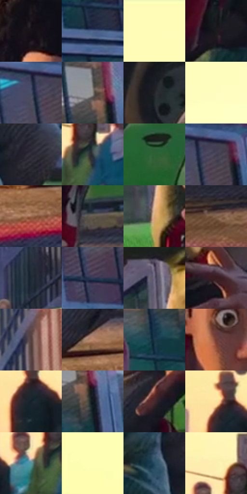

# 电影参考 100

- 状态：条件／活跃；来源世界：miles-home。
- 视角：low-angle；景别：full-body；场景：street。
- 时段：daylight-time-unspecified（外观依据，中置信度；具体时间／晨昏未知）；光照：warm-day。
- 材质候选：skin, fabric, asphalt, glass, painted-metal（帧级，不是像素分割）。
- 明暗组：dark；L* P5/P50/P95：7.09309 / 32.66278 / 97.85052。
- 资格门禁：motion。
- 原截图 SHA-256：`6fd65981af93212b2b9d19bcc9c9b102ef5fce2c9762ff3bf51484ffb7f93230`；尺寸：2880 × 1206。
- sRGB 像素 SHA-256：`4a5df12e4fd9321fa0f359f16e00fc647871bd29748319e5a87dbcda0eed9b92`。

## 观察与迁移

低机位跑动，地面前景与暖楼体的层次清楚。

100  /  低机位人物蹲落，绿色车身、红鞋与粉色路缘分担高纯度。  /  地面接触、手脚比例和冷暖反光先成立，再叠局部色散与排线。

本公开版保存32个128×128原像素色卡上下文；图集格子并非原场景相邻位置。原rect、图集tile和像素SHA见 `data/palette-crops.json`。上下文不足时不得批准替色，不能以小样推断完整构图。

## 实测色卡

颜色比例分母为保留采样像素，不是材料面积；全部 32 色参与全库匹配。表内四舍五入仅用于阅读，原精度在 JSON。

| ID | HEX | Lab | 原图 xy | 像素数 | 比例 | 明度角色 |
| --- | --- | --- | --- | ---: | ---: | --- |
| 100-S01 | #151218 | [5.943576, 2.662374, -3.405639] | [1648, 176] | 11209 | 5.797379% | deep-shadow |
| 100-S02 | #4D6388 | [41.655055, 2.072639, -23.104373] | [2168, 412] | 10719 | 5.543947% | midtone |
| 100-S03 | #FEFCB7 | [97.677186, -9.723818, 33.39051] | [308, 60] | 8411 | 4.350232% | highlight |
| 100-S04 | #1B1B1F | [9.921086, 1.066065, -2.756165] | [1752, 628] | 8289 | 4.287133% | deep-shadow |
| 100-S05 | #494F69 | [34.041287, 4.269141, -15.817249] | [2444, 208] | 8072 | 4.174899% | shadow |
| 100-S06 | #8D8986 | [57.342796, 0.913187, 2.135354] | [1992, 184] | 7320 | 3.785959% | midtone |
| 100-S07 | #232429 | [14.28278, 0.846225, -3.470988] | [1192, 888] | 7176 | 3.711481% | deep-shadow |
| 100-S08 | #FEFDC1 | [98.102737, -8.925406, 28.935712] | [468, 204] | 7176 | 3.711481% | highlight |
| 100-S09 | #2C2935 | [17.359367, 4.391168, -7.240505] | [2048, 576] | 7128 | 3.686655% | deep-shadow |
| 100-S10 | #31383B | [22.988669, -2.185558, -2.86904] | [500, 728] | 6969 | 3.604419% | shadow |
| 100-S11 | #2D6033 | [36.294848, -27.85809, 20.554121] | [2120, 712] | 6872 | 3.554250% | shadow |
| 100-S12 | #413D4F | [26.80804, 6.017399, -10.266111] | [2488, 200] | 6863 | 3.549595% | shadow |
| 100-S13 | #9D6C51 | [50.083733, 16.239077, 22.932653] | [1896, 1128] | 6776 | 3.504598% | midtone |
| 100-S14 | #62574D | [37.750991, 2.650573, 7.452186] | [1580, 976] | 6523 | 3.373744% | shadow |
| 100-S15 | #D6AA78 | [72.497869, 9.673139, 31.872579] | [1368, 648] | 6353 | 3.285819% | light |
| 100-S16 | #81624C | [44.125383, 9.383797, 17.365] | [2572, 1052] | 6301 | 3.258924% | midtone |
| 100-S17 | #1F2A35 | [16.524184, -1.342315, -8.61892] | [892, 648] | 6150 | 3.180826% | deep-shadow |
| 100-S18 | #2F3A57 | [24.697008, 4.181355, -18.896892] | [2420, 372] | 5928 | 3.066006% | shadow |
| 100-S19 | #6A647B | [43.666121, 7.348505, -11.977233] | [1360, 448] | 5590 | 2.891190% | midtone |
| 100-S20 | #371B20 | [13.83013, 14.523935, 2.679908] | [1512, 668] | 5550 | 2.870502% | deep-shadow |
| 100-S21 | #533F3F | [28.780957, 8.705769, 3.35325] | [1020, 164] | 5418 | 2.802230% | shadow |
| 100-S22 | #B8856B | [59.914885, 16.247891, 21.748779] | [1344, 1076] | 5280 | 2.730856% | midtone |
| 100-S23 | #1B384A | [22.143803, -4.633289, -14.353361] | [1952, 308] | 5242 | 2.711202% | shadow |
| 100-S24 | #743D33 | [32.459202, 22.915258, 16.845796] | [1660, 392] | 5144 | 2.660515% | shadow |
| 100-S25 | #15212B | [12.099895, -1.884485, -8.330564] | [240, 756] | 4465 | 2.309331% | deep-shadow |
| 100-S26 | #121920 | [8.377554, -0.979379, -5.915028] | [2028, 236] | 4229 | 2.187270% | deep-shadow |
| 100-S27 | #48292E | [20.678011, 15.221573, 2.927624] | [1516, 816] | 3718 | 1.922977% | shadow |
| 100-S28 | #FAE4A1 | [90.956022, -1.869197, 35.47402] | [216, 712] | 3619 | 1.871774% | highlight |
| 100-S29 | #53969D | [58.11704, -19.340836, -10.304053] | [432, 744] | 3242 | 1.676787% | midtone |
| 100-S30 | #FDFDB2 | [97.772534, -11.204121, 36.003806] | [32, 352] | 2824 | 1.460594% | highlight |
| 100-S31 | #294C62 | [30.692099, -5.518988, -16.726028] | [1964, 632] | 2412 | 1.247504% | shadow |
| 100-S32 | #FDF1B0 | [94.708538, -5.500574, 32.921487] | [440, 636] | 2378 | 1.229919% | highlight |

## 色阶与空间分布

- 采样 ROI：`[0.01, 0.02, 0.98, 0.94]`；步长：4；样本数：193346。
- 排除区：`[]`。
- 深暗、暗、中、亮、高光五段计数：`[57436, 62128, 35712, 13113, 24957]`。
- RGB 各 256 箱、L* 100 箱、13×5 色相明度表和 3×3 空间统计全部保存在 [总数据](../film-library.json)。
- [可视化档案](../../references/library.html)按需绘制直方图，不存 2,094 张重复图表图片。

## 纹理特征占比

**这是分块图像特征的面积占比，不是波点／排线／丝网／错版的精确语义覆盖率。** 窗格、发丝、织物也会产生方向或周期特征。
原图 ROI 像素 3098546；已测块覆盖 3098546（100.0000%）；未测 0。

| 特征 | 块覆盖像素 | 占已测面积 | 阈值敏感范围 |
| --- | ---: | ---: | --- |
| low-contrast | 245760 | 7.9315% | 7.9315% ~ 8.4602% |
| directional-structure | 752896 | 24.2984% | 13.1158% ~ 39.7151% |
| periodic-structure | 2083506 | 67.2414% | 52.3534% ~ 75.9578% |
| mixed-detail | 16384 | 0.5288% | 0.0000% ~ 2.4662% |

阈值敏感范围不是统计置信区间。逐块坐标、尺度、对比、方向一致性、频谱集中度、频率与角度见 [全量特征记录](../texture-features.jsonl)，以帧号定位。
四种印刷层的真实像素覆盖仍标为 `null`，不能填 0，也不能拿上表代替。不得据这些代理测量删除唯一证据。

[测量方法与保留策略](../../references/library-retention.md) · [分类索引](../archive/README.md)
