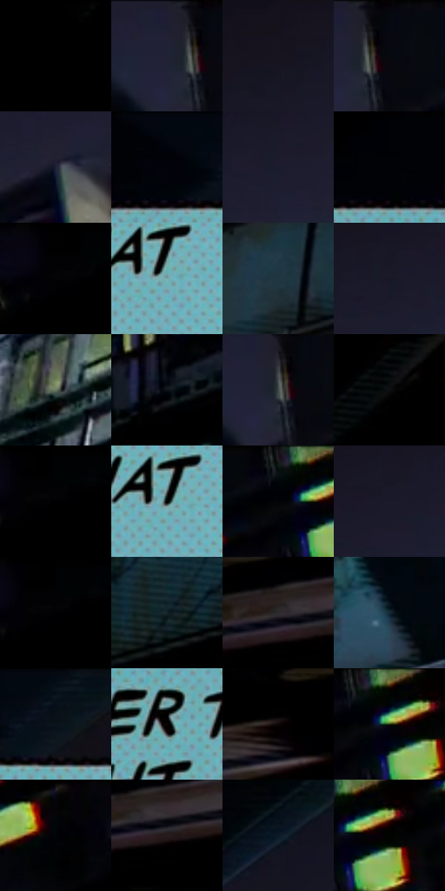

# 电影参考 101

- 状态：条件／活跃；来源世界：miles-home。
- 视角：low-angle；景别：environment-wide；场景：city。
- 时段：night-appearance（外观依据，中置信度；具体时间／晨昏未知）；光照：night-mixed。
- 材质候选：metal, brick, glass, sky（帧级，不是像素分割）。
- 明暗组：very-dark；L* P5/P50/P95：0.0 / 2.5182 / 48.00194。
- 资格门禁：caption。
- 原截图 SHA-256：`8cc30522fc61fffb97788c992b54f91d2069224abcad7c19602e635e615476df`；尺寸：2876 × 1202。
- sRGB 像素 SHA-256：`4632284fc5ba4db1aab89bfce7adc258af8a51e0d3a5e9855ada8f644919e00c`。

## 观察与迁移

高架列车和叙事框，窗光是小面积亮点。

101  /  深夜高架列车上方是浅蓝色点阵矩形与黑字，标记时间转换。  /  这是叙事时间卡，不是黄色角色念头；框色和语义对应不同功能。

本公开版保存32个128×128原像素色卡上下文；图集格子并非原场景相邻位置。原rect、图集tile和像素SHA见 `data/palette-crops.json`。上下文不足时不得批准替色，不能以小样推断完整构图。

## 实测色卡

颜色比例分母为保留采样像素，不是材料面积；全部 32 色参与全库匹配。表内四舍五入仅用于阅读，原精度在 JSON。

| ID | HEX | Lab | 原图 xy | 像素数 | 比例 | 明度角色 |
| --- | --- | --- | --- | ---: | ---: | --- |
| 101-S01 | #000000 | [0.0, 0.0, 0.0] | [32, 28] | 45511 | 23.657809% | deep-shadow |
| 101-S02 | #1D1F32 | [12.425115, 4.875042, -12.826286] | [2084, 28] | 7782 | 4.045287% | deep-shadow |
| 101-S03 | #16151E | [7.232009, 2.96334, -6.103969] | [1240, 140] | 7682 | 3.993305% | deep-shadow |
| 101-S04 | #07090F | [2.484271, 0.413743, -2.733855] | [2136, 48] | 7044 | 3.661656% | deep-shadow |
| 101-S05 | #1F2237 | [13.891711, 5.080522, -14.092286] | [1928, 80] | 7032 | 3.655418% | deep-shadow |
| 101-S06 | #02060C | [1.532755, -0.19618, -2.681516] | [772, 36] | 6695 | 3.480236% | deep-shadow |
| 101-S07 | #1B1C2D | [10.942241, 4.6802, -11.530123] | [1692, 92] | 6686 | 3.475558% | deep-shadow |
| 101-S08 | #010205 | [0.549399, 0.155597, -1.227343] | [648, 28] | 6599 | 3.430333% | deep-shadow |
| 101-S09 | #010101 | [0.274173, -1.7e-05, 3.3e-05] | [2780, 36] | 6573 | 3.416817% | deep-shadow |
| 101-S10 | #79ABAD | [66.677277, -15.980994, -6.353433] | [948, 204] | 6546 | 3.402782% | light |
| 101-S11 | #223641 | [21.431064, -4.518511, -9.366657] | [916, 916] | 6525 | 3.391866% | shadow |
| 101-S12 | #171827 | [8.839498, 4.151555, -10.407991] | [1460, 136] | 6407 | 3.330526% | deep-shadow |
| 101-S13 | #6B7A64 | [49.453431, -10.002141, 10.21907] | [948, 656] | 5890 | 3.061776% | midtone |
| 101-S14 | #0F121A | [5.498606, 0.864978, -5.677352] | [1776, 456] | 5614 | 2.918304% | deep-shadow |
| 101-S15 | #434C4B | [31.509262, -3.845547, -0.635369] | [2108, 72] | 5406 | 2.810180% | shadow |
| 101-S16 | #0E0F10 | [4.267299, -0.147078, -0.620897] | [1580, 972] | 4773 | 2.481130% | deep-shadow |
| 101-S17 | #000304 | [0.667381, -0.645506, -0.65474] | [2812, 28] | 4569 | 2.375086% | deep-shadow |
| 101-S18 | #030201 | [0.586869, 0.122421, 0.470628] | [936, 196] | 4346 | 2.259165% | deep-shadow |
| 101-S19 | #000409 | [0.962393, -0.350848, -2.26054] | [2376, 44] | 4114 | 2.138565% | deep-shadow |
| 101-S20 | #191A2A | [9.896183, 4.417618, -10.972542] | [1556, 100] | 4012 | 2.085543% | deep-shadow |
| 101-S21 | #000102 | [0.235652, -0.122473, -0.470529] | [2808, 28] | 3619 | 1.881251% | deep-shadow |
| 101-S22 | #142427 | [12.965156, -5.724051, -4.131662] | [1400, 804] | 3575 | 1.858379% | deep-shadow |
| 101-S23 | #2B2A2C | [17.23265, 0.93034, -1.139157] | [1960, 1064] | 3364 | 1.748695% | deep-shadow |
| 101-S24 | #162935 | [15.557141, -3.588281, -10.1534] | [1880, 628] | 3149 | 1.636933% | deep-shadow |
| 101-S25 | #0C161E | [6.735601, -1.473213, -6.935047] | [884, 32] | 3097 | 1.609902% | deep-shadow |
| 101-S26 | #060504 | [1.409389, 0.122368, 0.470727] | [740, 184] | 3081 | 1.601584% | deep-shadow |
| 101-S27 | #0E0707 | [2.354667, 1.952767, 0.688326] | [2180, 1004] | 2891 | 1.502817% | deep-shadow |
| 101-S28 | #000308 | [0.746528, -0.089331, -2.168434] | [2412, 40] | 2831 | 1.471628% | deep-shadow |
| 101-S29 | #040508 | [1.371919, 0.155545, -1.227244] | [2628, 44] | 1995 | 1.037053% | deep-shadow |
| 101-S30 | #291D1D | [12.214393, 5.874783, 2.277695] | [2000, 1084] | 1957 | 1.017300% | deep-shadow |
| 101-S31 | #0D1927 | [8.369967, -0.065469, -11.20209] | [372, 464] | 1866 | 0.969996% | deep-shadow |
| 101-S32 | #000200 | [0.392156, -0.801121, 0.572636] | [2452, 68] | 1141 | 0.593122% | deep-shadow |

## 色阶与空间分布

- 采样 ROI：`[0.01, 0.02, 0.98, 0.94]`；步长：4；样本数：192372。
- 排除区：`[]`。
- 深暗、暗、中、亮、高光五段计数：`[169813, 10248, 5325, 6885, 101]`。
- RGB 各 256 箱、L* 100 箱、13×5 色相明度表和 3×3 空间统计全部保存在 [总数据](../film-library.json)。
- [可视化档案](../../references/library.html)按需绘制直方图，不存 2,094 张重复图表图片。

## 纹理特征占比

**这是分块图像特征的面积占比，不是波点／排线／丝网／错版的精确语义覆盖率。** 窗格、发丝、织物也会产生方向或周期特征。
原图 ROI 像素 3082950；已测块覆盖 3082950（100.0000%）；未测 0。

| 特征 | 块覆盖像素 | 占已测面积 | 阈值敏感范围 |
| --- | ---: | ---: | --- |
| low-contrast | 1031878 | 33.4705% | 31.1164% ~ 36.8875% |
| directional-structure | 694528 | 22.5280% | 12.9289% ~ 33.1028% |
| periodic-structure | 1291008 | 41.8757% | 35.7808% ~ 46.4635% |
| mixed-detail | 65536 | 2.1258% | 0.0000% ~ 3.7201% |

阈值敏感范围不是统计置信区间。逐块坐标、尺度、对比、方向一致性、频谱集中度、频率与角度见 [全量特征记录](../texture-features.jsonl)，以帧号定位。
四种印刷层的真实像素覆盖仍标为 `null`，不能填 0，也不能拿上表代替。不得据这些代理测量删除唯一证据。

[测量方法与保留策略](../../references/library-retention.md) · [分类索引](../archive/README.md)
